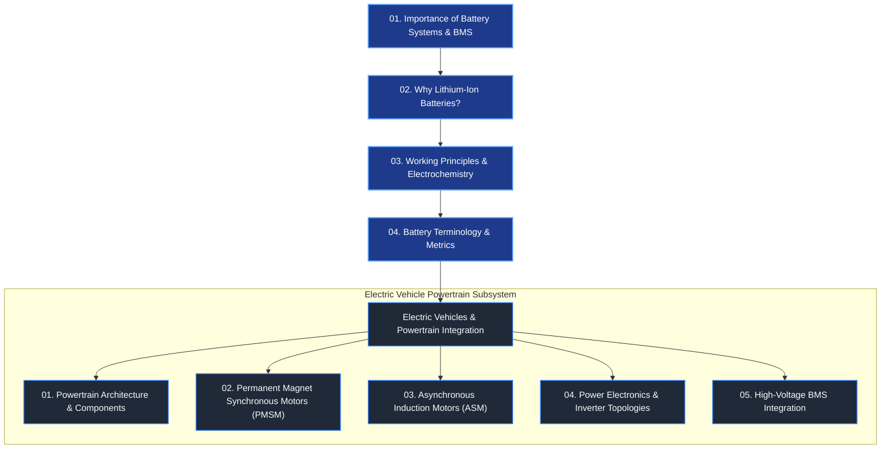

# Fundamentals of Battery Systems & BMS

Welcome to the **Fundamentals** module of the Battery Systems Technology compendium. This section establishes the rigorous scientific, electrochemical, and system-engineering foundations required to understand, design, simulate, and operate advanced energy storage systems and Battery Management Systems (BMS)[^plett2015a][^andrea2010].

Whether deployed in battery electric vehicles (BEVs), stationary energy storage systems (BESS), or electrified aviation, modern high-voltage batteries represent coupled electro-thermal-mechanical systems that demand precise monitoring, multi-layer safety architectures, and state-estimation algorithms[^scrosati2010].

---

## Roadmap of Fundamentals

The curriculum in this module is structured systematically from atomic and electrochemical principles up to vehicle-level integration and battery management:

---

## Chapter Overview

| Chapter | Core Focus | Key Concepts & Methodologies |
| :--- | :--- | :--- |
| **[01. Importance of Battery Systems & BMS](01_importance_of_battery.md)** | System Boundary & Safety | Ragone analysis, operating window (Safe Operating Area), functional safety (ISO 26262), multi-layer BMS protection architecture. |
| **[02. Why Lithium-Ion Batteries?](02_why_lithium_battery.md)** | Technological Justification | Electrochemical potentials ($E^\circ = -3.04\,\text{V}$), theoretical capacity derivation, gravimetric vs. volumetric energy density, comparative chemistries. |
| **[03. Working Principles & Electrochemistry](03_how_lithium_battery_works.md)** | Microscopic & Transport Physics | Intercalation kinetics, rocking-chair mechanism, half-cell thermodynamics ($\Delta G = -zFE$), Solid Electrolyte Interphase (SEI) dynamics. |
| **[04. Battery Terminology & Metrics](04_battery_terminology.md)** | Mathematical Definitions | State of Charge (SoC), Depth of Discharge (DoD), State of Health (SoH), C-Rate, internal impedance, Coulombic/energy efficiencies, international standards. |
| **[Electric Vehicles](electric_vehicles/01_components.md)** | System Powertrain Context | Traction inverters, DC-DC converters, motor topologies (PMSM vs. ASM), high-voltage interlocks (HVIL), and precharge control. |

---

## Foundational Engineering Standards

All technical definitions and safety architectures presented across this module conform to established international automotive and electrical standards:

- **ISO 26262:** *Road Vehicles – Functional Safety* (Automotive Safety Integrity Levels ASIL A through ASIL D)[^iso26262].
- **IEC 62619:** *Secondary cells and batteries containing alkaline or other non-acid electrolytes – Safety requirements for industrial applications*[^iec62619].
- **IEC 62660-1 / -2 / -3:** *Secondary lithium-ion cells for the propulsion of electric road vehicles – Performance, reliability, and safety testing*[^iec62660].
- **UN 38.3:** *Transport of Dangerous Goods – Lithium Metal and Lithium Ion Batteries* (thermal, altitude, vibration, and impact certification)[^un383].
- **SAE J2464 / UL 2580:** *Electric and Hybrid Electric Vehicle Rechargeable Energy Storage System (RESS) Safety and Abuse Testing*[^saej2464].

---

## References

[^plett2015a]: Plett, G. L. (2015). *Battery Management Systems, Volume I: Battery Modeling*. Artech House, Norwood, MA. ISBN: 978-1-63081-023-8.
[^andrea2010]: Andrea, D. (2010). *Battery Management Systems for Large Lithium-Ion Battery Packs*. Artech House, Norwood, MA. ISBN: 978-1-60807-104-3.
[^scrosati2010]: Scrosati, B., & Garche, J. (2010). *Lithium batteries: Status, prospects and future*. Journal of Power Sources, 195(9), 2419–2430. DOI: [10.1016/j.jpowsour.2009.11.048](https://doi.org/10.1016/j.jpowsour.2009.11.048)
[^iso26262]: International Organization for Standardization. (2018). *ISO 26262:2018 Road vehicles — Functional safety*. Geneva, Switzerland.
[^iec62619]: International Electrotechnical Commission. (2022). *IEC 62619:2022 Secondary cells and batteries containing alkaline or other non-acid electrolytes*. Geneva, Switzerland.
[^iec62660]: International Electrotechnical Commission. (2018). *IEC 62660: Secondary lithium-ion cells for the propulsion of electric road vehicles*. Geneva, Switzerland.
[^un383]: United Nations. (2021). *Recommendations on the Transport of Dangerous Goods, Manual of Tests and Criteria*, Section 38.3. New York and Geneva.
[^saej2464]: SAE International. (2021). *SAE J2464: Electric and Hybrid Electric Vehicle Rechargeable Energy Storage System (RESS) Safety and Abuse Testing*. Warrendale, PA.
