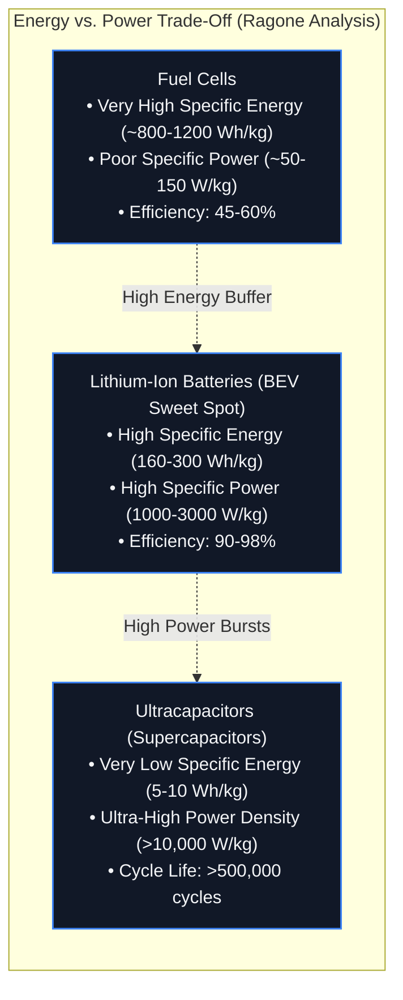
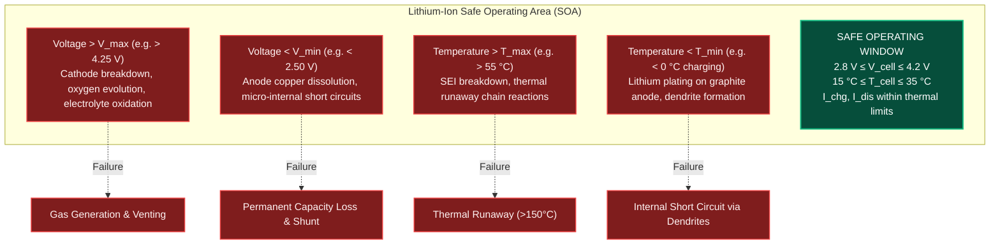
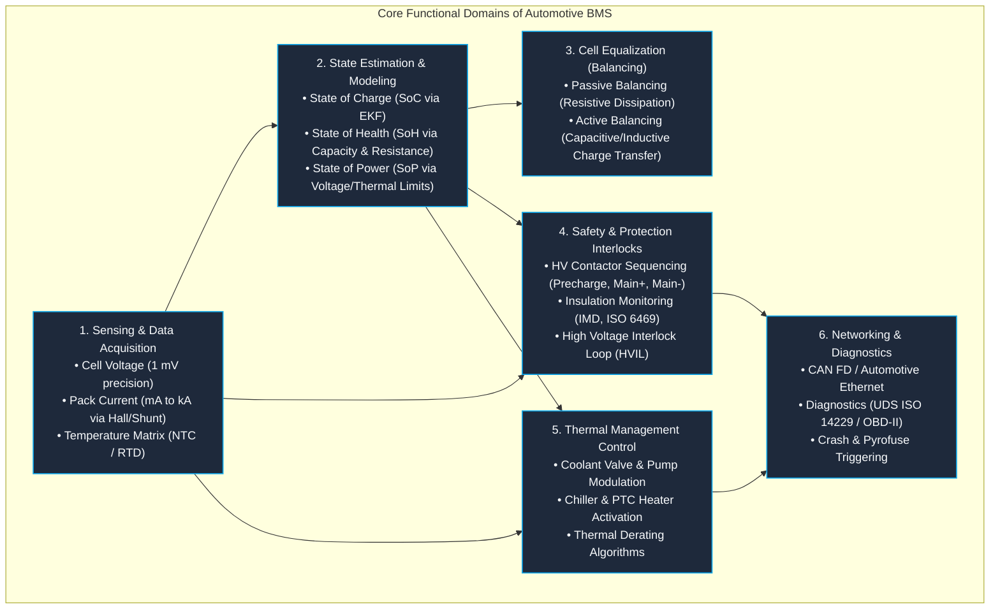
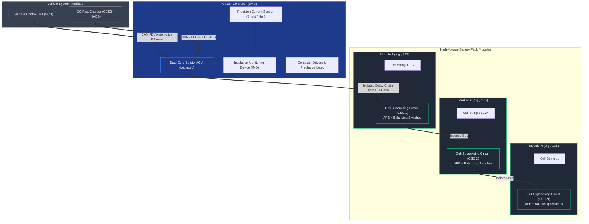

# Importance of Battery Systems & BMS in Electromobility

Electrochemical energy storage systems have emerged as the foundational technology enabling the global decarbonization of transportation, grid-scale renewable integration, and portable consumer electronics[^tarascon2001][^whittingham2004]. In automotive applications—ranging from hybrid electric vehicles (HEVs) to 800V battery electric vehicles (BEVs) and heavy commercial trucks—the battery pack is simultaneously the heaviest, most cost-critical, and safety-sensitive subsystem[^scrosati2010][^linden2002].

However, high-energy lithium-based cells cannot simply be wired together and left unregulated. Because lithium-ion chemistries operate outside thermodynamic stability windows, they require a sophisticated electronic control and protection layer: the **Battery Management System (BMS)**[^plett2015a][^andrea2010][^bergveld2002].

---

## 1. Energy Storage Comparison: The Ragone Domain

To evaluate why lithium-ion batteries dominate electrified transportation over competing storage mediums, engineers analyze energy storage technologies across two fundamental metrics:

- **Gravimetric Specific Energy ($e_g$):** The total usable electrical energy per unit mass ($\text{Wh/kg}$):

    $$
    e_g = \frac{\int_0^{t_{\text{dis}}} V(t) \cdot I(t) \, dt}{m_{\text{pack}}}
    $$

- **Gravimetric Specific Power ($p_g$):** The maximum instantaneous rate of energy delivery per unit mass ($\text{W/kg}$):

    $$
    p_g = \frac{P_{\text{peak}}}{m_{\text{pack}}} = \frac{V_{\text{terminal}} \cdot I_{\text{max}}}{m_{\text{pack}}}
    $$

### Quantitative Technology Comparison

The table below contrasts the physical and economic properties of primary energy storage systems used in mobile and stationary applications[^larminie2012][^linden2002]:

| Technology | Specific Energy ($\text{Wh/kg}$) | Volumetric Density ($\text{Wh/L}$) | Specific Power ($\text{W/kg}$) | Round-Trip Efficiency ($\eta$) | Cycle Life ($80\%\,\text{DoD}$) | Self-Discharge ($\%/\text{month}$) |
| :--- | :--- | :--- | :--- | :--- | :--- | :--- |
| **Lead-Acid ($\text{Pb-Acid}$)** | $30 - 50$ | $60 - 90$ | $150 - 300$ | $70 - 85\%$ | $400 - 800$ | $4 - 8\%$ |
| **Nickel-Metal Hydride ($\text{NiMH}$)** | $60 - 100$ | $140 - 300$ | $250 - 1000$ | $65 - 75\%$ | $1000 - 1500$ | $15 - 30\%$ |
| **Lithium-Ion ($\text{NMC/NCA}$)** | $180 - 280$ | $400 - 750$ | $1500 - 3000$ | $92 - 97\%$ | $1500 - 3000$ | $1 - 2\%$ |
| **Lithium Iron Phosphate ($\text{LFP}$)** | $140 - 190$ | $300 - 450$ | $2000 - 4500$ | $95 - 98\%$ | $3000 - 8000$ | $1 - 2\%$ |
| **Ultracapacitors (EDLC)** | $5 - 10$ | $10 - 20$ | $5000 - 15000$ | $95 - 98\%$ | $> 500,000$ | $20 - 40\%$ |
| **Hydrogen Fuel Cell ($\text{PEMFC} + \text{Tank}$)** | $500 - 1200$ | $300 - 600$ | $100 - 300$ | $45 - 60\%$ | $> 5000\,\text{hours}$ | $\approx 0\%$ |

> [!NOTE]
> While hydrogen fuel cells offer superior gravimetric range for heavy-duty long-haul transport, their low tank-to-wheel efficiency ($\approx 50\%$ vs. $>90\%$ in BEVs) and sluggish dynamic response require hybridization with a high-power lithium-ion buffer battery[^larminie2012].

---

## 2. Inherent Vulnerabilities & The Safe Operating Area (SOA)

Unlike lead-acid batteries, which tolerate moderate overcharge via water electrolysis, lithium-ion cells cannot self-regulate. Every lithium-ion cell possesses a strict boundary known as the **Safe Operating Area (SOA)**[^plett2015a][^andrea2010]:

### Physics of SOA Violations

1. **Overcharge ($V_{\text{cell}} > V_{\text{max}}$):**
   Excess delithiation of the cathode destabilizes its transition-metal oxide lattice (e.g., in $\text{Li}_{1-x}\text{Ni}_{0.8}\text{Mn}_{0.1}\text{Co}_{0.1}\text{O}_2$), causing oxygen release into the organic carbonate electrolyte. This triggers violent exothermic combustion[^dahn2011].
2. **Overdischarge ($V_{\text{cell}} < V_{\text{min}}$):**
   When the anode potential rises above $+3.5\,\text{V}$ vs. $\text{Li/Li}^+$, the copper substrate foil oxidizes into cuprous/cupric ions ($\text{Cu} \rightarrow \text{Cu}^{2+} + 2e^-$). Upon subsequent recharge, copper precipitates dendritically across the separator, producing localized low-resistance internal short circuits[^plett2015a].
3. **Low-Temperature Fast Charging ($T < 0^\circ\text{C}$):**
   Lithium-ion solid-state diffusion within graphite slows dramatically ($D_{\text{Li}} \propto \exp(-E_a / RT)$). When overpotential drives the anode surface potential below $0\,\text{V}$ vs. $\text{Li/Li}^+$, metallic lithium deposits on the electrode surface rather than intercalating—leading to rapid capacity loss and dangerous dendrite growth[^fleckenstein2013].
4. **Overtemperature ($T > 60^\circ\text{C}$):**
   The metastably protective Solid Electrolyte Interphase (SEI) decomposes exothermically between $80^\circ\text{C}$ and $120^\circ\text{C}$, exposing bare lithiated graphite to continuous solvent reduction and driving thermal propagation[^peled1979][^wang2012].

---

## 3. The Core Functions of a Battery Management System

The BMS represents the intelligence, protection shield, and communication conduit of the battery pack. Modern automotive BMS architectures execute six critical operational domains[^andrea2010][^bergveld2002]:

### Detailed Functional Breakdown

#### A. High-Precision Sensing
- **Cell Voltage Monitoring:** Dedicated Analog Front-End (AFE) ICs monitor every series cell tap with synchronized delta-sigma ($\Delta\Sigma$) or SAR ADCs, providing measurement accuracy better than $\pm 1\,\text{mV}$ over $-40^\circ\text{C}$ to $+85^\circ\text{C}$.
- **Current Measurement:** Redundant current sensing utilizes calibrated low-temperature-coefficient Manganin shunts (for high dynamic accuracy and Coulomb counting) paired with Hall-effect or fluxgate transducers (for galvanic isolation and high-current saturation resistance).

#### B. Cell Balancing (Equalization)
Due to manufacturing tolerances and thermal gradients inside large packs, individual cell capacities and self-discharge rates vary slightly. Over repeated cycles without balancing, the weakest cell reaches $V_{\text{min}}$ first during discharge and $V_{\text{max}}$ first during charge, prematurely truncating the entire pack's usable capacity[^andrea2010].
- **Passive Balancing:** Switched bypass resistors discharge high-voltage cells (typically $50 - 200\,\text{mA}$) during the constant-voltage charging phase.
- **Active Balancing:** Bi-directional DC-DC converters shuttle charge from higher-energy cells to lower-energy cells with efficiencies $>85\%$, minimizing heat dissipation in heavy-duty or stationary applications.

---

## 4. Hardware Architecture: Centralized vs. Distributed Master-Slave

Automotive packs typically contain between 96 and 216 cells in series (e.g., $400\,\text{V}$ to $800\,\text{V}$ architectures). To manage wiring complexity and maintain galvanic isolation, industry standardizes on a **Modular Master-Slave** topology[^andrea2010]:

---

## 5. Functional Safety (ISO 26262) & ASIL Decomposition

Because high-voltage traction batteries store hundreds of megajoules of chemical energy and operate at lethal voltages ($>60\,\text{VDC}$), the BMS must comply with automotive functional safety standard **ISO 26262**[^iso26262]:

- **ASIL-D Hazard Classifications:**
  - Inadvertent contactor closure or welded contactor failure leading to shock hazard.
  - Undetected cell overcharge resulting in thermal runaway propagation.
  - Incorrect state-of-power calculation resulting in loss of propulsion during highway passing maneuvers.
- **Hardware Architectural Metrics:**
  - Single Point Fault Metric ($\text{SPFM} \ge 99\%$ for ASIL-D).
  - Latent Fault Metric ($\text{LFM} \ge 90\%$).
  - Probabilistic Metric for Random Hardware Failures ($\text{PMHF} < 10\,\text{FIT}$, where $1\,\text{FIT} = 10^{-9}\,\text{failures/hour}$).
- **De-energization & Pyro-Switch:** In a severe crash detected via accelerometers or airbag controllers, the BMS triggers a pyrotechnic disconnect switch (pyrofuse) within $<2\,\text{ms}$, galvanically isolating the high-voltage pack from the chassis[^iso26262].

---

## Summary

The high specific energy of lithium-ion chemistry makes modern electromobility viable, but its narrow operational window demands a robust, deterministically executed control architecture. The Battery Management System reconciles cell-level electrochemical sensitivity with vehicle-level power, safety, and longevity demands.

---

## References

[^tarascon2001]: Tarascon, J.-M., & Armand, M. (2001). *Issues and challenges facing rechargeable lithium batteries*. Nature, 414(6861), 359–367. DOI: [10.1038/35104644](https://doi.org/10.1038/35104644)
[^whittingham2004]: Whittingham, M. S. (2004). *Lithium batteries and cathode materials*. Chemical Reviews, 104(10), 4271–4302. DOI: [10.1021/cr020731c](https://doi.org/10.1021/cr020731c)
[^scrosati2010]: Scrosati, B., & Garche, J. (2010). *Lithium batteries: Status, prospects and future*. Journal of Power Sources, 195(9), 2419–2430. DOI: [10.1016/j.jpowsour.2009.11.048](https://doi.org/10.1016/j.jpowsour.2009.11.048)
[^linden2002]: Linden, D., & Reddy, T. B. (2002). *Handbook of Batteries* (3rd ed.). McGraw-Hill, New York. ISBN: 978-0-07-135978-7.
[^plett2015a]: Plett, G. L. (2015). *Battery Management Systems, Volume I: Battery Modeling*. Artech House, Norwood, MA. ISBN: 978-1-63081-023-8.
[^andrea2010]: Andrea, D. (2010). *Battery Management Systems for Large Lithium-Ion Battery Packs*. Artech House, Norwood, MA. ISBN: 978-1-60807-104-3.
[^bergveld2002]: Bergveld, H. J., Kruijt, W. S., & Notten, P. H. (2002). *Battery Management Systems: Design by Modelling*. Philips Research Book Series, Vol. 1. Springer, Dordrecht. DOI: [10.1007/978-94-017-0843-2](https://doi.org/10.1007/978-94-017-0843-2)
[^larminie2012]: Larminie, J., & Lowry, J. (2012). *Electric Vehicle Technology Explained* (2nd ed.). John Wiley & Sons, Chichester. ISBN: 978-1-119-94273-3.
[^dahn2011]: Dahn, J. R., et al. (2011). *High-precision coulometry for predicting battery cycle life*. Journal of The Electrochemical Society, 158(3), A302. DOI: [10.1149/1.3533417](https://doi.org/10.1149/1.3533417)
[^fleckenstein2013]: Fleckenstein, M., Fischer, S., & Bohlen, O. (2013). *Fast charging of lithium-ion batteries: A review of experimental results and modeling approaches*. Journal of Power Sources, 223, 259–269.
[^peled1979]: Peled, E. (1979). *The electrochemical behavior of alkali and alkaline earth metals in nonaqueous systems—The solid electrolyte interphase*. Journal of The Electrochemical Society, 126(12), 2047–2051. DOI: [10.1149/1.2128859](https://doi.org/10.1149/1.2128859)
[^wang2012]: Wang, Q., et al. (2012). *Thermal runaway caused fire and explosion of lithium ion batteries*. Journal of Power Sources, 208, 210–224. DOI: [10.1016/j.jpowsour.2012.02.038](https://doi.org/10.1016/j.jpowsour.2012.02.038)
[^iso26262]: International Organization for Standardization. (2018). *ISO 26262:2018 Road vehicles — Functional safety*. Geneva, Switzerland.
