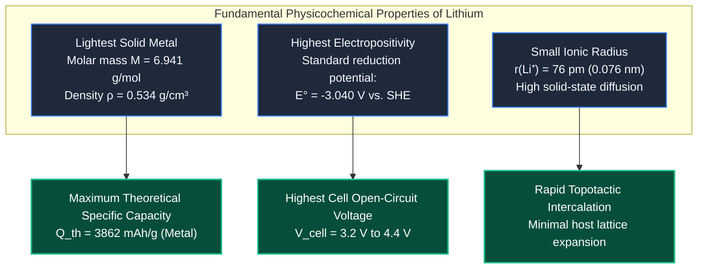
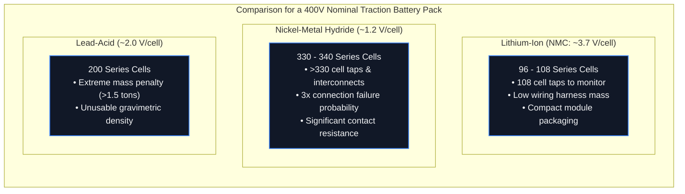
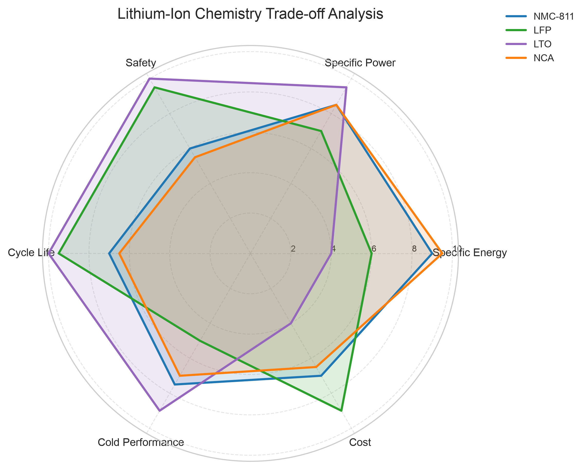

# Why Lithium-Ion Batteries? Thermodynamic & Technological Foundations

The ubiquitous adoption of lithium-ion batteries across consumer electronics, electric vehicles, and grid-scale storage represents one of the most consequential engineering transitions of the past half-century[^goodenough2013][^whittingham2004]. Recognized by the 2019 Nobel Prize in Chemistry awarded to John B. Goodenough, M. Stanley Whittingham, and Akira Yoshino, lithium-ion chemistry displaced century-old secondary battery systems—principally lead-acid and nickel-cadmium/nickel-metal hydride—not merely through incremental engineering, but due to fundamental electrochemical and thermodynamic principles[^tarascon2001][^scrosati2010].

---

## 1. The Elemental Advantage of Lithium

To understand why lithium is the unrivaled charge carrier for high-performance mobile energy storage, one must examine its position in the periodic table (Group 1, Period 2, atomic number $Z = 3$):

### Derivation of Theoretical Specific Capacity

The theoretical gravimetric capacity ($Q_{\text{th}}$) of any electrochemical active material is governed strictly by Faraday's law of electrolysis[^linden2002]:

$$
Q_{\text{th}} = \frac{z \cdot F}{M}
$$

where:

- $z$ is the number of electrons transferred per reaction unit ($z = 1$ for $\text{Li} \rightleftharpoons \text{Li}^+ + e^-$).
- $F$ is the Faraday constant ($F = 96485.33\,\text{C/mol} \approx 26.801\,\text{Ah/mol}$).
- $M$ is the molar mass of the active species ($\text{g/mol}$).

For metallic lithium ($M = 6.941\,\text{g/mol}$):

$$
Q_{\text{th, Li}} = \frac{1 \times 26801.5\,\text{mAh/mol}}{6.941\,\text{g/mol}} \approx 3861.5\,\text{mAh/g} \quad (3.86\,\text{Ah/g})
$$

Contrasting this with competing secondary battery anode materials demonstrates lithium's dramatic gravimetric superiority:

| Metal / Species | Valence ($z$) | Molar Mass ($M$, $\text{g/mol}$) | Theoretical Capacity ($Q_{\text{th}}$, $\text{mAh/g}$) | Reduction Potential ($E^\circ$ vs. SHE) |
| :--- | :--- | :--- | :--- | :--- |
| **Lithium ($\text{Li}$)** | $1$ | $6.94$ | **$3862$** | **$-3.04\,\text{V}$** |
| **Sodium ($\text{Na}$)** | $1$ | $22.99$ | $1166$ | $-2.71\,\text{V}$ |
| **Magnesium ($\text{Mg}$)** | $2$ | $24.31$ | $2205$ | $-2.37\,\text{V}$ |
| **Aluminum ($\text{Al}$)** | $3$ | $26.98$ | $2980$ | $-1.66\,\text{V}$ |
| **Zinc ($\text{Zn}$)** | $2$ | $65.38$ | $820$ | $-0.76\,\text{V}$ |
| **Lead ($\text{Pb}$)** | $2$ | $207.2$ | $259$ | $-0.13\,\text{V}$ |

---

## 2. Cell Voltage and System Complexity

The open-circuit voltage ($\text{OCV}$) of an electrochemical cell is dictated by the chemical potential difference ($\Delta \mu_{\text{Li}}$) between the positive electrode (cathode) and negative electrode (anode)[^goodenough2013]:

$$
V_{\text{cell}} = -\frac{\mu_{\text{cathode}} - \mu_{\text{anode}}}{e} = E_{\text{cathode}} - E_{\text{anode}}
$$

Because lithium exhibits the most negative reduction potential in the periodic table, pairing a lithiated graphite anode ($E \approx 0.1 - 0.2\,\text{V}$ vs. $\text{Li/Li}^+$) with a transition metal oxide cathode (e.g., NMC, where $E \approx 3.8 - 4.3\,\text{V}$ vs. $\text{Li/Li}^+$) yields a cell potential of $3.6\,\text{V}$ to $4.2\,\text{V}$[^whittingham2004].

### System Architecture Impact: The Series Cell Count

Power delivered to an electric vehicle traction inverter is given by $P = V_{\text{pack}} \cdot I$. To limit $I^2 R$ Ohmic heating losses in cables and copper busbars, modern EV powertrains operate at high nominal pack voltages (typically $400\,\text{V}$ or $800\,\text{V}$)[^larminie2012]:

$$
N_{\text{series}} = \left\lceil \frac{V_{\text{system, nom}}}{V_{\text{cell, nom}}} \right\rceil
$$

A lithium-ion architecture reduces the number of series interconnects, measurement taps, and cell monitoring channels by a factor of three compared to nickel chemistries, dramatically lowering hardware failure rates and contact-resistance losses[^andrea2010].

---

## 3. Operational & Thermodynamic Advantages

Beyond raw energy density and voltage, lithium-ion technology possesses crucial operational characteristics essential for dynamic automotive drive cycles:

### A. High Coulombic and Energy Efficiency
The Coulombic efficiency ($\eta_C$) is the ratio of discharge capacity to charge capacity:

$$
\eta_C = \frac{Q_{\text{dis}}}{Q_{\text{chg}}} = \frac{\int_0^{t_{\text{dis}}} I_{\text{dis}}(t) \, dt}{\int_0^{t_{\text{chg}}} I_{\text{chg}}(t) \, dt}
$$

In high-quality lithium-ion cells, $\eta_C$ exceeds **$99.8\%$** under standard C-rates, with parasitic parasitic side reactions consuming less than $0.1\%$ of cyclable lithium per cycle[^dahn2011]. The round-trip energy efficiency ($\eta_E = \eta_C \cdot \frac{\bar{V}_{\text{dis}}}{\bar{V}_{\text{chg}}}$) regularly exceeds **$92 - 96\%$**, whereas lead-acid and NiMH systems dissipate $20 - 35\%$ of input energy as heat through water decomposition and gassing reactions[^linden2002].

### B. Total Absence of Memory Effect
Nickel-cadmium and older nickel-metal hydride batteries suffer from the "memory effect" (voltage depression caused by the formation of large, electrochemically inactive $\gamma\text{-NiOOH}$ or $\text{Cd}_5\text{OH}_8(\text{NO}_3)_2$ microcrystalline phases when repeatedly recharged from partial discharge states). Lithium-ion intercalation chemistries are immune to this degradation mechanism, enabling arbitrary shallow cycling and opportunistic regenerative braking without capacity truncation[^winter1998].

### C. Low Self-Discharge
Lithium-ion cells exhibit self-discharge rates of only **$1 - 2\%$ per month** at room temperature ($25^\circ\text{C}$), driven purely by slow electrolyte oxidation and passive SEI thickening[^peled1979]. By comparison, NiMH cells self-discharge at rates of $15 - 30\%$ per month, rendering them poorly suited for long-term standby or seasonal storage.

---

## 4. Comprehensive Chemistry Comparison Matrix

The multi-dimensional trade-offs across lithium-ion chemistries (NMC-811, LFP, LTO, and NCA) are synthesized below using the multivariate radar analysis generated by `battery_toolkit.visualization.radar`:

The table below contrasts all major rechargeable chemistries across automotive, aerospace, and stationary criteria[^scrosati2010][^linden2002][^plett2015a]:

| Parameter | Lead-Acid ($\text{Pb-Acid}$) | Nickel-Cadmium ($\text{Ni-Cd}$) | Nickel-Metal Hydride ($\text{Ni-MH}$) | Sodium-Ion ($\text{Na-Ion}$) | Li-Ion ($\text{LFP}$) | Li-Ion ($\text{NMC 811}$) |
| :--- | :--- | :--- | :--- | :--- | :--- | :--- |
| **Cell Nominal Voltage ($V$)** | $2.0\,\text{V}$ | $1.2\,\text{V}$ | $1.2\,\text{V}$ | $3.0 - 3.1\,\text{V}$ | $3.2\,\text{V}$ | $3.6 - 3.7\,\text{V}$ |
| **Gravimetric Energy ($\text{Wh/kg}$)** | $35 - 50$ | $45 - 60$ | $70 - 95$ | $130 - 160$ | $150 - 185$ | $250 - 300$ |
| **Volumetric Energy ($\text{Wh/L}$)** | $70 - 100$ | $100 - 150$ | $180 - 260$ | $280 - 350$ | $350 - 450$ | $650 - 750$ |
| **Coulombic Efficiency ($\%$)** | $80 - 85\%$ | $75 - 85\%$ | $70 - 80\%$ | $96 - 98\%$ | $>99.5\%$ | $>99.5\%$ |
| **Cycle Life ($80\%\,\text{DoD}$)** | $300 - 600$ | $1000 - 1500$ | $800 - 1500$ | $2000 - 4000$ | $3500 - 10000$ | $1500 - 3000$ |
| **Thermal Runaway Onset ($T_{\text{onset}}$)** | Non-flammable | Non-flammable | Non-flammable | $180 - 210^\circ\text{C}$ | $270 - 300^\circ\text{C}$ | $170 - 190^\circ\text{C}$ |
| **Memory Effect Present?** | No | Severe | Moderate | No | None | None |
| **Primary Limitation** | Massive weight, toxic lead | Cadmium toxicity (RoHS banned) | High self-discharge, heat generation | Lower energy density | Lower voltage, lower energy density | Cobalt/Nickel cost, thermal sensitivity |

---

## 5. Challenges & The Next Frontiers

Despite lithium-ion's dominance, major engineering challenges remain active areas of international research:

1. **Supply Chain & Resource Concentration:**
   Cobalt and nickel extraction involves geopolitical and ESG vulnerabilities. This has spurred intense development of cobalt-free high-voltage spinels ($\text{LNMO}$) and advanced $\text{LiFePO}_4 / \text{LMFP}$ cathodes[^scrosati2010].
2. **Thermal Runaway Susceptibility:**
   Liquid organic carbonate electrolytes (EC, DMC, EMC) have flashpoints below $35^\circ\text{C}$. Solid-state electrolytes (sulfides, oxides, polymers) aim to replace flammable solvents with non-combustible ceramic or polymer ion conductors[^xu2004].
3. **Fast-Charging Lithium Plating:**
   At charge rates $>2\text{C}$ under low ambient temperatures, lithium-ion diffusion within graphite particles is outpaced by charge transfer, precipitating metallic dendrites. Silicon-graphene anodes and active pre-heating thermal management mitigate this limitation[^fleckenstein2013].

---

## References

[^goodenough2013]: Goodenough, J. B., & Park, K.-S. (2013). *The Li-ion rechargeable battery: A perspective*. Journal of the American Chemical Society, 135(4), 1167–1176. DOI: [10.1021/ja3091438](https://doi.org/10.1021/ja3091438)
[^whittingham2004]: Whittingham, M. S. (2004). *Lithium batteries and cathode materials*. Chemical Reviews, 104(10), 4271–4302. DOI: [10.1021/cr020731c](https://doi.org/10.1021/cr020731c)
[^tarascon2001]: Tarascon, J.-M., & Armand, M. (2001). *Issues and challenges facing rechargeable lithium batteries*. Nature, 414(6861), 359–367. DOI: [10.1038/35104644](https://doi.org/10.1038/35104644)
[^scrosati2010]: Scrosati, B., & Garche, J. (2010). *Lithium batteries: Status, prospects and future*. Journal of Power Sources, 195(9), 2419–2430. DOI: [10.1016/j.jpowsour.2009.11.048](https://doi.org/10.1016/j.jpowsour.2009.11.048)
[^linden2002]: Linden, D., & Reddy, T. B. (2002). *Handbook of Batteries* (3rd ed.). McGraw-Hill, New York. ISBN: 978-0-07-135978-7.
[^larminie2012]: Larminie, J., & Lowry, J. (2012). *Electric Vehicle Technology Explained* (2nd ed.). John Wiley & Sons, Chichester. ISBN: 978-1-119-94273-3.
[^andrea2010]: Andrea, D. (2010). *Battery Management Systems for Large Lithium-Ion Battery Packs*. Artech House, Norwood, MA. ISBN: 978-1-60807-104-3.
[^dahn2011]: Dahn, J. R., et al. (2011). *High-precision coulometry for predicting battery cycle life*. Journal of The Electrochemical Society, 158(3), A302. DOI: [10.1149/1.3533417](https://doi.org/10.1149/1.3533417)
[^winter1998]: Winter, M., et al. (1998). *Insertion electrode materials for rechargeable lithium batteries*. Advanced Materials, 10(10), 725–763. DOI: [10.1002/(SICI)1521-4095(199807)10:10<725::AID-ADMA725>3.0.CO;2-Z](https://doi.org/10.1002/(SICI)1521-4095(199807)10:10<725::AID-ADMA725>3.0.CO;2-Z)
[^peled1979]: Peled, E. (1979). *The electrochemical behavior of alkali and alkaline earth metals in nonaqueous systems—The solid electrolyte interphase*. Journal of The Electrochemical Society, 126(12), 2047–2051. DOI: [10.1149/1.2128859](https://doi.org/10.1149/1.2128859)
[^plett2015a]: Plett, G. L. (2015). *Battery Management Systems, Volume I: Battery Modeling*. Artech House, Norwood, MA. ISBN: 978-1-63081-023-8.
[^xu2004]: Xu, K. (2004). *Nonaqueous liquid electrolytes for lithium-based rechargeable batteries*. Chemical Reviews, 104(10), 4303–4418. DOI: [10.1021/cr030203g](https://doi.org/10.1021/cr030203g)
[^fleckenstein2013]: Fleckenstein, M., Fischer, S., & Bohlen, O. (2013). *Fast charging of lithium-ion batteries: A review of experimental results and modeling approaches*. Journal of Power Sources, 223, 259–269.
