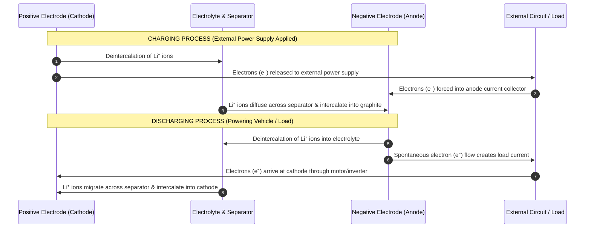
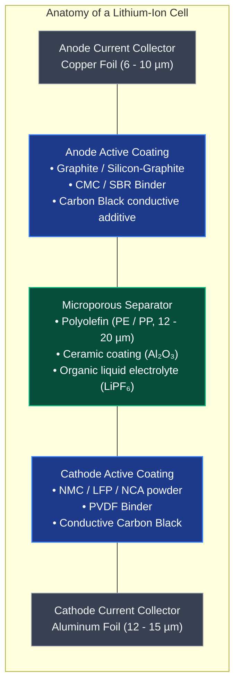
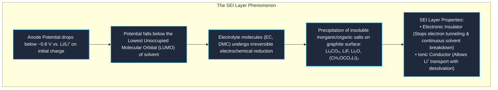
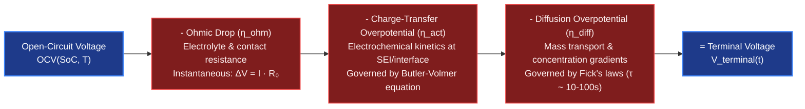

# Working Principles & Electrochemistry of Lithium-Ion Cells

A lithium-ion cell is an electrochemical energy conversion and storage device that operates on the **"rocking-chair" (shuttlecock) intercalation principle**[^armand1980][^tarascon2001]. First conceptualized by Armand in 1980 and commercialized by Sony in 1991, the cell stores and releases electrical energy by shuttling lithium ions ($\text{Li}^+$) back and forth between two host insertion compounds, while electrons flow through an external electrical load or charger[^scrosati2010][^goodenough2013].

Unlike lead-acid or nickel-cadmium batteries, in which the active electrode materials undergo destructive chemical phase transformation or dissolution/precipitation, lithium-ion intercalation is a **topotactic reaction**: lithium guest ions enter and exit host crystal lattices with minimal rearrangement of the host matrix[^winter1998][^whittingham2004].

---

## 1. The Rocking-Chair Transport Mechanism

The operational cycle of a lithium-ion cell consists of coordinated electron and ion transport through two distinct paths:

### Physical Transport Rules:
- **Inside the Cell:** Only ions ($\text{Li}^+$) move. The separator and electrolyte are electrical insulators ($t_{e^-} \approx 0$). If electrons could cross internally, an internal short circuit would occur.
- **Outside the Cell:** Only electrons ($e^-$) move through metallic conductors, current collectors, and the external load.

---

## 2. Electrochemical Half-Cell & Full-Cell Reactions

Consider a classic commercial cell pairing a layered transition-metal oxide cathode (e.g., lithium cobalt oxide $\text{LiCoO}_2$ or lithium nickel-manganese-cobalt oxide $\text{NMC}$) with a synthetic graphite anode ($\text{C}_6$)[^goodenough2013][^whittingham2004]:

### Positive Electrode (Cathode):

$$
\text{LiCoO}_2 \underset{\text{discharge}}{\overset{\text{charge}}{\rightleftharpoons}} \text{Li}_{1-x}\text{CoO}_2 + x\text{Li}^+ + x e^-
$$

During charging, oxidation of transition-metal cations (e.g., $\text{Co}^{3+} \rightarrow \text{Co}^{4+} + e^-$) balances the extraction of positively charged lithium ions into the electrolyte. During discharge, reduction occurs as lithium inserts into the crystal planes.

### Negative Electrode (Anode):

$$
\text{C}_6 + x\text{Li}^+ + x e^- \underset{\text{discharge}}{\overset{\text{charge}}{\rightleftharpoons}} \text{Li}_x\text{C}_6
$$

Graphite accommodates lithium between its graphene sheets up to a maximum stoichiometric saturation of $\text{LiC}_6$ (Stage 1 intercalation), yielding a theoretical capacity of $372\,\text{mAh/g}$.

### Full-Cell Reversible Reaction:

$$
\text{LiCoO}_2 + \text{C}_6 \underset{\text{discharge}}{\overset{\text{charge}}{\rightleftharpoons}} \text{Li}_{1-x}\text{CoO}_2 + \text{Li}_x\text{C}_6
$$

### Thermodynamics & Cell Potential

The electrical work generated by the cell is linked to the change in Gibbs free energy ($\Delta G$) of the chemical reaction via Faraday's relation[^linden2002]:

$$
\Delta G = -z \cdot F \cdot E_{\text{cell}}
$$

The open-circuit voltage ($\text{OCV}$) under non-standard conditions follows the **Nernst Equation**:

$$
E_{\text{cell}} = E^\circ_{\text{cell}} - \frac{R \cdot T}{z \cdot F} \ln\left( \frac{a_{\text{Li, anode}}}{a_{\text{Li, cathode}}} \right)
$$

where $R = 8.314\,\text{J/(mol}\cdot\text{K)}$ is the universal gas constant, $T$ is temperature in Kelvin, and $a_i$ represents the chemical activity of lithium in the respective electrode host.

---

## 3. Cell Components & Materials Science

A high-performance lithium-ion cell contains five primary engineering constituents[^tarascon2001][^xu2004]:

### Detailed Component Specifications

1. **Negative Current Collector (Copper):**
   High-purity rolled or electrodeposited copper foil ($6 - 10\,\mu\text{m}$). Copper is stable at low anode potentials ($0.0 - 0.3\,\text{V}$ vs. $\text{Li/Li}^+$), whereas aluminum would form an unwanted $\text{Li-Al}$ alloy at these voltages.
2. **Positive Current Collector (Aluminum):**
   Aluminum foil ($12 - 15\,\mu\text{m}$). Aluminum passivates against corrosion at high potentials ($>3.0\,\text{V}$ vs. $\text{Li/Li}^+$) through the formation of an ultrathin $\text{Al}_2\text{O}_3$ and $\text{AlF}_3$ surface film.
3. **Electrolyte:**
   A non-aqueous solution composed of a lithium salt—predominantly **Lithium Hexafluorophosphate ($\text{LiPF}_6$, $1.0 - 1.2\,\text{M}$)**—dissolved in a blend of high-dielectric cyclic carbonates (Ethylene Carbonate, $\text{EC}$) and low-viscosity linear carbonates (Dimethyl Carbonate $\text{DMC}$, Ethyl Methyl Carbonate $\text{EMC}$)[^xu2004].
4. **Separator:**
   A microporous polymer membrane (polyethylene $\text{PE}$, polypropylene $\text{PP}$, or $\text{PP/PE/PP}$ trilayer) with sub-micron pore size ($30 - 50\%$ porosity). Modern automotive separators are coated on one or both sides with ceramic nanoparticles ($\text{Al}_2\text{O}_3$ or $\text{Boehmite}$) to prevent thermal shrinkage up to $200^\circ\text{C}$ and resist dendrite penetration.

---

## 4. The Solid Electrolyte Interphase (SEI)

The **Solid Electrolyte Interphase (SEI)**, discovered and formulated by Emanuel Peled in 1979, is arguably the most critical and complex interfacial phenomenon in lithium battery science[^peled1979][^peled1997]:

### Engineering Implications of the SEI:
- **First-Cycle Loss (Formation Loss):**
  Building the SEI consumes $5 - 12\%$ of the cyclable lithium from the cathode during factory formation cycling, representing irreversible capacity loss.
- **Aging & Capacity Fade:**
  During prolonged cycling and high-temperature storage, mechanical expansion/contraction of graphite particles fractures the brittle SEI. Fresh electrolyte contacts the newly exposed active material, consuming additional cyclable lithium and causing capacity fade and internal resistance rise[^dahn2011][^plett2015a].

---

## 5. Overpotentials and Voltage Losses Under Load

When a cell delivers current ($I > 0$), its terminal voltage ($V_{\text{terminal}}$) drops below its thermodynamic open-circuit voltage ($\text{OCV}$) due to three distinct physical overpotentials[^plett2015a][^newman2004]:

$$
V_{\text{terminal}}(t) = \text{OCV}(\text{SoC}) - \eta_{\text{ohm}}(t) - \eta_{\text{act}}(t) - \eta_{\text{diff}}(t)
$$

### Mathematical Formulation of Polarization:

1. **Ohmic Overpotential ($\eta_{\text{ohm}}$):**
   Ohm's law governs the immediate drop across metallic current collectors, contact resistances, and ionic migration through electrolyte pores:

    $$
    \eta_{\text{ohm}} = I(t) \cdot R_0
    $$

2. **Activation Polarization ($\eta_{\text{act}}$):**
   The energy barrier to transfer lithium ions across the electrode-electrolyte interface is governed by the **Butler-Volmer equation**[^newman2004]:

    $$
    I = I_0 \left[ \exp\left( \frac{\alpha_a F \eta_{\text{act}}}{R T} \right) - \exp\left( -\frac{\alpha_c F \eta_{\text{act}}}{R T} \right) \right]
    $$

    where $I_0$ is the exchange current density and $\alpha_a, \alpha_c$ are anodic and cathodic charge transfer coefficients ($\alpha_a + \alpha_c = 1$).

3. **Concentration / Diffusion Polarization ($\eta_{\text{diff}}$):**
   Lithium-ion solid-state diffusion inside spherical active particles is modeled via **Fick's second law**[^newman2004]:

    $$
    \frac{\partial c_s(r,t)}{\partial t} = \frac{D_s}{r^2} \frac{\partial}{\partial r}\left( r^2 \frac{\partial c_s(r,t)}{\partial r} \right)
    $$

   Because solid-state diffusion coefficients are low ($D_s \approx 10^{-14} - 10^{-12}\,\text{m}^2/\text{s}$), concentration gradients build up between particle surfaces and particle cores during aggressive acceleration or fast charging, creating a time-delayed relaxation voltage that requires RC-network modeling in the BMS.

---

## References

[^armand1980]: Armand, M. (1980). *Intercalation electrodes*. In: Materials for Advanced Batteries, Springer US, pp. 145–161. DOI: [10.1007/978-1-4684-3851-2_10](https://doi.org/10.1007/978-1-4684-3851-2_10)
[^tarascon2001]: Tarascon, J.-M., & Armand, M. (2001). *Issues and challenges facing rechargeable lithium batteries*. Nature, 414(6861), 359–367. DOI: [10.1038/35104644](https://doi.org/10.1038/35104644)
[^scrosati2010]: Scrosati, B., & Garche, J. (2010). *Lithium batteries: Status, prospects and future*. Journal of Power Sources, 195(9), 2419–2430. DOI: [10.1016/j.jpowsour.2009.11.048](https://doi.org/10.1016/j.jpowsour.2009.11.048)
[^goodenough2013]: Goodenough, J. B., & Park, K.-S. (2013). *The Li-ion rechargeable battery: A perspective*. Journal of the American Chemical Society, 135(4), 1167–1176. DOI: [10.1021/ja3091438](https://doi.org/10.1021/ja3091438)
[^winter1998]: Winter, M., et al. (1998). *Insertion electrode materials for rechargeable lithium batteries*. Advanced Materials, 10(10), 725–763. DOI: [10.1002/(SICI)1521-4095(199807)10:10<725::AID-ADMA725>3.0.CO;2-Z](https://doi.org/10.1002/(SICI)1521-4095(199807)10:10<725::AID-ADMA725>3.0.CO;2-Z)
[^whittingham2004]: Whittingham, M. S. (2004). *Lithium batteries and cathode materials*. Chemical Reviews, 104(10), 4271–4302. DOI: [10.1021/cr020731c](https://doi.org/10.1021/cr020731c)
[^linden2002]: Linden, D., & Reddy, T. B. (2002). *Handbook of Batteries* (3rd ed.). McGraw-Hill, New York. ISBN: 978-0-07-135978-7.
[^xu2004]: Xu, K. (2004). *Nonaqueous liquid electrolytes for lithium-based rechargeable batteries*. Chemical Reviews, 104(10), 4303–4418. DOI: [10.1021/cr030203g](https://doi.org/10.1021/cr030203g)
[^peled1979]: Peled, E. (1979). *The electrochemical behavior of alkali and alkaline earth metals in nonaqueous systems—The solid electrolyte interphase*. Journal of The Electrochemical Society, 126(12), 2047–2051. DOI: [10.1149/1.2128859](https://doi.org/10.1149/1.2128859)
[^peled1997]: Peled, E., Golodnitsky, D., & Ardel, G. (1997). *Advanced model for solid electrolyte interphase (SEI) on carbon and Li electrodes*. Journal of The Electrochemical Society, 144(8), L208. DOI: [10.1149/1.1837858](https://doi.org/10.1149/1.1837858)
[^dahn2011]: Dahn, J. R., et al. (2011). *High-precision coulometry for predicting battery cycle life*. Journal of The Electrochemical Society, 158(3), A302. DOI: [10.1149/1.3533417](https://doi.org/10.1149/1.3533417)
[^plett2015a]: Plett, G. L. (2015). *Battery Management Systems, Volume I: Battery Modeling*. Artech House, Norwood, MA. ISBN: 978-1-63081-023-8.
[^newman2004]: Newman, J., & Thomas-Alyea, K. E. (2004). *Electrochemical Systems* (3rd ed.). John Wiley & Sons, Hoboken, NJ. ISBN: 978-0-471-47756-3.
