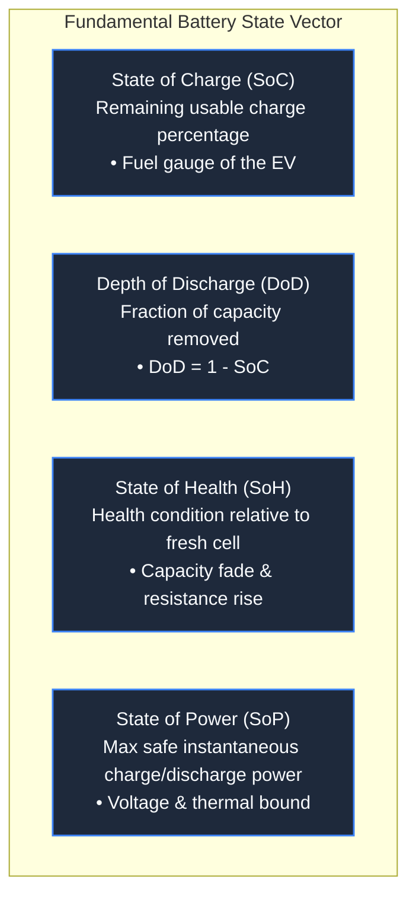
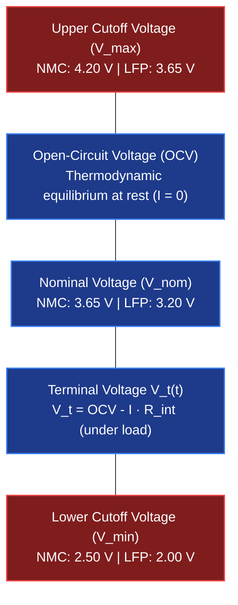
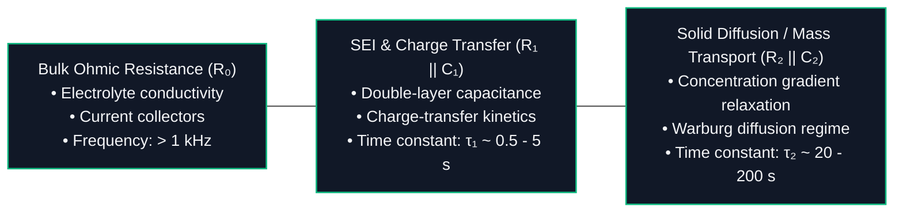

# Battery Terminology, Key Metrics & Standardization

Developing, simulating, and operating Battery Management Systems (BMS) for electric vehicles and stationary storage systems requires a mathematically rigorous vocabulary[^plett2015a][^andrea2010]. Because cell behaviors depend strongly on non-linear couplings between temperature, current rate, state of charge, and cycle history, imprecise definitions lead to simulation errors and safety hazards.

This reference provides formal mathematical definitions, physical interpretations, and governing international standards for core battery engineering terminology.

---

## 1. Capacity and Charge Metrics

### Ampere-Hour ($\text{Ah}$) and Coulomb ($\text{C}$)
Charge capacity ($Q$) quantifies the total electrical charge an electrochemical cell can deliver under defined discharge conditions:

$$
Q = \int_0^{t_{\text{dis}}} I(t) \, dt
$$

- In SI units, charge is expressed in **Coulombs ($\text{C}$)**: $1\,\text{C} = 1\,\text{A}\cdot\text{s}$.
- In battery engineering, capacity is conventionally specified in **Ampere-hours ($\text{Ah}$)**:

$$
1\,\text{Ah} = 3600\,\text{A}\cdot\text{s} = 3600\,\text{C}
$$

### Nominal vs. Usable Capacity
- **Nominal Capacity ($C_{\text{nom}}$):** The manufacturer-rated capacity delivered by a pristine cell at standard temperature ($25^\circ\text{C}$) when discharged at a low reference rate (typically $0.2\text{C}$ or $0.33\text{C}$) from $V_{\text{max}}$ to $V_{\text{min}}$.
- **Usable Capacity ($C_{\text{usable}}$):** The actual charge extracted within the vehicle's restricted operating buffer (e.g., $10\%$ to $90\%\,\text{SoC}$), accounting for temperature derating and aging.

---

## 2. State Metrics: SoC, DoD, and SoH

### State of Charge ($\text{SoC}$)
The State of Charge represents the ratio of currently available charge to the maximum available capacity under the current degradation state:

$$
\text{SoC}(t) = \text{SoC}(t_0) - \frac{1}{C_{\text{usable}}} \int_{t_0}^t \eta_i \cdot I(\tau) \, d\tau
$$

where:

- $I(\tau)$ is the terminal current (defined as positive for discharge and negative for charge).
- $\eta_i$ is the Coulombic efficiency factor ($\eta_i \approx 1.0$ during discharge; $\eta_i \le 1.0$ during charge to account for parasitic side reactions).
- In discrete digital implementations, the BMS updates $\text{SoC}$ at each sampling interval $\Delta t$:

$$
\text{SoC}_{k} = \text{SoC}_{k-1} - \frac{I_k \cdot \Delta t}{C_{\text{usable}} \cdot 3600}
$$

### Depth of Discharge ($\text{DoD}$)
The percentage of battery capacity that has been discharged relative to the fully charged state:

$$
\text{DoD}(t) = 1 - \text{SoC}(t) \quad \left[\text{or } \text{DoD}\% = 100\% - \text{SoC}\%\right]
$$

During cycling aging analysis, partial cycles are aggregated using rainflow counting algorithms, where damage scales exponentially with cycle depth ($\Delta \text{DoD}$)[^plett2015a].

### State of Health ($\text{SoH}$)
State of Health tracks irreversible battery aging relative to its Beginning-of-Life ($\text{BOL}$) baseline. It is dual-dimensional, reflecting both capacity loss and impedance rise[^andrea2010]:

1. **Capacity-Based Health ($\text{SoH}_C$):**

    $$
    \text{SoH}_C = \frac{C_{\text{actual, max}}}{C_{\text{nominal}}} \times 100\%
    $$

2. **Resistance-Based Health ($\text{SoH}_R$):**

    $$
    \text{SoH}_R = \frac{R_{\text{EOL}} - R_{\text{actual}}}{R_{\text{EOL}} - R_{\text{BOL}}} \times 100\%
    $$

> [!IMPORTANT]
> In automotive applications, **End-of-Life ($\text{EOL}$)** is reached when $\text{SoH}_C$ drops to **$70 - 80\%$**, or when internal resistance increases by **$100\%$ ($2\times R_{\text{BOL}}$)**, which restricts acceleration and regenerative braking capability.

---

## 3. C-Rate and Peukert's Law

The **C-Rate** normalizes the charge or discharge current relative to nominal capacity:

$$
I = C_{\text{rate}} \cdot C_{\text{nom}}
$$

- **$1\text{C}$ Rate:** A current that charges or discharges the nominal capacity in exactly $1\,\text{hour}$ (e.g., $100\,\text{A}$ for a $100\,\text{Ah}$ cell).
- **$0.5\text{C}$ Rate:** Discharges the cell in $2\,\text{hours}$ (e.g., $50\,\text{A}$ for a $100\,\text{Ah}$ cell).
- **$3\text{C}$ Rate:** Discharges the cell in $20\,\text{minutes}$ ($1/3\,\text{hour}$, e.g., $300\,\text{A}$).

### Peukert's Effect
Under elevated C-rates, internal Ohmic dissipation and mass-transport limitations reduce the net delivered capacity before reaching $V_{\text{min}}$. This is modeled historically via **Peukert's Law**[^peukert1897]:

$$
C_p = I^k \cdot t
$$

where $k$ is the Peukert exponent ($k \approx 1.02 - 1.15$ for lithium-ion, compared to $1.25 - 1.40$ for lead-acid). Lower exponents signify that lithium-ion cells maintain high usable capacity even under aggressive acceleration demands[^linden2002].

---

## 4. Voltage Thresholds & The Cell Potential Window

### Definitions:
- **Open-Circuit Voltage ($\text{OCV}$):** The stable potential difference between positive and negative terminals when no current flows ($I = 0$) and electrochemical relaxation has completed (typically $> 1 - 2\,\text{hours}$ rest).
- **Terminal Voltage ($V_t$):** The instantaneous voltage measured across cell terminals under active load or charging:

    $$
    V_t(t) = \text{OCV}(\text{SoC}, T) - I(t) \cdot R_{\text{internal}}
    $$

- **Nominal Voltage ($V_{\text{nom}}$):** The volumetric median voltage during a standard $0.2\text{C}$ discharge cycle.
- **Upper Cutoff Voltage ($V_{\text{max}}$):** The maximum permissible charging limit. Exceeding $V_{\text{max}}$ triggers electrolyte oxidation, transition metal dissolution, and catastrophic thermal runaway.
- **Lower Cutoff Voltage ($V_{\text{min}}$):** The minimum permissible discharge threshold. Discharging below $V_{\text{min}}$ causes anode copper dissolution and permanent internal micro-short circuits.

---

## 5. Impedance & Equivalent Circuit Parameters

Under AC excitation or dynamic drive cycles, internal cell resistance behaves as a complex, frequency-dependent impedance ($Z(\omega)$)[^plett2015a]:

### DC Internal Resistance ($R_{\text{DC}}$)
Determined experimentally via current step pulses (e.g., $10\,\text{second}$ high-rate discharge pulse per ISO 12405 / IEC 62660-1):

$$
R_{\text{DC}} = \frac{\Delta V}{\Delta I} = \frac{V(t_0) - V(t_0 + 10\,\text{s})}{I_{\text{pulse}}}
$$

---

## 6. Energy and Power Density Metrics

Battery systems are evaluated on both mass (gravimetric) and spatial (volumetric) bases[^linden2002]:

| Metric | Symbol | SI Unit | Formula | Significance in EV Design |
| :--- | :--- | :--- | :--- | :--- |
| **Gravimetric Energy Density (Specific Energy)** | $e_g$ | $\text{Wh/kg}$ | $e_g = \frac{E_{\text{usable}}}{m_{\text{cell/pack}}}$ | Determines vehicle driving range per unit curb weight. |
| **Volumetric Energy Density** | $e_v$ | $\text{Wh/L}$ | $e_v = \frac{E_{\text{usable}}}{V_{\text{cell/pack}}}$ | Determines passenger cabin and cargo volume constraints. |
| **Gravimetric Power Density (Specific Power)** | $p_g$ | $\text{W/kg}$ | $p_g = \frac{P_{\text{peak}}}{m_{\text{cell/pack}}}$ | Determines $0 - 100\,\text{km/h}$ acceleration and hill-climbing capability. |
| **Volumetric Power Density** | $p_v$ | $\text{W/L}$ | $p_v = \frac{P_{\text{peak}}}{V_{\text{cell/pack}}}$ | Determines packaging volume of high-power hybrid battery packs. |

---

## 7. Governing Standards and Test Specifications

Automotive battery systems are governed by comprehensive international compliance frameworks:

| Standard | Publishing Body | Scope & Mandate |
| :--- | :--- | :--- |
| **ISO 26262** | ISO | Automotive functional safety lifecycle (hazard analysis, ASIL classification, fail-safe contactor open states). |
| **IEC 62619** | IEC | Industrial secondary lithium-ion safety (cell balancing, overcharge, thermal abuse). |
| **IEC 62660-1/-2/-3** | IEC | Secondary lithium-ion cells for EV propulsion: Part 1 (Performance), Part 2 (Reliability), Part 3 (Safety). |
| **UN 38.3** | United Nations | Transport safety certification: thermal cycling, altitude simulation, vibration, external short circuit, impact. |
| **SAE J2464 / UL 2580** | SAE / UL | RESS safety testing: nail penetration, crush, immersion, drop, thermal propagation. |
| **GB/T 38031** | Standardization China | Chinese mandatory national standard: 5-minute thermal runaway non-propagation rule for passenger egress. |

---

## References

[^plett2015a]: Plett, G. L. (2015). *Battery Management Systems, Volume I: Battery Modeling*. Artech House, Norwood, MA. ISBN: 978-1-63081-023-8.
[^andrea2010]: Andrea, D. (2010). *Battery Management Systems for Large Lithium-Ion Battery Packs*. Artech House, Norwood, MA. ISBN: 978-1-60807-104-3.
[^peukert1897]: Peukert, W. (1897). *Über die Abhängigkeit der Kapazität von der Entladestromstärke bei Bleiakkumulatoren*. Elektrotechnische Zeitschrift (ETZ), 18, 287–288.
[^linden2002]: Linden, D., & Reddy, T. B. (2002). *Handbook of Batteries* (3rd ed.). McGraw-Hill, New York. ISBN: 978-0-07-135978-7.
