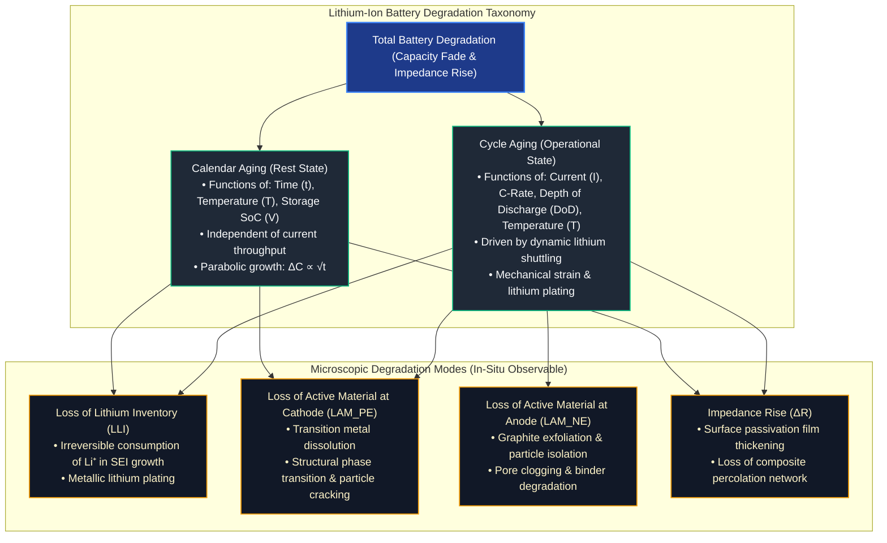

# Aging & Degradation in Battery Systems

All secondary electrochemical energy storage systems experience irreversible performance degradation throughout their service life[^vetter2005][^broussely2005]. In automotive battery packs and grid-scale storage installations, degradation manifests primarily as **capacity fade** (loss of vehicle driving range or energy storage capacity) and **internal resistance increase** (loss of peak power, acceleration, and regenerative braking capability)[^plett2015a][^andrea2010].

Understanding the multi-physics degradation mechanisms of lithium-ion batteries is essential for designing accurate State-of-Health ($\text{SoH}$) estimation algorithms, sizing pack energy margins over warranty periods (typically 8 years / 160,000 km), and optimizing BMS operational safeguards[^schmalstieg2014][^ecker2014].

---

## Degradation Taxonomy: Calendar vs. Cycle Aging

Battery degradation is fundamentally separated into two interacting domains[^keil2016][^vetter2005]:

---

## Chapter Curriculum

This module is structured into two comprehensive deep dives:

| Chapter | Core Focus | Key Methodologies & Formulations |
| :--- | :--- | :--- |
| **[01. Cycle Aging](01_cycle_ageing.md)** | Operational Degradation | Depth of Discharge ($\text{DoD}$) Wöhler curves, C-rate Ohmic heating, low-temperature lithium plating, mechanical fatigue, rainflow counting, non-linear aging knees, and Incremental Capacity Analysis ($\text{ICA} / dQ/dV$). |
| **[02. Calendar Aging](02_calendar_ageing.md)** | Storage Degradation | SEI diffusion kinetics ($t^{0.5}$ time law), Arrhenius thermal acceleration ($E_a$), high-voltage electrolyte oxidation, storage $\text{SoC}$ optimization, and semi-empirical modeling. |

---

## The Three Core Degradation Modes

Modern electrochemical diagnostics classify all internal degradation mechanisms into three decoupled physical modes[^dubarry2012][^birkl2017]:

1. **Loss of Lithium Inventory ($\text{LLI}$):**
   Cyclable lithium ions are trapped irreversibly in parasitic chemical compounds—predominantly the ongoing formation and repair of the Solid Electrolyte Interphase (SEI) on the anode and metallic lithium plating. $\text{LLI}$ reduces the cell's usable capacity while leaving the electrode host lattices largely intact.
2. **Loss of Active Material on Positive/Negative Electrodes ($\text{LAM}_{\text{PE}} / \text{LAM}_{\text{NE}}$):**
   Active interstitial sites within host crystal matrices become electrochemically inaccessible due to particle microcracking, contact loss from the current collector, phase transformation, or binder breakdown.
3. **Impedance Rise ($\text{IR}$):**
   Thickening of interfacial passivation films and contact degradation increase Ohmic resistance ($R_0$) and charge-transfer resistance ($R_{\text{ct}}$), diminishing output voltage and power capability.

---

## References

[^vetter2005]: Vetter, J., et al. (2005). *Ageing mechanisms of Li-ion batteries*. Journal of Power Sources, 147(1-2), 269–281. DOI: [10.1016/j.jpowsour.2005.01.006](https://doi.org/10.1016/j.jpowsour.2005.01.006)
[^broussely2005]: Broussely, M., et al. (2005). *Main aging mechanisms in Li ion batteries*. Journal of Power Sources, 146(1-2), 90–96. DOI: [10.1016/j.jpowsour.2005.03.172](https://doi.org/10.1016/j.jpowsour.2005.03.172)
[^plett2015a]: Plett, G. L. (2015). *Battery Management Systems, Volume I: Battery Modeling*. Artech House, Norwood, MA. ISBN: 978-1-63081-023-8.
[^andrea2010]: Andrea, D. (2010). *Battery Management Systems for Large Lithium-Ion Battery Packs*. Artech House, Norwood, MA. ISBN: 978-1-60807-104-3.
[^schmalstieg2014]: Schmalstieg, J., et al. (2014). *A holistic aging model for Li(NiMnCo)O2 based 18650 lithium-ion cells*. Journal of Power Sources, 257, 325–334. DOI: [10.1016/j.jpowsour.2014.02.012](https://doi.org/10.1016/j.jpowsour.2014.02.012)
[^ecker2014]: Ecker, M., et al. (2014). *Calendar and cycle life study of Li(NiMnCo)O2-based 18650 lithium-ion cells*. Journal of Power Sources, 248, 839–851. DOI: [10.1016/j.jpowsour.2013.09.143](https://doi.org/10.1016/j.jpowsour.2013.09.143)
[^keil2016]: Keil, P., et al. (2016). *Calendar aging of lithium-ion batteries: I. Impact of the check-up profile on aging after long-term storage*. Journal of The Electrochemical Society, 163(9), A1872. DOI: [10.1149/2.0411609jes](https://doi.org/10.1149/2.0411609jes)
[^dubarry2012]: Dubarry, M., Truchot, C., & Liaw, B. Y. (2012). *Synthesize battery degradation modes by slope analysis*. Journal of Power Sources, 219, 204–216. DOI: [10.1016/j.jpowsour.2012.07.016](https://doi.org/10.1016/j.jpowsour.2012.07.016)
[^birkl2017]: Birkl, C. R., et al. (2017). *Degradation diagnostics for lithium ion cells*. Journal of Power Sources, 341, 373–386. DOI: [10.1016/j.jpowsour.2016.12.011](https://doi.org/10.1016/j.jpowsour.2016.12.011)
