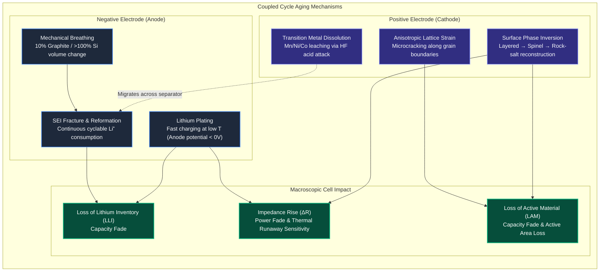
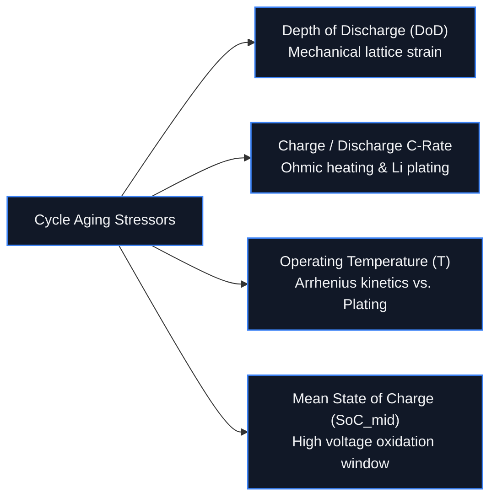
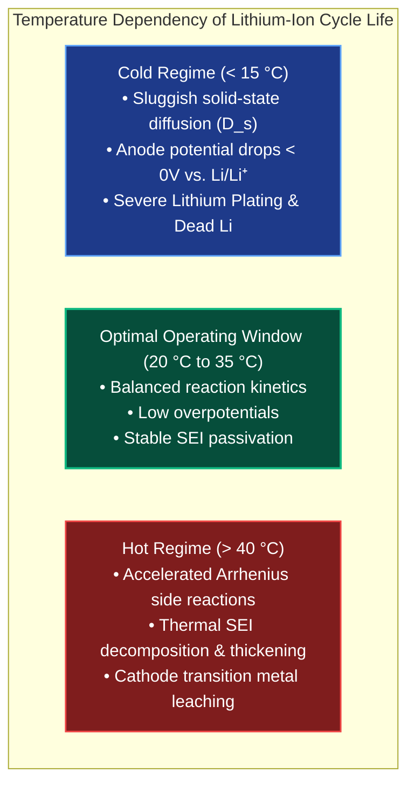
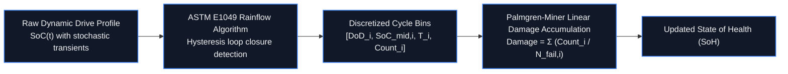
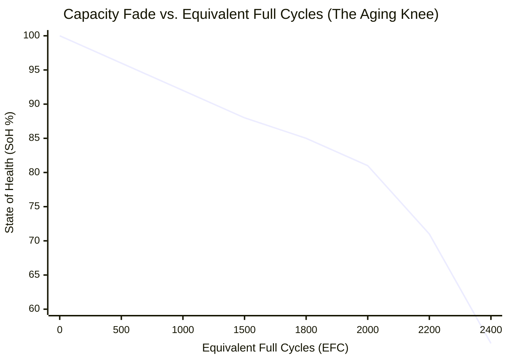
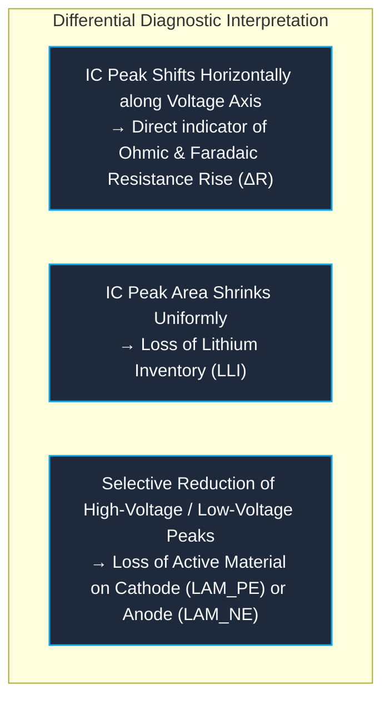

# Cycle Aging: Mechanisms, Mathematical Modeling & Mitigation

**Cycle aging** refers to the progressive, irreversible degradation of a battery cell caused by dynamic charge and discharge operations[^vetter2005][^broussely2005]. While calendar aging advances inexorably as a function of storage time, temperature, and rest potential, cycle aging is driven by the dynamic shuttling of lithium ions across the cell, macroscopic current throughput, phase transformations, and mechanical expansion/contraction within host electrode crystal lattices[^schmalstieg2014][^ecker2014].

In electric vehicles (EVs) and stationary energy storage systems (BESS), managing cycle aging directly determines pack operating lifespan, warranty liability, and total cost of ownership[^andrea2010][^plett2015a].

---

## 1. Microscopic & Chemical Mechanisms of Cycle Aging

Cycle aging is not caused by a single isolated reaction, but by coupled electrochemical and mechanical degradation mechanisms operating concurrently across the anode, cathode, and electrolyte[^vetter2005][^birkl2017]:

### A. Mechanical Breathing and Particle Microcracking
During intercalation and deintercalation, electrode active materials experience periodic volume variations:
- Graphite exhibits a $\approx 10\%$ volume expansion when fully lithiated to $\text{LiC}_6$.
- Silicon anodes undergo massive volume swings of $200 - 300\%$, inducing severe mechanical stresses.
- Layered cathode oxides ($\text{LiNi}_{1-x-y}\text{Mn}_x\text{Co}_y\text{O}_2$) contract and expand anisotropically along their crystallographic $c$-axis by $2 - 8\%$ during high-voltage delithiation.

Repeated mechanical strain drives intergranular and intragranular **microcracking** along primary particle grain boundaries. Fractured particle fragments lose electrical contact with the carbon-black conductive matrix, directly causing **Loss of Active Material ($\text{LAM}_{\text{PE}} / \text{LAM}_{\text{NE}}$)**[^woodward2020].

### B. Dynamic SEI Fracture and Continuous Lithium Trapping
Fresh Solid Electrolyte Interphase (SEI) initially formed during factory formation is passivating but brittle. As graphite particles expand and contract during cycling, the SEI layer cracks. Newly exposed bare lithiated graphite instantly reacts with carbonate solvents, consuming additional cyclable lithium ions ($\text{Li}^+$) to repair the film. This continuous regeneration is the primary driver of linear **Loss of Lithium Inventory ($\text{LLI}$)** during moderate cycling[^peled1979][^dahn2011].

### C. Lithium Plating During Low-Temperature / Fast Charging
When charging at high C-rates or low ambient temperatures ($T < 10^\circ\text{C}$), lithium-ion solid-state diffusion within the anode particles ($D_s \approx 10^{-14}\,\text{m}^2/\text{s}$) becomes rate-limiting. As overpotential increases, the local electrostatic potential of the graphite surface ($\Phi_s - \Phi_l$) drops below $0\,\text{V}$ versus $\text{Li/Li}^+$[^fleckenstein2013][^waldmann2014]:

$$
\eta_{\text{anode}} = \Phi_s - \Phi_l - U_{\text{eq}} < 0\,\text{V}
$$

Under this thermodynamic condition, incoming lithium ions do not intercalate; instead, they reduce into **metallic lithium dendrites** on the graphite surface:

$$
\text{Li}^+ + e^- \longrightarrow \text{Li}_{(\text{metal})}
$$

Plated metallic lithium reacts violently with the electrolyte, creating electrically isolated "dead lithium" (irreversible $\text{LLI}$) and risking separator puncture, leading to catastrophic internal short circuits[^waldmann2014].

---

## 2. Key Operational Stress Factors

### A. Depth of Discharge (DoD) & Wöhler Fatigue Analogy
Mechanical fatigue in battery electrodes mirrors structural fatigue in metals. Cycling at deep discharge depths induces severe lattice strain. Empirical cycle life follows an exponential power law analogous to **Wöhler fatigue curves**[^plett2015a][^ecker2014]:

$$
N_{\text{cycles}}(\text{DoD}) = A \cdot (\text{DoD})^{-B}
$$

where $A$ and $B$ are chemistry-specific fitting constants ($B \approx 1.5 - 2.2$ for high-nickel NMC):

| Depth of Discharge ($\text{DoD}$) | Usable Cycle Life ($80\%\,\text{SoH}$) | Lifetime Equivalent Full Cycles ($\text{EFC} = N \times \text{DoD}$) | Cumulative Energy Throughput ($E_{\text{total}} / E_{\text{nom}}$) |
| :--- | :--- | :--- | :--- |
| **$100\%$ ($100 \rightarrow 0\%$)** | $\approx 800 - 1,200$ | $1,000$ | $1,000\,\text{EFC}$ |
| **$80\%$ ($90 \rightarrow 10\%$)** | $\approx 1,800 - 2,500$ | $1,600$ | $1,600\,\text{EFC}$ ($+60\%$) |
| **$50\%$ ($75 \rightarrow 25\%$)** | $\approx 4,500 - 6,000$ | $2,625$ | $2,625\,\text{EFC}$ ($+162\%$) |
| **$20\%$ ($60 \rightarrow 40\%$)** | $\approx 18,000 - 25,000$ | $4,200$ | $4,200\,\text{EFC}$ ($+320\%$) |

> [!TIP]
> Operating the battery across shallow cycles centered around $50\%\,\text{SoC}$ can triple the cumulative lifetime energy throughput compared to continuous $100\%\,\text{DoD}$ cycling.

### B. Temperature: The U-Shaped Aging Window
The operational temperature profile exhibits an optimal sweet spot governed by two opposing degradation regimes[^waldmann2014]:

---

## 3. Mathematical Modeling of Cycle Aging

In advanced BMS algorithms and vehicle fleet simulation, cycle aging is modeled using semi-empirical multi-variable formulations[^schmalstieg2014][^ecker2014]:

### Semi-Empirical Formulation (Schmalstieg Model)
The cycle-induced capacity loss ($\Delta C_{\text{cyc}}$) and internal resistance growth ($\Delta R_{\text{cyc}}$) are formulated as separated power-law products of cumulative charge throughput ($Q_{\text{throughput}}$), temperature, mean $\text{SoC}$, and cycle depth:

$$
\Delta C_{\text{cyc}} = \beta_{\text{cap}}(T, \text{SoC}_{\text{mid}}, I_{\text{chg}}) \cdot (\text{DoD})^\gamma \cdot (Q_{\text{throughput}})^z
$$

where:

$$
\beta_{\text{cap}} = A \cdot \exp\left( -\frac{E_{a,\text{cyc}}}{R \cdot T} \right) \cdot \exp\left( \alpha \cdot (\text{SoC}_{\text{mid}} - 0.5) \right) \cdot \left( 1 + \delta \cdot C_{\text{rate, chg}} \right)
$$

- $E_{a,\text{cyc}}$ is the apparent activation energy for cycling side-reactions ($E_a \approx 20 - 35\,\text{kJ/mol}$).
- $z$ is the time/throughput exponent ($z \approx 0.5$ for diffusion-limited SEI growth; transitions toward $z \approx 1.0$ when mechanical fatigue dominates).
- $\gamma$ is the depth-of-discharge exponent ($\gamma \approx 1.2 - 1.8$).

### Rainflow Cycle Counting for Dynamic Driving Cycles
Real automotive driving cycles (WLTP, US06, real-world highway driving) exhibit stochastic, non-periodic micro-cycling from regenerative braking and throttle transients. The BMS decomposes continuous current profiles into discrete closed hysteresis loops using the **ASTM E1049 Rainflow Counting Algorithm**[^plett2015a]:

---

## 4. The Non-Linear "Aging Knee" (Rollover Phenomenon)

A critical safety and reliability concern in lithium-ion batteries is the **aging knee** (or rollover point)[^schmalstieg2014][^spotnitz2003]:

### Physical Triggers of the Knee:
During initial cycling (linear / $\sqrt{N}$ regime), degradation is dominated by stable SEI growth on the anode. However, once capacity approaches $75 - 80\%\,\text{SoH}$, the degradation rate can suddenly accelerate:
1. **Electrode Balancing Shift:** As lithium inventory is lost, the operating window of the graphite anode shifts toward higher states of lithiation at full charge, eventually forcing anode potential below $0\,\text{V}$ vs. $\text{Li/Li}^+$ during normal charging.
2. **Pore Clogging:** Thick SEI products fill the sub-micron pore volume of the composite anode, starving inner particles of liquid electrolyte.
3. **Severe Lithium Plating:** Once plating begins, it accelerates exponentially, precipitating catastrophic capacity loss, violent internal impedance spikes, and gas evolution[^waldmann2014].

---

## 5. In-Situ Diagnostics: ICA and DVA

To determine which physical mechanism ($\text{LLI}$ vs. $\text{LAM}$) is responsible for capacity loss without disassembling the pack, modern BMS algorithms execute in-situ differential analysis during controlled charging sessions[^dubarry2012][^birkl2017]:

### Incremental Capacity Analysis (ICA: $dQ/dV$)
By taking the derivative of charge capacity with respect to terminal voltage during a slow ($<0.1\text{C}$) charge:

$$
\text{IC}(V) = \frac{dQ}{dV} = I \cdot \left( \frac{dV}{dt} \right)^{-1}
$$

---

## 6. BMS Mitigation Strategies

Automotive BMS algorithms execute active mitigation protocols to retard cycle aging:

1. **Intelligent Fast-Charging Control (Multi-Stage CC-CV / Pulse):**
   Instead of static constant-current fast charging, the BMS monitors real-time overpotential and cell temperature, throttling charging current to prevent the anode potential from breaching $0\,\text{V}$ vs. $\text{Li/Li}^+$[^fleckenstein2013].
2. **Battery Preconditioning:**
   Before high-power DC fast charging (CCS / NACS), the BMS activates coolant heaters to bring the pack to $25 - 35^\circ\text{C}$, elevating solid-state diffusivity ($D_s$) and eliminating lithium plating risk.
3. **Range Buffering (Operating Window Clamping):**
   Automotive OEMs restrict usable capacity (e.g., $95\%$ upper limit, $5\%$ lower limit). By eliminating exposure to extreme voltages ($V > 4.2\,\text{V}$ and $V < 3.0\,\text{V}$), mechanical lattice strain is cut by more than half[^andrea2010].

---

## References

[^vetter2005]: Vetter, J., et al. (2005). *Ageing mechanisms of Li-ion batteries*. Journal of Power Sources, 147(1-2), 269–281. DOI: [10.1016/j.jpowsour.2005.01.006](https://doi.org/10.1016/j.jpowsour.2005.01.006)
[^broussely2005]: Broussely, M., et al. (2005). *Main aging mechanisms in Li ion batteries*. Journal of Power Sources, 146(1-2), 90–96. DOI: [10.1016/j.jpowsour.2005.03.172](https://doi.org/10.1016/j.jpowsour.2005.03.172)
[^schmalstieg2014]: Schmalstieg, J., et al. (2014). *A holistic aging model for Li(NiMnCo)O2 based 18650 lithium-ion cells*. Journal of Power Sources, 257, 325–334. DOI: [10.1016/j.jpowsour.2014.02.012](https://doi.org/10.1016/j.jpowsour.2014.02.012)
[^ecker2014]: Ecker, M., et al. (2014). *Calendar and cycle life study of Li(NiMnCo)O2-based 18650 lithium-ion cells*. Journal of Power Sources, 248, 839–851. DOI: [10.1016/j.jpowsour.2013.09.143](https://doi.org/10.1016/j.jpowsour.2013.09.143)
[^andrea2010]: Andrea, D. (2010). *Battery Management Systems for Large Lithium-Ion Battery Packs*. Artech House, Norwood, MA. ISBN: 978-1-60807-104-3.
[^plett2015a]: Plett, G. L. (2015). *Battery Management Systems, Volume I: Battery Modeling*. Artech House, Norwood, MA. ISBN: 978-1-63081-023-8.
[^birkl2017]: Birkl, C. R., et al. (2017). *Degradation diagnostics for lithium ion cells*. Journal of Power Sources, 341, 373–386. DOI: [10.1016/j.jpowsour.2016.12.011](https://doi.org/10.1016/j.jpowsour.2016.12.011)
[^woodward2020]: Woodward, C., et al. (2020). *Quantifying structural degradation in lithium-ion battery electrodes*. Nature Materials, 19, 876–882.
[^peled1979]: Peled, E. (1979). *The electrochemical behavior of alkali and alkaline earth metals in nonaqueous systems—The solid electrolyte interphase*. Journal of The Electrochemical Society, 126(12), 2047–2051. DOI: [10.1149/1.2128859](https://doi.org/10.1149/1.2128859)
[^dahn2011]: Dahn, J. R., et al. (2011). *High-precision coulometry for predicting battery cycle life*. Journal of The Electrochemical Society, 158(3), A302. DOI: [10.1149/1.3533417](https://doi.org/10.1149/1.3533417)
[^fleckenstein2013]: Fleckenstein, M., Fischer, S., & Bohlen, O. (2013). *Fast charging of lithium-ion batteries: A review of experimental results and modeling approaches*. Journal of Power Sources, 223, 259–269.
[^waldmann2014]: Waldmann, T., et al. (2014). *Temperature dependent ageing mechanisms in Lithium-ion batteries - A Post-Mortem study*. Journal of Power Sources, 262, 129–135. DOI: [10.1016/j.jpowsour.2014.03.112](https://doi.org/10.1016/j.jpowsour.2014.03.112)
[^spotnitz2003]: Spotnitz, R. (2003). *Simulation of capacity fade in lithium-ion cells*. Journal of Power Sources, 113(1), 81–90. DOI: [10.1016/S0378-7753(02)00492-1](https://doi.org/10.1016/S0378-7753(02)00492-1)
[^dubarry2012]: Dubarry, M., Truchot, C., & Liaw, B. Y. (2012). *Synthesize battery degradation modes by slope analysis*. Journal of Power Sources, 219, 204–216. DOI: [10.1016/j.jpowsour.2012.07.016](https://doi.org/10.1016/j.jpowsour.2012.07.016)
