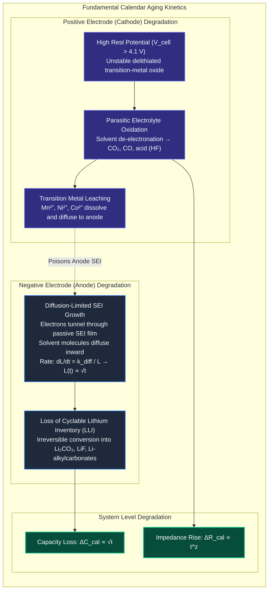
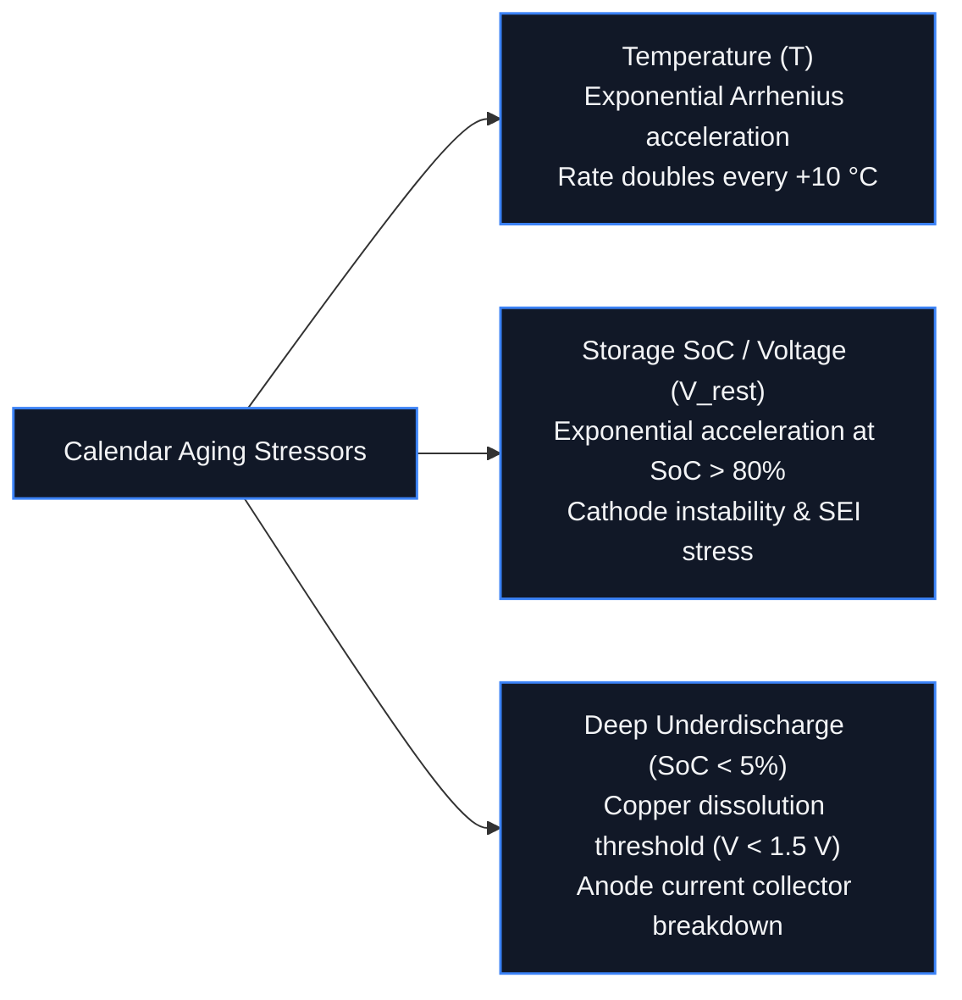
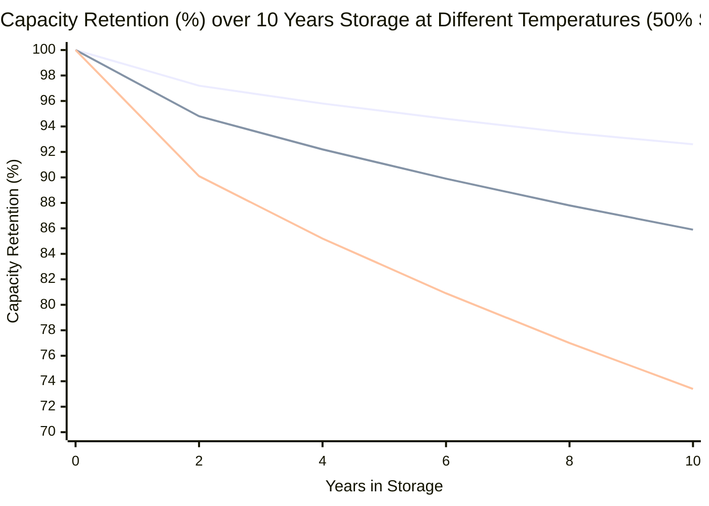

# Calendar Aging: Kinetics, Thermodynamic Modeling & Storage Protocols

**Calendar aging** encompasses all irreversible chemical and physical degradation processes that occur within an electrochemical cell over time, completely independent of charge-discharge cycling or electrical current throughput[^keil2016][^broussely2005]. 

In private passenger electric vehicles (BEVs), vehicles spend **$90\% - 95\%$ of their multi-year lifespan parked stationary** (at home, in parking facilities, or in transit logistics)[^ecker2014]. Consequently, calendar aging accounts for **$50\% - 70\%$ of the total cumulative capacity fade and impedance growth** observed over an 8-to-10-year warranty window[^schmalstieg2014][^keil2016].

---

## 1. Microscopic Kinetics of Calendar Aging

Unlike cycle aging, which is accelerated by mechanical strain and macroscopic ion flux, calendar aging is fundamentally driven by **spontaneous parasitic chemical side reactions** at the electrode-electrolyte interfaces under thermodynamic open-circuit conditions[^vetter2005][^peled1997]:

### A. The Square-Root Time Law ($\sqrt{t}$) of SEI Growth
The Solid Electrolyte Interphase (SEI) on graphite anodes passivates the active material against continuous bulk electrolyte reduction. However, SEI passivation is not mathematically absolute; neutral solvent molecules or electrons can slowly migrate through the porous passive film via solid-state vacancy diffusion or quantum tunneling[^peled1979][^broussely2005]:

The growth rate of the SEI layer thickness ($L_{\text{SEI}}$) is inversely proportional to its current thickness:

$$
\frac{d L_{\text{SEI}}}{dt} = \frac{k_{\text{diff}}}{L_{\text{SEI}}}
$$

Integrating this ordinary differential equation with initial boundary condition $L_{\text{SEI}}(0) = L_0$ yields the classical **parabolic growth law**:

$$
L_{\text{SEI}}(t) = \sqrt{L_0^2 + 2 k_{\text{diff}} \cdot t} \approx \alpha \cdot \sqrt{t}
$$

Because cyclable lithium ions ($\text{Li}^+$) from the cathode are permanently consumed in a stoichiometric $1:1$ ratio during this passivation growth, **calendar capacity loss follows a square-root-of-time dependency** ($\Delta C_{\text{cal}} \propto t^{0.5}$)[^keil2016][^broussely2005].

### B. High-Voltage Cathode Oxidation & Metal Dissolution
When a cell rests at a high state of charge ($\text{SoC} > 80\%$, corresponding to cathode potentials $>4.1\,\text{V}$ vs. $\text{Li/Li}^+$), the highly delithiated transition metal oxide lattice becomes oxidatively unstable[^goodenough2013]:
1. **Solvent Oxidation:** The organic carbonate electrolyte oxidizes catalytically on the cathode surface, generating gaseous byproducts ($\text{CO}_2, \text{CO}$) and trace hydrofluoric acid ($\text{HF}$) from $\text{LiPF}_6$ decomposition.
2. **Transition Metal Leaching:** $\text{HF}$ leaches manganese ($\text{Mn}^{2+}$), nickel ($\text{Ni}^{2+}$), and cobalt ($\text{Co}^{2+}$) cations from the cathode lattice into the liquid electrolyte.
3. **Cross-Talk SEI Poisoning:** Soluble $\text{Mn}^{2+}$ ions migrate through the separator to the negative electrode, where they reduce into metallic nanoparticles on the graphite surface, catalytically accelerating anode SEI breakdown and trapping additional lithium[^vetter2005].

---

## 2. Key Stress Drivers: Temperature & State of Charge

Calendar degradation kinetics are governed by two physical variables: **Storage Temperature ($T$)** and **Rest Voltage / State of Charge ($V_{\text{rest}} / \text{SoC}$)**[^keil2016][^ecker2014]:

### A. Temperature Dependency: The Arrhenius Relation
Parasitic side reactions follow **Arrhenius chemical reaction kinetics**[^linden2002][^plett2015a]:

$$
k(T) = A \cdot \exp\left( -\frac{E_a}{R \cdot T} \right)
$$

where:

- $k(T)$ is the reaction rate constant ($\text{s}^{-1}$).
- $A$ is the pre-exponential frequency factor.
- $E_a$ is the apparent activation energy ($E_a \approx 50 - 65\,\text{kJ/mol}$ for calendar SEI growth on graphite).
- $R = 8.314\,\text{J/(mol}\cdot\text{K)}$ is the universal gas constant.
- $T$ is absolute temperature in Kelvin.

> [!IMPORTANT]
> **The $10^\circ\text{C}$ Doubling Rule:** Because $E_a \approx 55\,\text{kJ/mol}$, an increase of just $10^\circ\text{C}$ (e.g., from $25^\circ\text{C}$ to $35^\circ\text{C}$) accelerates calendar capacity loss and resistance growth by approximately **$200\%$ ($2\times$)**. Storing a vehicle at $45^\circ\text{C}$ accelerates calendar degradation by roughly **$4\times$ to $5\times$** compared to $20^\circ\text{C}$!

### B. State of Charge ($\text{SoC}$) and Voltage Dependency
Calendar aging does not scale linearly with $\text{SoC}$. Experimental long-term matrix studies by Keil et al. and Schmalstieg et al. reveal distinct operational plateaus[^keil2016][^schmalstieg2014]:

| Storage $\text{SoC}$ Range | Cell Voltage ($V_{\text{rest}}$, NMC) | Calendar Aging Intensity | Governing Physical Mechanism |
| :--- | :--- | :--- | :--- |
| **$< 5\%\,\text{SoC}$** | $< 3.0\,\text{V}$ | Dangerous | High risk of copper dissolution if self-discharge drops cell $<1.5\,\text{V}$. |
| **$20\% - 50\%\,\text{SoC}$** | $3.60 - 3.82\,\text{V}$ | **Minimal (Optimal)** | Anode and cathode both in balanced, low-stress thermodynamic intercalation stages. |
| **$50\% - 75\%\,\text{SoC}$** | $3.82 - 4.02\,\text{V}$ | Moderate | Linear increase in chemical potential gradient. |
| **$> 80\%\,\text{SoC}$** | $> 4.10\,\text{V}$ | **Severe Acceleration** | High cathode oxidative potential; accelerated solvent oxidation and SEI degradation. |

---

## 3. Semi-Empirical Mathematical Modeling

Automotive OEMs parameterize calendar aging through calibrated semi-empirical models validated over multi-year test benches[^schmalstieg2014][^keil2016]:

### The Schmalstieg / Keil Formulation
Capacity loss ($\Delta C_{\text{cal}}$) and resistance growth ($\Delta R_{\text{cal}}$) over storage time $t$ are calculated as:

$$
\Delta C_{\text{cal}}(t, T, V_{\text{rest}}) = \alpha_C(V_{\text{rest}}) \cdot \exp\left( -\frac{E_{a, C}}{R \cdot T} \right) \cdot t^{0.5}
$$

$$
\Delta R_{\text{cal}}(t, T, V_{\text{rest}}) = \alpha_R(V_{\text{rest}}) \cdot \exp\left( -\frac{E_{a, R}}{R \cdot T} \right) \cdot t^{z_R}
$$

where:

- $\alpha_C(V_{\text{rest}}) = k_{c, 0} + k_{c, 1} \cdot V_{\text{rest}}$ models voltage acceleration.
- $z_R$ is the impedance growth time exponent ($z_R \approx 0.75 - 1.0$).
- $E_{a, C} \approx 52\,\text{kJ/mol}$ and $E_{a, R} \approx 62\,\text{kJ/mol}$.

*(Lines represent: Top: $15^\circ\text{C}$ Storage; Middle: $25^\circ\text{C}$ Storage; Bottom: $40^\circ\text{C}$ Storage).*

---

## 4. Storage Protocols & BMS Mitigation Strategies

Based on empirical and chemical realities, modern automotive BMS architectures implement automated preservation protocols[^andrea2010][^plett2015a]:

### A. The 80% Daily Charge Recommendation
Automotive manufacturers (Tesla, Porsche, VW, Hyundai) recommend setting the vehicle's standard daily charge limit to **$80\%\,\text{SoC}$**, reserving $100\%\,\text{SoC}$ only for immediate departure on long-distance road trips. Storing a vehicle at $80\%$ rather than $100\%\,\text{SoC}$ cuts calendar degradation rate by up to **$40\%$**[^keil2016].

### B. Departure-Time Charging (Smart Schedulers)
Instead of charging immediately upon arrival in the evening (which leaves the battery resting at $100\%\,\text{SoC}$ at elevated pack temperature all night), smart BMS controllers delay charging until early morning so that full charge is reached immediately prior to vehicle departure.

### C. Stationary Thermal Management (BESS & EV Sleep Modes)
When ambient temperatures exceed $38^\circ\text{C}$ (e.g., vehicles parked in summer sun), active BMS sleep watchdogs periodically wake the thermal management system to circulate chilled coolant through the battery pack, keeping internal cell temperatures safely below $32^\circ\text{C}$[^andrea2010].

### D. Long-Term Shipping / Seasonal Storage Mode
For vehicles or battery packs placed in seasonal storage or maritime shipping (lasting months):
- **Optimal Target:** Discharge or charge pack to **$30\% - 50\%\,\text{SoC}$**.
- **Temperature:** Store in climate-controlled environments between **$10^\circ\text{C}$ and $20^\circ\text{C}$**.
- **Low-Voltage Disconnect:** Disconnect low-voltage parasitic sleep loads (telematics, alarms) to eliminate self-discharge toward the destructive copper dissolution threshold ($<1.5\,\text{V}$).

---

## References

[^keil2016]: Keil, P., et al. (2016). *Calendar aging of lithium-ion batteries: I. Impact of the check-up profile on aging after long-term storage*. Journal of The Electrochemical Society, 163(9), A1872. DOI: [10.1149/2.0411609jes](https://doi.org/10.1149/2.0411609jes)
[^broussely2005]: Broussely, M., et al. (2005). *Main aging mechanisms in Li ion batteries*. Journal of Power Sources, 146(1-2), 90–96. DOI: [10.1016/j.jpowsour.2005.03.172](https://doi.org/10.1016/j.jpowsour.2005.03.172)
[^ecker2014]: Ecker, M., et al. (2014). *Calendar and cycle life study of Li(NiMnCo)O2-based 18650 lithium-ion cells*. Journal of Power Sources, 248, 839–851. DOI: [10.1016/j.jpowsour.2013.09.143](https://doi.org/10.1016/j.jpowsour.2013.09.143)
[^schmalstieg2014]: Schmalstieg, J., et al. (2014). *A holistic aging model for Li(NiMnCo)O2 based 18650 lithium-ion cells*. Journal of Power Sources, 257, 325–334. DOI: [10.1016/j.jpowsour.2014.02.012](https://doi.org/10.1016/j.jpowsour.2014.02.012)
[^vetter2005]: Vetter, J., et al. (2005). *Ageing mechanisms of Li-ion batteries*. Journal of Power Sources, 147(1-2), 269–281. DOI: [10.1016/j.jpowsour.2005.01.006](https://doi.org/10.1016/j.jpowsour.2005.01.006)
[^peled1979]: Peled, E. (1979). *The electrochemical behavior of alkali and alkaline earth metals in nonaqueous systems—The solid electrolyte interphase*. Journal of The Electrochemical Society, 126(12), 2047–2051. DOI: [10.1149/1.2128859](https://doi.org/10.1149/1.2128859)
[^peled1997]: Peled, E., Golodnitsky, D., & Ardel, G. (1997). *Advanced model for solid electrolyte interphase (SEI) on carbon and Li electrodes*. Journal of The Electrochemical Society, 144(8), L208. DOI: [10.1149/1.1837858](https://doi.org/10.1149/1.1837858)
[^goodenough2013]: Goodenough, J. B., & Park, K.-S. (2013). *The Li-ion rechargeable battery: A perspective*. Journal of the American Chemical Society, 135(4), 1167–1176. DOI: [10.1021/ja3091438](https://doi.org/10.1021/ja3091438)
[^linden2002]: Linden, D., & Reddy, T. B. (2002). *Handbook of Batteries* (3rd ed.). McGraw-Hill, New York. ISBN: 978-0-07-135978-7.
[^plett2015a]: Plett, G. L. (2015). *Battery Management Systems, Volume I: Battery Modeling*. Artech House, Norwood, MA. ISBN: 978-1-63081-023-8.
[^andrea2010]: Andrea, D. (2010). *Battery Management Systems for Large Lithium-Ion Battery Packs*. Artech House, Norwood, MA. ISBN: 978-1-60807-104-3.
