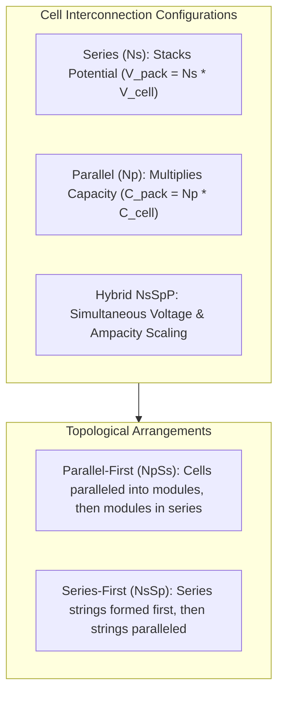
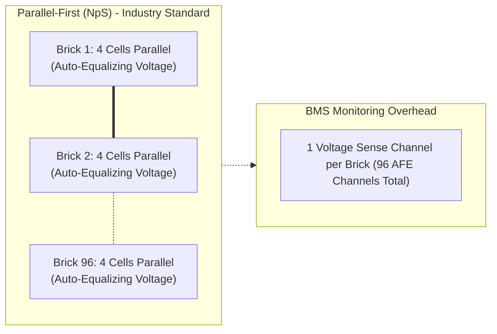
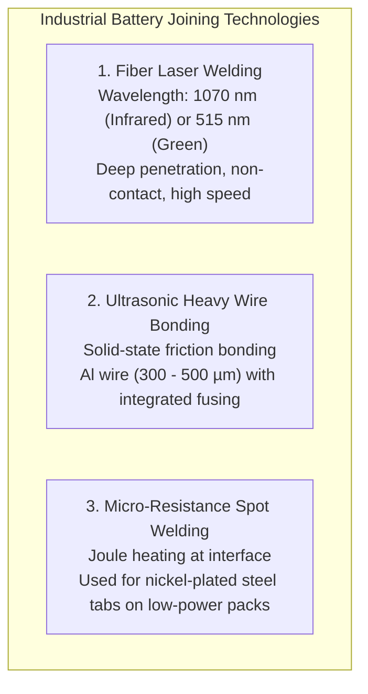
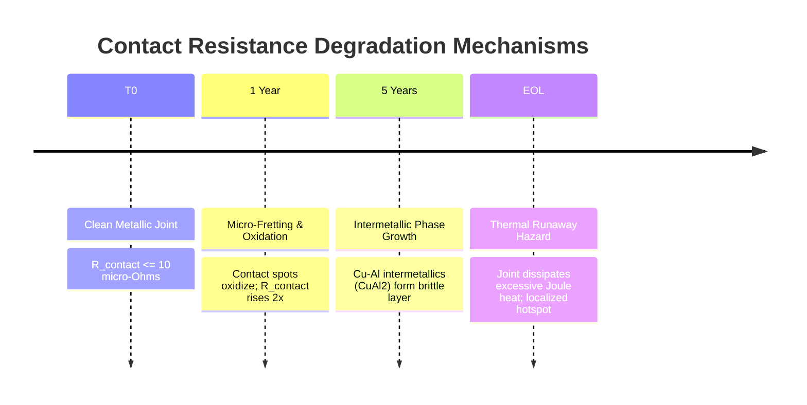

# Cell-to-Cell Electrical Interconnection and Topology

In battery pack engineering, cell-to-cell interconnections govern system voltage, ampacity, reliability, and thermal dissipation. Individual electrochemical cells—whether cylindrical (e.g., 21700, 4680), prismatic, or pouch—are assembled into series and parallel matrices ($N_s\text{S}N_p\text{P}$) to fulfill electric vehicle tractive demands or stationary grid storage requirements[^Andrea2020]. Establishing robust, low-resistance, and thermally resilient interconnections is essential to prevent localized resistive hotspots, thermal runaway propagation, and cell-to-cell imbalance[^Brand2015].

This chapter explores the electro-mechanical principles of cell interconnection: topological trade-offs ($N_s\text{S}N_p\text{P}$ vs. $N_p\text{P}N_s\text{S}$), busbar ampacity physics, joining technologies (laser welding, ultrasonic bonding, wire bonding), and contact resistance degradation under **ISO 16750** and **IEC 62660**[^IEC62660].

---

## 1. Electrical Interconnection Configurations

The fundamental building blocks of pack design are series connections, parallel connections, and hybrid matrices.



### 1.1 Mathematical Formulation of Interconnection Physics

| Configuration | Pack Terminal Voltage $V_{\text{pack}}$ | Pack Capacity $C_{\text{pack}}$ | Pack Internal Resistance $R_{\text{pack}}$ | Thermal Loss Equation $\dot{Q}_{\text{Joule}}$ |
| :--- | :--- | :--- | :--- | :--- |
| **Series ($N_s$)** | $N_s \cdot V_{\text{cell}}$ | $C_{\text{cell}}$ | $N_s \cdot R_{\text{cell}} + (N_s - 1) R_{\text{busbar}}$ | $I_{\text{pack}}^2 \cdot R_{\text{pack}}$ |
| **Parallel ($N_p$)** | $V_{\text{cell}}$ | $N_p \cdot C_{\text{cell}}$ | $\frac{R_{\text{cell}}}{N_p} + R_{\text{interconnect}}$ | $\left(\frac{I_{\text{pack}}}{N_p}\right)^2 \cdot R_{\text{cell}} \cdot N_p$ |
| **Hybrid ($N_s\text{S}N_p\text{P}$)** | $N_s \cdot V_{\text{cell}}$ | $N_p \cdot C_{\text{cell}}$ | $N_s \frac{R_{\text{cell}}}{N_p} + R_{\text{busbar\_total}}$ | $I_{\text{pack}}^2 \cdot \left(N_s \frac{R_{\text{cell}}}{N_p} + R_{\text{bus}}\right)$ |

### 1.2 Parallel-First ($N_p\text{S}$) vs. Series-First ($N_s\text{P}$)

Automotive battery systems almost universally adopt the **Parallel-First ($N_p\text{S}$)** architecture (e.g., $96\text{S}4\text{P}$ where 4 cells are welded directly in parallel into a "brick", and 96 bricks are connected in series)[^Andrea2020]:



- **Inherent Voltage Equalization**: Paralleled cells within each brick share physical terminals; their terminal voltages are constrained to be identical ($V_1 = V_2 = \dots = V_{N_p}$). Any instantaneous difference in electrochemical potential induces an internal balancing current:

$$
I_{\text{circ}} = \frac{V_1 - V_2}{R_{0,1} + R_{0,2} + 2 R_{\text{interconnect}}}
$$

- **Reduced BMS Channel Count**: The BMS Analog Front-End (AFE) needs only monitor $N_s$ voltage taps (96 channels for a 400V pack). In a series-first ($N_s\text{P}$) system, every individual series string would require independent voltage taps ($N_s \times N_p = 384$ channels), quadrupling harness complexity and silicon cost.

---

## 2. Busbar Ampacity and Thermal Sizing

Busbars distribute high traction currents (up to $500\,\text{A}$ continuous, $1{,}200\,\text{A}$ peak) across cell terminals. Sizing busbars requires balancing electrical conductance, thermal mass, and gravimetric density[^Brand2015].

```mermaid
graph TD
    CURR[Pack Current Profile I_pack] --> RMS_CALC[Calculate Root-Mean-Square Current I_RMS]
    RMS_CALC --> LOSS_CALC[Ohmic Joule Heat: Q_dot = I_RMS^2 * (rho * L / A)]
    LOSS_CALC --> THERM_DISS[Heat Dissipation to Coolant & Cell Caps]
    THERM_DISS --> TEMP_CHECK{"Max Delta T <= 10 K?"}
    TEMP_CHECK -- No --> RESIZE[Increase Cross-Section Area A or Change Material]
    TEMP_CHECK -- Yes --> PASS[Busbar Cross-Section Verified]
```

### 2.1 RMS Current and Cross-Sectional Area Equation

Under dynamic drive cycles (WLTP/US06), busbar heating is determined by the **Root-Mean-Square (RMS) Current**:

$$
I_{\text{RMS}} = \sqrt{\frac{1}{T} \int_0^T I(t)^2 \, dt}
$$

The steady-state temperature rise $\Delta T = T_{\text{busbar}} - T_{\text{ambient}}$ must remain bounded ($\Delta T \le 10 - 15\,\text{K}$) to prevent heat injection into cell positive terminals. The minimum cross-sectional area $A$ is given by:

$$
A \ge \frac{I_{\text{RMS}}}{J_{\text{allowable}}}
$$

where $J_{\text{allowable}}$ is the allowable current density (typically $3 - 5\,\text{A/mm}^2$ for air-cooled copper, or $6 - 8\,\text{A/mm}^2$ for liquid-coupled copper).

### 2.2 Material Comparison: Copper (CW004A) vs. Aluminum (EN AW-1050A)

| Physical Property | Electrolytic Copper (ETP-Cu) | Pure Aluminum (Al 99.5%) | Engineering Trade-Off |
| :--- | :--- | :--- | :--- |
| **Electrical Resistivity ($\rho$ at $20^\circ\text{C}$)** | $1.72 \times 10^{-8}\,\Omega\cdot\text{m}$ | $2.82 \times 10^{-8}\,\Omega\cdot\text{m}$ | Copper offers $64\%$ lower resistance for identical geometry. |
| **Density ($\delta$)** | $8.96\,\text{g/cm}^3$ | $2.70\,\text{g/cm}^3$ | Aluminum is **$70\%$ lighter** than copper. |
| **Thermal Conductivity ($\lambda$)** | $390\,\text{W/(m}\cdot\text{K)}$ | $220\,\text{W/(m}\cdot\text{K)}$ | Copper conducts heat away from cell terminals faster. |
| **Coefficient of Thermal Expansion ($\alpha$)** | $16.5 \times 10^{-6}\,\text{K}^{-1}$ | $23.0 \times 10^{-6}\,\text{K}^{-1}$ | Aluminum exhibits $39\%$ higher thermal expansion. |
| **Mass for Equivalent Resistance** | $1.0\times$ (Baseline) | **$0.49\times$ (51% mass saving)** | Aluminum delivers superior gravimetric efficiency. |

---

## 3. Cell Interconnection Joining Technologies

Welding cell terminals to busbars is a safety-critical manufacturing process. Excessive heat input damages the internal separator or electrolyte seal, while cold welds introduce high contact resistance ($R_{\text{contact}}$)[^Schmidt2021].



### 3.1 Laser Welding (Infrared vs. Green Laser)
Fiber laser welding focuses a high-power beam ($1 - 4\,\text{kW}$) to form a keyhole weld in milliseconds. 
- **The Reflectivity Challenge**: Highly conductive materials reflect infrared light (solid copper reflects $\approx 95\%$ of $1070\,\text{nm}$ radiation).
- **Green Laser Advantage**: Green laser radiation ($515\,\text{nm}$) exhibits $40\%$ higher absorption in cold copper, eliminating weld spatter and blowout defects into the cell jelly-roll[^Schmidt2021].

### 3.2 Ultrasonic Wire Bonding and Individual Cell Fusing
Pioneered in automotive cylindrical pack assembly, wire bonding ultrasonically scrubs pure aluminum or copper wires onto cell terminals:
- **Integrated Fusible Link**: The wire bond cross-section is precisely calibrated to act as a sacrificial fuse. If an individual cell experiences an internal short circuit ($R_{\text{int}} \to 0$), the massive discharge current from adjacent paralleled cells immediately melts the wire bond ($I_{\text{fuse}} \approx 20 - 30\,\text{A}$ for $300\,\mu\text{m}$ Al wire within $50\,\text{ms}$), isolating the defective cell from the pack without cascading thermal runaway[^Brand2015].

---

## 4. Contact Resistance and Aging Degradation

Under operating vehicle conditions, thermal cycling and vibration induce mechanical strain across busbar joints, driving **interfacial oxidation and fretting corrosion**[^IEC62660].



The contact resistance $R_{\text{contact}}$ across a mechanical bolted or clamped joint follows Holm's electrical contact theory:

$$
R_{\text{contact}} = \frac{\rho_m}{2} \sqrt{\frac{\pi H}{F_N}} + \frac{\sigma_{\text{film}}}{A_{\text{actual}}}
$$

where:
- $\rho_m$ is the metal resistivity,
- $H$ is the material hardness,
- $F_N$ is the normal clamping contact force,
- $\sigma_{\text{film}}$ is the electrical resistivity of the surface oxide/film layer.

To prevent contact resistance degradation, production automotive packs mandate welded interconnections over bolted joints, or apply nickel-flash plating and anaerobic anti-fretting compounds to preserve joint integrity over the 15-year vehicle service life.

---

## 5. Software Simulation and Pack Modeling

To design, simulate, and size series-parallel battery pack configurations programmatically, developers can utilize the tested `battery_toolkit` Python library:

```python
from battery_toolkit.core.cell import BatteryCell, CellChemistry
from battery_toolkit.core.pack import BatteryPack, PackTopology

# 1. Define cell parameters
cell = BatteryCell(
    name="Automotive NMC-811 21700",
    chemistry=CellChemistry.NMC,
    nominal_voltage=3.65,
    capacity_ah=5.0,
    r0_mohm=22.0,
    mass_g=69.0,
)

# 2. Instantiate 96S4P Pack Architecture
pack = BatteryPack(
    cell=cell,
    topology=PackTopology(num_series=96, num_parallel=4),
    busbar_resistance_mohm=0.5,
)

# Print pack parameters
print(pack.summary())
# Output:
# topology: 96S4P (384 cells)
# nominal_voltage_v: 350.4 V
# capacity_ah: 20.0 Ah
# nominal_energy_kwh: 7.01 kWh
# total_pack_mass_kg: 33.12 kg
```

For complete implementation details, see [codes/python/src/battery_toolkit/core/pack.py](file:///Users/cc/Desktop/Battery-Systems-Technology/codes/python/src/battery_toolkit/core/pack.py).

---

## 6. References

[^Andrea2020]: D. Andrea, *Battery Management Systems for Large Lithium-Ion Battery Packs*, Artech House, 2020.
[^Brand2015]: M. J. Brand, P. A. Schmidt, B. F. Zaeh, and A. Jossen, "Welding techniques for battery cells and their influence on battery performance," *Journal of Energy Storage*, vol. 1, pp. 63–70, 2015. [DOI: 10.1016/j.est.2015.05.005](https://doi.org/10.1016/j.est.2015.05.005)
[^IEC62660]: International Electrotechnical Commission, "Secondary lithium-ion cells for the propulsion of electric road vehicles - Part 1: Performance testing," *IEC Standard 62660-1:2018*, 2018.
[^Schmidt2021]: P. A. Schmidt, M. Schweier, and M. F. Zaeh, "Joining of lithium-ion batteries using green laser radiation," *Physics Procedia*, vol. 83, pp. 456–465, 2021.
