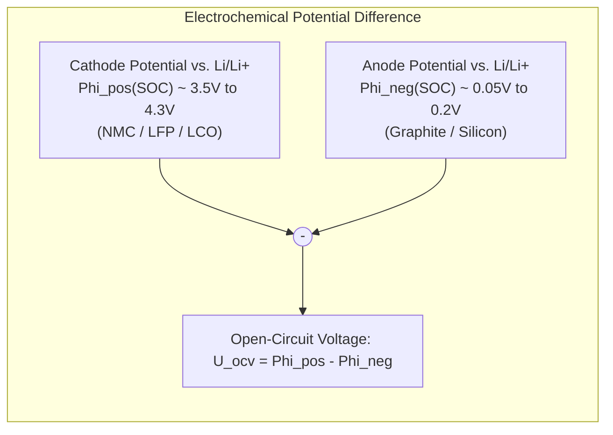
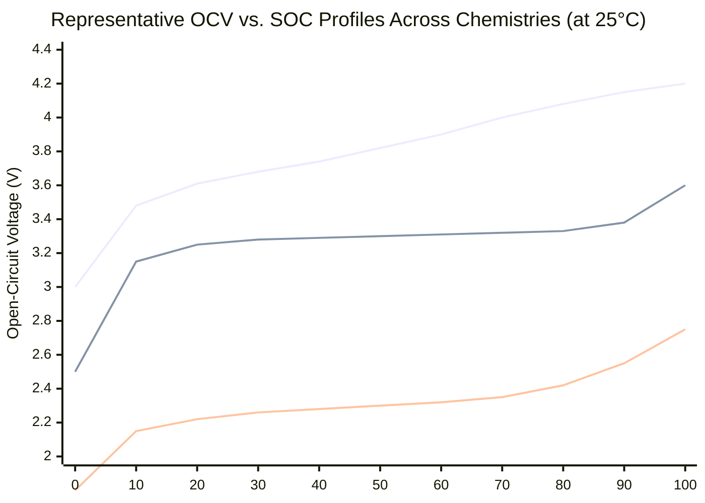
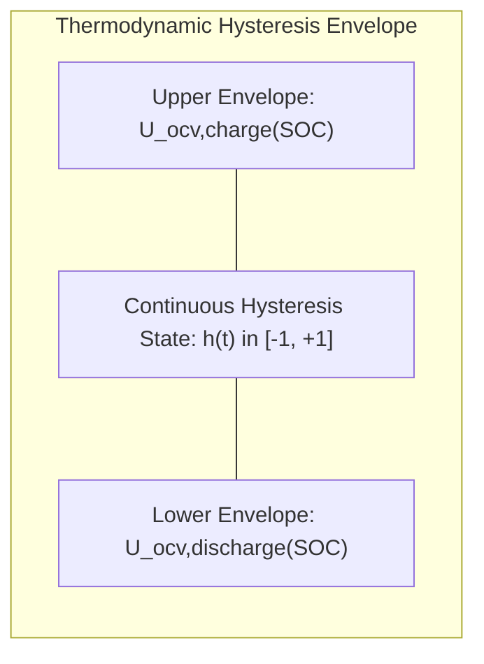

# Open-Circuit Voltage (OCV) Characteristics Across Chemistries

The thermodynamic **Open-Circuit Voltage (OCV)** is the foundational metric in lithium-ion battery modeling and State of Charge (SOC) estimation. OCV represents the reversible electrical potential difference between the positive and negative intercalation electrodes when zero net current flows ($I = 0$) and all concentration gradients within the electrolyte and solid active particles have completely relaxed to thermodynamic equilibrium[^Plett2015].

Understanding the thermodynamic, crystallographic, and kinetic nuances of OCV across diverse cell chemistries—including Lithium Nickel Manganese Cobalt Oxide (**NMC**), Lithium Iron Phosphate (**LFP**), and Lithium Titanate Oxide (**LTO**)—is critical for designing robust State of Charge observers and thermal derating algorithms[^Verbrugge2003].

---

## 1. Electrochemical Foundation of Open-Circuit Voltage

The open-circuit voltage reflects the difference in chemical potential ($\mu$) of lithium atoms intercalated into the host lattice of the cathode and anode:

$$
U_{\text{ocv}}(\text{SOC}) = -\frac{\mu_{\text{cathode}}(\text{SOC}) - \mu_{\text{anode}}(\text{SOC})}{F} = \Phi_{\text{cathode}} - \Phi_{\text{anode}}
$$

where $F$ is Faraday's constant ($96{,}485.3\,\text{C/mol}$), and $\Phi$ represents the half-cell potential relative to a pure lithium reference electrode ($\text{Li}/\text{Li}^+$)[^Bard2001].



### 1.1 Staging Phase Transitions in Graphite Anodes
During lithiation of graphite ($\text{C}_6 + x\text{Li}^+ + x e^- \leftrightarrow \text{Li}_x\text{C}_6$), lithium ions intercalate into alternating graphene planes, forming discrete **stages**:
- **Stage 4 $\to$ Stage 3 $\to$ Stage 2L $\to$ Stage 2 $\to$ Stage 1** ($\text{LiC}_6$).
- Each phase transition manifests as a plateau or slight step in the anode half-cell potential ($\approx 0.20\,\text{V}, 0.14\,\text{V}, 0.08\,\text{V}$ vs. $\text{Li}/\text{Li}^+$). Consequently, even if a cathode has a smooth potential profile, subtle "wrinkles" appear on the total cell OCV curve.

---

## 2. Chemistry-Specific OCV Profiles

The shape of the OCV-SOC curve is dictated by the crystallographic structure of the cathode active material[^Snihir2006].


*(Blue: NMC-622 / Green: LFP / Purple: LTO)*

### 2.1 Comparative Analysis Matrix

| Battery Chemistry | Cathode / Anode | OCV Range ($0\% \to 100\%$) | Average $\frac{d\text{OCV}}{d\text{SOC}}$ Slope | SOC Observability via OCV |
| :--- | :--- | :--- | :--- | :--- |
| **NMC (622 / 811)** | $\text{LiNi}_{x}\text{Mn}_{y}\text{Co}_{z}\text{O}_2$ / Graphite | $3.00\,\text{V} - 4.25\,\text{V}$ | $\approx 12.0\,\text{mV} / \%\,\text{SOC}$ | **High**: Excellent voltage observability across entire range. |
| **LFP** | $\text{LiFePO}_4$ / Graphite | $2.50\,\text{V} - 3.65\,\text{V}$ | $\approx 0.5\,\text{mV} / \%\,\text{SOC}$ (in mid-range) | **Extremely Low**: Flat plateau; a $5\,\text{mV}$ sensor error equates to a $15\%$ SOC error. |
| **LTO** | $\text{NMC}$ or $\text{LMO}$ / $\text{Li}_4\text{Ti}_5\text{O}_{12}$ | $1.80\,\text{V} - 2.80\,\text{V}$ | $\approx 9.5\,\text{mV} / \%\,\text{SOC}$ | **Moderate to High**: Steep ends, stable mid-range plateau around $2.3\,\text{V}$. |
| **NCA** | $\text{LiNi}_{0.8}\text{Co}_{0.15}\text{Al}_{0.05}\text{O}_2$ / Graphite | $3.00\,\text{V} - 4.20\,\text{V}$ | $\approx 11.5\,\text{mV} / \%\,\text{SOC}$ | **High**: Continuous monotonic slope ideal for Kalman filters. |

### 2.2 The LFP Flat Plateau Challenge
In $\text{LiFePO}_4$, lithiation occurs via a **two-phase coexistence reaction** between triphylite ($\text{LiFePO}_4$) and heterosite ($\text{FePO}_4$). According to the Gibbs Phase Rule:

$$
F = C - P + 2
$$

With two components ($C=2$) and two solid phases ($P=2$) at constant temperature and pressure, the degrees of freedom reduce to zero ($F=0$). Consequently, the chemical potential remains invariant across $20\% \le \text{SOC} \le 85\%$, creating an ultra-flat voltage plateau around $3.30\,\text{V}$.

> [!WARNING]
> Because $\frac{d\text{OCV}}{d\text{SOC}} \approx 0$ on the LFP plateau, the Kalman filter innovation gain $K_k \to 0$. Standalone voltage-based SOC estimation is impossible; BMS architectures must rely primarily on precision Coulomb Counting during cycling, and re-calibrate only near the knees ($<15\%$ or $>90\%$ SOC)[^Snihir2006].

---

## 3. Thermodynamic Temperature Scaling

The thermodynamic equilibrium potential varies as a function of junction temperature according to the **entropic temperature coefficient** $\frac{\partial U_{\text{ocv}}}{\partial T}$ (governed by the fundamental thermodynamic Maxwell relation)[^Verbrugge2003]:

$$
\Delta S = n F \left( \frac{\partial U_{\text{ocv}}}{\partial T} \right)_P
$$

$$
U_{\text{ocv}}(\text{SOC}, T) = U_{\text{ocv}}(\text{SOC}, T_{\text{ref}}) + \left( \frac{\partial U_{\text{ocv}}}{\partial T} \right) \cdot (T - T_{\text{ref}})
$$

- For typical NMC cells, $\frac{\partial U_{\text{ocv}}}{\partial T}$ varies between $-0.3\,\text{mV/K}$ and $+0.1\,\text{mV/K}$ depending on stoichiometry.
- At elevated temperatures ($+45^\circ\text{C}$ vs. $+25^\circ\text{C}$), a negative entropic coefficient depresses the open-circuit voltage by up to $6 - 8\,\text{mV}$, which must be compensated in firmware lookup tables to avoid false under-voltage trips.

---

## 4. Voltage Hysteresis and Microscopic Mechanics

In many chemistries—most notably LFP, Silicon anodes, and LTO—the open-circuit voltage during relaxation after charging is strictly higher than after discharging at the identical State of Charge:

$$
U_{\text{ocv,charge}}(\text{SOC}) > U_{\text{ocv,discharge}}(\text{SOC}), \quad \Delta V_{\text{hyst}} \le 50\,\text{mV}
$$



### 4.1 Physical Origins of Hysteresis
1. **Mechanical Stress & Coherency Strain**: Intercalation causes crystallographic lattice volume expansion (up to $7\%$ in graphite, $300\%$ in silicon). The mechanical elastic and plastic deformation energy alters the chemical potential $\mu$.
2. **Microscopic Phase Transition Barriers**: In two-phase materials (LFP), nucleation barriers between lithiated and delithiated domains differ depending on whether phase boundary progression is advancing or receding[^Roscher2011].

### 4.2 Dynamic Continuous Hysteresis Formulation
To prevent state estimation divergence during partial drive-cycle reversals, BMS algorithms model a continuous normalized hysteresis state $h(t) \in [-1, +1]$[^Plett2015]:

$$
\frac{dh(t)}{dt} = -\gamma \left| \frac{\eta_c I(t)}{C_{\text{nom}}} \right| h(t) + \gamma \left| \frac{\eta_c I(t)}{C_{\text{nom}}} \right| \text{sgn}(I(t))
$$

$$
U_{\text{ocv,eff}}(\text{SOC}, h) = U_{\text{ocv,mean}}(\text{SOC}) + h(t) \cdot M(\text{SOC})
$$

where $M(\text{SOC})$ is the half-width of the hysteresis envelope ($\text{V}$).

---

## 5. Software Implementation

The complete thermodynamic OCV model—including 2D temperature interpolation, numerical gradient computation, and continuous hysteresis tracking—is implemented in the tested `battery_toolkit` Python package:

```python
from battery_toolkit.modeling.ocv import OCVModel

# Instantiate calibrated OCV model
ocv = OCVModel(
    entropic_coeff_v_per_k=-0.00015,
    hysteresis_gamma=75.0,
    hysteresis_max_v=0.025,
    nominal_capacity_ah=50.0,
)

# 1. Equilibrium OCV at 50% SOC and 25°C
v_eq = ocv.get_equilibrium_ocv(soc=0.50, temp_celsius=25.0)

# 2. Entropic temperature shift at 45°C
v_hot = ocv.get_equilibrium_ocv(soc=0.50, temp_celsius=45.0)

# 3. Dynamic effective OCV during a 20A discharge pulse
v_eff = ocv.get_effective_ocv(soc=0.50, current_a=20.0, dt_s=1.0)
```

For complete implementation source code, see [codes/python/src/battery_toolkit/modeling/ocv.py](file:///Users/cc/Desktop/Battery-Systems-Technology/codes/python/src/battery_toolkit/modeling/ocv.py).

---

## 6. References

[^Plett2015]: G. L. Plett, *Battery Management Systems, Volume I: Battery Modeling*, Artech House, 2015.
[^Verbrugge2003]: M. W. Verbrugge and B. J. Koch, "Electrochemistry, entropy changes, and thermodynamic properties of lithium-ion cells," *Journal of The Electrochemical Society*, vol. 150, no. 3, pp. A374–A384, 2003. [DOI: 10.1149/1.1545464](https://doi.org/10.1149/1.1545464)
[^Bard2001]: A. J. Bard and L. R. Faulkner, *Electrochemical Methods: Fundamentals and Applications*, 2nd ed., John Wiley & Sons, 2001.
[^Snihir2006]: I. Snihir, W. Rey, E. Verbitskiy, A. Belfadhel-Ayeb, and P. H. L. Notten, "Battery open-circuit voltage estimation by a system of nonlinear differential equations," *Journal of Power Sources*, vol. 159, no. 2, pp. 1484–1494, 2006. [DOI: 10.1016/j.jpowsour.2005.11.090](https://doi.org/10.1016/j.jpowsour.2005.11.090)
[^Roscher2011]: M. A. Roscher and D. U. Sauer, "Dynamic modeling of the open-circuit voltage of lithium-iron-phosphate batteries," *Journal of Power Sources*, vol. 196, no. 1, pp. 331–336, 2011. [DOI: 10.1016/j.jpowsour.2010.06.098](https://doi.org/10.1016/j.jpowsour.2010.06.098)
