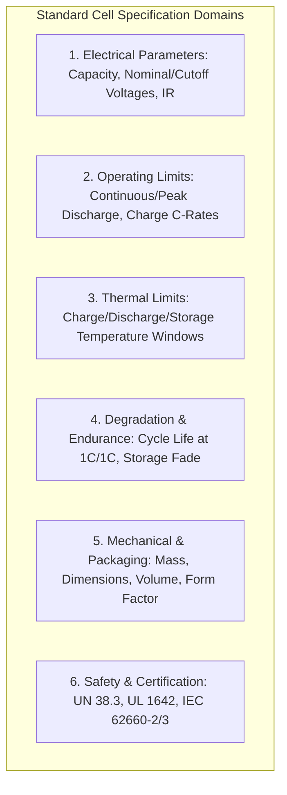
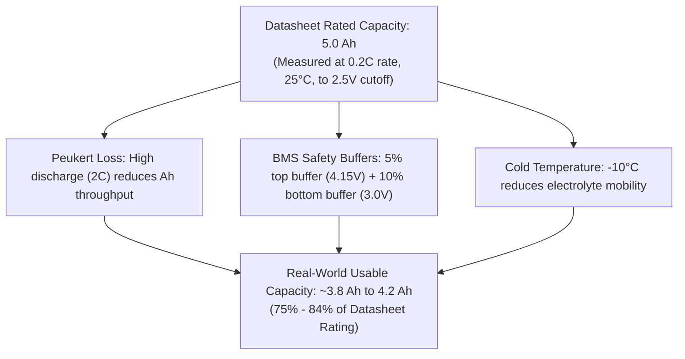
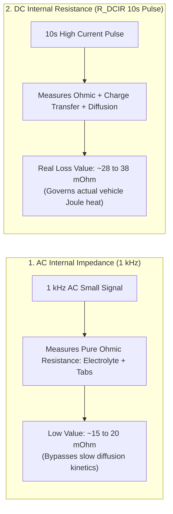
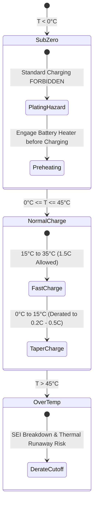

# Interpreting Battery Cell Specification Sheets and Datasheets

A technical specification sheet (datasheet) published by a Tier-1 cell manufacturer (e.g., CATL, LG Energy Solution, Panasonic, Samsung SDI) provides the standardized baseline data required to design modules, establish Battery Management System (BMS) safe operating areas (SOA), and simulate pack electro-thermal performance[^IEC62660]. However, extracting actionable parameters from datasheets requires understanding standard measurement protocols, temperature envelopes, and the physical distinctions between rated nominal ratings and extreme limits[^Andrea2020].

This chapter provides an exhaustive technical guide to interpreting lithium-ion cell datasheets: electrical capacity standards, C-rate ratings, AC vs. DC internal resistance, fast-charging temperature windows, and cycle life metrics under **IEC 62660-1**, **ISO 12405**, and **UN 38.3**[^ISO12405].

---

## 1. Anatomy of a Tier-1 Lithium-Ion Cell Datasheet

A standard automotive cell datasheet is structured into distinct electrical, thermal, mechanical, and safety domains:



### 1.1 Representative Benchmark: Tier-1 21700 NMC-811 Cell Datasheet

| Parameter Specification | Datasheet Value | Test Standard / Condition | Engineering Significance in BMS Design |
| :--- | :--- | :--- | :--- |
| **Nominal Voltage ($V_{\text{nom}}$)** | $3.65\,\text{V}$ | 0.2C discharge at $25^\circ\text{C}$ | Midpoint energy reference: $E_{\text{nom}} = V_{\text{nom}} \times C_{\text{rated}}$. |
| **Rated / Minimum Capacity ($C_{\text{rated}}$)**| $4{,}900\,\text{mAh}$ ($4.9\,\text{Ah}$)| IEC 61960 ($0.2\text{C}$, $2.50\,\text{V}$ cutoff at $25^\circ\text{C}$) | Guaranteed minimum capacity for pack sizing. |
| **Typical Capacity ($C_{\text{typ}}$)** | $5{,}000\,\text{mAh}$ ($5.0\,\text{Ah}$)| Mean across fresh manufacturing batch | Nominal manufacturing baseline. |
| **Upper Charge Cutoff ($V_{\text{max}}$)**| $4.20\,\text{V} \pm 0.03\,\text{V}$ | CC-CV charge ($0.5\text{C}$ to $4.20\text{V}$, $C/20$ taper)| ASIL-D Overvoltage Protection (OVP) threshold. |
| **Lower Discharge Cutoff ($V_{\text{min}}$)**| $2.50\,\text{V}$ (or $2.80\,\text{V}$ for longevity)| Discharge to specified end-of-discharge | ASIL-D Undervoltage Protection (UVP) threshold. |
| **Max Continuous Discharge Current**| $10.0\,\text{A}$ ($2.0\text{C}$) | Cell surface temp $\le 60^\circ\text{C}$ | Governs maximum continuous vehicle cruising speed. |
| **Peak Pulse Discharge Current** | $25.0\,\text{A}$ ($5.0\text{C}$) | Max 10 seconds duration | Dictates peak 0–100 km/h acceleration torque. |
| **Standard Charge Current** | $2.5\,\text{A}$ ($0.5\text{C}$) | CC-CV at $25^\circ\text{C}$, taper to $250\,\text{mA}$ | Nominal overnight AC charging profile. |
| **Maximum Fast Charge Current** | $5.0\,\text{A}$ ($1.0\text{C}$) to $7.5\,\text{A}$ ($1.5\text{C}$) | Restricted to $T \in [15^\circ\text{C}, 45^\circ\text{C}]$ | DC fast charging profile limit before derating. |
| **AC Internal Impedance ($1\,\text{kHz}$)**| $\le 20\,\text{m}\Omega$ | $1\,\text{kHz}$ AC excitation at $50\%$ SOC | Rapid QC end-of-line screening metric. |
| **DC Internal Resistance ($R_{\text{DCIR}}$)**| $\approx 25 - 35\,\text{m}\Omega$ | 10s discharge pulse at $25^\circ\text{C}$, $50\%$ SOC | True electro-thermal loss parameter for modeling. |
| **Cycle Life ($80\%$ SOH EOL)** | $\ge 1{,}000\,\text{cycles}$ | $1.0\text{C}$ charge / $1.0\text{C}$ discharge, $100\%$ DoD, $25^\circ\text{C}$| Baseline for Wöhler/Miner battery lifetime model. |
| **Weight** | $69.0\,\text{g} \pm 1.5\,\text{g}$ | Gravimetric mass | Pack gravimetric density determination. |

---

## 2. Rated Capacity vs. Usable Capacity Under Load

A critical trap in battery system engineering is confusing the datasheet **Rated Capacity ($C_{\text{rated}}$)** with the **Usable Pack Capacity** in an operating vehicle.



### 2.1 Standard Measurement Conditions (IEC 61960)
Datasheets specify capacity at very low C-rates:
- Rate: $0.2\text{C}$ (e.g., $1.0\,\text{A}$ for a $5.0\,\text{Ah}$ cell, taking 5 hours).
- Cutoff: Stretched down to $2.50\,\text{V}$.
- Temperature: Held precisely at $25.0^\circ\text{C} \pm 2^\circ\text{C}$.

In an electric vehicle:
1. Average discharge rates are higher ($0.8\text{C} - 2\text{C}$). The **Peukert Effect** and diffusion overpotential prematurely push the cell terminal voltage down to the cutoff threshold while active material remains unextracted[^Plett2015].
2. BMS safety buffers restrict cycling between $3.00\,\text{V}$ and $4.15\,\text{V}$ to prevent accelerated calendar aging, reducing usable capacity by $10 - 15\%$.

---

## 3. AC Impedance ($1\,\text{kHz}$) vs. DC Internal Resistance ($R_{\text{DCIR}}$)

Datasheets routinely quote two different internal resistance metrics:



### 3.1 The Physical Distinction
- **$1\,\text{kHz}$ AC Impedance ($R_{\text{AC}}$)**: Measured using an AC milliohm meter. Because $f = 1\,\text{kHz}$ ($\tau = 1\,\text{ms}$), the high-frequency double-layer capacitance acts as a dynamic short circuit ($Z_C = \frac{1}{j \omega C} \to 0$). It captures *only* the ohmic electrolyte, separator, and tab resistance.
- **DC Internal Resistance ($R_{\text{DCIR}}$)**: Governed by standard **IEC 62660-1** or **VDA test specifications**. A 10-second current pulse ($I_{\text{pulse}}$) is injected:

$$
R_{\text{DCIR}}(10\text{s}) = \frac{\left| V(t_0) - V(t_0 + 10\text{s}) \right|}{I_{\text{pulse}}}
$$

Because $10\,\text{s}$ has elapsed, charge-transfer resistance and solid-state diffusion overpotentials have fully developed:

$$
R_{\text{DCIR}} = R_0 + R_{\text{ct}}(1 - e^{-10/\tau_1}) + R_{\text{diff}}(1 - e^{-10/\tau_2}) \approx 1.5 - 2.0 \times R_{\text{AC}}
$$

> [!IMPORTANT]
> When designing battery pack cooling plates and calculating Joule heating ($\dot{Q} = I^2 R$), engineers **must use $R_{\text{DCIR}}$**, not the optimistic $1\,\text{kHz}$ AC impedance printed on the datasheet summary!

---

## 4. Temperature Operating Envelopes and Lithium Plating Risk

Datasheets define strict boundaries for charge, discharge, and storage:



### 4.1 The Low-Temperature Lithium Plating Boundary
While cells can discharge safely down to $-20^\circ\text{C}$ (with elevated internal resistance), **charging at sub-zero temperatures ($T < 0^\circ\text{C}$) is strictly prohibited or severely derated**:
- At low temperatures, the solid-state diffusion coefficient of lithium in graphite ($D_s$) plummets by orders of magnitude according to Arrhenius kinetics.
- When charge current is applied, intercalating $\text{Li}^+$ ions cannot penetrate the graphite lattice fast enough. The anode overpotential drops below $0\,\text{V}$ vs. $\text{Li}/\text{Li}^+$:

$$
\Phi_{\text{anode}} = \Phi_{\text{eq}} - \eta_{\text{charge}} < 0\,\text{V} \implies \text{Metallic Lithium Plates onto Anode Surface}
$$

Metallic lithium dendrites pierce the microporous separator, inducing catastrophic internal micro-shorts and thermal runaway. Consequently, the BMS must enforce strict charge derating tables derived from the manufacturer's low-temperature specifications[^Andrea2020].

---

## 5. Software Modeling via Python `battery_toolkit`

To instantiate cell parameters directly from datasheets into simulation environments, developers can use the `BatteryCell` class from `battery_toolkit`:

```python
from battery_toolkit.core.cell import BatteryCell, CellChemistry

# Instantiate cell object directly from Tier-1 Datasheet specifications
cell = BatteryCell(
    name="Panasonic NCR21700A",
    chemistry=CellChemistry.NCA,
    nominal_voltage=3.65,
    capacity_ah=4.90,            # Rated minimum capacity
    v_max=4.20,
    v_min=2.50,
    r0_mohm=26.0,                # 10s DCIR at 25°C
    mass_g=68.5,
    diameter_mm=21.1,
    length_mm=70.4,
    c_rate_continuous=2.0,       # 9.8 A continuous
    c_rate_peak=4.0,             # 19.6 A 10s peak
)

print(f"Energy: {cell.nominal_energy_wh:.2f} Wh")
print(f"Gravimetric Density: {cell.gravimetric_energy_density_wh_per_kg:.1f} Wh/kg")
print(f"Volumetric Density: {cell.volumetric_energy_density_wh_per_l:.1f} Wh/L")
```

For complete source implementation, see [codes/python/src/battery_toolkit/core/cell.py](file:///Users/cc/Desktop/Battery-Systems-Technology/codes/python/src/battery_toolkit/core/cell.py).

---

## 6. References

[^IEC62660]: International Electrotechnical Commission, "Secondary lithium-ion cells for the propulsion of electric road vehicles - Part 1: Performance testing," *IEC Standard 62660-1:2018*, 2018.
[^Andrea2020]: D. Andrea, *Battery Management Systems for Large Lithium-Ion Battery Packs*, Artech House, 2020.
[^ISO12405]: International Organization for Standardization, "Electrically propelled road vehicles - Test specification for lithium-ion traction battery packs and systems," *ISO Standard 12405-4:2018*, 2018.
[^Plett2015]: G. L. Plett, *Battery Management Systems, Volume I: Battery Modeling*, Artech House, 2015.
