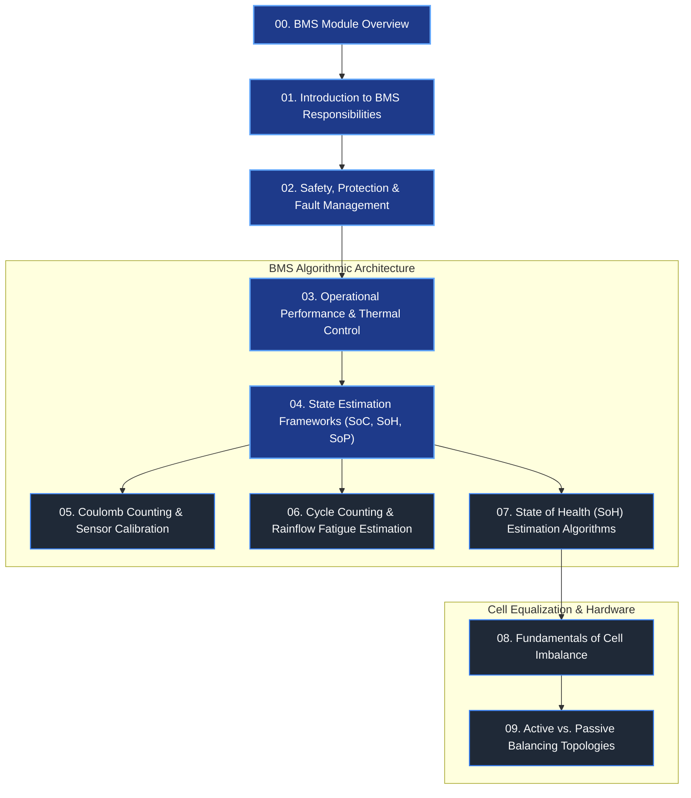

# Battery Management Systems (BMS): Module Overview

A **Battery Management System (BMS)** is the electronic brain, safety custodian, and algorithmic control center of modern high-voltage electrochemical energy storage systems[^plett2015a][^andrea2010]. In battery electric vehicles (BEVs), hybrid powertrains, stationary energy storage systems (BESS), and aerospace applications, the BMS coordinates thousands of individual cells, orchestrating real-time data acquisition, state estimation, active protection, cell equalization, and vehicle-level communication[^bergveld2002][^scrosati2010].

This module covers the operational principles, algorithmic architectures, and safety mechanisms that define modern automotive and industrial BMS engineering.

---

## Curriculum Roadmap

The chapters in this module are organized sequentially from fundamental monitoring principles to advanced algorithmic modeling and hardware balancing topologies:

---

## Chapter Directory

| Chapter | Core Engineering Focus | Key Methodologies & Formulations |
| :--- | :--- | :--- |
| **[01. Introduction to BMS](01_introduction_bms.md)** | System Boundary & Sensing | Multi-layer monitoring: cell voltage acquisition ($\Delta\Sigma$-ADCs), shunt and Hall-effect current sensing, temperature matrix distribution, and signal conditioning. |
| **[02. Safety & Protection](02_function_bms.md)** | Hazard Prevention & Interlocks | Safe Operating Area (SOA) enforcement, overvoltage/undervoltage limits, overcurrent thresholds, high-voltage interlock loops (HVIL), and ISO 6469-1 insulation monitoring ($R_{\text{iso}} \ge 500\,\Omega/\text{V}$). |
| **[03. Detailed Functions](03_detailed_functions.md)** | Dynamic Thermal & Charge Control | Multi-stage CC-CV charging curves, temperature-dependent current derating maps, contactor sequencing (Precharge, Main+, Main-), and cooling loop modulation. |
| **[04. BMS Algorithms](04_bms_algorithms.md)** | State Estimation Frameworks | Comparative survey: Coulomb counting, OCV lookup, Extended Kalman Filters (EKF), Unscented Kalman Filters (UKF), and State of Power (SoP) dynamic limits. |
| **[05. Coulomb Counting & Initial SoC](05_initial_bms.md)** | Deterministic Integration | Discrete Coulomb integration, current sensor bias error propagation, thermodynamic OCV relaxation lookup, and drift compensation algorithms. |
| **[06. Cycle Counting](06_cycle_counting.md)** | Mechanical & Thermal Fatigue | ASTM E1049 Rainflow cycle decomposition, half-cycle vs. full-cycle extraction, Palmgren-Miner linear damage summation, and DoD-dependent capacity fade. |
| **[07. SoH Algorithm](07_soh_algorithm.md)** | Degradation Tracking | Dual-metric health estimation: capacity fade ($\text{SoH}_C$) via recursive least squares (RLS) and internal resistance growth ($\text{SoH}_R$) with EOL criteria. |
| **[08. Cell Balancing](08_cell_balancing.md)** | Physics of Imbalance | Statistical causes of divergence (production tolerances, thermal gradients across packs), capacity truncation, and the economics of pack equalization. |
| **[09. Balancing Methods](09_cell_balancing_methods.md)** | Hardware Topologies | Quantitative comparison of passive switched-resistor shunts vs. active inductive/capacitive bidirectional DC-DC charge transfer architectures. |

---

## Governing Automotive Standards

All algorithms, isolation criteria, and functional safety mechanisms presented across this module comply with primary automotive regulatory frameworks:

- **ISO 26262:** *Road vehicles – Functional safety* (ASIL-C/D hazard mitigation for overvoltage and overtemperature)[^iso26262].
- **ISO 6469-1 / -3:** *Electrically propelled road vehicles – Safety specifications: Rechargeable energy storage system (RESS) and electrical safety*[^iso6469].
- **IEC 62619:** *Safety requirements for secondary lithium cells and batteries for industrial applications*[^iec62619].
- **UN ECE R100:** *Uniform provisions concerning the approval of vehicles with regard to specific requirements for the electric power train*[^ece100].

---

## References

[^plett2015a]: Plett, G. L. (2015). *Battery Management Systems, Volume I: Battery Modeling*. Artech House, Norwood, MA. ISBN: 978-1-63081-023-8.
[^andrea2010]: Andrea, D. (2010). *Battery Management Systems for Large Lithium-Ion Battery Packs*. Artech House, Norwood, MA. ISBN: 978-1-60807-104-3.
[^bergveld2002]: Bergveld, H. J., Kruijt, W. S., & Notten, P. H. (2002). *Battery Management Systems: Design by Modelling*. Philips Research Book Series, Vol. 1. Springer, Dordrecht. DOI: [10.1007/978-94-017-0843-2](https://doi.org/10.1007/978-94-017-0843-2)
[^scrosati2010]: Scrosati, B., & Garche, J. (2010). *Lithium batteries: Status, prospects and future*. Journal of Power Sources, 195(9), 2419–2430. DOI: [10.1016/j.jpowsour.2009.11.048](https://doi.org/10.1016/j.jpowsour.2009.11.048)
[^iso26262]: International Organization for Standardization. (2018). *ISO 26262:2018 Road vehicles — Functional safety*. Geneva, Switzerland.
[^iso6469]: International Organization for Standardization. (2019). *ISO 6469-1: Electrically propelled road vehicles — Safety specifications*. Geneva, Switzerland.
[^iec62619]: International Electrotechnical Commission. (2022). *IEC 62619:2022 Secondary cells and batteries containing alkaline or other non-acid electrolytes*. Geneva, Switzerland.
[^ece100]: United Nations Economic Commission for Europe. (2021). *Regulation No. 100: Electric power trained vehicles*. Geneva, Switzerland.
