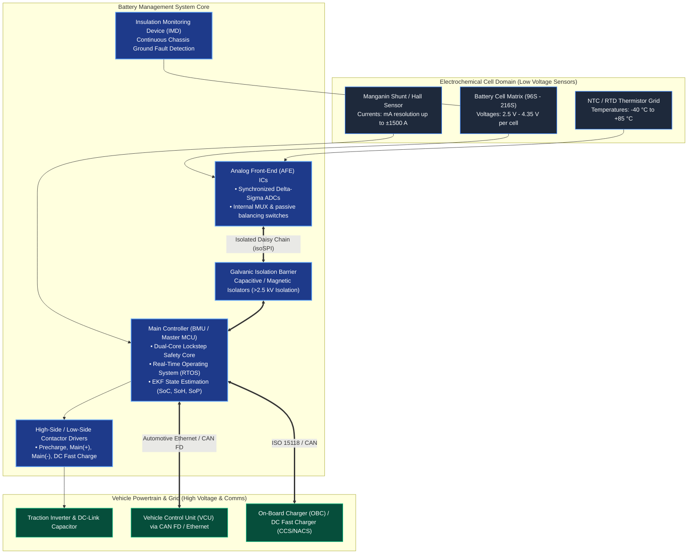
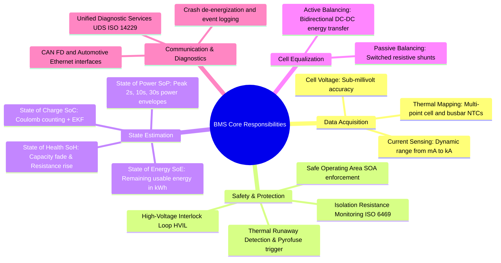
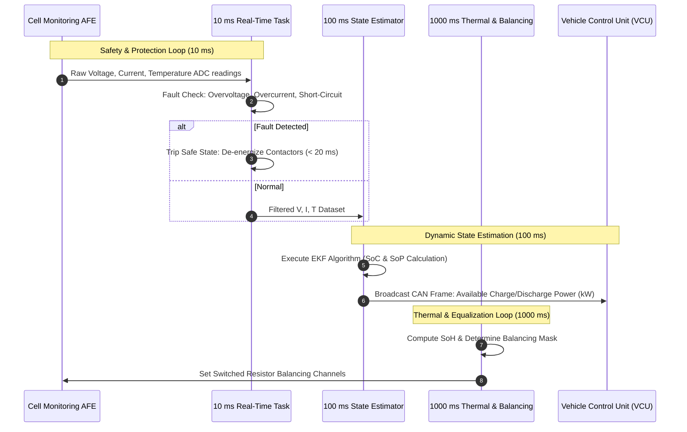

# Introduction to Battery Management Systems (BMS)

A **Battery Management System (BMS)** is the specialized electronic and computational architecture responsible for operating, monitoring, and protecting electrochemical energy storage packs[^plett2015a][^andrea2010]. Because lithium-ion cells operate with volatile organic carbonate electrolytes and exhibit narrow electrochemical and thermal safety envelopes, an unregulated battery pack presents severe risks of premature cell death, energetic thermal runaway, and lethal electrical hazards[^scrosati2010][^dahn2011].

The BMS sits at the boundary between raw electrochemistry and system-level applications, translating noisy cell-level analog voltages, currents, and temperatures into deterministic states, safety interlocks, and propulsion commands[^bergveld2002].

---

## 1. System Boundary and High-Voltage Environment

In an electric vehicle (EV) or stationary grid storage system (BESS), the BMS operates across a severe electrical and environmental interface:

---

## 2. Core Functional Pillars of a Modern BMS

A production-grade automotive BMS executes five interconnected operational domains in real time[^plett2015a][^andrea2010][^bergveld2002]:

---

## 3. High-Precision Sensing Requirements

The accuracy of all downstream BMS algorithms (SoC, SoH, SoP) is strictly bounded by sensor hardware fidelity[^plett2015a]:

### A. Cell Voltage Acquisition
Lithium-ion cells have very flat open-circuit voltage plateaus, particularly **Lithium Iron Phosphate ($\text{LFP}$)**, where a $1\,\text{mV}$ measurement error translates to an $\text{SoC}$ estimation error greater than $5\%$ between $30\%$ and $70\%\,\text{SoC}$[^schmalstieg2014]:
- **Analog Front-End (AFE):** Multi-channel (12-ch to 24-ch) dedicated battery ICs (e.g., ADI ADBMS6815, TI BQ79616, NXP MC33771C).
- **Measurement Precision:** Measurement accuracy better than $\pm 1.5\,\text{mV}$ across the entire temperature range ($-40^\circ\text{C}$ to $+105^\circ\text{C}$) using synchronized delta-sigma ($\Delta\Sigma$) analog-to-digital converters.
- **Low-Pass Filtering:** On-chip digital averaging filters reject high-frequency switching noise induced by inverter pulse-width modulation (PWM, typically $8 - 20\,\text{kHz}$).

### B. Current Measurement: Shunts vs. Hall Sensors
Pack current measurement must resolve currents across a dynamic range of **six orders of magnitude**: from quiescent sleep currents ($\approx 100\,\mu\text{A}$) up to peak acceleration and regenerative braking bursts ($\pm 1200\,\text{A}$)[^andrea2010]:

| Technology | Operating Principle | Measurement Accuracy | Advantages | Limitations |
| :--- | :--- | :--- | :--- | :--- |
| **Manganin Shunt** | Ohmic voltage drop ($V = I \cdot R_{\text{shunt}}$) across calibrated low-TCR alloy ($25 - 100\,\mu\Omega$). | High ($<0.1\%$) | Zero magnetic hysteresis; excellent for Coulomb counting integration. | Lacks galvanic isolation; dissipated power ($I^2 R$) at high current requires thermal management. |
| **Open-Loop Hall Effect** | Magnetic flux detection via Hall element in gapped ferromagnetic core. | Moderate ($1 - 2\%$) | Inherent galvanic isolation; zero power insertion loss. | Subject to magnetic core saturation, temperature drift, and residual offset. |
| **Closed-Loop (Fluxgate) Transducer** | Active zero-flux compensation with secondary feedback winding. | Very High ($<0.2\%$) | True galvanic isolation; negligible offset drift; broad bandwidth ($>100\,\text{kHz}$). | Higher cost, larger physical packaging volume, higher idle power consumption. |

> [!NOTE]
> Automotive safety architectures (ASIL-C/D) frequently mandate **redundant dual sensing**: a primary precision Manganin shunt paired with a secondary galvanically isolated fluxgate sensor to cross-check current readings and detect sensor drift[^iso26262].

### C. Temperature Matrix Distribution
Thermal gradients within a large battery pack accelerate cell imbalance and localized aging. NTC thermistors are deployed across:
1. Negative and positive cell terminal tabs (highest Ohmic heating locations).
2. Coolant inlet and outlet manifolds.
3. Central cells in dense modules (thermal core hot spots).

---

## 4. Hardware Realization & Real-Time Constraints

Automotive BMS electronic control units operate on **AUTOSAR**-compliant real-time operating systems (RTOS) executing deterministic task cycles[^andrea2010][^bergveld2002]:

---

## References

[^plett2015a]: Plett, G. L. (2015). *Battery Management Systems, Volume I: Battery Modeling*. Artech House, Norwood, MA. ISBN: 978-1-63081-023-8.
[^andrea2010]: Andrea, D. (2010). *Battery Management Systems for Large Lithium-Ion Battery Packs*. Artech House, Norwood, MA. ISBN: 978-1-60807-104-3.
[^scrosati2010]: Scrosati, B., & Garche, J. (2010). *Lithium batteries: Status, prospects and future*. Journal of Power Sources, 195(9), 2419–2430. DOI: [10.1016/j.jpowsour.2009.11.048](https://doi.org/10.1016/j.jpowsour.2009.11.048)
[^dahn2011]: Dahn, J. R., et al. (2011). *High-precision coulometry for predicting battery cycle life*. Journal of The Electrochemical Society, 158(3), A302. DOI: [10.1149/1.3533417](https://doi.org/10.1149/1.3533417)
[^bergveld2002]: Bergveld, H. J., Kruijt, W. S., & Notten, P. H. (2002). *Battery Management Systems: Design by Modelling*. Philips Research Book Series, Vol. 1. Springer, Dordrecht. DOI: [10.1007/978-94-017-0843-2](https://doi.org/10.1007/978-94-017-0843-2)
[^schmalstieg2014]: Schmalstieg, J., et al. (2014). *A holistic aging model for Li(NiMnCo)O2 based 18650 lithium-ion cells*. Journal of Power Sources, 257, 325–334. DOI: [10.1016/j.jpowsour.2014.02.012](https://doi.org/10.1016/j.jpowsour.2014.02.012)
[^iso26262]: International Organization for Standardization. (2018). *ISO 26262:2018 Road vehicles — Functional safety*. Geneva, Switzerland.
