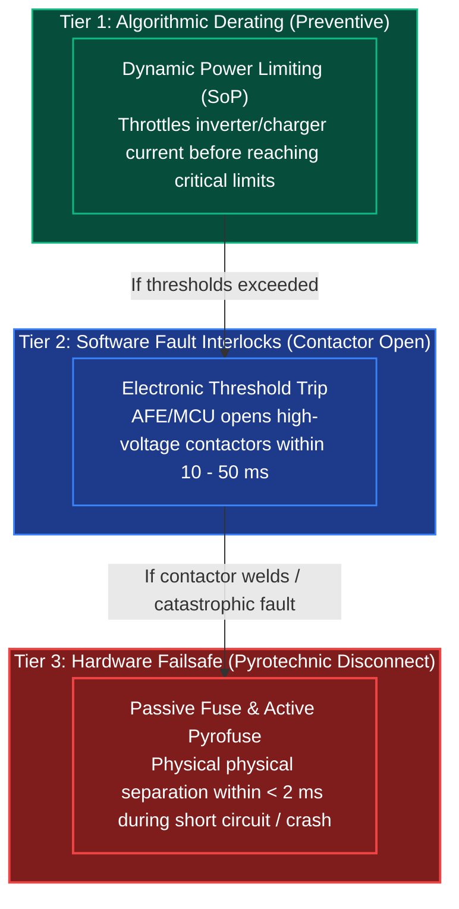
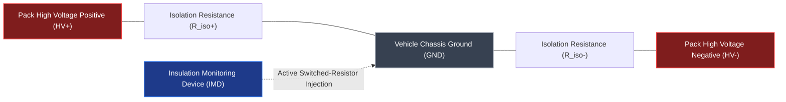
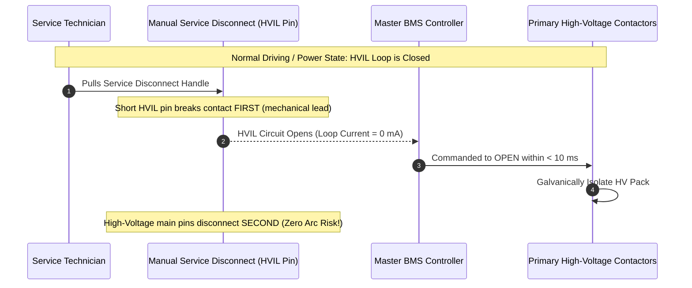
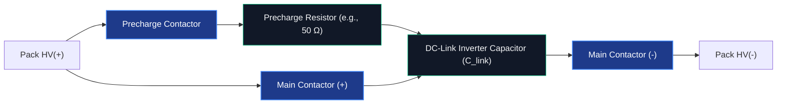

# Safety, Protection & Fault Management in BMS

Safety is the absolute foremost requirement of any Battery Management System (BMS)[^andrea2010][^plett2015a]. High-voltage traction battery packs in modern electric vehicles store hundreds of megajoules of chemical energy and operate at voltages between $400\,\text{V}$ and $900\,\text{V}$ DC[^iso6469]. Failure to detect abnormal operating conditions within milliseconds can result in lethal electric shock, explosive cell venting, or uncontrollable thermal runaway propagation[^wang2012][^scrosati2010].

Automotive functional safety standard **ISO 26262** mandates that battery protection mechanisms achieve safety integrity levels up to **ASIL D**—the most stringent category reserved for safety-critical automotive systems[^iso26262].

---

## 1. Multi-Tier Protection Hierarchy

Modern automotive safety architectures implement a **three-tier defense-in-depth protection model**[^andrea2010][^iso26262]:

---

## 2. Electrical Threshold Monitoring (Voltage, Current, Temp)

To prevent false trips while ensuring absolute safety, the BMS utilizes **multi-stage thresholds** with programmable debounce timers[^andrea2010][^plett2015a]:

### Safety Threshold Table (NMC Chemistry Example)

| Parameter | Normal Range | Warning (Derate) | Fault (Contactor Open) | Hardware Trip (AFE) | Fault Reaction Time |
| :--- | :--- | :--- | :--- | :--- | :--- |
| **Cell Overvoltage (OVP)** | $3.0 - 4.18\,\text{V}$ | $4.18\,\text{V}$ | $4.22\,\text{V}$ | $4.28\,\text{V}$ | $< 20\,\text{ms}$ |
| **Cell Undervoltage (UVP)** | $3.0 - 4.18\,\text{V}$ | $2.90\,\text{V}$ | $2.60\,\text{V}$ | $2.40\,\text{V}$ | $< 50\,\text{ms}$ |
| **Charge Overcurrent (OCP)** | $\le 200\,\text{A}$ | $220\,\text{A}$ | $250\,\text{A}$ | $300\,\text{A}$ | $< 10\,\text{ms}$ |
| **Discharge Overcurrent** | $\le 600\,\text{A}$ | $650\,\text{A}$ | $750\,\text{A}$ | $900\,\text{A}$ | $< 5\,\text{ms}$ |
| **Overtemperature (OT)** | $15 - 45^\circ\text{C}$ | $50^\circ\text{C}$ | $55^\circ\text{C}$ | $60^\circ\text{C}$ | $< 500\,\text{ms}$ |
| **Undertemperature Charge**| $0 - 45^\circ\text{C}$ | $5^\circ\text{C}$ | $0^\circ\text{C}$ | $-5^\circ\text{C}$ | $< 100\,\text{ms}$ |

---

## 3. High-Voltage Isolation Monitoring (ISO 6469-1)

Because traction batteries operate at dangerous voltages isolated from the vehicle metallic chassis, a breakdown in cable insulation presents an electrocution hazard[^iso6469]:

### Governing Standard: ISO 6469-1 / UN ECE R100
International safety regulations mandate a minimum electrical isolation resistance ($R_{\text{iso}}$):

$$
R_{\text{iso}} \ge 500\,\frac{\Omega}{\text{V}_{\text{nominal}}} \quad (\text{for DC systems})
$$

- For a **$400\,\text{V}$ nominal pack**, $R_{\text{iso}}$ must exceed **$200\,\text{k}\Omega$**.
- For an **$800\,\text{V}$ nominal pack**, $R_{\text{iso}}$ must exceed **$400\,\text{k}\Omega$**.
- If $R_{\text{iso}}$ drops below $100\,\Omega/\text{V}$ (critical isolation fault), the BMS alerts the driver and locks out contactor engagement upon vehicle power-down.

---

## 4. High-Voltage Interlock Loop (HVIL)

The **High-Voltage Interlock Loop (HVIL)** is a dedicated low-voltage, low-current hardware loop that passes in series through every removable high-voltage connector, module cover, manual service disconnect (MSD), and inverter cable[^andrea2010]:

By ensuring that the low-voltage HVIL pin disconnects **before** the high-voltage power pins disengage, the BMS de-energizes the contactors under zero-current conditions, preventing explosive electric arc flash and contactor destruction[^andrea2010].

---

## 5. Contactor Sequencing & Weld Detection

Automotive battery packs incorporate three primary electromechanical contactors and a precharge circuit[^plett2015a]:

### Contactor Weld Detection Protocol
If high current causes a contactor's copper-silver contacts to physically weld together, the pack cannot be de-energized in an emergency. The BMS executes automated weld detection before every startup and after every shutdown:
1. With $\text{Main}(+)$ and $\text{Main}(-)$ commanded open, the BMS measures voltage across the inverter DC-link terminals ($V_{\text{link}}$).
2. If $V_{\text{link}} \approx V_{\text{pack}}$, one or both contactors are welded.
3. The BMS closes $\text{Main}(-)$ independently; if $V_{\text{link}}$ jumps, $\text{Main}(+)$ is welded.
4. The system flags an irreversible diagnostic trouble code (DTC) and disables vehicle startup per **ISO 26262 ASIL D**[^iso26262].

---

## 6. Pyrotechnic Disconnect Switches (Pyrofuse)

In high-speed collisions or dead short-circuits (where current exceeds $2000\,\text{A}$ within micro-seconds), electromechanical contactors cannot open quickly enough and risk contactor arcing. 

The BMS interfaces with the vehicle crash sensing unit (airbag controller). Upon detecting a collision exceeding deceleration thresholds ($>5g$), an active pyrofuse detonates a small chemical propellant charge, physically driving an insulated solid knife blade through a busbar within **$< 1.5\,\text{ms}$**, completely severing the high-voltage circuit[^iso26262].

---

## References

[^andrea2010]: Andrea, D. (2010). *Battery Management Systems for Large Lithium-Ion Battery Packs*. Artech House, Norwood, MA. ISBN: 978-1-60807-104-3.
[^plett2015a]: Plett, G. L. (2015). *Battery Management Systems, Volume I: Battery Modeling*. Artech House, Norwood, MA. ISBN: 978-1-63081-023-8.
[^iso6469]: International Organization for Standardization. (2019). *ISO 6469-1: Electrically propelled road vehicles — Safety specifications*. Geneva, Switzerland.
[^wang2012]: Wang, Q., et al. (2012). *Thermal runaway caused fire and explosion of lithium ion batteries*. Journal of Power Sources, 208, 210–224. DOI: [10.1016/j.jpowsour.2012.02.038](https://doi.org/10.1016/j.jpowsour.2012.02.038)
[^scrosati2010]: Scrosati, B., & Garche, J. (2010). *Lithium batteries: Status, prospects and future*. Journal of Power Sources, 195(9), 2419–2430. DOI: [10.1016/j.jpowsour.2009.11.048](https://doi.org/10.1016/j.jpowsour.2009.11.048)
[^iso26262]: International Organization for Standardization. (2018). *ISO 26262:2018 Road vehicles — Functional safety*. Geneva, Switzerland.
