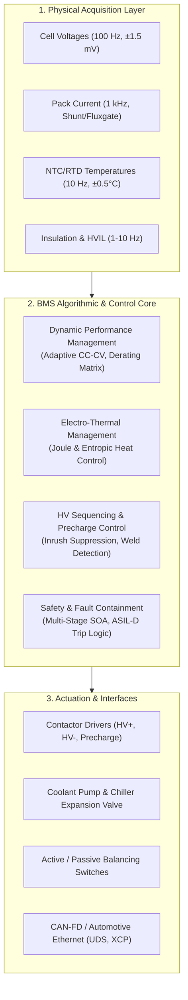
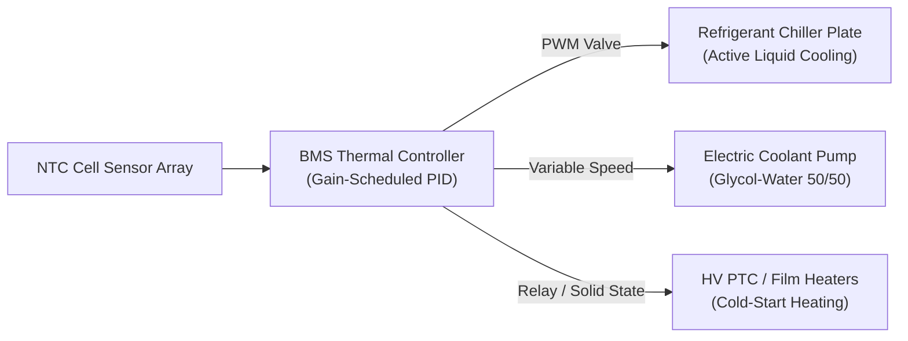
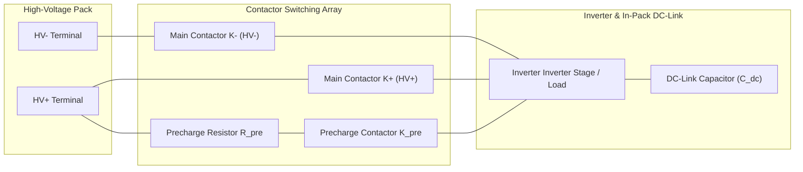
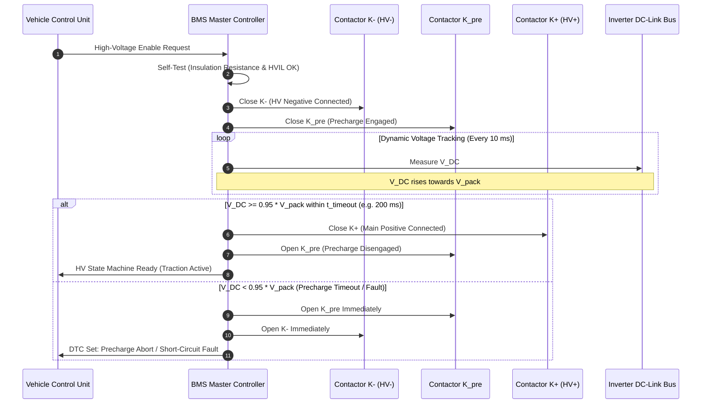

# Detailed BMS Functions & Operational Control

The Battery Management System (BMS) operates as the deterministic control authority of a modern high-voltage energy storage system. While high-level classifications divide BMS tasks into sensing, state estimation, and protection, real-world automotive and industrial applications demand deterministic real-time execution across dynamic performance management, electro-thermal regulation, high-voltage sequencing, and multi-network communication interfaces[^andrea2020][^plett2015].

This chapter provides a rigorous examination of the operational functions implemented within production BMS firmware, detailing the physics, mathematical derivations, circuit dynamics, and software logic governing energy storage operation under ISO 26262 and IEC 62619 standards.

---

## Functional Architecture Overview

Modern BMS functional architectures operate across five distinct control domains, executed deterministically within an AUTOSAR Classic or POSIX-compliant Real-Time Operating System (RTOS)[^autosar2021]:



---

## Dynamic Performance Management

Dynamic performance management ensures that battery output and charge throughput are maximized without violating the electrochemical stability window of the lithium-ion cells[^lu2013].

### Adaptive CC-CV Charge Control & Lithium Plating Prevention

Traditional charging uses constant-current constant-voltage (CC-CV) profiles based on fixed voltage cut-offs. However, fixed charging rates at low temperatures or high states of charge induce lithium plating—the metallic reduction of $\text{Li}^+$ ions on the graphite negative electrode surface rather than intercalation[^ecker2014]:

$$
\text{Li}^+ + e^- \longrightarrow \text{Li}^0_{(s)} \quad \text{when } \eta_{\text{anode}} < 0\,\text{V vs. Li/Li}^+
$$

Where the anode local overpotential $\eta_{\text{anode}}$ is defined by the solid-state potential $\Phi_s$, the electrolyte potential $\Phi_e$, and the thermodynamic equilibrium open-circuit potential $U_{\text{eq}}$:

$$
\eta_{\text{anode}} = \Phi_s - \Phi_e - U_{\text{eq}}(\text{SoC})
$$

To prevent $\eta_{\text{anode}} < 0\,\text{V}$, the BMS implements **temperature- and SoC-dependent derating maps** that dynamically throttle the maximum permissible continuous charge current $I_{\text{chg,max}}(T, \text{SoC})$:

$$
I_{\text{chg,max}}(T, \text{SoC}) = \min \left( I_{\text{spec,max}}, \; f_T(T) \cdot f_{\text{SoC}}(\text{SoC}) \cdot I_{\text{nom}} \right)
$$

| Cell Temperature ($T$) | Permissible Charge Current ($C$-Rate) | Dominant Physical Limiting Factor |
| :--- | :--- | :--- |
| $T < -10^\circ\text{C}$ | $0.00\,C$ (Charging Disabled) | Severe lithium plating, immediate dendrite short-circuit risk[^waldmann2014] |
| $-10^\circ\text{C} \le T < 0^\circ\text{C}$ | $0.05\,C - 0.10\,C$ (Pre-heating active) | Mass-transport overpotential in solid electrolyte interface (SEI) |
| $0^\circ\text{C} \le T < 15^\circ\text{C}$ | $0.20\,C - 0.50\,C$ | Reduced solid-state diffusion coefficient $D_s(T) = D_0 \exp\left(-\frac{E_a}{RT}\right)$ |
| $15^\circ\text{C} \le T \le 45^\circ\text{C}$ | $1.00\,C - 3.00\,C$ (Fast charging window) | Thermal heat rejection capacity of the chiller/cooling loop |
| $T > 45^\circ\text{C}$ | Linear derating to $0.00\,C$ at $60^\circ\text{C}$ | Cathode transition-metal dissolution and SEI decomposition risk |

---

## Electro-Thermal Management Systems (TMS)

The BMS thermal regulation module maintains the cell junction temperatures within the optimal window ($20^\circ\text{C} \le T_{\text{cell}} \le 35^\circ\text{C}$) while keeping inter-cell temperature gradients $\Delta T_{\text{pack}} \le 3^\circ\text{C}$[^pesaran2002].

### Heat Generation Physics

The instantaneous heat generation rate $\dot{Q}$ inside a lithium-ion cell comprises irreversible Joule heating and reversible entropic (reaction) heating, formalized by Bernardi's equation[^bernardi1985]:

$$
\dot{Q} = I \left( V_{\text{term}} - U_{\text{ocv}} \right) + I \cdot T_{\text{cell}} \frac{\partial U_{\text{ocv}}}{\partial T} = I^2 R_{\text{int}}(T, \text{SoC}) + I \cdot T_{\text{cell}} \frac{\partial U_{\text{ocv}}}{\partial T}
$$

Where:
- $I^2 R_{\text{int}}$ represents irreversible ohmic and polarization dissipation ($\text{W}$).
- $I \cdot T_{\text{cell}} \frac{\partial U_{\text{ocv}}}{\partial T}$ represents reversible entropic heat flux ($\text{W}$).
- $\frac{\partial U_{\text{ocv}}}{\partial T}$ is the entropic temperature coefficient ($\text{V/K}$), which fluctuates between positive (endothermic) and negative (exothermic) values depending on the crystallographic phase transitions in the intercalation host.

### Thermal Control Architectures

The BMS regulates cooling and heating actuators via closed-loop feedback:



1. **Passive Cooling:** Natural convection across module aluminum enclosures; applicable only in low-power stationary systems ($C$-rates $\le 0.2\,C$).
2. **Active Indirect Liquid Cooling:** Dielectric ethylene glycol-water (50/50) circulated through extruded aluminum cooling ribbons or bottom cold plates; dominant in modern high-performance EVs.
3. **Direct Immersion Cooling:** Non-conductive dielectric synthetic fluids (e.g., fluorinated hydrocarbons or synthetic esters) bathing the cell terminals directly, eliminating thermal contact resistance and reducing cell-to-coolant temperature deltas by $>70\%$[^karimi2013].

---

## High-Voltage Sequencing & Precharge Dynamics

To prevent catastrophic contactor contact welding caused by massive capacitive inrush currents during pack connection to an uncharged DC-link inverter bus, a dedicated precharge circuit is mandatory[^gautam2021].

### Precharge Circuit Analysis



When connecting a high-voltage pack ($V_{\text{pack}}$) to an uncharged DC bus with capacitance $C_{\text{dc}}$, direct closure of the main contactors would produce an instantaneous short-circuit inrush current limited solely by contact resistance ($R_{\text{parasitic}} \approx 20\,\text{m}\Omega$):

$$
I_{\text{inrush,peak}} = \frac{V_{\text{pack}}}{R_{\text{parasitic}}} = \frac{400\,\text{V}}{0.02\,\Omega} = 20{,}000\,\text{A}
$$

Such current creates severe electrical arcing, vaporizing contact surfaces and permanently welding the contacts shut. 

The BMS resolves this by executing a sequential precharge cycle via $R_{\text{pre}}$ and $K_{\text{pre}}$:

$$
V_{C}(t) = V_{\text{pack}} \left( 1 - e^{-\frac{t}{\tau_{\text{pre}}}} \right), \quad \tau_{\text{pre}} = R_{\text{pre}} C_{\text{dc}}
$$

The instantaneous inrush current flowing through $R_{\text{pre}}$ decays exponentially:

$$
I_{\text{pre}}(t) = \frac{V_{\text{pack}}}{R_{\text{pre}}} e^{-\frac{t}{\tau_{\text{pre}}}}
$$

The total thermal energy dissipated inside the precharge resistor during the cycle is entirely independent of the resistor value, depending solely on the DC capacitance and pack voltage:

$$
E_{R_{\text{pre}}} = \int_0^\infty I_{\text{pre}}^2(t) R_{\text{pre}} \, dt = \frac{1}{2} C_{\text{dc}} V_{\text{pack}}^2
$$

> [!IMPORTANT]
> The precharge resistor must possess a high pulse-energy rating ($E_{\text{pulse}} \ge 1.5 \cdot E_{R_{\text{pre}}}$) to withstand repeated abortive precharge cycles without thermal rupture.

### Contactor State-Machine Sequence

The BMS firmware executes precharge under strict timeout constraints:



---

## Contactor Weld Detection Diagnostics

Under ISO 26262 ASIL-D safety requirements, the BMS must verify that mechanical contactor contacts have not welded closed before enabling precharge and immediately after shutdown[^brand2013].

Weld detection uses differential voltage measurement across contactor terminals:

```
        HV+ Pack Term. o----[  K+  ]----o----[ Load / Inverter + ]
                            |      |
                         V_bat+   V_link+
```

1. **Pre-Drive Weld Check:**
   - Both $K^+$ and $K^-$ commanded **OPEN**.
   - With load disconnected, $V_{\text{link}}$ should decay toward $0\,\text{V}$ through internal bleeder resistors.
   - If $V_{\text{link}+} - V_{\text{link}-} \approx V_{\text{pack}}$, at least one contactor is welded.
   - The BMS selectively pulls one terminal to chassis reference via high-impedance sense dividers to isolate whether $K^+$ or $K^-$ is stuck closed.
2. **Post-Shutdown Weld Check:**
   - Command $K^+$ open while keeping $K^-$ closed for $50\,\text{ms}$.
   - If $V_{\text{link}}$ remains at $V_{\text{pack}}$, contactor $K^+$ has failed in a welded state.

---

## Interface Management & Vehicle Networking

The BMS acts as the central communication gateway between internal cell-monitoring satellites and vehicle control architectures:

### Protocol Hierarchy

| Protocol | Typical Baud Rate | Physical Layer | Primary Payload |
| :--- | :--- | :--- | :--- |
| **isoSPI / Daisy-Chain** | $1.0 - 2.0\,\text{Mbps}$ | Twisted pair with pulse transformer / capacitor isolation | Raw cell voltages, local temperatures, AFE register diagnostics |
| **CAN-FD** | $500\,\text{kbps}$ (Nom.) / $2.0-5.0\,\text{Mbps}$ (Data) | ISO 11898-2 differential pair | Dynamic limits ($P_{\text{chg,max}}, P_{\text{dis,max}}$), SoC, SoH, contactor status |
| **Automotive Ethernet** | $100\,\text{BASE-T1}$ / $1000\,\text{BASE-T1}$ | Single balanced twisted pair (BroadR-Reach) | SOME/IP telemetry, high-throughput cloud edge streaming, ECU reflashing |
| **UDS (ISO 14229)** | Over CAN / DoIP | Automotive Diagnostic Standard | Diagnostic Trouble Codes (DTCs), freeze frames, routine controls (e.g. manual contactor test) |

### Universal Diagnostic Service (UDS) Integration

The BMS firmware hosts an ISO 14229-1 server responding to diagnostic clients:
- **Service `0x19` (ReadDTCInformation):** Surfaces safety events (e.g., `DTC P0A80` - Hybrid Battery Pack Degradation).
- **Service `0x22` (ReadDataByIdentifier):** Exposes real-time pack parameters via DID identifiers (e.g., `0x1000` = Pack Voltage, `0x1001` = Minimum Cell Voltage, `0x1002` = Max Cell Temperature).
- **Service `0x27` (SecurityAccess):** Authenticates calibration engineers before enabling contactor override or flash-memory erasing.

---

## High-Voltage Sequencer & Contactor Management

The contactor sequencing, weld detection, and precharge state automaton are implemented in [`battery_toolkit.bms.state_machine`](file:///Users/cc/Desktop/Battery-Systems-Technology/codes/python/src/battery_toolkit/bms/state_machine.py). The sequencer guarantees arc-free contact closure and aborts on DC link precharge timeout:

```python
from battery_toolkit.bms import BMSStateMachine, BMSState

# Initialize contactor sequencer with 350 ms safety timeout
sm = BMSStateMachine(precharge_timeout_s=0.350)

# 1. Standby -> Precharge command: K- closes, K_pre closes, K+ remains open
sm.process_event(v_pack=400.0, v_link=0.0, i_pack=0.0, max_cell_temp=25.0, hvil_closed=True, drive_requested=True)
assert sm.state == BMSState.PRECHARGE and sm.k_minus and sm.k_pre and not sm.k_plus

# 2. Link voltage ramps to 95% (>= 380V) -> Main K+ closes, K_pre disengages
sm.process_event(v_pack=400.0, v_link=385.0, i_pack=5.0, max_cell_temp=25.0, hvil_closed=True, drive_requested=True)
assert sm.state == BMSState.RUN_DRIVE and sm.k_plus and not sm.k_pre

# 3. Controlled zero-current shutdown
sm.process_event(v_pack=400.0, v_link=385.0, i_pack=1.0, max_cell_temp=25.0, hvil_closed=True, shutdown_requested=True)
assert sm.state == BMSState.STANDBY and not sm.k_plus and not sm.k_minus
```

Automated verification suites and state transition tests are provided in [`codes/python/src/battery_toolkit/bms/state_machine.py`](file:///Users/cc/Desktop/Battery-Systems-Technology/codes/python/src/battery_toolkit/bms/state_machine.py) and [`test_bms.py`](file:///Users/cc/Desktop/Battery-Systems-Technology/codes/python/tests/test_bms.py).

---

## References

[^andrea2020]: Andrea, D. (2020). *Battery Management Systems for Large Lithium-Ion Battery Packs*. Artech House.
[^plett2015]: Plett, G. L. (2015). *Battery Management Systems, Volume I: Battery Modeling* & *Volume II: Equivalent-Circuit Methods*. Artech House.
[^autosar2021]: AUTOSAR Consortium. (2021). *Specification of Battery Management System Requirements (FO R21-11)*. AUTOSAR.
[^lu2013]: Lu, L., Han, X., Li, J., Hua, J., & Ouyang, M. (2013). A review on the key issues for lithium-ion battery management in electric vehicles. *Journal of Power Sources*, 226, 272–288.
[^ecker2014]: Ecker, M., et al. (2014). Parameterization of a physico-chemical model of a lithium-ion battery. *Journal of The Electrochemical Society*, 162(1), A1836.
[^waldmann2014]: Waldmann, T., et al. (2014). Temperature-dependent ageing mechanisms in Lithium-ion batteries—A Post-Mortem study. *Journal of Power Sources*, 262, 129–135.
[^pesaran2002]: Pesaran, A. A. (2002). Battery thermal management in EVs and HEVs: Issues and solutions. *Advanced Automotive Battery Conference*, Las Vegas, NV.
[^bernardi1985]: Bernardi, D., Pawlikowski, E., & Newman, J. (1985). A general energy balance for battery systems. *Journal of The Electrochemical Society*, 132(1), 5–12.
[^karimi2013]: Karimi, G., & Li, X. (2013). Thermal management of lithium-ion batteries for electric vehicles. *Applied Thermal Engineering*, 58(1-2), 625–635.
[^gautam2021]: Gautam, D., & Musavi, F. (2021). A review of automotive high-voltage precharge circuits and control strategies. *IEEE Transactions on Transportation Electrification*, 7(4), 2110–2122.
[^brand2013]: Brand, M. J., et al. (2013). Welding of contactors in automotive battery systems: Analysis and diagnostic routines. *IEEE Transactions on Vehicular Technology*, 63(6), 2548–2557.
