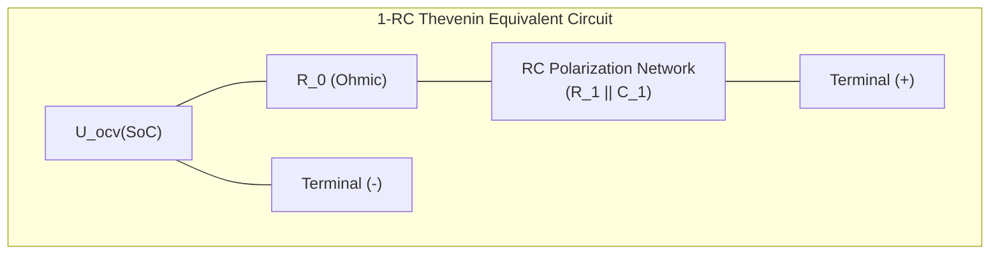
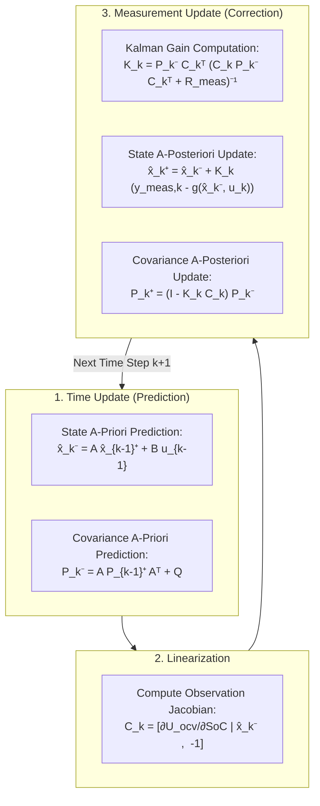
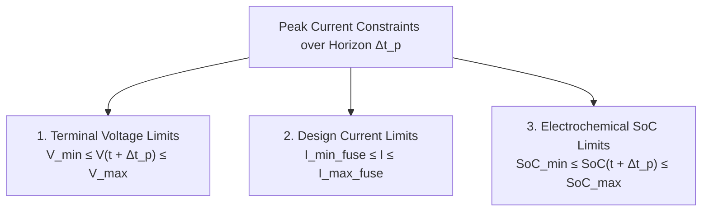

# State Estimation Algorithms (SoC, SoH & SoP)

Accurate determination of internal battery states is the core algorithmic challenge of any Battery Management System (BMS). Key physical states—such as the **State of Charge (SoC)**, **State of Health (SoH)**, and **State of Power (SoP)**—cannot be measured directly via physical transducers inside closed commercial cells[^plett2015]. Instead, they must be mathematically reconstructed in real time from external boundary observations: terminal voltage $V(t)$, pack current $I(t)$, and surface temperature $T(t)$[^hu2012].

This chapter provides the formal mathematical derivations, state-space representations, and algorithmic formulations of modern model-based estimation techniques, centering on the Extended Kalman Filter (EKF), Unscented Kalman Filter (UKF), and multi-parameter State of Power (SoP) predictors.

---

## State-Space Modeling: The 1-RC Thevenin Equivalent Circuit

To implement recursive observer algorithms, the non-linear electrochemical behavior of the lithium-ion cell is modeled using an equivalent circuit network (ECM). The **1-RC Thevenin model** provides an optimal trade-off between embedded computational overhead and physical accuracy[^he2011]:



The continuous-time governing differential equations are:

$$
\frac{d\,\text{SoC}(t)}{dt} = -\frac{\eta_c}{C_{\text{nom}}} I(t)
$$

$$
\frac{d\,V_{RC}(t)}{dt} = -\frac{1}{R_1 C_1} V_{RC}(t) + \frac{1}{C_1} I(t)
$$

Where:
- $\eta_c$ is the Coulombic efficiency ($\eta_c \approx 1.00$ during discharge, $\eta_c \le 1.00$ during charge).
- $C_{\text{nom}}$ is the nominal capacity in Ampere-seconds ($\text{As} = 3600 \times \text{Ah}$).
- $R_0$ denotes the high-frequency ohmic resistance of current collectors, electrolyte, and tabs.
- $R_1$ and $C_1$ represent the charge-transfer resistance and double-layer capacitance of the electrochemical interface.
- $V_{RC}$ is the polarization overpotential across the RC pair.

The terminal voltage $V_{\text{terminal}}(t)$ forms the non-linear observation equation:

$$
V_{\text{terminal}}(t) = U_{\text{ocv}}(\text{SoC}(t)) - R_0 I(t) - V_{RC}(t)
$$

Where $U_{\text{ocv}}(\text{SoC})$ is the non-linear thermodynamic open-circuit voltage function.

---

## Discrete-Time State-Space Formulation

Discretizing the continuous system over a fixed sampling interval $\Delta t$ (typically $\Delta t = 0.01\,\text{s}$ to $0.10\,\text{s}$) yields the linear state transition and non-linear output equations:

$$
\mathbf{x}_k = \begin{bmatrix} \text{SoC}_k \\ V_{RC,k} \end{bmatrix}, \quad u_k = I_k
$$

$$
\mathbf{x}_{k} = \mathbf{A} \mathbf{x}_{k-1} + \mathbf{B} u_{k-1} + \mathbf{w}_{k-1}
$$

$$
y_k = g(\mathbf{x}_k, u_k) + v_k = U_{\text{ocv}}(\text{SoC}_k) - R_0 u_k - V_{RC,k} + v_k
$$

The discrete transition matrix $\mathbf{A}$ and input coupling matrix $\mathbf{B}$ are derived using the zero-order hold (ZOH) exponential matrix solution:

$$
\mathbf{A} = \begin{bmatrix} 1 & 0 \\ 0 & \exp\left(-\frac{\Delta t}{\tau_1}\right) \end{bmatrix}, \quad \mathbf{B} = \begin{bmatrix} -\frac{\eta_c \Delta t}{C_{\text{nom}}} \\ R_1 \left(1 - \exp\left(-\frac{\Delta t}{\tau_1}\right)\right) \end{bmatrix}
$$

Where $\tau_1 = R_1 C_1$ is the diffusion relaxation time constant. The random variables $\mathbf{w}_k \sim \mathcal{N}(0, \mathbf{Q})$ and $v_k \sim \mathcal{N}(0, R_{\text{meas}})$ denote process disturbance noise and voltage measurement sensor noise, respectively.

---

## The Extended Kalman Filter (EKF)

Because the output equation $g(\mathbf{x}_k, u_k)$ is non-linear due to $U_{\text{ocv}}(\text{SoC})$, a standard linear Kalman filter cannot be applied directly. The Extended Kalman Filter linearizes the system around the current state estimate using a first-order Taylor series expansion[^plett2004]:



### Observation Jacobian Calculation

The measurement matrix $\mathbf{C}_k$ is computed at each time step as the partial derivative of the observation equation evaluated at the a-priori state $\hat{\mathbf{x}}_k^-$:

$$
\mathbf{C}_k = \left. \frac{\partial g(\mathbf{x}_k, u_k)}{\partial \mathbf{x}} \right|_{\hat{\mathbf{x}}_k^-} = \begin{bmatrix} \left. \frac{\partial U_{\text{ocv}}}{\partial \text{SoC}} \right|_{\hat{\text{SoC}}_k^-} & -1 \end{bmatrix}
$$

> [!NOTE]
> For chemistries with flat OCV curves such as Lithium Iron Phosphate ($\text{LiFePO}_4$), $\frac{\partial U_{\text{ocv}}}{\partial \text{SoC}} \approx 0$ across $20\% \le \text{SoC} \le 80\%$. In this regime, the Kalman gain for the SoC state approaches zero, causing the filter to rely almost entirely on Coulomb counting until the OCV steepens near the knees.

---

## Observer Comparison: EKF vs. UKF vs. Particle Filter

| Metric / Attribute | Extended Kalman Filter (EKF) | Unscented Kalman Filter (UKF) | Particle Filter (PF / Sequential Monte Carlo) |
| :--- | :--- | :--- | :--- |
| **Linearization Method** | 1st-order Taylor series expansion (Jacobian) | Unscented Transform via deterministic sigma points | Empirical probability distribution via random particles |
| **Posterior Distribution** | Assumes Gaussian | Captures true mean and covariance to 3rd order | Arbitrary non-Gaussian, multimodal distributions |
| **Computational Overhead** | Low ($\mathcal{O}(n^3)$, minimal floating point ops) | Moderate ($\approx 2n+1$ deterministic sigma point evaluations) | Extremely High ($100-1000$ particles evaluated per cycle) |
| **Tuning Complexity** | Covariance matrices $\mathbf{Q}$ and $R_{\text{meas}}$ | Matrices $\mathbf{Q}, R_{\text{meas}}$ plus UKF spread scalars ($\alpha, \beta, \kappa$) | Particle count, resampling threshold, noise injection |
| **Automotive Production Suitability** | Industry benchmark; native execution on AUTOSAR Classic | Increasing adoption in premium dual-core BMS | Primarily research; exceeds standard ISO 26262 microcontrollers |

---

## State of Power (SoP) Dynamic Prediction

The State of Power (SoP) defines the maximum charge and discharge electrical power ($P_{\text{chg,max}}, P_{\text{dis,max}}$) the pack can sustain over a future prediction horizon $\Delta t_p$ (typically $1\,\text{s}, 2\,\text{s}, 10\,\text{s}$, or $30\,\text{s}$) without violating design constraints[^xiong2018].

### Multi-Constraint Formulation

The maximum current is constrained simultaneously by three physical boundaries:



#### 1. Voltage Constraint Current

Predicting the terminal voltage after a pulse of duration $\Delta t_p$ using the 1-RC model:

$$
V(t + \Delta t_p) = U_{\text{ocv}}\left(\text{SoC}(t + \Delta t_p)\right) - I \cdot R_0 - V_{RC}(t) e^{-\frac{\Delta t_p}{\tau_1}} - I \cdot R_1 \left(1 - e^{-\frac{\Delta t_p}{\tau_1}}\right)
$$

Solving for the maximum discharge current ($I_{\text{dis}}^{V}$) such that $V(t + \Delta t_p) \ge V_{\min}$:

$$
I_{\text{dis}}^{V} = \frac{U_{\text{ocv}}(\text{SoC}_t) - V_{\min} - V_{RC}(t) e^{-\frac{\Delta t_p}{\tau_1}}}{R_0 + R_1 \left(1 - e^{-\frac{\Delta t_p}{\tau_1}}\right)}
$$

Similarly, solving for the maximum charge current ($I_{\text{chg}}^{V} < 0$) to keep $V(t + \Delta t_p) \le V_{\max}$:

$$
I_{\text{chg}}^{V} = \frac{U_{\text{ocv}}(\text{SoC}_t) - V_{\max} - V_{RC}(t) e^{-\frac{\Delta t_p}{\tau_1}}}{R_0 + R_1 \left(1 - e^{-\frac{\Delta t_p}{\tau_1}}\right)}
$$

#### 2. SoC Constraint Current

To prevent deep depletion ($\text{SoC} < \text{SoC}_{\min}$) or overfill ($\text{SoC} > \text{SoC}_{\max}$):

$$
I_{\text{dis}}^{\text{SoC}} = \frac{(\text{SoC}_t - \text{SoC}_{\min}) \cdot C_{\text{nom}}}{\eta_c \cdot \Delta t_p}
$$

$$
I_{\text{chg}}^{\text{SoC}} = -\frac{(\text{SoC}_{\max} - \text{SoC}_t) \cdot C_{\text{nom}}}{\Delta t_p}
$$

#### 3. Power Boundary Execution

Combining all bounding conditions:

$$
I_{\text{dis,max}} = \min\left( I_{\text{spec,dis}}, \; I_{\text{dis}}^{V}, \; I_{\text{dis}}^{\text{SoC}} \right)
$$

$$
I_{\text{chg,max}} = \max\left( -I_{\text{spec,chg}}, \; I_{\text{chg}}^{V}, \; I_{\text{chg}}^{\text{SoC}} \right)
$$

The instantaneous State of Power transmitted over CAN to the motor inverter is:

$$
P_{\text{dis,max}} = I_{\text{dis,max}} \cdot V_{\min}, \quad P_{\text{chg,max}} = |I_{\text{chg,max}}| \cdot V_{\max}
$$

---

## Production Python Implementation: 1-RC Extended Kalman Filter

The following script implements an Extended Kalman Filter with online linearization, 1-RC equivalent circuit modeling, and synthetic noise injection:

```python
"""
Extended Kalman Filter (EKF) for State of Charge (SoC) Estimation.
Implements a 1-RC Thevenin battery model with discrete-time updates.
"""

import numpy as np
from typing import Tuple


class BatteryEKF:
    def __init__(
        self,
        c_nom_ah: float = 2.5,        # 2.5 Ah nominal capacity
        r0: float = 0.025,            # 25 mOhm ohmic resistance
        r1: float = 0.015,            # 15 mOhm diffusion resistance
        c1: float = 1200.0,           # 1200 F double-layer capacitance
        dt: float = 0.10,             # 100 ms sample period
        q_soc: float = 1e-7,          # Process noise covariance: SoC
        q_vrc: float = 1e-6,          # Process noise covariance: V_RC
        r_meas: float = 4e-4,         # Sensor noise covariance: (20 mV)^2
        initial_soc: float = 0.80,    # Starting at 80% SoC
    ) -> None:
        self.c_nom = c_nom_ah * 3600.0  # Convert Ah to Ampere-seconds (Coulombs)
        self.r0 = r0
        self.r1 = r1
        self.c1 = c1
        self.dt = dt
        self.tau1 = r1 * c1

        # State vector: [SoC, V_RC]^T
        self.x = np.array([[initial_soc], [0.0]], dtype=float)

        # State error covariance matrix P
        self.P = np.array([
            [1e-4, 0.0],
            [0.0, 1e-4]
        ], dtype=float)

        # Process noise covariance matrix Q
        self.Q = np.array([
            [q_soc, 0.0],
            [0.0, q_vrc]
        ], dtype=float)

        # Measurement noise covariance scalar
        self.R_meas = r_meas

        # Discrete-time linear state transition matrices
        self.A = np.array([
            [1.0, 0.0],
            [0.0, np.exp(-self.dt / self.tau1)]
        ], dtype=float)

        self.B = np.array([
            [-self.dt / self.c_nom],
            [self.r1 * (1.0 - np.exp(-self.dt / self.tau1))]
        ], dtype=float)

    @staticmethod
    def ocv_function(soc: float) -> float:
        """
        Non-linear empirical polynomial OCV curve for NMC chemistry.
        """
        # 5th-order empirical fit
        return 3.0 + 1.2 * soc - 0.6 * (soc ** 2) + 0.8 * (soc ** 3)

    @staticmethod
    def docv_dsoc(soc: float) -> float:
        """
        Analytical derivative dU_ocv / dSoC.
        """
        return 1.2 - 1.2 * soc + 2.4 * (soc ** 2)

    def step(self, current: float, v_terminal_meas: float) -> Tuple[float, float]:
        """
        Execute one complete Predict-Linearize-Update EKF cycle.
        Current convention: Positive = Discharge, Negative = Charge.
        """
        # --- 1. PREDICTION (Time Update) ---
        x_pred = self.A @ self.x + self.B * current
        # Bound SoC physically between 0.0 and 1.0
        x_pred[0, 0] = np.clip(x_pred[0, 0], 0.0, 1.0)
        P_pred = self.A @ self.P @ self.A.T + self.Q

        # --- 2. LINEARIZATION ---
        soc_pred = x_pred[0, 0]
        v_rc_pred = x_pred[1, 0]
        c_jacobian = np.array([[self.docv_dsoc(soc_pred), -1.0]], dtype=float)

        # --- 3. CORRECTION (Measurement Update) ---
        y_model = self.ocv_function(soc_pred) - (self.r0 * current) - v_rc_pred
        innovation = v_terminal_meas - y_model

        # Innovation covariance
        s_cov = c_jacobian @ P_pred @ c_jacobian.T + self.R_meas
        # Kalman Gain
        k_gain = P_pred @ c_jacobian.T @ np.linalg.inv(s_cov)

        # A-posteriori state update
        self.x = x_pred + k_gain * innovation
        self.x[0, 0] = np.clip(self.x[0, 0], 0.0, 1.0)

        # Joseph stabilized form for covariance update: (I - K C) P (I - K C)^T + K R K^T
        eye = np.eye(2)
        i_kc = eye - k_gain @ c_jacobian
        self.P = i_kc @ P_pred @ i_kc.T + k_gain * self.R_meas @ k_gain.T

        return float(self.x[0, 0]), float(self.x[1, 0])


# --- Test & Simulation Harness ---
if __name__ == "__main__":
    np.random.seed(42)
    ekf = BatteryEKF(initial_soc=0.60)  # BMS initialized with 60% estimate (True = 75%)

    true_soc = 0.75
    true_vrc = 0.0
    r0_true = 0.025
    r1_true = 0.015
    c1_true = 1200.0
    tau_true = r1_true * c1_true
    dt = 0.10
    c_nom_true = 2.5 * 3600.0

    print("Step | Current [A] | True SoC | EKF SoC  | Residual [mV]")
    print("---------------------------------------------------------")

    sim_currents = [2.0] * 50 + [0.0] * 20 + [-1.5] * 30  # Discharge -> Rest -> Regen

    for step_i, i_k in enumerate(sim_currents):
        # Update ground truth cell physics
        true_soc -= (i_k * dt) / c_nom_true
        true_vrc = true_vrc * np.exp(-dt / tau_true) + r1_true * (1.0 - np.exp(-dt / tau_true)) * i_k
        v_true = ekf.ocv_function(true_soc) - (r0_true * i_k) - true_vrc
        v_meas = v_true + np.random.normal(0.0, 0.005)  # Add 5 mV sensor noise

        est_soc, est_vrc = ekf.step(current=i_k, v_terminal_meas=v_meas)

        if step_i % 10 == 0:
            error_mv = (est_soc - true_soc) * 1000.0
            print(f"{step_i:4d} | {i_k:11.1f} | {true_soc:8.4f} | {est_soc:8.4f} | {error_mv:8.2f} %")
```

---

## References

[^plett2015]: Plett, G. L. (2015). *Battery Management Systems, Volume II: Equivalent-Circuit Methods*. Artech House.
[^hu2012]: Hu, X., Li, S., & Peng, H. (2012). A comparative study of equivalent circuit models for Li-ion batteries. *Journal of Power Sources*, 198, 359–367.
[^he2011]: He, H., Xiong, R., & Fan, J. (2011). Evaluation of lithium-ion battery equivalent circuit models for state of charge estimation by an experimental approach. *Energies*, 4(4), 582–598.
[^plett2004]: Plett, G. L. (2004). Extended Kalman filtering for battery management systems of LiPB-based HEV battery packs: Part 1. Background and Part 2. Modeling and identification. *Journal of Power Sources*, 134(2), 252–276.
[^xiong2018]: Xiong, R., et al. (2018). Towards a smarter battery management system: A critical review on battery state of power estimation. *Journal of Cleaner Production*, 202, 1228–1240.
