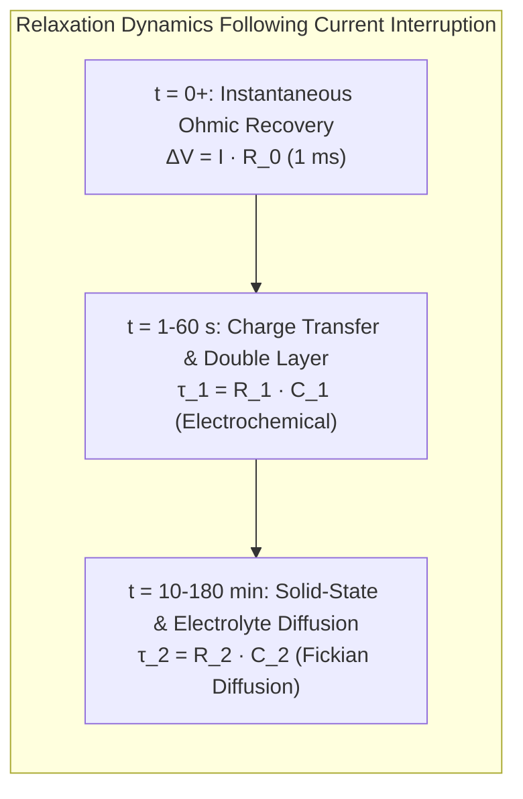
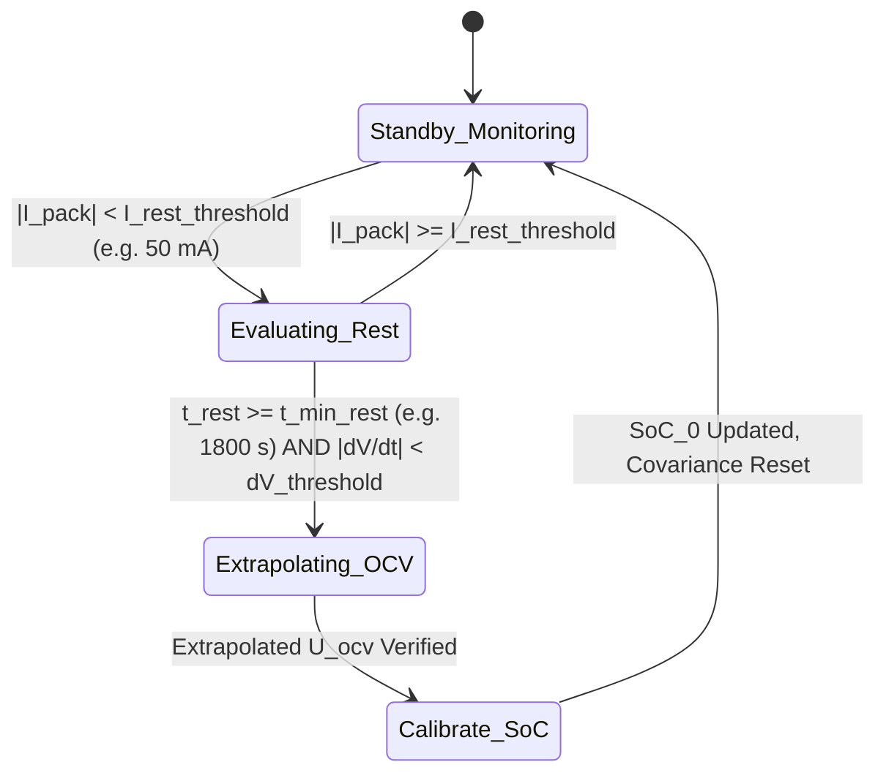

# Initial SoC Estimation & Coulomb Counting Error Dynamics

At vehicle ignition or battery system power-on, the Battery Management System (BMS) must determine the initial State of Charge ($\text{SoC}_0$). Because Coulomb counting is an open-loop integrator, any initialization error $\Delta \text{SoC}_0$ persists indefinitely throughout the operational cycle[^plett2004]:

$$
\text{SoC}(t) = \left( \text{SoC}_0 + \Delta \text{SoC}_0 \right) - \frac{1}{C_{\text{nom}}} \int_{t_0}^t \eta_c I(\tau) \, d\tau
$$

Achieving an accurate $\text{SoC}_0$ requires reading the Open-Circuit Voltage (OCV) under resting conditions. However, electrochemical relaxation dynamics, phase-transition hysteresis, and sensor inaccuracies introduce significant drift and uncertainty[^verbrugge2003].

This chapter investigates the physics of rest relaxation, electrochemical hysteresis modeling, current sensor bias propagation, and real-time auto-calibration routines.

---

## Electrochemical Relaxation & Open-Circuit Voltage (OCV)

The true thermodynamic Open-Circuit Voltage ($U_{\text{ocv}}$) is defined as the potential difference between positive and negative electrodes when the net current is zero and all concentration gradients within the solid active material particles and liquid electrolyte have completely equalized[^roscher2011]:

$$
U_{\text{ocv}}(\text{SoC}, T) = \Phi_{\text{eq,cathode}}(\text{SoC}, T) - \Phi_{\text{eq,anode}}(\text{SoC}, T)
$$

### Post-Load Voltage Relaxation

When load current is interrupted ($I \to 0$), the terminal voltage does not jump instantaneously to $U_{\text{ocv}}$. Instead, it undergoes a multi-time-scale relaxation:



The terminal relaxation voltage curve $V_{\text{relax}}(t)$ is mathematically modeled via an $n$-order RC exponential decay:

$$
V_{\text{relax}}(t) = U_{\text{ocv}} - \sum_{i=1}^n V_{RC,i}(0) \cdot \exp\left(-\frac{t}{\tau_i}\right)
$$

Where:
- $\tau_1 = R_1 C_1 \approx 5 - 30\,\text{s}$ (interfacial kinetics and electric double-layer discharge).
- $\tau_2 = R_2 C_2 \approx 300 - 3600\,\text{s}$ (solid-state lithium diffusion within active material host lattices, governed by Fick's second law $\frac{\partial c_s}{\partial t} = \frac{D_s}{r^2}\frac{\partial}{\partial r}\left(r^2 \frac{\partial c_s}{\partial r}\right)$).

> [!WARNING]
> Sampling the cell voltage after only 5 minutes of rest can introduce up to $30-80\,\text{mV}$ of relaxation overpotential error. In flat-profile chemistries like LFP, an $80\,\text{mV}$ error shifts the inferred initial SoC by more than $40\%$.

---

## Electrochemical Voltage Hysteresis

In many lithium-ion chemistries—most notably Lithium Iron Phosphate ($\text{LiFePO}_4$) and Silicon-doped graphite anodes—the thermodynamic equilibrium potential depends not only on the instantaneous lithium concentration but also on the **direction of prior cycling** (charge vs. discharge)[^snihir2006]:

$$
U_{\text{ocv,charge}}(\text{SoC}) > U_{\text{ocv,discharge}}(\text{SoC})
$$

```
   Terminal
   Voltage [V]
      ^
 3.45 |                  /------------------/  Charge OCV Branch
      |                 /   Hysteresis     /
 3.35 |                /      ΔV_h        /
      |               /------------------/     Discharge OCV Branch
 3.25 |              /
      +-------------+---------------------+------> SoC [%]
      0            20                    100
```

### Physical Origins of Hysteresis

1. **Mechanical Stress & Volume Changes:** Intercalation causes lattice expansion ($\approx 7\%$ in graphite, $\approx 6.8\%$ in $\text{LiFePO}_4$, and $>300\%$ in Silicon), generating elastic-plastic mechanical stress that shifts the chemical potential $\mu = \mu_0 + \Omega \sigma_{\text{hydrostatic}}$[^farmann2015].
2. **Microscopic Phase Separation & Domain Pinning:** Two-phase coexistence (e.g., heterosite $\text{FePO}_4$ and triphylite $\text{LiFePO}_4$) creates interfacial energy barriers and phase-boundary pinning during crystallographic phase transitions.

### Continuous Hysteresis State-Space Model

To prevent initialization and tracking errors, BMS algorithms incorporate a continuous dynamic hysteresis state $h(t) \in [-1, +1]$[^plett2004]:

$$
\frac{dh(t)}{dt} = -\gamma \left| \frac{\eta_c I(t)}{C_{\text{nom}}} \right| h(t) + \gamma \left| \frac{\eta_c I(t)}{C_{\text{nom}}} \right| \text{sgn}(I(t))
$$

$$
U_{\text{ocv,eff}}(\text{SoC}, h) = U_{\text{ocv,mean}}(\text{SoC}) + h(t) \cdot M(\text{SoC})
$$

Where:
- $\gamma$ is a positive tuning parameter governing the rate of transition between hysteresis envelopes.
- $M(\text{SoC})$ is half the hysteresis voltage envelope width: $M(\text{SoC}) = \frac{U_{\text{chg}}(\text{SoC}) - U_{\text{dis}}(\text{SoC})}{2}$.

---

## Coulomb Counting Error Dynamics & Sensor Drift

Coulomb counting computes charge throughput by integrating sampled current over time:

$$
\text{SoC}(t) = \text{SoC}_0 - \frac{1}{C_{\text{nom}}} \int_0^t \eta_c I_{\text{meas}}(\tau) \, d\tau
$$

### Sensor Error Decomposition

Real-world current sensors (precision Manganin shunts, Hall-effect transducers, fluxgate sensors) introduce three distinct error sources:

$$
I_{\text{meas}}(t) = (1 + \epsilon_{\text{gain}}) \cdot I_{\text{true}}(t) + I_{\text{bias}}(T) + e_{\text{quantization}}(t)
$$

Where:
- $\epsilon_{\text{gain}}$ is the multiplicative gain error (typically $\pm 0.5\%$ to $\pm 1.0\%$).
- $I_{\text{bias}}(T)$ is the temperature-dependent offset/bias drift.
- $e_{\text{quantization}}$ is the ADC quantization noise.

### Integration Drift Propagation

Substituting the sensor error model into the Coulomb counting equation reveals the cumulative drift:

$$
\Delta \text{SoC}_{\text{drift}}(t) = -\frac{1}{C_{\text{nom}}} \int_0^t I_{\text{bias}} \, d\tau = -\frac{I_{\text{bias}} \cdot t}{C_{\text{nom}}}
$$

```
Cumulative SoC Error [%]
   ^
 5 |                                       / Over-estimation Drift (+I_bias)
   |                                     /
 0 +-----------------------------------+-------------------------> Time [Hours]
   |                                     \
-5 |                                       \ Under-estimation Drift (-I_bias)
```

#### Quantitative Impact Analysis

Consider an automotive pack with nominal capacity $C_{\text{nom}} = 60\,\text{Ah}$ operating for 24 hours (e.g., continuous low-rate camping load or autonomous monitoring):

| Sensor Type | Typical Bias Offset ($I_{\text{bias}}$) | 1-Hour SoC Drift | 24-Hour SoC Drift | 7-Day Continuous Drift |
| :--- | :--- | :--- | :--- | :--- |
| **Commercial Hall Effect** | $150\,\text{mA}$ | $0.25\%$ | $6.00\%$ | $42.0\%$ (Catastrophic) |
| **Precision Shunt ($100\,\mu\Omega$)** | $20\,\text{mA}$ | $0.033\%$ | $0.80\%$ | $5.60\%$ |
| **Zero-Drift Fluxgate** | $1.5\,\text{mA}$ | $0.0025\%$ | $0.06\%$ | $0.42\%$ |

---

## Production Rest Detection & Auto-Calibration Routine

To eliminate cumulative integration drift, the BMS continuously evaluates resting conditions and resets the Coulomb counter when safe equilibrium is achieved.



### Auto-Calibration Conditions

A valid resting point for OCV lookup requires:
1. $|I_{\text{pack}}| < 50\,\text{mA}$ continuously for at least $t_{\text{rest}} \ge 1800\,\text{s}$ ($30\,\text{min}$).
2. $\left| \frac{dV_{\text{terminal}}}{dt} \right| < 1.0\,\frac{\text{mV}}{\text{min}}$ across an 8-minute rolling observation window.
3. Temperature rate of change $\left| \frac{dT}{dt} \right| < 0.2\,\frac{^\circ\text{C}}{\text{min}}$.

---

## OCV-SOC Initialization in Battery Toolkit

The temperature-dependent OCV lookup and thermodynamic hysteresis compensation are implemented in [`battery_toolkit.modeling.ocv`](file:///Users/cc/Desktop/Battery-Systems-Technology/codes/python/src/battery_toolkit/modeling/ocv.py):

```python
from battery_toolkit.modeling.ocv import OCVModel

# Initialize OCV model with temperature coefficient dU/dT
ocv_model = OCVModel(dudt_v_per_k=-0.00015)

# Calculate SOC from measured rest voltage at 25°C
rest_voltage = 3.840  # Measured terminal voltage after 30 min rest
inferred_soc = ocv_model.soc_from_ocv(ocv_v=rest_voltage, temp_c=25.0)

# Evaluate cold start conditions (0°C) with Gibbs-Helmholtz temperature correction
inferred_soc_cold = ocv_model.soc_from_ocv(ocv_v=rest_voltage, temp_c=0.0)

print(f"Startup OCV: {rest_voltage:.3f}V -> Inferred SOC: {inferred_soc * 100:.1f}% (25°C) | {inferred_soc_cold * 100:.1f}% (0°C)")
```

Full algorithmic implementation, cubic spline interpolation, continuous hysteresis tracking, and verification tests are in [`codes/python/src/battery_toolkit/modeling/ocv.py`](file:///Users/cc/Desktop/Battery-Systems-Technology/codes/python/src/battery_toolkit/modeling/ocv.py) and [`test_modeling.py`](file:///Users/cc/Desktop/Battery-Systems-Technology/codes/python/tests/test_modeling.py).

---

## References

[^plett2004]: Plett, G. L. (2004). Extended Kalman filtering for battery management systems of LiPB-based HEV battery packs: Part 1. Background. *Journal of Power Sources*, 134(2), 252–261.
[^verbrugge2003]: Verbrugge, M. W., & Koch, B. J. (2003). Modeling and experimental characterization of lithium-ion batteries. *Journal of The Electrochemical Society*, 150(4), A374.
[^roscher2011]: Roscher, M. A., & Sauer, D. U. (2011). Dynamic electric behavior and open-circuit-voltage modeling of $\text{LiFePO}_4$ cathode based lithium-ion batteries. *Journal of Power Sources*, 196(1), 331–336.
[^snihir2006]: Snihir, I., Reynaud, W., Gerssen-Gondrand, G., & Jansen, H. J. (2006). Battery open-circuit voltage estimation by a combined linear/exponential regression method. *Journal of Power Sources*, 159(2), 1484–1487.
[^farmann2015]: Farmann, A., & Sauer, D. U. (2015). A comprehensive review of on-board condition monitoring of lithium-ion batteries based on open-circuit voltage. *Journal of Power Sources*, 281, 114–130.
