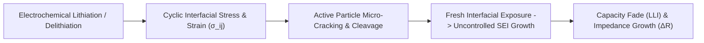

# Cycle Counting & Fatigue Damage Summation

In real-world applications—such as electric vehicle drive cycles (WLTP, US06) or renewable grid frequency regulation—batteries rarely experience complete, monolithic charge-discharge cycles from $0\%$ to $100\%$ State of Charge (SoC). Instead, they are subjected to chaotic, highly dynamic micro-cycles, regenerative braking pulses, and partial depth-of-discharge (DoD) swings[^millner2010].

Quantifying battery mechanical wear and capacity degradation requires translating erratic SoC trajectories into discrete closed stress cycles. This chapter formalizes the application of the **ASTM E1049 Rainflow cycle counting algorithm**, the **Palmgren-Miner linear damage hypothesis**, and non-linear Wöhler stress models to lithium-ion degradation tracking.

---

## Electrochemical Fatigue Mechanics

During insertion and de-insertion of lithium ions, electrode host matrices undergo periodic lattice expansion and contraction:
- **Graphite Anode:** $\approx 7 - 10\%$ crystallographic volume change between $\text{C}_6$ and $\text{LiC}_6$[^xu2018].
- **Silicon-Doped Graphite:** $>100 - 300\%$ localized volume expansion.
- **NMC / LCO Cathodes:** Anisotropic $c$-axis contraction and lattice distortion up to $2 - 3\%$.



This mechanical breathing generates severe shear and tensile stresses at primary particle boundaries, inducing intergranular and transgranular microcracking. Fresh metallic and active surfaces are continuously exposed to liquid electrolyte, consuming active cyclable lithium to repair the solid electrolyte interphase (SEI)[^schmalstieg2014].

---

## Limitations of Naive Counting Approaches

Traditional battery telemetry often relies on two rudimentary methods:
1. **Zero-Crossing Current Integration:** Sums Ah throughput and divides by $2 \cdot C_{\text{nom}}$:
   
   $$
   \text{EFC}_{\text{naive}} = \frac{1}{2 \cdot C_{\text{nom}}} \int_0^t |I(\tau)| \, d\tau
   $$

2. **Peak-to-Valley Detection:** Detects directional reversals.

> [!CAUTION]
> Naive Ah throughput completely neglects the **depth-dependent non-linearity** of mechanical strain. Because particle strain energy scales super-linearly with cycle depth, a single $100\%$ DoD cycle inflicts substantially more fatigue damage than ten $10\%$ DoD cycles, even though their Ah throughput is identical.

---

## ASTM E1049-85 Rainflow Cycle Counting

Originally formulated in structural mechanical fatigue by Matsuishi and Endo (1968) and standardized in ASTM E1049-85, the **Rainflow counting method** decomposes complex irregular time series into an equivalent set of closed hysteresis stress-strain loops[^astm1985][^matsuishi1968].

```
  SoC [%]
   ^
90 |      B (90%)
   |     /\                  D (85%)
   |    /  \      C (70%)   /\
   |   /    \    /\        /  \
50 |  /      \  /  \      /    \
   | /        \/    \    /      \
20 |/          A     \  /        \
   +-----------(40%)--\/----------\----------> Time
                      E (20%)
```

### Four-Point Reversal Rule

The continuous SoC profile is first filtered to isolate local turning points (peaks and valleys). The sequence is then evaluated using a sliding four-point window $[S_1, S_2, S_3, S_4]$:

1. Define inner stress range $\Delta S_{\text{inner}} = |S_2 - S_3|$.
2. Define outer bounding ranges $\Delta S_{\text{left}} = |S_1 - S_2|$ and $\Delta S_{\text{right}} = |S_3 - S_4|$.
3. If $\Delta S_{\text{inner}} \le \Delta S_{\text{left}}$ and $\Delta S_{\text{inner}} \le \Delta S_{\text{right}}$:
   - A closed sub-cycle of range $\Delta \text{DoD} = \Delta S_{\text{inner}}$ and mean $\bar{S} = \frac{S_2 + S_3}{2}$ is extracted.
   - Points $S_2$ and $S_3$ are removed from the vector.
   - The algorithm rewinds to point $S_1$ and resumes scanning.
4. Otherwise, advance the four-point window by one index.

Residual unclosed paths after processing the sequence represent half-cycles.

---

## Palmgren-Miner Cumulative Damage Hypothesis

The cumulative fatigue damage $D_{\text{total}}$ induced by $K$ discrete extracted cycles is modeled via Palmgren-Miner's linear damage rule[^miner1945]:

$$
D_{\text{total}} = \sum_{i=1}^K \frac{1}{N_f(\Delta \text{DoD}_i, \bar{\text{SoC}}_i, T_i)} \le 1.0
$$

Where:
- $N_f(\Delta \text{DoD}_i, \bar{\text{SoC}}_i, T_i)$ is the total cycles to failure (typically defined as $80\%$ remaining capacity, $\text{SoH} = 0.80$) under stress condition $i$.
- When $D_{\text{total}} = 1.0$, the battery reaches its End-of-Life (EOL).

### Wöhler Power-Law Formulation

The cycle life $N_f$ follows a modified Wöhler (S-N) power law with an Arrhenius temperature dependence and a mean SoC acceleration factor[^schmalstieg2014]:

$$
N_f(\Delta \text{DoD}, \bar{\text{SoC}}, T) = N_0 \cdot \left( \frac{\Delta \text{DoD}}{1.0} \right)^{-\beta_{\text{DoD}}} \cdot \exp\left( -k_{\text{SoC}} \cdot (\bar{\text{SoC}} - 0.5) \right) \cdot \exp\left( \frac{E_a}{R} \left( \frac{1}{T} - \frac{1}{T_{\text{ref}}} \right) \right)
$$

Where:
- $N_0$ is the reference cycle life under $100\%$ DoD at $25^\circ\text{C}$ (e.g., $1500$ cycles for NMC, $4000$ cycles for LFP).
- $\beta_{\text{DoD}} \approx 1.5 - 2.2$ is the fatigue damage exponent.
- $k_{\text{SoC}} \approx 0.8 - 1.4$ accounts for accelerated cathode degradation at high average potential.

#### Non-Linear Fatigue Comparison ($\beta = 2.0, N_0 = 2000$)

| Cycle Profile | Range ($\Delta \text{DoD}$) | Cycles to Failure ($N_f$) | Damage per Cycle ($1/N_f$) | Number of Cycles for Equivalent Damage of $1 \times 100\%$ Cycle |
| :--- | :--- | :--- | :--- | :--- |
| **Deep Cycle** | $100\%$ ($1.00$) | $2{,}000$ | $5.00 \times 10^{-4}$ | $1$ cycle (Ah throughput = $2 \cdot C_n$) |
| **Mid Cycle** | $50\%$ ($0.50$) | $8{,}000$ | $1.25 \times 10^{-4}$ | $4$ cycles (Ah throughput = $4 \cdot C_n$) |
| **Shallow Cycle** | $20\%$ ($0.20$) | $50{,}000$ | $2.00 \times 10^{-5}$ | $25$ cycles (Ah throughput = $10 \cdot C_n$) |
| **Micro-Cycle** | $5\%$ ($0.05$) | $800{,}000$ | $1.25 \times 10^{-6}$ | $400$ cycles (Ah throughput = $40 \cdot C_n$) |

> [!TIP]
> Operating within shallow micro-cycles delivers up to **20 times more total cumulative energy throughput** before reaching EOL compared to deep cycling.

---

## Production Python Implementation: ASTM E1049 Rainflow Counter

The following production script implements the ASTM E1049 four-point Rainflow counting algorithm and calculates cumulative Miner fatigue damage:

```python
"""
ASTM E1049-85 Compliant Rainflow Cycle Counting and Fatigue Estimator.
Extracts closed cycles from dynamic State of Charge (SoC) profiles.
"""

from dataclasses import dataclass
from typing import List, Tuple
import numpy as np


@dataclass
class Cycle:
    range_dod: float   # Cycle range ΔDoD in [0.0, 1.0]
    mean_soc: float    # Cycle mean SoC in [0.0, 1.0]
    count: float       # 1.0 for closed cycle, 0.5 for half-cycle


class RainflowDamageCalculator:
    def __init__(
        self,
        n0_ref: float = 2500.0,       # Cycles to failure at 100% DoD
        beta_dod: float = 1.85,       # Non-linear DoD exponent
        k_soc: float = 0.90,          # High-SoC acceleration coefficient
    ) -> None:
        self.n0 = n0_ref
        self.beta = beta_dod
        self.k_soc = k_soc

    @staticmethod
    def extract_turning_points(series: np.ndarray) -> np.ndarray:
        """
        Filters input series to keep only strict local extrema (peaks and valleys).
        """
        if len(series) < 3:
            return series

        diffs = np.diff(series)
        # Exclude flat zero-differential regions
        non_zero = diffs != 0
        if not np.any(non_zero):
            return np.array([series[0]])

        compact_series = [series[0]]
        for i in range(len(diffs)):
            if diffs[i] != 0:
                compact_series.append(series[i + 1])

        # Identify direction reversals
        turning_points = [compact_series[0]]
        for i in range(1, len(compact_series) - 1):
            d1 = compact_series[i] - compact_series[i - 1]
            d2 = compact_series[i + 1] - compact_series[i]
            if d1 * d2 < 0:  # Peak or Valley
                turning_points.append(compact_series[i])
        turning_points.append(compact_series[-1])

        return np.array(turning_points)

    def count_cycles(self, soc_history: np.ndarray) -> List[Cycle]:
        """
        Executes ASTM E1049 four-point rainflow cycle extraction.
        """
        pts = list(self.extract_turning_points(soc_history))
        extracted_cycles: List[Cycle] = []

        while len(pts) >= 3:
            s1, s2, s3 = pts[0], pts[1], pts[2]
            r1 = abs(s1 - s2)
            r2 = abs(s2 - s3)

            if len(pts) >= 4:
                s4 = pts[3]
                r3 = abs(s3 - s4)
                if r2 <= r1 and r2 <= r3:
                    # Closed inner loop between s2 and s3
                    extracted_cycles.append(Cycle(
                        range_dod=r2,
                        mean_soc=(s2 + s3) / 2.0,
                        count=1.0
                    ))
                    # Remove s2 and s3
                    del pts[1:3]
                    continue

            if r2 <= r1:
                extracted_cycles.append(Cycle(
                    range_dod=r2,
                    mean_soc=(s2 + s3) / 2.0,
                    count=1.0
                ))
                del pts[1:3]
            else:
                # Rotate stack if no loop closed
                pts.append(pts.pop(0))
                break

        # Remaining points form residual half-cycles
        for i in range(len(pts) - 1):
            r = abs(pts[i] - pts[i + 1])
            m = (pts[i] + pts[i + 1]) / 2.0
            extracted_cycles.append(Cycle(range_dod=r, mean_soc=m, count=0.5))

        return extracted_cycles

    def compute_damage(self, cycles: List[Cycle]) -> Tuple[float, float]:
        """
        Applies Wöhler model and Palmgren-Miner rule.
        Returns: (Total Cumulative Damage D, Estimated Remaining Useful Life Cycles)
        """
        total_damage = 0.0

        for cyc in cycles:
            if cyc.range_dod < 1e-4:
                continue
            # Wöhler cycles to failure
            n_f = (
                self.n0
                * (cyc.range_dod ** (-self.beta))
                * np.exp(-self.k_soc * (cyc.mean_soc - 0.50))
            )
            cycle_damage = cyc.count / n_f
            total_damage += cycle_damage

        return total_damage, (1.0 - total_damage)


# --- Test & Simulation Harness ---
if __name__ == "__main__":
    # Synthetic EV Drive Profile: Discharge with Regen Braking Events
    soc_profile = np.array([
        0.90, 0.70, 0.75, 0.60, 0.65, 0.50, 0.85, 0.40, 0.45, 0.20, 0.95
    ])

    calculator = RainflowDamageCalculator()
    cycles = calculator.count_cycles(soc_profile)

    print(f"Extracted {len(cycles)} cycle components from dynamic profile:\n")
    print("Type        | Range ΔDoD | Mean SoC | Damage Contribution")
    print("---------------------------------------------------------")

    for idx, c in enumerate(cycles):
        cyc_type = "Full Cycle" if c.count == 1.0 else "Half Cycle"
        # Calculate isolated damage for display
        n_f = calculator.n0 * (c.range_dod ** (-calculator.beta))
        d_i = c.count / n_f
        print(f"{cyc_type:11s} | {c.range_dod*100:9.1f}% | {c.mean_soc*100:7.1f}% | {d_i:11.2e}")

    total_d, _ = calculator.compute_damage(cycles)
    print("---------------------------------------------------------")
    print(f"Total Palmgren-Miner Damage Accumulated: D = {total_d:.4e}")
```

---

## References

[^millner2010]: Millner, A. (2010). Modeling lithium ion battery health for electric vehicles. *IEEE Conference on Innovative Technologies for an Efficient and Reliable Electricity Supply (CITRES)*, 396–400.
[^xu2018]: Xu, B., Oudalov, A., Ulbig, A., Andersson, G., & Kirschen, D. S. (2018). Modeling of lithium-ion battery degradation for cell life assessment. *IEEE Transactions on Smart Grid*, 9(2), 1131–1140.
[^schmalstieg2014]: Schmalstieg, J., Käbitz, S., Ecker, M., & Sauer, D. U. (2014). A holistic aging model for Li(NiMnCo)O2 based 18650 lithium-ion batteries. *Journal of Power Sources*, 257, 325–334.
[^astm1985]: ASTM International. (1985 / Reapproved 2017). *ASTM E1049-85: Standard Practices for Cycle Counting in Fatigue Analysis*. ASTM International.
[^matsuishi1968]: Matsuishi, M., & Endo, T. (1968). Fatigue of metals subjected to varying stress. *Japan Society of Mechanical Engineers*, Fukuoka, Japan.
[^miner1945]: Miner, M. A. (1945). Cumulative damage in fatigue. *Journal of Applied Mechanics*, 12(3), A159–A164.
