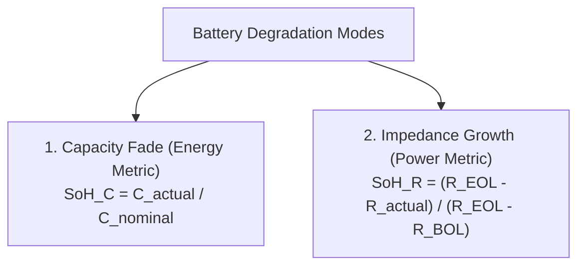
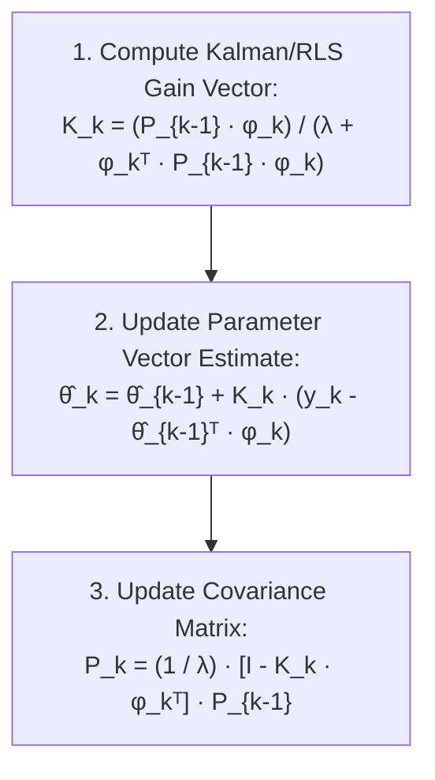
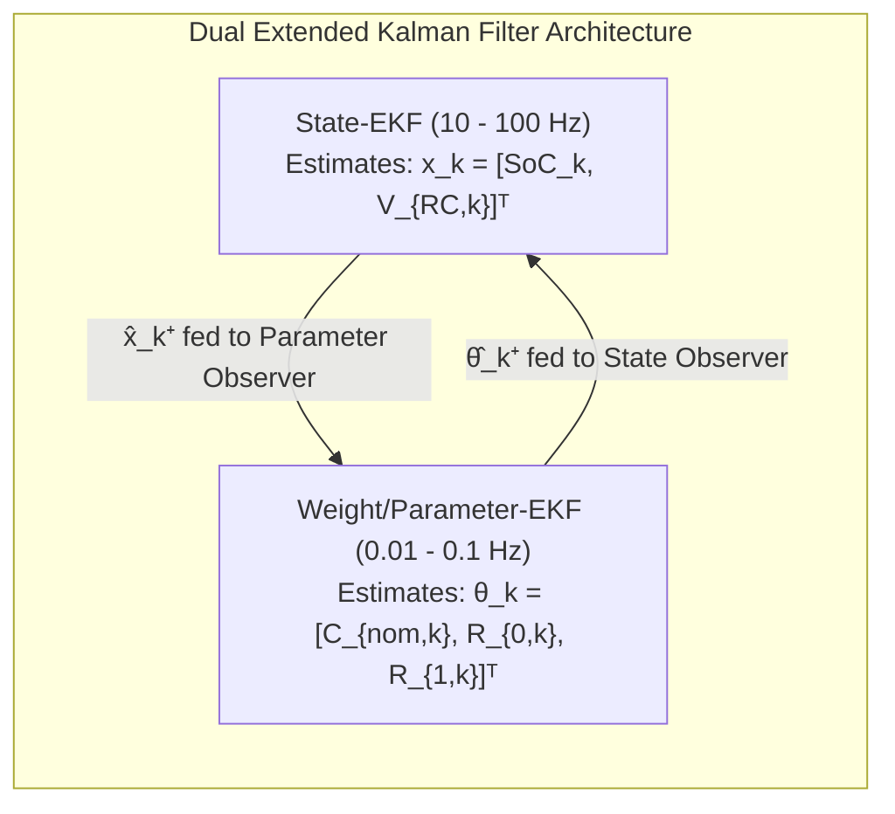

# State of Health (SoH) Estimation Algorithms

The **State of Health (SoH)** of a lithium-ion battery quantifies its degradation state relative to its nominal beginning-of-life (BOL) specifications. Accurate online SoH tracking is critical for vehicle residual range prediction, thermal limit adjustments, warranty validation, and safety hazard mitigation[^berecibar2016].

Unlike State of Charge (SoC), which changes within seconds or minutes, SoH evolves gradually over months and thousands of cycles. This chapter formalizes the dual-metric definition of battery health, online parameter tracking via **Recursive Least Squares (RLS)** with exponential forgetting, and non-invasive diagnostic techniques using **Incremental Capacity Analysis (ICA)** and **Differential Voltage Analysis (DVA)**.

---

## Dual-Metric Health Quantification

Battery degradation is fundamentally two-dimensional, characterized by loss of storage capacity (energy fade) and increase in internal impedance (power fade)[^bloom2005]:



### 1. Capacity State of Health ($\text{SoH}_C$)

$$
\text{SoH}_C = \frac{C_{\text{actual}}(T_{\text{ref}})}{C_{\text{nominal}}(T_{\text{ref}})} \times 100\%
$$

Where:
- $C_{\text{nominal}}$ is the factory-rated capacity at reference temperature ($25^\circ\text{C}$).
- $C_{\text{actual}}$ is the maximum deliverable capacity under a standard $C/3$ or $1\,C$ constant-current discharge.
- Automotive End-of-Life (EOL) standard: $\text{SoH}_C \le 80\%$.

### 2. Resistance State of Health ($\text{SoH}_R$)

$$
\text{SoH}_R = \frac{R_{\text{EOL}} - R_{\text{actual}}}{R_{\text{EOL}} - R_{\text{BOL}}} \times 100\%
$$

Alternatively, the internal resistance increase ratio $\Delta R$ is expressed as:

$$
\Delta R = \frac{R_{\text{actual}} - R_{\text{BOL}}}{R_{\text{BOL}}} \times 100\%
$$

Under ISO 12405 and IEC 62660 standards, a cell reaches power EOL when $R_{\text{actual}} \ge 2.0 \cdot R_{\text{BOL}}$ ($\Delta R \ge +100\%$), as excessive Joule heating ($I^2 R$) prevents high-power vehicle acceleration and fast charging.

---

## Online Parameter Estimation via Recursive Least Squares (RLS)

To estimate internal resistance and capacity continuously without interrupting operation, the BMS employs **Recursive Least Squares (RLS) with an exponential forgetting factor**[^xiong2014].

### Autoregressive Model Formulation

Consider the discrete-time 1-RC Thevenin battery model rearranged into a regression form:

$$
V_{\text{terminal}, k} = U_{\text{ocv}, k} - R_0 I_k - V_{RC, k}
$$

Taking the backward difference approximation over time step $\Delta t$, the input-output relationship maps to the canonical linear parameter vector form:

$$
y_k = \boldsymbol{\theta}_k^T \boldsymbol{\phi}_k + e_k
$$

Where:
- $y_k$ is the system output observation.
- $\boldsymbol{\phi}_k$ is the regressor vector containing measured currents and terminal voltages.
- $\boldsymbol{\theta}_k$ is the parameter vector containing model parameters (such as $R_0, R_1, C_1$).
- $e_k$ is the modeling residual error.

### RLS Update Equations with Forgetting Factor ($\lambda$)

Because battery health evolves slowly, older measurements must be discounted exponentially using a forgetting factor $\lambda \in [0.98, 0.9995]$:



$$
\mathbf{K}_k = \frac{\mathbf{P}_{k-1} \boldsymbol{\phi}_k}{\lambda + \boldsymbol{\phi}_k^T \mathbf{P}_{k-1} \boldsymbol{\phi}_k}
$$

$$
\hat{\boldsymbol{\theta}}_k = \hat{\boldsymbol{\theta}}_{k-1} + \mathbf{K}_k \left( y_k - \boldsymbol{\phi}_k^T \hat{\boldsymbol{\theta}}_{k-1} \right)
$$

$$
\mathbf{P}_k = \frac{1}{\lambda} \left( \mathbf{I} - \mathbf{K}_k \boldsymbol{\phi}_k^T \right) \mathbf{P}_{k-1}
$$

---

## Incremental Capacity & Differential Voltage Analysis (ICA / DVA)

Direct electrochemical tracking of internal degradation modes without opening the cell is achieved via differential thermodynamic analysis[^dubarry2012]:

### 1. Incremental Capacity Analysis (ICA, $dQ/dV$)

$$
\text{IC}(V) = \frac{dQ}{dV} = I(t) \cdot \left( \frac{dV}{dt} \right)^{-1}
$$

Under slow charging ($C/20$ to $C/10$), phase transitions within positive and negative electrode crystallographic lattices appear as pronounced peaks:

```
    dQ/dV [Ah/V]
        ^
   120  |         Peak 2 (Graphite Stage II -> I)
        |           /\
    80  |          /  \      Peak 3 (Cathode transition)
        |  Peak 1 /    \       /\
    40  |   /\   /      \     /  \
        |--/--\-/--------\---/----\-------> Terminal Voltage [V]
          3.5   3.7      3.9  4.1
```

- **Peak Height Reduction:** Direct quantification of **Loss of Lithium Inventory (LLI)** driven by continuous SEI layer growth and lithium plating.
- **Peak Position Lateral Shift:** Direct quantification of **Ohmic Overpotential Growth ($\Delta R_0$)**.
- **Differential Peak Area Distortion:** Indicates **Loss of Active Material ($\text{LAM}$)** in either positive or negative electrodes.

### 2. Differential Voltage Analysis (DVA, $dV/dQ$)

$$
\text{DV}(Q) = \frac{dV}{dQ} = \frac{dV}{dt} \cdot \frac{1}{I(t)}
$$

DVA differentiates cell voltage with respect to transferred charge, transforming voltage plateaus into sharp vertical peaks. The distance $\Delta Q$ between identifiable anode and cathode phase transition peaks allows direct decoupling of $\text{LAM}_{\text{PE}}$ (positive electrode) from $\text{LAM}_{\text{NE}}$ (negative electrode)[^berecibar2016].

---

## Dual Extended Kalman Filter (DEKF) Architecture

In modern premium BMS implementations, the State of Charge (fast state $\mathbf{x}_k$) and the battery parameters (slow state $\boldsymbol{\theta}_k$) are estimated simultaneously using two parallel, interacting Extended Kalman Filters[^plett2004]:



By separating the execution frequencies, the State-EKF tracks rapid vehicle acceleration and regenerative braking dynamics, while the Parameter-EKF filters out high-frequency transients and tracks true electro-chemical capacity loss over months.

---

## Production Python Implementation: RLS Ohmic Resistance Tracker

The following script implements Recursive Least Squares (RLS) with an exponential forgetting factor to track cell internal resistance $R_0$ online from dynamic current-voltage pulses:

```python
"""
Recursive Least Squares (RLS) with Exponential Forgetting Factor.
Tracks battery internal resistance (R_0) online under dynamic current excitation.
"""

import numpy as np
from typing import Tuple


class OnlineResistanceRLS:
    def __init__(
        self,
        r0_initial: float = 0.020,     # Initial guess: 20 mOhm
        lambda_factor: float = 0.995,  # Forgetting factor (0.99 - 0.999)
        initial_p: float = 10.0,       # Initial covariance scale
    ) -> None:
        self.r0 = r0_initial
        self.lam = lambda_factor
        self.P = initial_p  # Scalar covariance for single-parameter R_0 tracking

    def update(self, delta_v: float, delta_i: float) -> float:
        """
        Executes one RLS step on differential excitation:
        Model: ΔV_k = R_0 · ΔI_k + e_k
        Where:
            y_k = ΔV_k
            phi_k = ΔI_k
            theta_k = R_0
        """
        # Exclude near-zero current pulses to prevent division by zero / singularity
        if abs(delta_i) < 0.20:
            return self.r0

        phi = delta_i
        y = delta_v

        # 1. Gain computation: K_k = (P_{k-1} * phi) / (lambda + phi * P_{k-1} * phi)
        k_gain = (self.P * phi) / (self.lam + phi * self.P * phi)

        # 2. Residual error
        residual = y - phi * self.r0

        # 3. Parameter update
        self.r0 += k_gain * residual
        # Physically bound resistance: must remain strictly positive
        self.r0 = max(0.001, self.r0)

        # 4. Covariance update: P_k = (1 / lambda) * (1 - K_k * phi) * P_{k-1}
        self.P = (1.0 / self.lam) * (1.0 - k_gain * phi) * self.P

        return self.r0


# --- Verification Execution ---
if __name__ == "__main__":
    np.random.seed(42)
    
    # Ground truth: cell starts at 25 mOhm and degrades to 38 mOhm over time
    true_r0_profile = np.linspace(0.025, 0.038, 100)
    tracker = OnlineResistanceRLS(r0_initial=0.015, lambda_factor=0.985)

    print("Step | True R_0 [mΩ] | Estimated R_0 [mΩ] | Estimation Error [mΩ]")
    print("-----------------------------------------------------------------")

    for step_idx, true_r0 in enumerate(true_r0_profile):
        # Generate dynamic current pulse between -50 A (regen) and +100 A (traction)
        pulse_i = np.random.uniform(-30.0, 60.0)
        # Terminal voltage drop with 3 mV sensor noise
        noise = np.random.normal(0.0, 0.003)
        delta_v = pulse_i * true_r0 + noise

        est_r0 = tracker.update(delta_v=delta_v, delta_i=pulse_i)

        if step_idx % 15 == 0 or step_idx == len(true_r0_profile) - 1:
            err_mohm = (est_r0 - true_r0) * 1000.0
            print(f"{step_idx:4d} | {true_r0*1000:13.2f} | {est_r0*1000:18.2f} | {err_mohm:19.2f}")
```

---

## References

[^berecibar2016]: Berecibar, M., et al. (2016). Critical review of state of health estimation methods of Li-ion batteries for real-time applications. *Renewable and Sustainable Energy Reviews*, 56, 572–587.
[^bloom2005]: Bloom, I., et al. (2005). Differential voltage analyses of high-power, lithium-ion cells: 1. Technique and application. *Journal of Power Sources*, 139(1-2), 295–303.
[^xiong2014]: Xiong, R., Sun, F., Chen, Z., & He, H. (2014). A data-driven multi-scale extended Kalman filtering based state of charge estimation method for lithium-ion polymer battery of electric vehicles. *Applied Energy*, 113, 1463–1476.
[^dubarry2012]: Dubarry, M., Truchot, C., & Liaw, B. Y. (2012). Synthesize battery degradation modes via a diagnostic and prognostic model. *Journal of Power Sources*, 219, 204–216.
[^plett2004]: Plett, G. L. (2004). Extended Kalman filtering for battery management systems of LiPB-based HEV battery packs: Part 3. State and parameter estimation. *Journal of Power Sources*, 134(2), 277–292.
