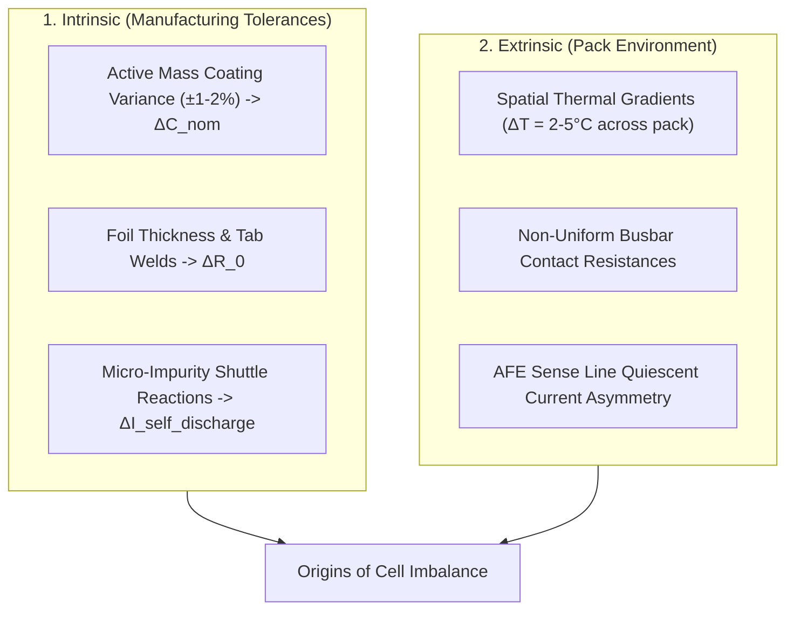
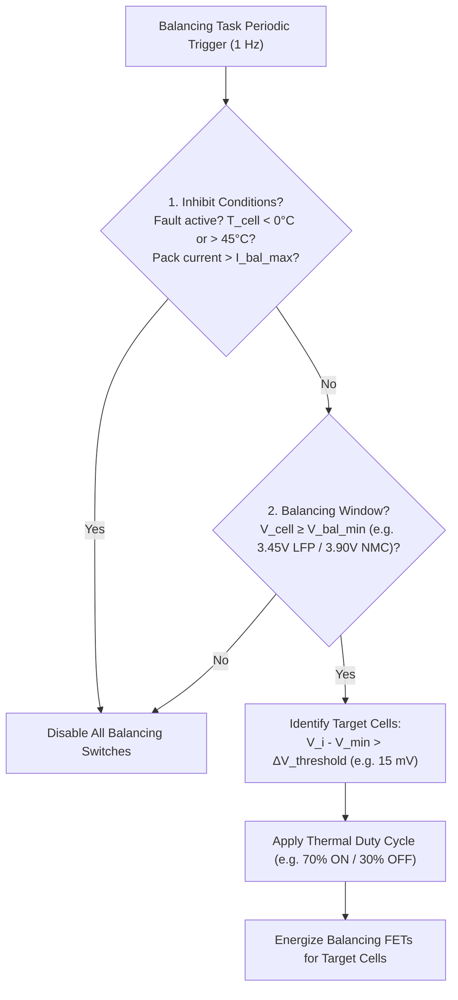

# Cell Imbalance Dynamics & Modeling

In multi-cell battery packs, individual lithium-ion cells are connected in series strings to achieve high system voltages (e.g., $400\,\text{V}$ to $800\,\text{V}$ in electric vehicles, requiring 96 to 192 cells in series, $96\text{s} - 192\text{s}$). While ideal circuit models assume identical behavior across all cells, real-world battery packs exhibit inevitable cell-to-cell divergence in capacity, internal resistance, and self-discharge rates[^andrea2020].

Without intervention, these discrepancies compound over successive cycles, causing premature discharge termination, overcharge hazards, accelerated aging, and severe loss of usable pack energy[^daowd2011]. This chapter analyzes the physical mechanisms of cell imbalance, formalizes the usable capacity equations of series strings, and explores algorithmic balancing strategies.

---

## Physical Origins of Cell-to-Cell Imbalance

Cell divergence originates from two distinct domains: **intrinsic manufacturing dispersion** and **extrinsic operational gradients**[^baronti2014].



### 1. Statistical Manufacturing Tolerances

Even within the same production batch from Tier-1 cell manufacturers, microscopic variations occur:
- **Active Material Mass Loading:** Slot-die coating thickness variations ($\pm 1.5\,\mu\text{m}$) yield nominal capacity variations:

$$
C_i \sim \mathcal{N}\left(\mu_C, \, \sigma_C^2\right), \quad \frac{\sigma_C}{\mu_C} \approx 0.5\% - 1.5\%
$$

- **Impedance Dispersion:** Ultrasonic or laser tab welding tolerances and separator winding tension create ohmic resistance variations:

$$
R_{0,i} \sim \mathcal{N}\left(\mu_R, \, \sigma_R^2\right), \quad \frac{\sigma_R}{\mu_R} \approx 3\% - 8\%
$$

### 2. Spatial Thermal Gradients

Thermal distribution across a large pack is never perfectly homogeneous. Due to fluid boundary layer development in cooling cold plates and geometry constraints, cells near the coolant inlet operate cooler than cells near the outlet ($\Delta T_{\text{pack}} \approx 2^\circ\text{C} - 5^\circ\text{C}$)[^pesaran2002].

According to the Arrhenius relation, side-reaction rates and solid-electrolyte interphase (SEI) growth scale exponentially with local temperature:

$$
k_{\text{SEI}}(T) = A \cdot \exp\left(-\frac{E_a}{R \cdot T_{\text{cell}}}\right)
$$

A temperature delta of $\Delta T = 5^\circ\text{C}$ accelerates degradation in warmer cells by $\approx 25 - 40\%$, causing accelerated capacity fade and resistance growth that permanently unbalances the series string.

### 3. Self-Discharge Variance

Parasitic chemical side-reactions—including transition metal dissolution, electrolyte oxidation, and microscopic shuttle reactions—induce a continuous leakage current ($I_{\text{sd}}$) even when the pack is disconnected:

$$
I_{\text{sd}, i}(T) = I_{0, i} \cdot \exp\left(-\frac{E_{a, \text{sd}}}{R \cdot T_i}\right)
$$

If Cell A exhibits an $I_{\text{sd}}$ of $15\,\mu\text{A}$ while Cell B exhibits $45\,\mu\text{A}$, Cell B loses an extra $0.26\,\text{Ah}$ per year in storage, drifting away from Cell A.

---

## Usable Capacity in Series Strings: "The Weakest Link"

In a series string of $N$ cells, the same string current $I_{\text{pack}}(t)$ flows through every cell:

$$
I_1(t) = I_2(t) = \dots = I_N(t) = I_{\text{pack}}(t)
$$

### Cutoff Boundaries

1. **Charging Cutoff:** Charging must stop as soon as the **highest cell voltage** reaches the upper safety limit $V_{\max}$ (e.g., $4.20\,\text{V}$ for NMC):

$$
t_{\text{chg,end}} \iff \max_{i \in [1, N]} V_i(t) = V_{\max}
$$

2. **Discharging Cutoff:** Discharging must stop as soon as the **lowest cell voltage** drops to the lower safety limit $V_{\min}$ (e.g., $2.80\,\text{V}$ for NMC):

$$
t_{\text{dis,end}} \iff \min_{i \in [1, N]} V_i(t) = V_{\min}
$$

```
Cell Voltages in Unbalanced 3S String:
   ^
   |  [=== Cell 1 ===] 4.20V (Stops Charge! Other cells underfilled)
V  |  [== Cell 2 ==]   4.05V
   |  [= Cell 3 =]     3.90V
   +------------------------------------------------------------
   |  [= Cell 3 =]     2.80V (Stops Discharge! Energy left in Cells 1 & 2)
   |  [== Cell 2 ==]   3.10V
   |  [=== Cell 1 ===] 3.35V
```

### Mathematical Derivation of Usable Pack Capacity

Let each cell $i$ have individual capacity $C_i$ and initial State of Charge $\text{SoC}_i(0) \in [0, 1]$.

The charge capacity that can be added to cell $i$ before it reaches $100\%$ SoC is:

$$
Q_{\text{chg}, i} = (1 - \text{SoC}_i(0)) \cdot C_i
$$

The charge capacity that can be extracted from cell $i$ before it reaches $0\%$ SoC is:

$$
Q_{\text{dis}, i} = \text{SoC}_i(0) \cdot C_i
$$

Because the cells are in series, the total usable charge capacity of the pack $Q_{\text{usable,pack}}$ without balancing is strictly bounded by the minimums:

$$
Q_{\text{usable,pack}} = \min_{i \in [1, N]} \left[ \text{SoC}_i(0) \cdot C_i \right] + \min_{i \in [1, N]} \left[ (1 - \text{SoC}_i(0)) \cdot C_i \right]
$$

> [!IMPORTANT]
> The usable capacity of an unbalanced series string is **strictly less than the capacity of its weakest cell**:
> $Q_{\text{usable,pack}} \le \min_{i} C_i$.
> Unusable energy remains trapped in non-limiting cells at both ends of the cycle.

---

## Balancing Metrics: Voltage vs. State of Charge (SoC)

Selecting the balancing control variable is critical for system stability:

| Balancing Metric | Operating Principle | Major Advantages | Severe Pitfalls / Limitations |
| :--- | :--- | :--- | :--- |
| **Terminal Voltage ($V_i$)** | Balance when $V_i - \min_j V_j > \Delta V_{\text{th}}$ | Simple, requires no model or state estimator | Fails completely during current flow ($I \cdot R_i$ drops corrupt voltage); highly misleading in flat OCV chemistries ($\text{LiFePO}_4$)[^gallardo2014] |
| **Open-Circuit Voltage ($U_{\text{ocv}, i}$)** | Balance based on reconstructed resting OCV | Eliminates dynamic $I \cdot R$ drops | Requires extended rest or mathematical observer convergence |
| **State of Charge ($\text{SoC}_i$)** | Balance when $\text{SoC}_i - \min_j \text{SoC}_j > \Delta \text{SoC}_{\text{th}}$ | True electrochemical charge equalization; independent of cell internal resistance variations | Demands a robust observer (e.g. EKF) to prevent balancing errors caused by estimator drift |

### The LFP Voltage Balancing Challenge

In Lithium Iron Phosphate ($\text{LiFePO}_4$) cells, the $U_{\text{ocv}}$ curve is exceptionally flat across $20\% \le \text{SoC} \le 80\%$, exhibiting a slope of less than $0.5\,\text{mV} / \%\,\text{SoC}$:

```
     ΔV = 5 mV  ===>  ΔSoC ≈ 15% - 25% uncertainty!
```

If voltage-based balancing is engaged during this flat plateau, minor sensor noise ($\pm 3\,\text{mV}$) or contact resistance deltas will cause the BMS to discharge cells that are actually at lower states of charge, worsening pack imbalance. Consequently, **LFP systems balance exclusively at the high-voltage end of charge** ($V_{\text{cell}} \ge 3.45\,\text{V}$), where the OCV curve steepens sharply[^stuart2011].

---

## Algorithmic Balancing Strategies

BMS firmware implements deterministic rules to govern balancing actuators:



1. **Hysteresis Thresholds:** Balancing activates when $\Delta V > \Delta V_{\text{on}}$ (e.g., $15\,\text{mV}$) and deactivates when $\Delta V \le \Delta V_{\text{off}}$ (e.g., $5\,\text{mV}$) to prevent high-frequency chatter.
2. **Thermal Duty Cycling:** Because passive balancing generates heat on the circuit board ($P_{\text{loss}} = I_{\text{bal}}^2 R_{\text{bal}}$), balancing switches are pulsed (e.g., 8 seconds ON, 2 seconds OFF for ADC measurement and thermal settling).
3. **Neighbor Inhibition:** To avoid localized PCB hot spots, the BMS prevents adjacent balancing channels from turning on simultaneously.

---

## Production Python Implementation: Series Pack Imbalance Simulator

The following simulation demonstrates the compounding effect of cell capacity and resistance dispersion in an unmanaged series string vs. an actively balanced string:

```python
"""
Series Battery Pack Imbalance Simulator.
Calculates usable capacity loss under intrinsic cell dispersion.
"""

from dataclasses import dataclass
from typing import List
import numpy as np


@dataclass
class Cell:
    cell_id: int
    c_nom_ah: float       # Nominal capacity [Ah]
    r0_ohms: float        # Ohmic internal resistance [Ohms]
    soc: float            # Current State of Charge [0.0 to 1.0]

    def terminal_voltage(self, current_amps: float) -> float:
        """Simplified OCV linear approximation for NMC."""
        ocv = 3.20 + 0.95 * self.soc
        return ocv - current_amps * self.r0_ohms


class SeriesPack:
    def __init__(self, cells: List[Cell]) -> None:
        self.cells = cells

    def compute_usable_capacity_unbalanced(self) -> float:
        """
        Calculates theoretical usable capacity without balancing:
        Q_usable = min(SoC_i * C_i) + min((1 - SoC_i) * C_i)
        """
        q_dis_available = min(c.soc * c.c_nom_ah for c in self.cells)
        q_chg_available = min((1.0 - c.soc) * c.c_nom_ah for c in self.cells)
        return q_dis_available + q_chg_available

    def run_passive_balancing_step(
        self,
        target_v_threshold: float = 0.010,  # 10 mV threshold
        r_bleed_ohms: float = 33.0,          # 33 Ohm bleed resistor
        dt_seconds: float = 1.0              # 1 second step
    ) -> List[int]:
        """
        Executes one passive bleed cycle on cells exceeding the lowest cell.
        Returns list of cell IDs being bled.
        """
        voltages = [c.terminal_voltage(0.0) for c in self.cells]
        v_min = min(voltages)
        active_bleeders: List[int] = []

        for idx, cell in enumerate(self.cells):
            v_cell = voltages[idx]
            if (v_cell - v_min) > target_v_threshold:
                # Bleed current I = V / R_bleed
                i_bleed = v_cell / r_bleed_ohms
                # Discharge cell slightly: ΔSoC = (I * dt) / (C_nom * 3600)
                delta_soc = (i_bleed * dt_seconds) / (cell.c_nom_ah * 3600.0)
                cell.soc = max(0.0, cell.soc - delta_soc)
                active_bleeders.append(cell.cell_id)

        return active_bleeders


# --- Verification Execution ---
if __name__ == "__main__":
    np.random.seed(101)

    # Instantiate an unmanaged 4-cell series string (4S) with 2% manufacturing variance
    pack_cells = [
        Cell(cell_id=1, c_nom_ah=50.0, r0_ohms=0.0018, soc=0.88),
        Cell(cell_id=2, c_nom_ah=49.1, r0_ohms=0.0021, soc=0.82),  # Lowest capacity
        Cell(cell_id=3, c_nom_ah=50.5, r0_ohms=0.0017, soc=0.91),  # Highest SoC
        Cell(cell_id=4, c_nom_ah=49.8, r0_ohms=0.0019, soc=0.84),
    ]

    pack = SeriesPack(pack_cells)
    min_single_cell_capacity = min(c.c_nom_ah for c in pack.cells)
    usable_q = pack.compute_usable_capacity_unbalanced()

    print(f"Pack Configuration: 4S Multi-Cell String")
    print(f"Lowest Individual Cell Capacity: {min_single_cell_capacity:.2f} Ah")
    print(f"Usable Pack Capacity (Unbalanced): {usable_q:.2f} Ah")
    print(f"Trapped Energy / Lost Capacity:   {(min_single_cell_capacity - usable_q):.2f} Ah ({(min_single_cell_capacity - usable_q)/min_single_cell_capacity*100:.1f} %)\n")

    # Simulate balancing over 3600 seconds
    for t in range(3600):
        bleeders = pack.run_passive_balancing_step(target_v_threshold=0.005, dt_seconds=1.0)

    usable_q_after = pack.compute_usable_capacity_unbalanced()
    print(f"After 1 Hour Passive Balancing:")
    print(f"Usable Pack Capacity (Balanced):   {usable_q_after:.2f} Ah")
    print(f"Capacity Recovery:                +{(usable_q_after - usable_q):.2f} Ah")
```

---

## References

[^andrea2020]: Andrea, D. (2020). *Battery Management Systems for Large Lithium-Ion Battery Packs*. Artech House.
[^daowd2011]: Daowd, M., et al. (2011). A review of passive and active battery balancing technologies. *International Journal of Applied Energy Studies*, 7(2), 154–168.
[^baronti2014]: Baronti, F., et al. (2014). Run-time evaluation of cell-to-cell differences in lithium-ion batteries. *IEEE Transactions on Industrial Electronics*, 61(6), 2881–2892.
[^pesaran2002]: Pesaran, A. A. (2002). Battery thermal management in EVs and HEVs: Issues and solutions. *Advanced Automotive Battery Conference*, Las Vegas, NV.
[^gallardo2014]: Gallardo-Lozano, J., et al. (2014). Battery balancing architectures for electric vehicles: Analysis and comparison. *Renewable and Sustainable Energy Reviews*, 39, 439–455.
[^stuart2011]: Stuart, T. A., & Zhu, W. (2011). Modularized battery management for large lithium-ion packs. *IEEE Transactions on Aerospace and Electronic Systems*, 47(3), 1904–1912.
