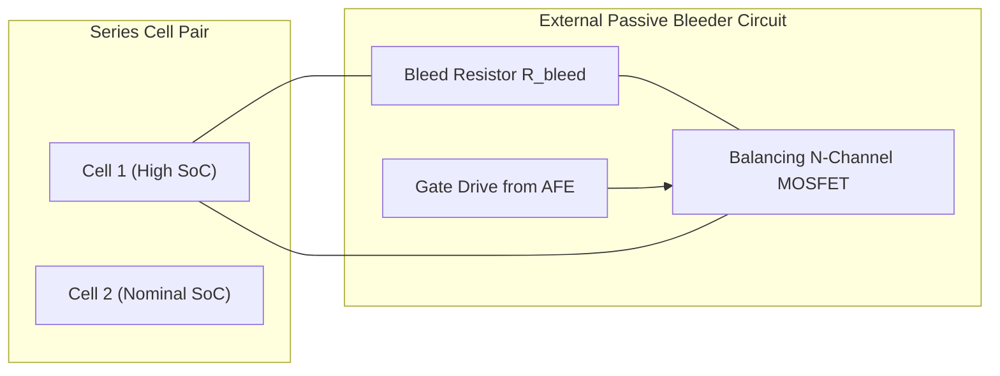
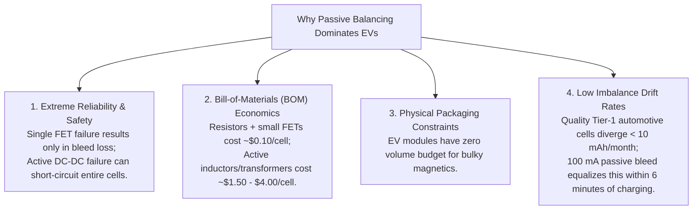

# Active vs. Passive Cell Balancing Topologies

Cell balancing circuits equalize State of Charge (SoC) and cell voltages across series strings, preventing premature capacity cutoffs and overcharge conditions. Balancing architectures fall into two primary paradigms: **Passive Balancing** (dissipating excess chemical energy as thermal heat) and **Active Balancing** (redistributing charge non-dissipatively between cells via capacitive, inductive, or transformer-coupled converters)[^andrea2020][^daowd2014].

This chapter evaluates the circuit topologies, power electronics derivations, thermal dissipation models, and economic trade-offs governing modern balancing hardware.

---

## Architectural Comparison Matrix

| Technical Parameter | Passive Bleed (Internal AFE) | Passive Bleed (External FET) | Switched Capacitor (Active) | Bidirectional Buck-Boost (Active) | Isolated Flyback (Cell-to-Pack Active) |
| :--- | :--- | :--- | :--- | :--- | :--- |
| **Balancing Mechanism** | Resistive heat dissipation | Resistive heat dissipation | Capacitive charge shuttling | Inductive energy transfer | Magnetic transformer isolation |
| **Energy Efficiency** | $0\%$ (Total loss) | $0\%$ (Total loss) | $75\% - 85\%$ | $82\% - 90\%$ | $85\% - 92\%$ |
| **Balancing Current** | $50 - 200\,\text{mA}$ | $0.5 - 2.0\,\text{A}$ | $0.2 - 1.0\,\text{A}$ | $1.0 - 5.0\,\text{A}$ | $2.0 - 10.0\,\text{A}$ |
| **Relative Hardware Cost** | Baseline ($1\times$) | $1.2\times - 1.5\times$ | $3\times - 5\times$ | $6\times - 8\times$ | $8\times - 12\times$ |
| **PCB Component Count / Cell** | $1$ Resistor | $1$ Resistor + $1$ FET | $2$ FETs + $1$ Capacitor | $4$ FETs + $1$ Inductor | $2$ FETs + Transformer tap |
| **Silicon Real Estate** | Integrated into AFE | Low footprint | Medium footprint | High (Bulky magnetics) | Very high (Planar transformers) |
| **Industry Adoption** | $>85\%$ of commercial EVs | High-power stationary ESS | Research / low-voltage | Niche industrial | Premium aerospace / niche |

---

## Passive Balancing Topologies

Passive balancing operates by switching a resistive load in parallel with a cell whose voltage or SoC exceeds the pack threshold[^lee2011].



### 1. Internal AFE vs. External MOSFET Switching

Modern Analog Front-End (AFE) ICs (e.g., Texas Instruments BQ79616, Analog Devices LTC6813, NXP MC33771C) integrate internal balancing MOSFETs:
- **Internal Balancing:** The discharge current flows directly through internal silicon switches in the AFE package. To prevent exceeding the chip's maximum junction temperature ($T_j \le 125^\circ\text{C}$), internal currents are strictly bounded:

$$
I_{\text{bal,internal}} \le \frac{T_{j,\max} - T_{\text{ambient}}}{\theta_{JA} \cdot V_{\text{cell}} \cdot N_{\text{channels}}} \approx 50 - 150\,\text{mA}
$$

- **External Balancing:** High-capacity cells ($>60\,\text{Ah}$) require faster balancing rates ($I_{\text{bal}} \approx 0.5 - 1.5\,\text{A}$). External logic-level N-channel MOSFETs and discrete pulse-rated ceramic/power resistors are mounted on the PCB, offloading thermal stress from the AFE.

### 2. Thermal Dissipation Modeling

When $K$ cells in a module are balanced simultaneously, the total heat flux $\dot{Q}_{\text{dissipated}}$ injected into the BMS enclosure is:

$$
\dot{Q}_{\text{dissipated}} = \sum_{k=1}^K I_{\text{bal}, k}^2 R_{\text{bleed}, k} = \sum_{k=1}^K \frac{V_{\text{cell}, k}^2}{R_{\text{bleed}, k}}
$$

For a 16-channel module with $R_{\text{bleed}} = 33\,\Omega$ at $V_{\text{cell}} = 4.0\,\text{V}$:

$$
P_{\text{per\_cell}} = \frac{(4.0\,\text{V})^2}{33\,\Omega} \approx 0.485\,\text{W}
$$

If all 16 channels engage concurrently, the PCB dissipates $\approx 7.76\,\text{W}$. Without thermal copper planes, thermal vias, and heatsinking, local temperatures quickly exceed automotive limits ($>85^\circ\text{C}$).

---

## Active Balancing Circuit Topologies

Active balancing transfers energy directly from higher-charge cells to lower-charge cells or between individual cells and the entire pack[^kim2014].

### 1. Switched-Capacitor (SC) Converters

Switched-capacitor topologies shuttle charge between adjacent cells without inductors:


During phase $\phi_1$, switch $S_1$ closes, charging capacitor $C_s$ to $V_k$. During phase $\phi_2$, $S_1$ opens and $S_2$ closes, discharging $C_s$ into cell $k+1$.

The average balancing current transferred between adjacent cells is:

$$
I_{\text{bal,avg}} = f_{\text{sw}} \cdot C_s \cdot (V_k - V_{k+1})
$$

Where $f_{\text{sw}}$ is the switching frequency ($50 - 200\,\text{kHz}$).

> [!WARNING]
> Because $I_{\text{bal,avg}} \propto (V_k - V_{k+1})$, the balancing current approaches **zero** as cell voltages equalize. Furthermore, moving charge from Cell 1 to Cell 16 requires 15 cascaded transfer cycles, resulting in poor end-to-end balancing speed and cumulative switching losses.

### 2. Bidirectional Buck-Boost Inductive Balancing

Inductors store magnetic energy ($E_L = \frac{1}{2} L I_L^2$), enabling constant current transfer regardless of voltage differences[^cao2008]:


1. **Charge Phase:** $Q_1$ turns on for duration $D \cdot T_{\text{sw}}$, ramping current in inductor $L$:

$$
I_{L,\text{peak}} = \frac{V_k}{L} \cdot D T_{\text{sw}}
$$

2. **Discharge Phase:** $Q_1$ turns off and $Q_2$ (or body diode) conducts, discharging stored magnetic energy into cell $k+1$:

$$
\frac{dI_L}{dt} = -\frac{V_{k+1}}{L}
$$

The average balancing current is decoupled from $\Delta V$:

$$
I_{\text{bal}} = \frac{V_k \cdot D^2 \cdot T_{\text{sw}}}{2 L}
$$

### 3. Isolated Flyback Converter (Cell-to-Pack / Pack-to-Cell)

To eliminate neighbor-only limitations, isolated flyback converters move charge directly between any individual weak cell and the entire high-voltage pack bus:


- **Energy Source:** The entire pack ($400\,\text{V}$) provides the energy.
- **Energy Destination:** Current is injected directly into whichever cell has the lowest SoC, equalizing the string in a single conversion step with an electrical efficiency of $\approx 85\%$.

---

## Why Passive Balancing Dominates Automotive Production

Despite wasting energy as heat, **passive balancing accounts for over 85% of commercial electric vehicle designs** (Tesla Model 3/Y, VW MEB ID.4, Porsche Taycan, Hyundai E-GMP)[^andrea2020].



---

## Active vs. Passive Balancing Analysis in Battery Toolkit

The comparative balancing speed, thermal dissipation, and transfer efficiency model is implemented in [`battery_toolkit.bms.balancing`](file:///Users/cc/Desktop/Battery-Systems-Technology/codes/python/src/battery_toolkit/bms/balancing.py):

```python
from battery_toolkit.bms import PassiveBalancingSimulator, ActiveBalancingSimulator

# Cell parameters: 65 Ah cell with 3% SoC imbalance (1.95 Ah charge delta)
q_delta_ah = 1.95
v_nom = 3.70

# 1. Passive bleed model (27 Ohm bleeder with 80% thermal duty cycle)
passive = PassiveBalancingSimulator(cell_capacities_ah=[65.0, 65.0], cell_socs=[0.83, 0.80], bleed_resistor_ohms=27.0)
i_passive_effective = (v_nom / 27.0) * 0.80
time_passive_h = q_delta_ah / i_passive_effective
heat_passive_wh = v_nom * q_delta_ah

# 2. Active inductive buck-boost model (2.5 A transfer current, 88% efficiency)
active = ActiveBalancingSimulator(transfer_current_a=2.5, efficiency=0.88)
res_active = active.calculate_transfer_metrics(q_delta_ah=q_delta_ah, v_nom=v_nom)

print(f"Passive Bleed: {time_passive_h:.2f} h | Dissipated: {heat_passive_wh:.2f} Wh (0% efficiency)")
print(f"Active Inductive: {res_active['time_hours']:.2f} h | Dissipated: {res_active['heat_dissipated_wh']:.2f} Wh (88% efficiency)")
```

Source code, circuit loss formulas, and test validations are maintained in [`codes/python/src/battery_toolkit/bms/balancing.py`](file:///Users/cc/Desktop/Battery-Systems-Technology/codes/python/src/battery_toolkit/bms/balancing.py) and [`test_bms.py`](file:///Users/cc/Desktop/Battery-Systems-Technology/codes/python/tests/test_bms.py).

---

## References

[^andrea2020]: Andrea, D. (2020). *Battery Management Systems for Large Lithium-Ion Battery Packs*. Artech House.
[^daowd2014]: Daowd, M., et al. (2014). A bidirectional active balancing topology for lithium-ion batteries. *IEEE Transactions on Power Electronics*, 29(4), 1695–1705.
[^lee2011]: Lee, Y. S., & Cheng, M. W. (2011). Intelligent energy management for multiple battery systems with active cell balancing. *IEEE Transactions on Industrial Electronics*, 58(8), 3409–3418.
[^kim2014]: Kim, M. Y., Kim, C. H., Kim, J. H., & Cho, G. W. (2014). An active cell balancing circuit for series-connected battery strings using switched capacitor. *IEEE Transactions on Power Electronics*, 29(8), 4160–4169.
[^cao2008]: Cao, J., Schofield, N., & Emadi, A. (2008). Battery balancing methods: A challenge in electric vehicle applications. *IEEE Vehicle Power and Propulsion Conference*, Harbin, China.
