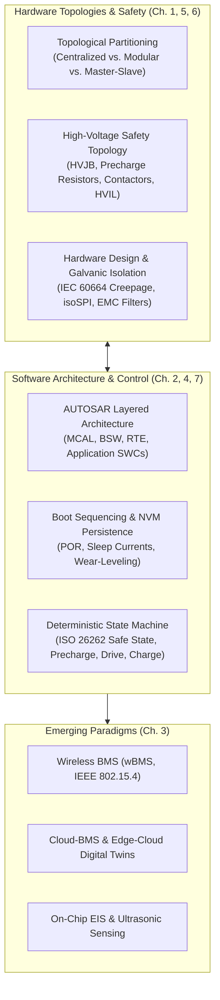
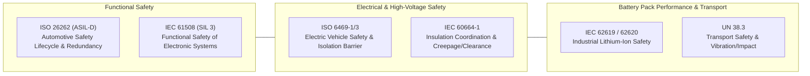

# Battery Management System (BMS) Architecture

The Battery Management System (BMS) represents the core cyber-physical architecture of an electrified powertrain or stationary energy storage system. Operating at the confluence of high-voltage power electronics, real-time embedded systems, and electrochemistry, the BMS architecture must guarantee nanosecond-scale fault containment, galvanic safety isolation, deterministic real-time control, and seamless vehicle network integration[^andrea2020][^plett2015].

This module establishes the comprehensive hardware and software architectural paradigms governing modern automotive and grid-scale battery systems, detailing structural topologies, AUTOSAR software layering, EMC/safety hardware design, and next-generation wireless/cloud architectures.

---

## Architectural Hierarchy & Curriculum Roadmap

The architecture of a high-voltage BMS spans multiple abstraction layers, from cell-monitoring satellite integrated circuits to cloud digital twins:

### Module Chapter Guide

1. [BMS Topologies & Hardware Partitioning](01_bms_architecture.md): Structural comparison between Centralized, Modular, Master-Slave, and Distributed topologies; wiring harness trade-offs, galvanic isolation boundaries ($>2.5\,\text{kV}_{\text{RMS}}$), and failure containment.
2. [AUTOSAR Software Architecture & Control](02_bms_control.md): Layered AUTOSAR Classic architecture (MCAL, BSW, RTE, SWC), multi-rate task scheduling ($1\,\text{ms}, 10\,\text{ms}, 100\,\text{ms}$), safety watchdogs, and memory partitioning.
3. [Next-Generation BMS Technologies](03_development_trends.md): Wireless BMS (wBMS) protocols, cloud-edge hybrid state estimation, digital twins, and embedded on-chip Electrochemical Impedance Spectroscopy (EIS).
4. [Boot Sequencing, Sleep Modes & NVM Persistence](04_initial_soc.md): Microcontroller startup sequences, Power-On Reset (POR), low-power sleep state current budgeting ($I_{\text{sleep}} \le 100\,\mu\text{A}$), RTC wake-up timers, and EEPROM/Flash wear-leveling.
5. [Hardware Design, Galvanic Isolation & EMC Compliance](05_bms_design.md): High-voltage PCB design, creepage and clearance distances under IEC 60664-1, pulse transformers vs. capacitive isolators, CISPR 25 Class 5 EMC filtering, and anti-aliasing AFE filters.
6. [High-Voltage Distribution & Safety Topology](06_topology.md): High-Voltage Junction Box (HVJB) sizing, precharge RC timing analysis ($\tau = RC$), inrush energy dissipation ($E = \frac{1}{2} C_{\text{dc}} V_{\text{pack}}^2$), High-Voltage Interlock Loop (HVIL), and pyro-fuse integration.
7. [Deterministic BMS State Machine & Safety Handling](07_state_machine.md): UML statechart execution, precharge state machine, fast-charging sequencing, fault priority handling, and ISO 26262 ASIL-D emergency shutdown transitions.

---

## Regulatory Standards & Functional Safety Framework

BMS hardware and software architectures are strictly governed by international safety codes:

| Standard | Governing Domain | Primary Architectural Mandate |
| :--- | :--- | :--- |
| **ISO 26262 (Part 1-12)** | Road Vehicles - Functional Safety | Mandates ASIL-D for overcharge, overtemperature, and unintended contactor opening; requires single-point fault metric $\text{SPFM} \ge 99\%$ and latent fault metric $\text{LFM} \ge 90\%$[^iso26262]. |
| **ISO 6469-1 / 3** | Electrically Propelled Road Vehicles | Defines galvanic isolation boundaries; specifies minimum isolation resistance of $500\,\Omega/\text{V}$ for DC systems and electrical shock protection. |
| **IEC 60664-1** | Insulation Coordination | Establishes minimum clearance (air gap) and creepage (surface distance) rules based on pollution degree, comparative tracking index (CTI), and working voltage. |
| **IEC 62619 / 62620** | Industrial Lithium-Ion Safety | Mandates BMS secondary protection independence, propagation prevention, and thermal runaway containment. |
| **UN 38.3** | Transport of Dangerous Goods | Validates mechanical integrity under vibration, altitude depressurization, thermal shock, and external short circuit. |

---

## References

[^andrea2020]: Andrea, D. (2020). *Battery Management Systems for Large Lithium-Ion Battery Packs*. Artech House.
[^plett2015]: Plett, G. L. (2015). *Battery Management Systems, Volume I: Battery Modeling* & *Volume II: Equivalent-Circuit Methods*. Artech House.
[^iso26262]: International Organization for Standardization. (2018). *ISO 26262: Road vehicles — Functional safety*. ISO.
