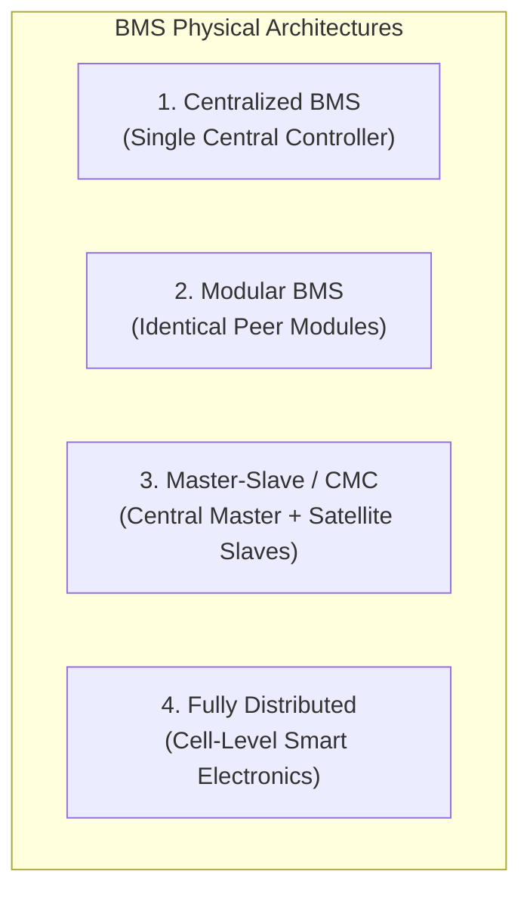
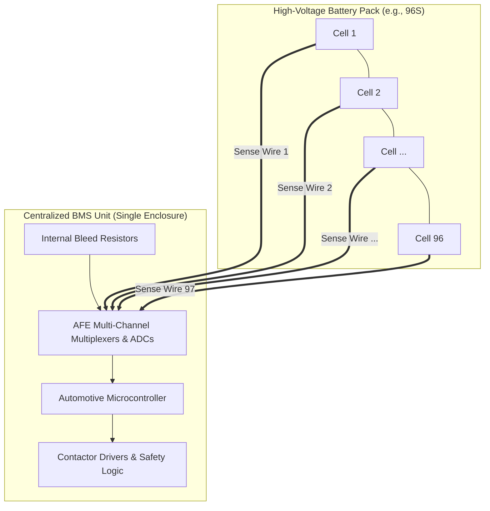
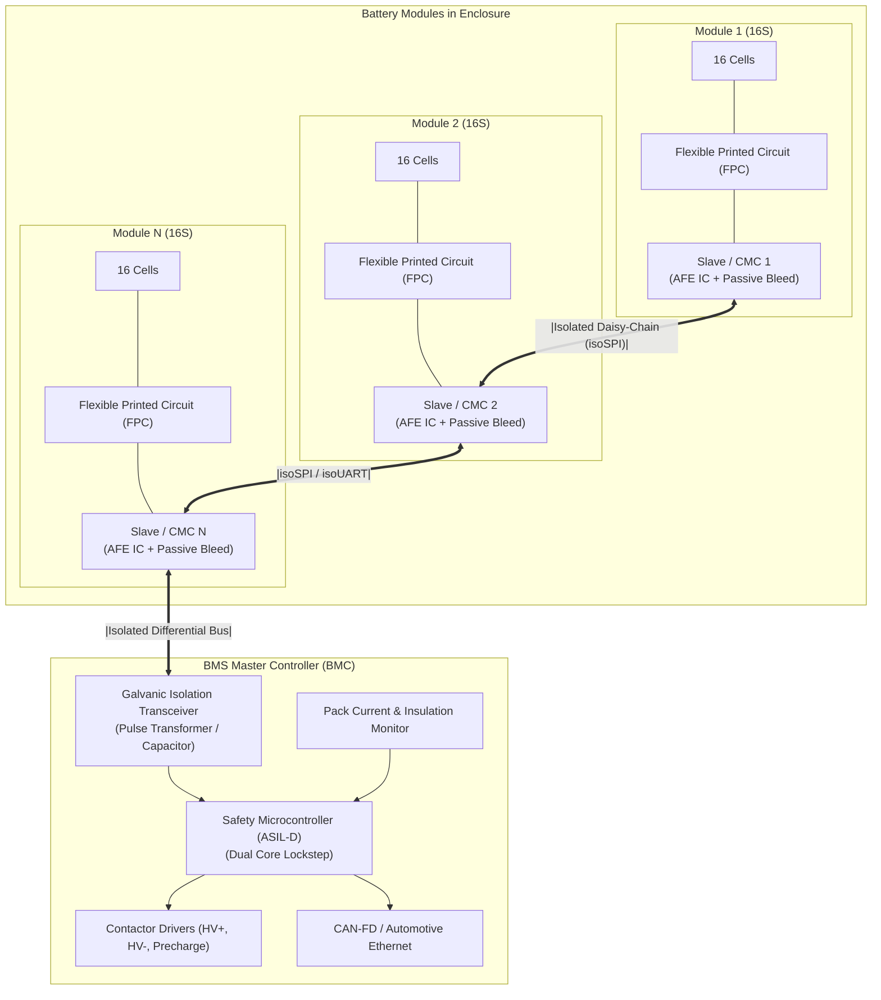

# BMS Topologies: Centralized, Modular & Distributed Architectures

The physical and electrical partitioning of a Battery Management System (BMS) defines how voltage sensing, temperature monitoring, cell balancing, state estimation, contactor control, and external communication are distributed across physical printed circuit boards (PCBs) and wiring harnesses[^andrea2020]. 

In a high-voltage battery system (spanning $400\,\text{V}$ to over $1000\,\text{V}$ in modern electric vehicles and grid-scale ESS), the topological configuration dictates the length of dangerous high-voltage wiring harnesses, galvanic isolation requirements, electromagnetic immunity, modular scalability, and production economics[^stuart2011].

This chapter provides a rigorous technical comparison of the four primary BMS topologies: **Centralized**, **Modular**, **Master-Slave (Master-Satellite)**, and **Fully Distributed (Smart Cell)** architectures.

---

## Topological Classification & Architectural Overview



| Architectural Attribute | Centralized | Modular | Master-Slave (Master-Satellite) | Fully Distributed (Smart Cell) |
| :--- | :--- | :--- | :--- | :--- |
| **Typical Voltage Range** | $12\,\text{V} - 48\,\text{V}$ (Up to $100\,\text{V}$) | $100\,\text{V} - 400\,\text{V}$ | $400\,\text{V} - 1000\,\text{V}+$ | $400\,\text{V} - 800\,\text{V}$ (Specialized) |
| **Wiring Harness Complexity** | Extremely High ($N+1$ HV wires to 1 box) | Medium (Intra-module harness) | Low (Short module FPC + 2-wire isoSPI) | Minimal (Single daisy-chain bus) |
| **High-Voltage Fire Hazard** | High (Long HV sense lines crisscross pack) | Medium | Very Low (HV contained strictly in modules) | Very Low |
| **Galvanic Isolation** | Not required (Shares ground) | Required per module | Required at Master boundary ($>2.5\,\text{kV}$) | Required per cell |
| **Single-Point Failure Risk** | Complete system failure | Module failure | Master failure trips pack | Single cell ASIC bypassable |
| **BOM Cost per Cell** | Lowest (Single PCB, single MCU) | High (Redundant MCUs & power supplies) | Optimized (Low-cost AFE slaves + 1 safety MCU) | High (ASIC packaging on every cell) |
| **Automotive EV Adoption** | Mild-hybrid ($48\,\text{V}$), LEVs, E-bikes | Niche industrial ESS | $>90\%$ of commercial passenger EVs | Emerging research / niche high-end |

---

## 1. Centralized BMS Architecture

In a centralized topology, all cell sensing, balancing switches, microcontroller processing, contactor drivers, and power supplies reside on a **single central PCB** enclosed in a unified housing[^pop2008].



### Technical Trade-Offs

- **The $N+1$ Wiring Bottleneck:** Monitoring a series string of $N$ cells requires $N+1$ discrete measurement conductors bundled into thick harnesses. For a $96\text{s}$ pack, 97 individual wires—each carrying full cell electrical potentials ranging from $0\,\text{V}$ to $400\,\text{V}$—must be routed from distant mechanical corners of the pack into a single multipin connector.
- **Safety Hazard:** If a mechanical crash or vibration causes insulation chaffing between Wire 1 ($0\,\text{V}$) and Wire 96 ($400\,\text{V}$), an immediate, un-fused $400\,\text{V}$ dead short occurs directly within the wiring harness, bypassing pack fuses and creating catastrophic electrical fires.
- **Suitability:** Highly cost-effective and robust for low-voltage, physically compact systems such as $12\,\text{V}$ lead-acid replacement, $48\,\text{V}$ mild-hybrid vehicle (MHEV) packs, and electric two-wheelers.

---

## 2. Master-Slave (Master-Satellite / CMC) Architecture

The **Master-Slave topology**—often termed **Master-Satellite** or **Battery Management Controller (BMC) + Cell Monitoring Controllers (CMCs)**—is the universal industry standard for production electric vehicles (Tesla, VW MEB, Porsche, GM Ultium)[^brand2013].



### Detailed Functional Partitioning

1. **Cell Monitoring Controller (CMC / Slave Board):**
   - Mounted directly on the module structural top-plate.
   - Connects to cell terminals via direct solder or laser-welded Flexible Printed Circuits (FPC), eliminating discrete hand-routed wire harnesses.
   - Contains a multi-channel Analog Front-End (AFE) ASIC (e.g., Texas Instruments BQ79616, Analog Devices ADBMS6817) with dedicated 16-bit Delta-Sigma ($\Delta\Sigma$) ADCs.
   - Integrates passive balancing FETs and NTC thermistor multiplexers.
   - Operates floating at the local common-mode potential of the module (e.g., Module 6 sits at $250\,\text{V}-300\,\text{V}$ relative to chassis ground).
2. **Battery Management Controller (BMC / Master Board):**
   - Located outside the hazardous module zone, typically adjacent to the High-Voltage Junction Box (HVJB).
   - Powered from the vehicle low-voltage battery ($12\,\text{V}$ or $24\,\text{V}$ chassis supply).
   - Houses the ASIL-D automotive safety microcontroller (e.g., Infineon AURIX TC397, NXP S32K3).
   - Executes state estimation (SoC, SoH, SoP), contactor sequencing, thermal management control loops, and vehicle network gateways (CAN-FD, Ethernet SOME/IP).

---

## Galvanic Isolation & Robust Daisy-Chain Topologies

Because CMCs operate at high common-mode floating voltages, all signals routed to the Master Controller must cross a **galvanic isolation barrier** rated for working voltages $>1000\,\text{V}_{\text{DC}}$ and transient dielectric withstand voltages $>2500\,\text{V}_{\text{RMS}}$ (IEC 60664-1)[^analogdevices2021].

### Isolated SPI (isoSPI) & Differential Pulse Signaling

Instead of running full CAN controllers on every slave module (which adds excessive silicon cost, quartz oscillators, and power consumption), slaves communicate via **proprietary isolated differential physical layers** (such as ADI isoSPI, TI proprietary differential UART, or NXP isolated daisy chain).

```
Master Board                       Slave Board 1
[ Controller ]                     [ AFE ASIC ]
[ isoSPI TX/RX ]                   [ isoSPI Port B ]
       |                                  |
  [Pulse XFMR]                       [Pulse XFMR]
       |===(Twisted Shielded Pair)========|
```

- High-frequency pulse transformers or high-voltage Class-Y capacitors provide galvanic separation.
- Differential signaling ($\pm 1\,\text{V}$) with high common-mode rejection ratio ($\text{CMRR} > 100\,\text{dB}$) allows reliable communication through severe inverter switching noise ($\frac{dV}{dt} > 50\,\text{V/ns}$ from SiC/GaN power stages).

### Fault-Tolerant Ring Topology (Dual-Master Redundancy)

In high-reliability automotive architectures, the daisy chain is routed as a closed ring with transceivers at both ends of the Master microcontroller:


If a physical cable break occurs (e.g., between CMC 2 and CMC N during vehicle collision):
1. The forward chain communications stall at the break.
2. The Master detects communication loss within $2\,\text{ms}$.
3. Port B is energized in reverse mode, addressing CMC N backwards.
4. **$100\%$ of cell data remains accessible**, satisfying ISO 26262 ASIL-D fault-tolerant operational requirements.

---

## 3. Fully Distributed (Smart Cell) Architecture

The **Fully Distributed BMS** integrates dedicated miniature silicon micro-ASICs directly onto the terminal interconnects or inside the cell safety cap of every single cell[^andrea2020].

### Mechanics

- Each cell carries its own micro-controller, voltage sensor, local temperature sensor, and balancing switch.
- Only a single thin communication loop (or wireless near-field link) connects the cells in a daisy-chain.
- Eliminates module-level CMCs entirely.

### Challenges Preventing Mass Commercialization

- **Extreme Thermal Stress:** Micro-ASICs are bonded directly to cell terminals, exposing silicon to cell operating temperatures (up to $60^\circ\text{C}-80^\circ\text{C}$), degrading semiconductor reliability.
- **Cost Multiplication:** A $96\text{s}2\text{p}$ pack requires 192 individual packaged ASICs, crystal oscillators or precision RC clocks, and protection components, exceeding the BOM of a 6-slave Master-Slave system by $>300\%$.

---

## References

[^andrea2020]: Andrea, D. (2020). *Battery Management Systems for Large Lithium-Ion Battery Packs*. Artech House.
[^stuart2011]: Stuart, T. A., & Zhu, W. (2011). Modularized battery management for large lithium-ion packs. *IEEE Transactions on Aerospace and Electronic Systems*, 47(3), 1904–1912.
[^pop2008]: Pop, V., et al. (2008). *Battery Management Systems: Accurate State-of-Charge Indication for Battery-Powered Applications*. Springer.
[^brand2013]: Brand, M. J., et al. (2013). Welding of contactors in automotive battery systems: Analysis and diagnostic routines. *IEEE Transactions on Vehicular Technology*, 63(6), 2548–2557.
[^analogdevices2021]: Analog Devices. (2021). *ADBMS6817: 16-Channel Multicell Battery Monitor Technical Specification*. Analog Devices Inc.
