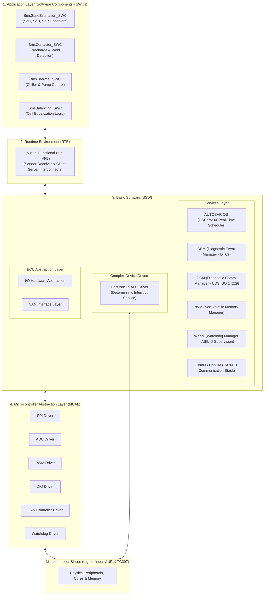
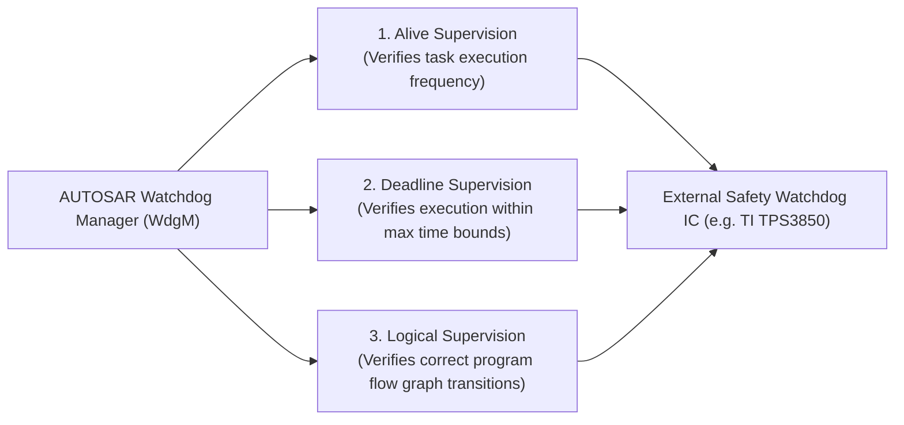

# AUTOSAR Software Architecture & Deterministic Control

In safety-critical automotive energy storage systems, Battery Management System (BMS) software is deployed according to the **AUTOSAR (AUTOmotive Open System ARchitecture) Classic Platform** standard (typically Releases 4.x / R20-11)[^autosar2021]. AUTOSAR enforces a modular, standardized architecture that completely decouples high-level electrochemical control algorithms from underlying microcontroller silicon, facilitating ISO 26262 ASIL-D functional safety certification, hardware re-usability, and deterministic real-time execution[^furst2009].

This chapter provides an in-depth analysis of the AUTOSAR layered software architecture, deterministic multi-rate task scheduling, and runtime safety supervision mechanisms within automotive BMS firmware.

---

## AUTOSAR Classic Architecture for High-Voltage BMS

The BMS firmware stack is structured into four distinct horizontal layers interconnected by standardized interfaces:

---

## 1. Application Layer: Software Components (SWCs)

The BMS business logic resides entirely within atomic **Software Components (SWCs)**. SWCs contain no silicon-dependent register calls; all communication occurs through typed ports mapped onto the Runtime Environment (RTE)[^autosar2021]:

1. **`BmsStateEstimation_SWC`:**
   - Houses the Extended Kalman Filter (EKF) for State of Charge (SoC).
   - Executes Recursive Least Squares (RLS) for ohmic resistance tracking.
   - Computes continuous and peak pulse power limits ($P_{\text{dis,max}}, P_{\text{chg,max}}$) transmitted to the vehicle inverter.
2. **`BmsContactor_SWC`:**
   - Controls the high-voltage sequencing state machine: Open, Precharge, Main Closed, Rapid Discharge, Emergency Trip.
   - Evaluates terminal voltage feedback across contactors to detect mechanical welding.
3. **`BmsThermal_SWC`:**
   - Collects module NTC temperature maps.
   - Executes gain-scheduled PID controllers outputting target coolant flow rates and chiller expansion valve openings over CAN to the thermal management ECU.
4. **`BmsBalancing_SWC`:**
   - Compares individual cell states against pack thresholds.
   - Computes duty-cycle command vectors for slave AFE balancing channels.

---

## 2. Basic Software (BSW) & Complex Device Drivers (CDD)

The BSW layer provides standardized infrastructural services to ensure system stability and vehicle network compliance:

### Complex Device Drivers (CDD) for Low-Latency Sensing

Standard AUTOSAR SPI driver stacks traverse multiple abstraction layers (MCAL $\to$ SpiIf $\to$ IoHwAb $\to$ RTE), introducing microsecond latencies unacceptable for high-voltage short-circuit containment.

A **Complex Device Driver (CDD)** bypasses the standard stack, establishing direct DMA-based hardware links to the physical SPI peripheral:
- Enables $2\,\text{Mbps}$ continuous streaming from slave AFE daisy chains.
- Executes hardware cyclic redundancy checks (CRC-15 / CRC-16) in assembly.
- Directly invokes hardware emergency interrupt routines upon detecting severe cell voltage limits ($V_{\text{cell}} > 4.25\,\text{V}$ or $V_{\text{cell}} < 2.0\,\text{V}$).

### Diagnostic Services: DEM and DCM

- **Diagnostic Communication Manager (DCM):** Implements ISO 14229-1 (Unified Diagnostic Services, UDS) and ISO 13400 (DoIP - Diagnostic over IP). Handles diagnostic sessions, security seed-key access (Service `0x27`), and parameter read/write (Service `0x22`).
- **Diagnostic Event Manager (DEM):** Logs Diagnostic Trouble Codes (DTCs), monitors failure debounce counters, and freezes parameter snapshots (pack voltage, current, cell temperatures, timestamp) into non-volatile memory upon fault confirmation.

---

## Deterministic Real-Time Multi-Rate Task Scheduling

Automotive BMS algorithms execute within an **OSEK/VDX-compliant AUTOSAR OS**. To balance processor throughput against physical control dynamics, functions are partitioned across cyclic task loops[^andrea2020]:

```mermaid
gantt
    title BMS Deterministic Multi-Rate Task Execution Schedule
    dateFormat X
    axisFormat %s ms

    section 1 ms Task
    Overcurrent & Pyro Trip Check (50 us) : 0, 1
    Hardware Watchdog Kick (20 us)       : 1, 2
    Overcurrent & Pyro Trip Check (50 us) : 2, 3

    section 10 ms Task
    Coulomb Counting Integration (150 us)  : 0, 3
    Contactor State Machine Step (200 us)  : 3, 5
    Inverter CAN-FD Frame Transmit (100 us): 5, 7

    section 100 ms Task
    AFE Cell Voltage Readout & CRC (2 ms)  : 0, 5
    EKF State-Space Correction (1.5 ms)    : 5, 8
    Thermal Control PID Loop (500 us)      : 8, 10

    section 1000 ms Task
    SoH Parameter Extraction (15 ms)       : 0, 10
    Insulation Resistance Calculation (5 ms): 10, 15
    NVM Flash Calibration Backup (20 ms)   : 15, 25
```

| Task Priority | Periodic Cycle Time | Target Execution Time ($t_{\text{exec}}$) | Primary Functional Allocation |
| :--- | :--- | :--- | :--- |
| **ISR / High** | Asynchronous / $1\,\text{ms}$ | $< 100\,\mu\text{s}$ | Fast short-circuit current comparator interrupt; pyro-fuse firing command; hardware watchdog trigger. |
| **Task 1** | $10\,\text{ms}$ | $< 1.5\,\text{ms}$ | High-speed current integration (Coulomb counting); contactor sequencer state machine; dynamic power limits ($P_{\text{lim}}$) transmitted via CAN-FD ($100\,\text{Hz}$). |
| **Task 2** | $100\,\text{ms}$ | $< 8.0\,\text{ms}$ | Complete cell voltage array acquisition from all CMCs; temperature array sensor polling; Extended Kalman Filter (EKF) measurement update; thermal valve actuation. |
| **Task 3** | $1000\,\text{ms}$ ($1\,\text{s}$) | $< 40.0\,\text{ms}$ | Capacity fade and SoH regression calculations; cell balancing target matrix update; ISO 6469-1 insulation resistance estimation; NvM parameter wear-leveling writes. |

---

## Functional Safety Supervision under ISO 26262 ASIL-D

Achieving ASIL-D functional safety requires temporal, logical, and spatial isolation of software routines[^iso26262].

### 1. Spatial Memory Partitioning (MPU)

The microcontroller hardware **Memory Protection Unit (MPU)** enforces strict memory boundaries:
- **ASIL-D Partition:** Hosts contactor open logic, voltage safety thresholds, and isolation monitoring. Any attempt by low-safety software to write into this memory space causes an immediate hardware trap.
- **Quality Management (QM) Partition:** Hosts cloud telemetry logging, user display formatting, and routine service communications. A crash in the QM partition cannot alter contactor states or corrupt safety buffers.

### 2. Watchdog Manager (WdgM) Three-Tier Supervision

The AUTOSAR Watchdog Manager (`WdgM`) monitors software execution integrity across three independent dimensions:

1. **Alive Supervision:** Verifies that periodic tasks (e.g., the $10\,\text{ms}$ contactor loop) execute within specified minimum and maximum arrival frequency bounds.
2. **Deadline Supervision:** Validates that the elapsed time between start and end checkpoints of a critical calculation does not exceed defined timing constraints.
3. **Logical Program Flow Supervision:** Verifies that functions execute in the exact mathematical order defined by a Directed Acyclic Graph (DAG). If a memory bit-flip skips a safety check, the logical supervision failure immediately cuts the hardware watchdog output, de-energizing the main contactors into the safe state.

---

## References

[^autosar2021]: AUTOSAR Consortium. (2021). *Specification of Battery Management System Requirements (FO R21-11)*. AUTOSAR.
[^furst2009]: Fürst, S., et al. (2009). AUTOSAR–A worldwide standard is on the road. *14th International VDI Congress Electronic Systems for Motor Vehicles*, Baden-Baden, 62, 412–424.
[^andrea2020]: Andrea, D. (2020). *Battery Management Systems for Large Lithium-Ion Battery Packs*. Artech House.
[^iso26262]: International Organization for Standardization. (2018). *ISO 26262-6: Road vehicles — Functional safety — Part 6: Product development at the software level*. ISO.
