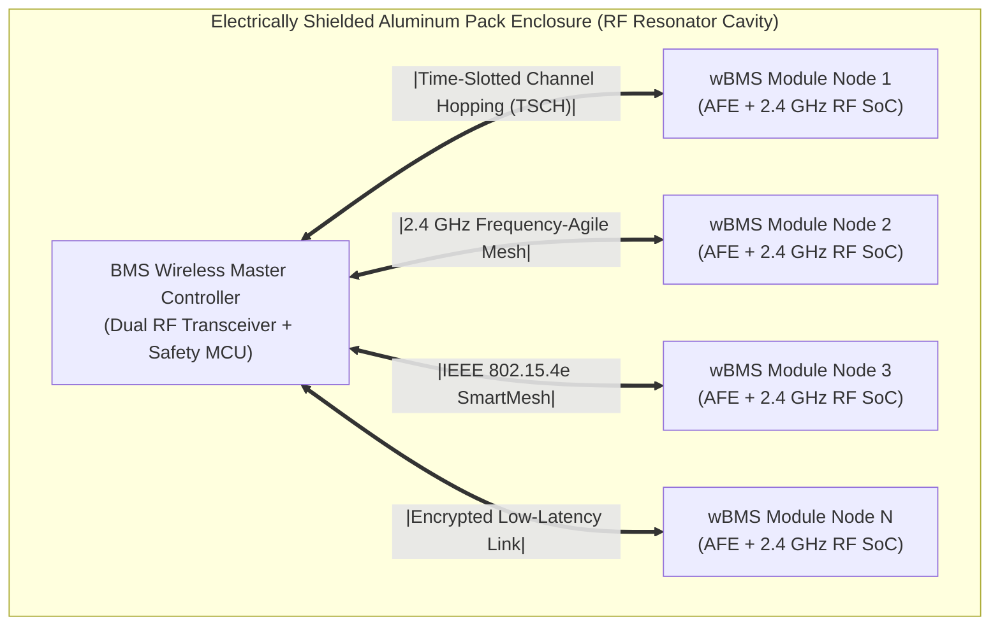
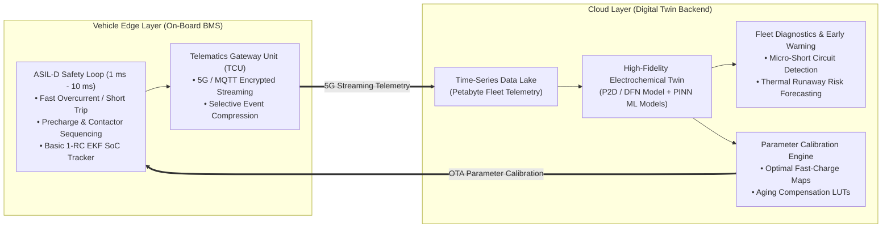
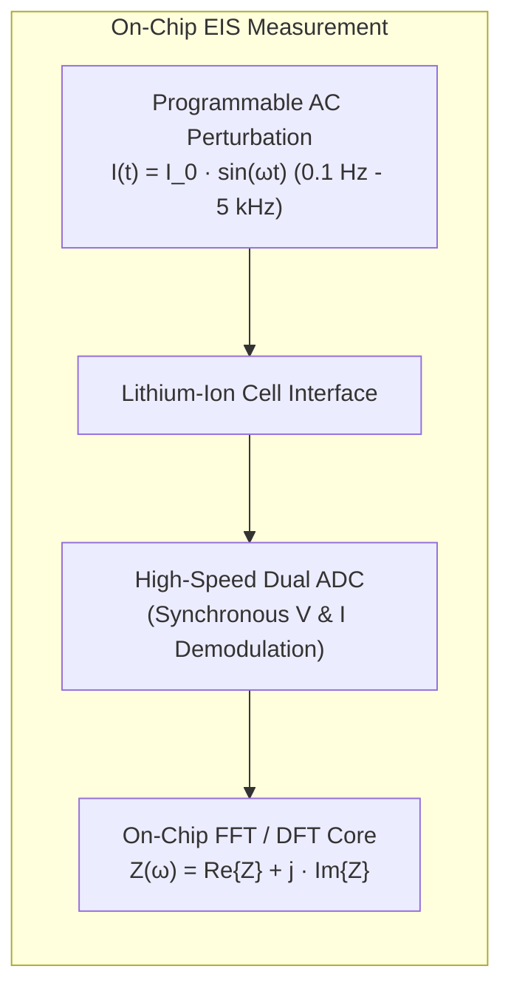

# Next-Generation BMS Technologies: Wireless, Cloud & On-Chip EIS

Battery Management Systems (BMS) are undergoing a structural paradigm shift. Driven by requirements for higher gravimetric energy density, reduced manufacturing complexity, and predictive lifetime safety, the industry is transitioning from static, wired electronic architectures toward **wireless networks (wBMS)**, **cloud-based digital twins**, and embedded **on-chip Electrochemical Impedance Spectroscopy (EIS)**[^hu2020][^yang2021].

This chapter explores the physical, computational, and architectural foundations of these next-generation battery management technologies.

---

## 1. Wireless Battery Management Systems (wBMS)

Traditional high-voltage battery packs contain complex wire harnesses, multipin connectors, and flexible printed circuits (FPCs) routing signals from module CMCs to the central master controller. These physical harnesses add manufacturing labor, mass, failure points (fretting corrosion, connector pin fatigue), and mechanical volume inside the pack[^analogdevices2020].



### Physical Layer & Networking Architecture

A **Wireless BMS (wBMS)** replaces the wired daisy chain (isoSPI / CAN) with ultra-reliable, short-range $2.4\,\text{GHz}$ RF transceivers integrated directly onto each module's cell monitoring controller (e.g., ADI SmartMesh IP / TI SimpleLink wBMS)[^texasinst2021]:

- **Protocol Standard:** IEEE 802.15.4e Time-Slotted Channel Hopping (TSCH).
- **Packet Delivery Performance:** Target Packet Error Rate $\text{PER} < 10^{-7}$ (fewer than one lost packet in 10 million transmissions).
- **Deterministic Latency:** Synchronized time-slots ensure all cell voltages across 100+ series channels are acquired within $<10\,\text{ms}$.
- **Cryptographic Security:** Hardware AES-128 / AES-256 message authentication codes (MAC) and dynamic session keys prevent man-in-the-middle packet spoofing or denial-of-service (DoS) attacks on the high-voltage bus.

### Architectural Advantages & Challenges

| Key Advantage | Physical Impact & Quantitative Benefit |
| :--- | :--- |
| **Mass Reduction** | Eliminates up to $90\%$ of intra-pack wiring harnesses, saving $10 - 20\,\text{kg}$ of copper and plastics per passenger EV. |
| **Volumetric Efficiency** | Reclaims up to $15\%$ of pack volume, enabling higher active cell packing density (Cell-to-Pack, CTP). |
| **Automated Manufacturing** | Eliminates complex robotic harness plugging and manual routing; modules are simply placed into trays without wire connections. |
| **Second-Life Circularity** | Modules retain full historical lifetime telemetry in on-board flash, allowing immediate second-life stationary ESS reuse without rewiring. |

> [!CAUTION]
> **RF Multipath Fading in Metallic Enclosures:** The battery pack is an enclosed metal cavity (Faraday cage) packed with reflective aluminum cell cans and copper busbars. This environment creates severe multipath reflections, constructive/destructive interference, and spatial RF nulls. Robust wBMS architectures deploy dual spatial diversity antennas and dynamic frequency hopping across 16 channels to ensure reliable transmission.

---

## 2. Cloud-BMS & Edge-Cloud Digital Twins

While embedded on-board BMS microcontrollers (the edge) excel at nanosecond-scale safety trips and real-time current integration, their memory ($\le 16\,\text{MB}$) and computing power are insufficient to execute complex physics-based electrochemical or machine learning models.

The **Cloud-BMS architecture** partitions battery management into a symbiotic edge-cloud ecosystem[^yang2021]:



### High-Fidelity Digital Twin Implementation

1. **Electrochemical Doyle-Fuller-Newman (DFN / P2D) Models:** The cloud executes coupled non-linear partial differential equations (PDEs) modeling solid-state diffusion, liquid-phase electrolyte migration, and Butler-Volmer kinetics across thousands of spatial mesh points in parallel.
2. **Physics-Informed Neural Networks (PINNs):** Deep learning architectures constrained by thermodynamic conservation laws predict long-term degradation trajectories and remaining useful life (RUL) with errors $<2\%$.
3. **Pre-Emptive Thermal Runaway Anomaly Detection:** Cloud analytics scan high-frequency voltage and impedance trends across millions of operational vehicle kilometers. Microscopic internal shorts (caused by manufacturing particle contamination or lithium dendrites) are identified **weeks or months before physical thermal runaway occurs**, triggering proactive dealer service alerts.

---

## 3. On-Chip Electrochemical Impedance Spectroscopy (EIS)

Electrochemical Impedance Spectroscopy (EIS) has traditionally been confined to expensive laboratory benchtop potentiostats. Next-generation Analog Front-End (AFE) silicon integrates direct on-chip impedance spectroscopy engines into every cell channel (e.g., Analog Devices ADBMS6830)[^meddings2020].



### Nyquist Plot Electrochemical Feature Extraction

Applying a small AC current excitation ($I_{\text{ac}} \approx 100 - 500\,\text{mA}$) over a wide frequency spectrum yields the complex impedance locus $Z(\omega) = Z'(\omega) + j Z''(\omega)$:

```
  -Im(Z) [mΩ]
     ^
     |                     Charge-Transfer
     |                       Semi-Circle
     |                          /\
     |             R_sei       /  \      R_ct
     |             /\         /    \
     |            /  \       /      \        Warburg Tail (Diffusion)
     |           /    \     /        \          /
     |----------/------\---/----------\--------/-----> Re(Z) [mΩ]
     |         |   SEI  | |  Kinetics  |
     +---------+--------+-+------------+
              R_0
```

1. **High-Frequency Real Intercept ($R_0$ at $f \approx 1\,\text{kHz}$):** Measures pure ohmic resistance of electrolyte, foil current collectors, and tabs.
2. **Mid-Frequency Arcs ($R_{\text{sei}}$ and $R_{\text{ct}}$ at $f \approx 1\,\text{Hz} - 1\,\text{kHz}$):** Directly separates the growth of the Solid Electrolyte Interphase layer from the charge-transfer kinetic barrier.
3. **Low-Frequency Warburg Tail ($f < 0.1\,\text{Hz}$):** Quantifies solid-state Fickian diffusion kinetics ($D_s$) inside electrode active materials.

> [!TIP]
> **Real-Time Lithium Plating Detection:** When metallic lithium plates onto the graphite negative electrode during fast charging, an anomalous second high-frequency phase loop and sudden reduction in charge-transfer resistance $R_{\text{ct}}$ appear instantaneously on the Nyquist plot, allowing the BMS to throttle charging before dendrites can puncture the separator[^pastor2021].

---

## 4. Management of Emerging Battery Chemistries

Next-generation cell chemistries require new BMS control parameters:

| Emerging Chemistry | Unique Physical Behavior | BMS Architectural Requirement |
| :--- | :--- | :--- |
| **All-Solid-State Batteries (ASSB)** | Requires high mechanical stack pressure ($1 - 5\,\text{MPa}$) to maintain interfacial contact; pressure varies with SoC. | Integration of piezo-resistive thin-film pressure transducers and dynamic mechanical clamp actuators. |
| **Silicon-Dominant Anodes ($>20\%\,\text{Si}$)** | Severe volume breathing ($>100\%$ locally, $>15\%$ macro-pack expansion); massive hysteresis. | Continuous strain-gauge sensing; 2D state-space hysteresis observer algorithms. |
| **Sodium-Ion ($\text{Na-Ion}$)** | Capable of safe zero-volt ($0.0\,\text{V}$) deep discharge storage without copper dissolution. | Wide dynamic range AFEs capable of operating down to $0.00\,\text{V}$ without latch-up or damage. |

---

## References

[^hu2020]: Hu, X., et al. (2020). Battery management system for electric vehicles: Recent advances and future directions. *IEEE Transactions on Transportation Electrification*, 6(4), 1307–1326.
[^yang2021]: Yang, S., et al. (2021). Cloud battery management system: Architecture, state of charge estimation, and state of health estimation. *IEEE Transactions on Industrial Electronics*, 68(12), 12224–12234.
[^analogdevices2020]: Analog Devices. (2020). *Wireless Battery Management System (wBMS): Automotive Functional Safety and High Reliability*. Analog Devices Whitepaper.
[^texasinst2021]: Texas Instruments. (2021). *Wireless BMS and the Automotive Transition to Electrification*. Technical Whitepaper.
[^meddings2020]: Meddings, N., et al. (2020). Application of electrochemical impedance spectroscopy to commercial Li-ion cells: A review. *Journal of Power Sources*, 480, 228742.
[^pastor2021]: Pastor-Flores, F., et al. (2021). Detection of lithium plating on lithium-ion batteries by electrochemical impedance spectroscopy. *Journal of The Electrochemical Society*, 168(4), 040510.
