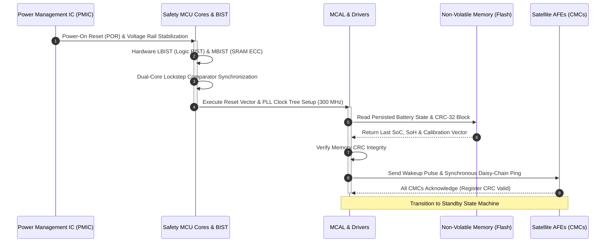
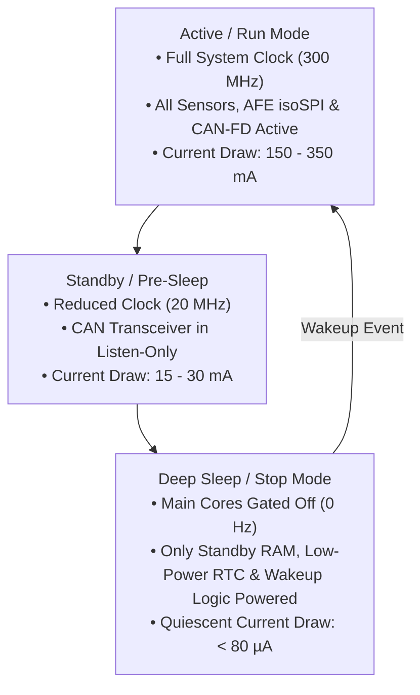
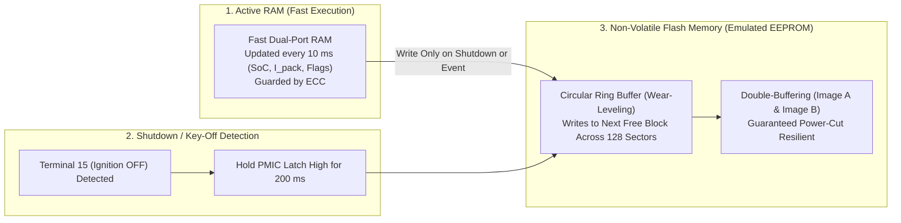

# Boot Sequencing, Sleep Modes & NVM Persistence

The operational lifecycle of a Battery Management System (BMS) extends far beyond active driving or charging. During vehicle parking or long-term storage, the BMS must enter ultra-low-power sleep states to prevent parasitic depletion of the auxiliary $12\,\text{V}$ battery and high-voltage traction pack[^andrea2020]. 

When vehicle ignition, charging plugs, or timed wake-up events occur, the BMS executes a deterministic **boot sequence**, validates memory integrity via **Hardware Built-In Self-Tests (BIST)**, and restores critical electrochemical states ($\text{SoC}$, $\text{SoH}$, cumulative fatigue damage, and fault logs) from **Non-Volatile Memory (NVM)**[^autosar_nvm2021].

This chapter formalizes the microcontroller startup pipeline, quiescent current budgeting, cyclic wake-up architectures, and flash wear-leveling algorithms.

---

## Microcontroller Startup & Hardware Built-In Self-Test (BIST)

Upon power application or wake-up interrupt, an automotive ASIL-D microcontroller (such as the Infineon AURIX TC3xx or NXP S32K3) undergoes a multi-stage hardware and software verification pipeline before closing any high-voltage circuits[^infineon2020]:

### 1. Power-On Reset (POR) & Safety Supply Supervision

The dedicated System Basis Chip (SBC) / Power Management IC (PMIC, e.g., Bosch CY310 or TI TPS65381A-Q1) supervises all internal voltage rails ($V_{\text{core}} = 1.25\,\text{V}, V_{\text{io}} = 3.3\,\text{V} / 5.0\,\text{V}$). If any rail exhibits an undervoltage or overvoltage condition outside $\pm 3\%$, a hardware reset line holds the microcontroller in a safe clamp state.

### 2. Hardware BIST (Logic & Memory Built-In Self-Test)

Under ISO 26262 ASIL-D requirements, latent hardware faults within the microcontroller silicon itself must be detected before code execution begins:
- **MBIST (Memory BIST):** Automatically writes, reads, and inverts test patterns across all internal SRAM blocks to verify single-bit Error Correction Code (ECC) and double-bit error detection logic.
- **LBIST (Logic BIST):** Employs pseudo-random pattern generators to test internal logic gates, achieving $>90\%$ latent fault coverage within $<15\,\text{ms}$.
- **Lockstep Comparator:** Two redundant physical processor cores execute the identical instruction stream staggered by a 2-clock delay. If a physical comparator detects a discrepancy between the outputs of Core 0 and Core 1, a non-maskable Safety Alarm is triggered immediately.

---

## Quiescent Current Budgeting & Low-Power Sleep Modes

When a vehicle is parked at an airport for 30 to 60 days, continuous operation of the BMS would discharge the $12\,\text{V}$ auxiliary lead-acid or LFP battery, disabling the vehicle[^andrea2020].

### Quiescent Current Breakdown

Automotive Original Equipment Manufacturers (OEMs) strictly mandate that the total parasitic quiescent current drawn from the $12\,\text{V}$ auxiliary battery during deep sleep must not exceed **$100\,\mu\text{A}$** (with tier-1 targets pushing toward $\le 50\,\mu\text{A}$):

| Subsystem Component | Active Operating Current | Deep Sleep Quiescent Current | Power Gating Technique |
| :--- | :--- | :--- | :--- |
| **Microcontroller (Safety Cores)** | $120.0\,\text{mA}$ | $15.0\,\mu\text{A}$ | Core supply completely gated; retain $64\,\text{kB}$ standby SRAM |
| **System Basis Chip / PMIC** | $25.0\,\text{mA}$ | $18.0\,\mu\text{A}$ | Switched into ultra-low-quiescent LDO mode |
| **AFE Satellite Interface (isoSPI)**| $35.0\,\text{mA}$ | $2.5\,\mu\text{A}$ per CMC | AFE enters `SLEEP` state via serial broadcast command |
| **CAN-FD Transceiver** | $45.0\,\text{mA}$ | $10.0\,\mu\text{A}$ | Partial networking / selective wake-up mode (ISO 11898-2) |
| **Insulation Monitoring Circuit** | $12.0\,\text{mA}$ | $0.0\,\mu\text{A}$ | Disconnected via high-voltage solid-state opto-relays |
| **Total BMS Quiescent Current** | **$\approx 237\,\text{mA}$** | **$\approx 55 - 75\,\mu\text{A}$** | **Meets OEM Requirement ($< 100\,\mu\text{A}$)** |

### Asynchronous & Cyclic Wake-Up Triggers

The BMS exits deep sleep and returns to active run mode upon any of the following hardware wake-up events:
1. **CAN-FD Network Activity:** Reception of a standardized wake-up frame (WUF) or voltage edge on the CAN RX line.
2. **High-Voltage Interlock Loop (HVIL) Interruption:** Physical disconnection of a high-voltage connector or service plug.
3. **EVSE Charger Connection:** Detection of a resistance change on the Control Pilot (CP) or Proximity Pilot (PP) line.
4. **Real-Time Clock (RTC) Cyclic Timer:** The low-power RTC timer triggers every 1 to 4 hours. The BMS wakes up for $500\,\text{ms}$, measures all cell voltages under resting conditions ($I=0$), checks for abnormal self-discharge, executes passive balancing if configured, and returns to sleep.

---

## Non-Volatile Memory (NVM) Architecture & Wear-Leveling

State estimation variables ($\text{SoC}$, $\text{SoH}$, cumulative cycle count, Palmgren-Miner damage $D$) must be saved when the BMS powers down and restored accurately upon restart[^autosar_nvm2021].

### The Flash Endurance Dilemma

- Standard microcontroller Data Flash (EEPROM emulation) possesses a rated write endurance of **$100{,}000$ cycles per sector**.
- If the BMS software naively wrote the estimated State of Charge to the same Flash memory address every $100\,\text{ms}$ (the task loop rate), the memory sector would be permanently destroyed by dielectric breakdown in less than:

$$
t_{\text{destruction}} = \frac{100{,}000 \text{ cycles}}{10 \text{ writes/sec}} = 10{,}000 \text{ seconds} \approx 2.78 \text{ hours!}
$$

### AUTOSAR NvM Architecture & Double-Buffering

To guarantee a 15-year / 300,000 km automotive service lifetime, the BMS employs a **three-tier memory architecture**:

1. **Runtime Execution in SRAM:** All state variables are maintained exclusively in volatile SRAM during vehicle operation.
2. **Event-Based & Periodic Shadow Writing:**
   - **Controlled Key-Off Shutdown:** When the vehicle ignition signal (Terminal 15 / `KL15`) turns off, the PMIC maintains power to the microcontroller for $200\,\text{ms}$, during which the complete state block is serialized, CRC-32 protected, and written to Flash.
   - **Periodic Checkpointing:** Every 15 minutes, a state checkpoint is committed to non-volatile storage to guard against sudden auxiliary battery disconnection (e.g., terminal detachment).
3. **Circular Ring-Buffer Wear-Leveling:** Data writes rotate sequentially across a wide array of Flash sectors (e.g., 64 blocks of $4\,\text{kB}$). Rotating writes across 64 sectors increases total write endurance from $100{,}000$ to $6.4 \times 10^6$ cycles, ensuring lifetime durability.
4. **Power-Fail Resilient Double-Buffering:** Data is written alternately between Block A and Block B with a sequence counter and CRC-32 checksum. If power is severed mid-write (corrupting Block A), the boot routine discards Block A and restores valid data from Block B.

---

## References

[^andrea2020]: Andrea, D. (2020). *Battery Management Systems for Large Lithium-Ion Battery Packs*. Artech House.
[^autosar_nvm2021]: AUTOSAR Consortium. (2021). *Specification of Memory Abstraction Interface and NVRAM Manager (FO R21-11)*. AUTOSAR.
[^infineon2020]: Infineon Technologies. (2020). *AURIX TC3xx 32-Bit Microcontroller Family User's Manual*. Infineon AG.
