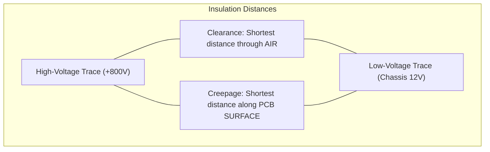
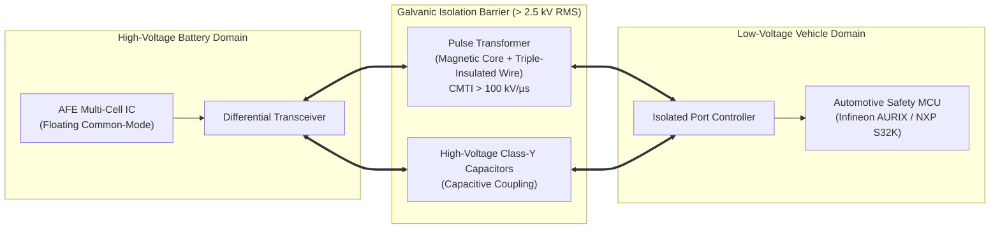
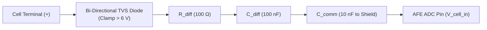

# Hardware Design, Galvanic Isolation & EMC Compliance

Designing the electronic hardware for a high-voltage Battery Management System (BMS) presents severe challenges in electrical insulation, high-voltage clearance, and electromagnetic compatibility (EMC). The BMS printed circuit board (PCB) interfaces directly with high-voltage traction domains ($400\,\text{V}$ to $>1000\,\text{V}_{\text{DC}}$) while simultaneously connecting to touchable low-voltage vehicle networks ($12\,\text{V}$ chassis ground, CAN-FD, and driver displays)[^andrea2020].

Under international safety standards—principally **IEC 60664-1**, **ISO 6469-3**, and **CISPR 25 Class 5**—the hardware must guarantee that no dielectric breakdown, surface tracking, or inverter switching noise can breach the low-voltage domain or corrupt cell measurement accuracy[^iec60664][^cispr25].

This chapter formalizes the physical layout rules, insulation coordination equations, galvanic isolation technologies, and anti-aliasing filter designs essential for production automotive BMS hardware.

---

## Insulation Coordination: Creepage & Clearance (IEC 60664-1)

Insulation coordination dictates the physical separation required between conductive copper traces on a PCB to prevent electrical flashover through air or carbonized surface tracking along the laminate[^iec60664].



### Definitions & Governing Parameters

1. **Clearance:** The shortest distance through air between two conductive elements. Clearance protects against transient atmospheric overvoltage breakdown (Paschen's law).
2. **Creepage:** The shortest distance along the surface of an insulating dielectric material between two conductive elements. Creepage prevents progressive carbon-tracking failure caused by moisture, dust, and ionic salt contamination.
3. **Comparative Tracking Index (CTI):** A material parameter measuring resistance to electrical breakdown under surface electrolyte tracking:
   - **Material Group I:** $\text{CTI} \ge 600\,\text{V}$ (High-performance polyimides and advanced epoxy resins).
   - **Material Group II:** $400\,\text{V} \le \text{CTI} < 600\,\text{V}$.
   - **Material Group IIIa:** $175\,\text{V} \le \text{CTI} < 400\,\text{V}$ (Standard automotive FR-4 laminate, typically $\text{CTI} \approx 200\,\text{V}$).

### Minimum Distance Equations for High-Voltage Packs (Pollution Degree 2)

Automotive battery enclosures are sealed against bulk water spray (IP67 / IP6K9K) but experience internal humidity condensation and minor ionic contamination, classifying them as **Pollution Degree 2**:

| System Voltage ($V_{\text{DC}}$) | Working Voltage ($V_{\text{RMS}}$) | Basic Clearance (Air) | Basic Creepage (FR-4 Group IIIa) | Reinforced Creepage (Safety Barrier) |
| :--- | :--- | :--- | :--- | :--- |
| **$48\,\text{V}$ (MHEV)** | $34\,\text{V}$ | $0.20\,\text{mm}$ | $0.63\,\text{mm}$ | $1.26\,\text{mm}$ |
| **$400\,\text{V}$ (BEV)** | $283\,\text{V}$ | $1.50\,\text{mm}$ | $4.00\,\text{mm}$ | $8.00\,\text{mm}$ |
| **$800\,\text{V}$ (Fast BEV)** | $566\,\text{V}$ | $3.00\,\text{mm}$ | $8.00\,\text{mm}$ | $16.00\,\text{mm}$ |
| **$1000\,\text{V}$ (Commercial)**| $707\,\text{V}$ | $4.20\,\text{mm}$ | $10.00\,\text{mm}$ | $20.00\,\text{mm}$ |

### PCB Milling: Isolation Slots

Because maintaining a $16\,\text{mm}$ continuous surface creepage distance across a compact PCB consumes excessive board area, BMS designers mill **physical air slots** into the PCB laminate across the high-voltage / low-voltage boundary:

```
  +-------------------------------------------------------------+
  |  High-Voltage Domain (+800V)                                |
  |  [AFE IC]  [Bleed Resistors]  [isoSPI Driver]               |
  +-------------------------------------------------------------+
         ||                                              ||
         ||  <===== MILLED AIR SLOT THROUGH PCB =====>   ||
         ||                                              ||
  +-------------------------------------------------------------+
  |  Low-Voltage Domain (12V Chassis GND)                       |
  |  [Safety MCU]  [CAN-FD]  [Power Supply / PMIC]              |
  +-------------------------------------------------------------+
```

By cutting completely through the FR-4 fiberglass core, the surface path is broken. The dielectric boundary reverts to the air clearance rule, reducing the required separation distance from $16.0\,\text{mm}$ down to $3.5\,\text{mm}$.

---

## Galvanic Isolation Barrier Architecture

All control, telemetry, and diagnostic signals crossing between high-voltage CMCs and the low-voltage master controller must traverse a **galvanic isolation barrier** with a rated dielectric breakdown strength of at least $2500\,\text{V}_{\text{RMS}}$ for 60 seconds (UL 1577 / IEC 60747-5-5)[^andrea2020].



### Comparison of Isolation Technologies

1. **Pulse Transformers (Magnetic Coupling):**
   - **Mechanism:** High-permeability toroidal ferrite cores wound with triple-insulated copper wire.
   - **Common-Mode Transient Immunity (CMTI):** $> 100\,\text{kV}/\mu\text{s}$.
   - **Aging:** Zero degradation over 20+ years; entirely immune to optical clouding or thermal degradation.
   - **Dominant standard:** Preferred for isoSPI daisy-chain networks across battery modules.
2. **Capacitive Digital Isolators:**
   - **Mechanism:** On-chip silicon dioxide ($\text{SiO}_2$) dielectric microscopic capacitors ($>15\,\text{kV}/\text{mm}$ dielectric strength).
   - **CMTI:** $\approx 75 - 150\,\text{kV}/\mu\text{s}$.
   - **Data Rates:** High throughput ($>150\,\text{Mbps}$), suitable for high-speed parallel buses and SPI links.
3. **Optocouplers (Optical Coupling):**
   - **Mechanism:** Infrared LED illuminating a phototransistor across a transparent silicone gap.
   - **Pitfalls in High-Voltage BMS:** Current Transfer Ratio (CTR) degrades by $20 - 40\%$ over 10 years at automotive temperatures ($>85^\circ\text{C}$); low CMTI ($<25\,\text{kV}/\mu\text{s}$). Consequently, optocouplers are largely obsolete in modern automotive traction BMS.

---

## Electromagnetic Compatibility (EMC) & CISPR 25 Class 5

In an electric vehicle, the battery pack is mechanically adjacent to the traction inverter. The inverter switches currents up to $800\,\text{A}$ across $800\,\text{V}$ DC buses using Silicon Carbide (SiC) MOSFETs at high slew rates:

$$
\frac{dV}{dt} > 50\,\frac{\text{V}}{\text{ns}}, \quad \frac{dI}{dt} > 1200\,\frac{\text{A}}{\mu\text{s}}
$$

This extreme switching speed injects high-frequency common-mode noise across the battery cells and sense lines, threatening to corrupt millivolt-level ADC measurements or reset microcontrollers[^ott2009].

### Filtering & Noise Suppression Topology



1. **Differential & Common-Mode Anti-Aliasing RC Filters:**
   - Placed on every individual cell sense line directly adjacent to the AFE pins.
   - Series resistors ($R_{\text{diff}} = 100\,\Omega$) and differential capacitor ($C_{\text{diff}} = 100\,\text{nF}$) create a low-pass anti-aliasing cutoff frequency:

     $$
     f_{c, \text{diff}} = \frac{1}{2\pi \cdot (2 R_{\text{diff}}) \cdot C_{\text{diff}}} = \frac{1}{2\pi \cdot 200\,\Omega \cdot 100 \times 10^{-9}\,\text{F}} \approx 7.96\,\text{kHz}
     $$

   - Common-mode capacitors ($C_{\text{comm}} = 10\,\text{nF}$) divert high-frequency common-mode spikes to the local module shield plane.

2. **Transient Voltage Suppressors (TVS):**
   - Bi-directional TVS diodes on every sense pin clamp inductive voltage spikes caused by module disconnection, fuse clearing, or tab-welding hot-plugging to $<6.0\,\text{V}$, shielding delicate $5\,\text{V}$ AFE CMOS inputs.

3. **Common-Mode Chokes (CMC):**
   - High-impedance common-mode chokes ($Z_{\text{cm}} > 1000\,\Omega$ at $100\,\text{MHz}$) inserted into isolated communication lines reject conducted RF noise and ensure compliance with **CISPR 25 Class 5** radiated emissions limits ($<18\,\text{dB}\mu\text{V/m}$ in the FM broadcast band).

---

## References

[^andrea2020]: Andrea, D. (2020). *Battery Management Systems for Large Lithium-Ion Battery Packs*. Artech House.
[^iec60664]: International Electrotechnical Commission. (2020). *IEC 60664-1: Insulation coordination for equipment within low-voltage systems — Part 1: Principles, requirements and tests*. IEC.
[^cispr25]: International Electrotechnical Commission. (2016). *CISPR 25: Vehicles, boats and internal combustion engines — Radio disturbance characteristics — Limits and methods of measurement*. IEC.
[^ott2009]: Ott, H. W. (2009). *Electromagnetic Compatibility Engineering*. John Wiley & Sons.
