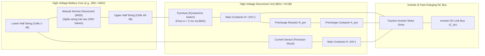

# High-Voltage Distribution & Safety Topology

The high-voltage power distribution topology of an electric vehicle or industrial energy storage system houses the electromechanical switching, circuit protection, and precharge elements required to deliver hundreds of kilowatts safely. Enclosed within the **High-Voltage Junction Box (HVJB)** or Battery Disconnect Unit (BDU), this subsystem operates under the direct deterministic control of the Battery Management System (BMS)[^gautam2021][^andrea2020].

This chapter formalizes the high-voltage circuit schematic, precharge resistor transient thermodynamics, pyrotechnic safety switch (pyrofuse) actuation, Manual Service Disconnect (MSD) placement, and High-Voltage Interlock Loop (HVIL) monitoring under **ISO 6469-1** and **SAE J2344** standards[^iso6469][^saej2344].

---

## High-Voltage Junction Box (HVJB) Power Schematic

The power distribution architecture places safety isolation, overcurrent clearing, and contactor switching across both positive and negative poles:



### Critical Component Placements

1. **Manual Service Disconnect (MSD):** Located at the geometric and electrical center of the series battery string. Removing the MSD splits a hazardous $400\,\text{V}$ or $800\,\text{V}$ pack into two isolated sub-packs ($\le 200\,\text{V}$ or $\le 400\,\text{V}$), protecting service technicians from lethal touch potentials.
2. **Pyrofuse (Pyroswitch):** Located in series with the main traction path. Triggered actively by the BMS pyrotechnic squib driver in the event of an external short-circuit or vehicle crash.
3. **Current Shunt:** Placed on the negative battery rail ($V_{\text{bat}-}$) near chassis ground potential to minimize common-mode voltage stress on the sensing ADC.
4. **Symmetrical Main Contactors ($K^+$ and $K^-$):** Two independent, hermetically sealed, gas-filled ceramic contactors isolate both high-voltage poles completely when open.

---

## Precharge Engineering & Transient Thermodynamics

Directly closing the main positive contactor ($K^+$) into an uncharged inverter DC-link capacitor ($C_{\text{dc}}$) generates catastrophic inrush current ($I_{\text{inrush}} > 10{,}000\,\text{A}$), welding contactor tips instantly[^gautam2021].

The BMS prevents welding by first closing the negative contactor $K^-$ and the precharge contactor $K_{\text{pre}}$, channeling current through precharge resistor $R_{\text{pre}}$.

```
   Voltage [V]
      ^
 V_bat|---------------------------------/  Pack Terminal Voltage
      |                                /
      |                        ......./    Precharge Complete (V_link >= 0.95 * V_bat)
      |                       /
      |                      /
      |                     /  V_link(t) = V_bat * (1 - e^(-t / RC))
      |                    /
    0 +-------------------+-----------------------------------> Time [s]
      |<--- Precharge --->| K+ Closes, K_pre Opens
```

### Derivation of Precharge RC Sizing

The instantaneous capacitor voltage $V_{\text{link}}(t)$ and current $I_{\text{pre}}(t)$ evolve according to first-order linear differential equations:

$$
V_{\text{link}}(t) = V_{\text{pack}} \left( 1 - \exp\left(-\frac{t}{\tau_{\text{pre}}}\right) \right), \quad \tau_{\text{pre}} = R_{\text{pre}} C_{\text{dc}}
$$

$$
I_{\text{pre}}(t) = \frac{V_{\text{pack}}}{R_{\text{pre}}} \exp\left(-\frac{t}{\tau_{\text{pre}}}\right)
$$

### Total Resistor Thermal Energy Dissipation

The total electrical energy converted to heat inside the precharge resistor during a complete precharge cycle is obtained by integrating the instantaneous Joule heating from $t = 0$ to $\infty$:

$$
E_{R_{\text{pre}}} = \int_0^\infty I_{\text{pre}}^2(t) R_{\text{pre}} \, dt = \int_0^\infty \left( \frac{V_{\text{pack}}}{R_{\text{pre}}} e^{-\frac{t}{\tau}} \right)^2 R_{\text{pre}} \, dt
$$

$$
E_{R_{\text{pre}}} = \frac{V_{\text{pack}}^2}{R_{\text{pre}}} \int_0^\infty e^{-\frac{2t}{\tau}} \, dt = \frac{V_{\text{pack}}^2}{R_{\text{pre}}} \left[ -\frac{\tau}{2} e^{-\frac{2t}{\tau}} \right]_0^\infty = \frac{V_{\text{pack}}^2 \tau}{2 R_{\text{pre}}}
$$

Substituting $\tau = R_{\text{pre}} C_{\text{dc}}$:

$$
E_{R_{\text{pre}}} = \frac{1}{2} C_{\text{dc}} V_{\text{pack}}^2
$$

> [!IMPORTANT]
> The total energy dissipated in the precharge resistor is **completely independent of the resistor value $R_{\text{pre}}$**, depending solely on the DC-link capacitance and pack voltage.

#### Quantitative Engineering Example ($800\,\text{V}$ EV Powertrain)

- Pack Voltage $V_{\text{pack}} = 800\,\text{V}$
- Inverter DC-Link Capacitance $C_{\text{dc}} = 1200\,\mu\text{F} = 1.20 \times 10^{-3}\,\text{F}$
- Target Precharge Duration: $t_{\text{pre}} = 150\,\text{ms}$ to achieve $V_{\text{link}} \ge 0.95 \cdot V_{\text{pack}}$ ($t = 3\tau$)

$$
3\tau = 0.150\,\text{s} \implies \tau = 0.050\,\text{s}
$$

$$
R_{\text{pre}} = \frac{\tau}{C_{\text{dc}}} = \frac{0.050\,\text{s}}{1.20 \times 10^{-3}\,\text{F}} \approx 41.7\,\Omega \quad (\text{Select standard } 40\,\Omega \text{ or } 47\,\Omega)
$$

$$
I_{\text{peak}} = \frac{800\,\text{V}}{40\,\Omega} = 20.0\,\text{A}
$$

$$
P_{\text{peak}} = I_{\text{peak}}^2 R_{\text{pre}} = (20.0\,\text{A})^2 \cdot 40\,\Omega = 16{,}000\,\text{W} \quad (16.0\,\text{kW})
$$

$$
E_{\text{dissipated}} = \frac{1}{2} \cdot (1.20 \times 10^{-3}\,\text{F}) \cdot (800\,\text{V})^2 = 384.0\,\text{Joules}
$$

The selected precharge resistor must be a pulse-rated, thick-film planar or ceramic-core wirewound resistor capable of absorbing $>500\,\text{J}$ single-pulse energy without rupture.

---

## Pyrotechnic Safety Switch (Pyrofuse)

Traditional sand-filled thermal melting fuses exhibit severe limitations in high-voltage DC circuits:
- **Clearing Time Latency:** At moderate overcurrents ($2000\,\text{A}$, a dead short across an $800\,\text{V}$ pack), a melting fuse can take $20 - 100\,\text{ms}$ to melt. During this delay, battery busbars, contactors, and cell tabs can vaporize.
- **Arc Re-Ignition:** Above $500\,\text{V}_{\text{DC}}$, interrupting DC current creates sustained plasma arcs that cannot be quenched by melting wire elements.

A **pyrofuse** resolves this by integrating an automotive airbag micro-gas generator (squib) with a hardened mechanical shear blade:

```mermaid
flowchart LR
    BMS_Trip["BMS Hardware Trip Signal<br/>(Analog Comparator or Crash Sensor)"] --> Firing_Circuit["ASIL-D Pyro Driver ASIC<br/>(Dual High-Side & Low-Side FETs)"]
    Firing_Circuit -->|2 A Firing Current (2 ms)| Squib["Micro-Gas Generator<br/>(Chemical Propellant)"]
    Squib --> Blade["Hardened Dielectric Shear Blade"]
    Blade --> Copper_Busbar["High-Voltage Copper Conductor"]
    Copper_Busbar --> Disconnect["Physical Busbar Cleaved & Arc Quenched in < 2 ms!"]
```

1. **Trigger Condition:** The BMS fires the pyrofuse upon detecting extreme short-circuit currents ($I > 2500\,\text{A}$) or upon receiving an immediate hardwired crash pulse from the vehicle Airbag Control Unit (ACU).
2. **Actuation Speed:** The propellant ignites within $<500\,\mu\text{s}$, driving the blade through the busbar and extinguishing electrical arcs within **$<2\,\text{ms}$**, completely isolating the high-voltage pack before mechanical contactor contacts can weld.

---

## High-Voltage Interlock Loop (HVIL)

The **High-Voltage Interlock Loop (HVIL)** is a dedicated low-voltage diagnostic loop that passes in series through every high-voltage connector, inverter plug, battery cover, and the Manual Service Disconnect (MSD) handle[^saej2344]:


### Break-Before-Make Mechanical Interlock

The HVIL pins inside every high-voltage connector are engineered with a shorter physical length than the main high-voltage power pins:
- When a technician or crash force begins pulling a connector apart, the **HVIL pins disconnect first** while the high-voltage power pins are still mechanically mated ($2-5\,\text{mm}$ overlap remaining).
- The BMS detects the open HVIL circuit within $<5\,\text{ms}$ and commands immediate de-energization of the main contactors.
- By the time the high-voltage power pins separate into open air, the line current is already zero, **completely preventing lethal electric arc-flash discharge**.

---

## References

[^gautam2021]: Gautam, D., & Musavi, F. (2021). A review of automotive high-voltage precharge circuits and control strategies. *IEEE Transactions on Transportation Electrification*, 7(4), 2110–2122.
[^andrea2020]: Andrea, D. (2020). *Battery Management Systems for Large Lithium-Ion Battery Packs*. Artech House.
[^iso6469]: International Organization for Standardization. (2019). *ISO 6469-1: Electrically propelled road vehicles — Safety specifications — Part 1: On-board rechargeable energy storage system (RESS)*. ISO.
[^saej2344]: SAE International. (2020). *SAE J2344: Guidelines for Electric Vehicle Safety*. SAE International.
