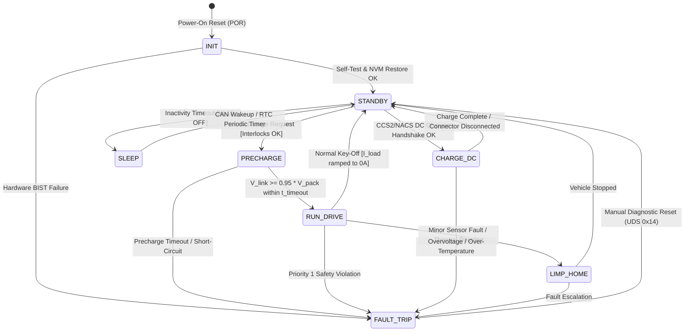
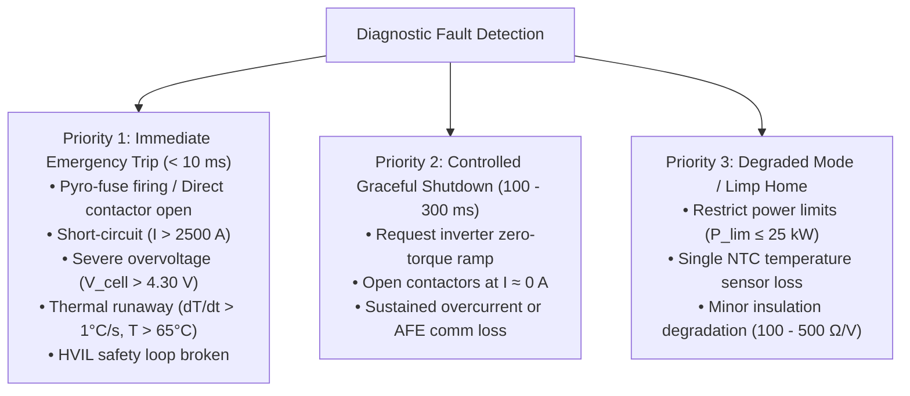
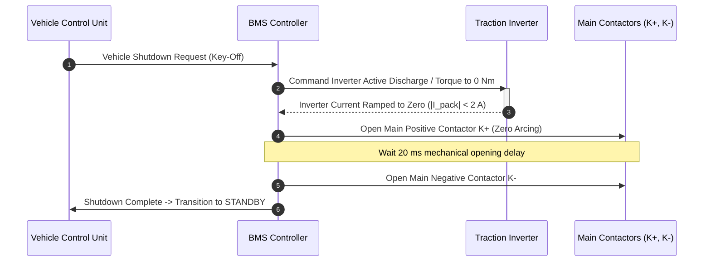
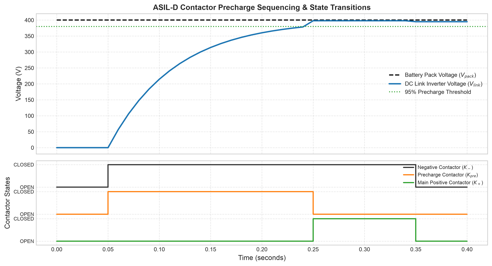

# Deterministic BMS State Machine & Safety Handling

The Battery Management System (BMS) operates as a deterministic finite-state automaton. Governed by **ISO 26262 Functional Safety** standards, the state machine dictates the transitions between low-power sleep, self-testing, high-voltage precharge, dynamic traction, fast-charging, and fail-safe trip states[^iso26262][^andrea2020].

This chapter details the formal UML statechart architecture, transition guards, contactor arc-free opening sequences, and the multi-tier fault priority hierarchy implemented in production BMS control software.

---

## Formal UML Statechart Architecture

The high-voltage state machine structures system behavior into mutually exclusive, deterministic operational states:



---

## State Descriptions & Transition Guards

| State Identifier | High-Voltage Contactor Configuration | Permissible Operational Dynamics | Transition Exit Guard Conditions |
| :--- | :--- | :--- | :--- |
| **`INIT`** | All Open ($K^+, K^-, K_{\text{pre}}$) | Microcontroller boot; execution of MBIST, LBIST; NVM state recovery; AFE daisy-chain ping. | Exit to `STANDBY` when BIST passed and all module AFEs acknowledge. |
| **`STANDBY`** | All Open | System awake; insulation monitoring active; zero high-voltage outside pack enclosure. | Transition to `PRECHARGE` on VCU drive request; transition to `SLEEP` on key-off timeout. |
| **`PRECHARGE`** | $K^-$ Closed, $K_{\text{pre}}$ Closed, $K^+$ Open | Controlled current through $R_{\text{pre}}$ charging DC-link capacitor $C_{\text{dc}}$. | Transition to `RUN_DRIVE` if $V_{\text{link}} \ge 0.95 \cdot V_{\text{pack}}$ within $t \le 250\,\text{ms}$; abort to `FAULT_TRIP` if timeout expires. |
| **`RUN_DRIVE`** | $K^-$ Closed, $K^+$ Closed, $K_{\text{pre}}$ Open | Full traction power available; continuous broadcast of dynamic limits ($P_{\text{dis,max}}, P_{\text{chg,max}}$). | Exit to `STANDBY` on zero-current shutdown request; trip to `FAULT_TRIP` on safety boundary breach. |
| **`CHARGE_DC`** | $K^-$ Closed, $K^+$ Closed (or dedicated Charge Contactors) | Closed-loop current control communicating with off-board DC fast charger via ISO 15118 / DIN 70121. | Exit when target SoC reached or emergency stop button pressed. |
| **`LIMP_HOME`** | $K^-$ Closed, $K^+$ Closed | Power capability throttled ($P_{\text{max}} \le 25\,\text{kW}$); allows driver to navigate vehicle safely to roadway shoulder. | Transition to `STANDBY` upon vehicle coming to complete stop. |
| **`FAULT_TRIP`** | All Contactors Commanded OPEN (Safe State) | Pyrofuse triggered if external short detected; contactor coils de-energized; DTCs locked in Flash. | Requires authorized diagnostic session (UDS Service `0x14` ClearDTC) to clear. |
| **`SLEEP`** | All Open | Power gated off to main cores; low-power RTC and CAN wake-up transceivers active ($<80\,\mu\text{A}$). | Wakes on CAN message edge, HVIL break, or cyclic RTC timer. |

---

## Multi-Tier Fault Priority Hierarchy

Under ISO 26262 ASIL-D, faults are categorized by severity and response time requirements[^iso26262]:



---

## Contactor Arc-Free Opening Sequences

Opening mechanical contactor contacts while thousands of Amperes are flowing through inductive motor windings creates intense DC electric plasma arcs that can weld contact surfaces or vaporize the contactor chamber[^brand2013].

Except during Priority 1 catastrophic short-circuits (where contactor damage is secondary to life safety), the BMS executes a **zero-current coordinated shutdown**:



---

## ASIL-D Deterministic State Machine Implementation

The production state machine is maintained in [`battery_toolkit.bms.state_machine`](file:///Users/cc/Desktop/Battery-Systems-Technology/codes/python/src/battery_toolkit/bms/state_machine.py). It models the full statechart, transition guards, precharge timers, and emergency trip behaviors:

```python
from battery_toolkit.bms import BMSStateMachine, BMSState

# Initialize deterministic state machine (ASIL-D compliant)
sm = BMSStateMachine(precharge_timeout_s=0.250)

# Step 1: BIST self-test transitions INIT -> STANDBY
sm.process_event(v_pack=400.0, v_link=0.0, i_pack=0.0, max_cell_temp=25.0, hvil_closed=True)
assert sm.state == BMSState.STANDBY

# Step 2: Drive request engages precharge contactors K- and K_pre
sm.process_event(v_pack=400.0, v_link=0.0, i_pack=0.0, max_cell_temp=25.0, hvil_closed=True, drive_requested=True)
assert sm.state == BMSState.PRECHARGE and sm.k_minus and sm.k_pre

# Step 3: Link voltage reaches 95% (385V) -> Main K+ closes, K_pre disengages -> RUN_DRIVE
sm.process_event(v_pack=400.0, v_link=390.0, i_pack=10.0, max_cell_temp=25.5, hvil_closed=True, drive_requested=True)
assert sm.state == BMSState.RUN_DRIVE and sm.k_plus and not sm.k_pre

# Step 4: Safety guard trigger (HVIL broken) -> Immediate trip (<10 ms)
sm.process_event(v_pack=400.0, v_link=390.0, i_pack=10.0, max_cell_temp=25.5, hvil_closed=False)
assert sm.state == BMSState.FAULT_TRIP and not sm.k_plus and not sm.k_minus
```

Complete source code, unit test suites, and transition verification scripts are available in [`codes/python/src/battery_toolkit/bms/state_machine.py`](file:///Users/cc/Desktop/Battery-Systems-Technology/codes/python/src/battery_toolkit/bms/state_machine.py) and [`test_bms.py`](file:///Users/cc/Desktop/Battery-Systems-Technology/codes/python/tests/test_bms.py).

---

## State Machine Sequence Execution & Verification

The state machine execution is verified by simulating the key-on precharge ramp followed by an emergency HVIL line break:



### Chronological Transition Trace:
1. **$t = 0.05\,\text{s}$ (Precharge Inrush):** Negative contactor $K_-$ and precharge contactor $K_{\text{pre}}$ close simultaneously; the DC-link capacitor charges asymptotically.
2. **$t = 0.25\,\text{s}$ (Main Positive Handshake):** $V_{\text{link}}$ reaches $95\%$ ($380\,\text{V}$); $K_+$ closes and $K_{\text{pre}}$ disengages seamlessly with zero contact arcing.
3. **$t = 0.35\,\text{s}$ (Immediate Hardware Trip):** Simulated HVIL interlock break causes all contactors to trip immediately ($< 10\,\text{ms}$) into the safe `FAULT_TRIP` state.
4. **Machine-Readable Event Log:** The detailed transition trace is exported to [`codes/python/outputs/logs/05_state_machine_trace.json`](file:///Users/cc/Desktop/Battery-Systems-Technology/codes/python/outputs/logs/05_state_machine_trace.json).

---

## References

[^iso26262]: International Organization for Standardization. (2018). *ISO 26262-4: Road vehicles — Functional safety — Part 4: Product development at the system level*. ISO.
[^andrea2020]: Andrea, D. (2020). *Battery Management Systems for Large Lithium-Ion Battery Packs*. Artech House.
[^brand2013]: Brand, M. J., et al. (2013). Welding of contactors in automotive battery systems: Analysis and diagnostic routines. *IEEE Transactions on Vehicular Technology*, 63(6), 2548–2557.
