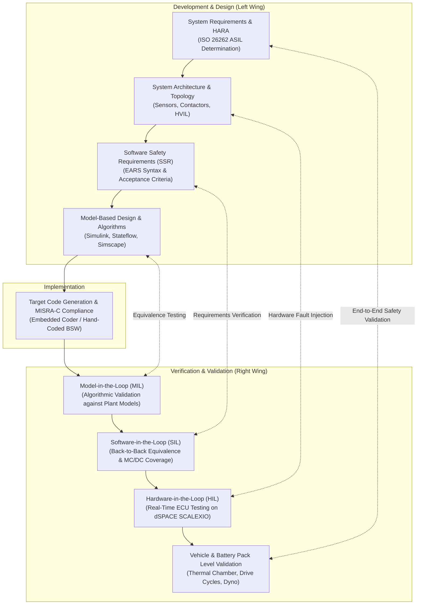
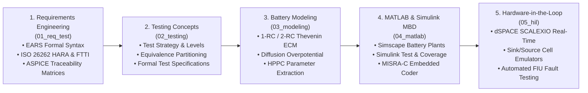

# Battery Systems Modeling & Testing: Curriculum & Framework

The design, verification, and validation of automotive and grid-scale Battery Management Systems (BMS) are governed by strict functional safety standards (**ISO 26262 ASIL-D**) and process assessment models (**Automotive SPICE / ASPICE PAM v3.1/v4.0**)[^iso26262][^automotivespice]. Because high-energy lithium-ion battery packs operate under extreme electro-thermal stress and represent severe fire and electrocution hazards, physical trial-and-error testing on live battery cells is prohibitively dangerous, destructive, and expensive[^plett2015].

Instead, modern automotive engineering employs **Model-Based Design (MBD)**, progressing through hierarchical verification stages: from mathematical plant modeling and desktop **Model-in-the-Loop (MIL)** simulations, to **Software-in-the-Loop (SIL)** code validation, and high-fidelity real-time **Hardware-in-the-Loop (HIL)** emulation on specialized platforms like dSPACE SCALEXIO[^andrea2020].

This module establishes the comprehensive theoretical and practical framework for modeling battery electrochemistry, authoring ISO 26262 requirements, implementing model-based control in MATLAB/Simulink, and validating production BMS hardware via automated HIL testbenches.

---

## The Automotive V-Model & Verification Hierarchy

The battery software and hardware development lifecycle is mapped across the classic automotive **V-Model**, ensuring full bi-directional traceability between requirements, models, and test execution:

---

## Curriculum Structure: The 5 Pillars of Module 10

This module is partitioned into five distinct, deeply specialized engineering domains:

### 1. [Requirements Engineering (01_req_test)](01_req_test/01_overview.md)
Focuses on writing unambiguous, verifiable, and safety-compliant engineering requirements. Covers **EARS (Easy Approach to Requirements Syntax)**, ISO 26262 Hazard Analysis and Risk Assessment (HARA), Automotive Safety Integrity Levels (ASIL A-D), Fault Tolerant Time Intervals (FTTI), and bi-directional traceability matrices under ASPICE SWE.1/SYS.2.

### 2. [Testing Concepts & Strategies (02_testing)](02_testing/01_test_concept.md)
Establishes the testing methodology spanning unit, integration, and system qualification. Explores black-box techniques (Equivalence Class Partitioning, Boundary Value Analysis), white-box techniques (Control Flow Analysis, Modified Condition/Decision Coverage - MC/DC), and automated regression test suites.

### 3. [Battery Electrochemical & Circuit Modeling (03_modeling)](03_modeling/01_equivalent_circuit.md)
Develops the physical and electrical equivalents of lithium-ion cells: 1-RC Thevenin and 2-RC Dual Polarization networks, Warburg diffusion impedance, Hybrid Pulse Power Characterization (HPPC) parameter extraction, and Open-Circuit Voltage (OCV) test titrations with hysteresis modeling.

### 4. [Model-Based Design with MATLAB & Simulink (04_matlab)](04_matlab/01_intro.md)
Translates battery models and control state machines into executable Simulink/Simscape architectures. Implements automated test harnesses in Simulink Test, verifies requirements coverage via Simulink Requirements, measures MC/DC code coverage, and executes production code generation with Embedded Coder adhering to MISRA-C:2012 guidelines.

### 5. [Hardware-in-the-Loop (HIL) Real-Time Emulation (05_hil)](05_hil/01_scalexio.md)
Integrates physical production BMS ECUs with real-time multi-core simulators (dSPACE SCALEXIO / Speedgoat). Details high-precision sink/source cell emulators ($\pm 1\,\text{mV}$ accuracy with passive balancing load sinking), Fault Injection Units (FIU) for open-wire and short-circuit testing, thermal NTC resistor emulation, and automated ASAM XIL / CANoe Python test sequences.

---

## Regulatory Standards & Automotive Quality Mandates

| Standard | Domain & Scope | Mandates & Verification Impact on BMS |
| :--- | :--- | :--- |
| **ISO 26262 (Parts 3, 4, 6, 8)** | Functional Safety for Road Vehicles | Mandates HARA, Safety Goals, FTTI ($< 10\,\text{ms}$ for short-circuits), ASIL decomposition, MC/DC code coverage ($100\%$ for ASIL-D), and Fault Injection Testing on HIL[^iso26262]. |
| **Automotive SPICE (ASPICE v3.1 / v4.0)** | Software Process Assessment | Enforces bi-directional traceability from System Requirements (SYS.2) down to Software Unit Verification (SWE.4) and System Qualification Testing (SYS.5)[^automotivespice]. |
| **MISRA-C:2012 / MISRA C++** | Embedded Coding Guidelines | Restricts hazardous language constructs (e.g., dynamic memory allocation, unbounded pointers, implicit type conversions) in generated and hand-written C/C++ firmware[^misra2012]. |
| **IEC 62660-1 / 2 / 3** | Secondary Lithium-Ion Cells for EVs | Governs electrical performance, reliability, and thermal/mechanical abuse testing (crush, nail penetration, overcharge). |
| **UL 2580 / UN 38.3** | Batteries for Use in Electric Vehicles / Transport | Certifies fire containment, non-propagation during thermal runaway, and mechanical vibration/shock survival under simulated transit conditions. |

---

## References

[^iso26262]: International Organization for Standardization. (2018). *ISO 26262: Road vehicles — Functional safety (Parts 1–12)*. ISO.
[^automotivespice]: VDA QMC Working Group 13. (2017). *Automotive SPICE Process Assessment / Reference Model (PAM/PRM) v3.1*. VDA.
[^plett2015]: Plett, G. L. (2015). *Battery Management Systems, Volume I: Battery Modeling* & *Volume II: Equivalent-Circuit Methods*. Artech House.
[^andrea2020]: Andrea, D. (2020). *Battery Management Systems for Large Lithium-Ion Battery Packs*. Artech House.
[^misra2012]: MISRA Consortium. (2012 / AMD 2020). *MISRA C:2012 Guidelines for the Use of the C Language in Critical Systems*. MIRA Ltd.
