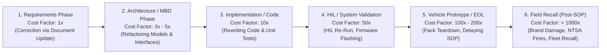
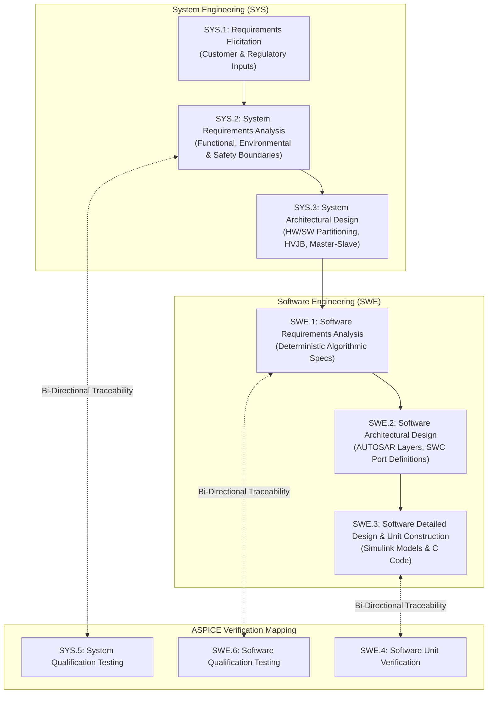

# Automotive Requirements Engineering: Overview & Framework

In safety-critical automotive systems, requirements engineering is the single most decisive factor determining product safety, software quality, and regulatory compliance[^eberlein2002]. A flawed, ambiguous, or incomplete requirement introduced during early conceptual phases propagates downstream through architectural design, implementation, and testing—multiplying the cost of rectification by orders of magnitude[^boehm1988].

Within the **Automotive SPICE (ASPICE PAM v3.1/v4.0)** and **ISO 26262** functional safety lifecycles, requirements engineering is formal, structured, and strictly audited under process groups **SYS.2 (System Requirements Analysis)** and **SWE.1 (Software Requirements Analysis)**[^automotivespice][^iso26262].

This chapter establishes the foundational principles, defect amplification economics, and process flows governing automotive requirements engineering for high-voltage battery management systems.

---

## The Economics of Defect Detection: The $10\times$ Amplification Rule

Empirical software engineering data across the automotive and aerospace industries reveals the exponential cost escalation of resolving specification errors across the development lifecycle[^boehm1988]:

> [!CAUTION]
> In an electric vehicle battery system, an ambiguous requirement regarding contactor welding thresholds or overcharge voltage cutoffs discovered during fleet operation can result in multi-billion-dollar vehicle recalls, regulatory penalties, or thermal runaway fires. Rigorous requirements engineering front-loads verification to the earliest phase of the V-Model.

---

## ASPICE Process Groups: SYS.2 and SWE.1

Under Automotive SPICE, requirements engineering forms the foundation of the left wing of the V-Model:

### Key ASPICE Process Outcomes (SWE.1 / SYS.2)

1. **Elicitation & Refinement:** Transforming customer use cases, charging standards (ISO 15118), and crash requirements (FMVSS 305) into atomic technical specifications.
2. **Analysis for Correctness & Feasibility:** Verifying that requirements are physically realizable with selected silicon (e.g. AFE sampling rates, ADC resolution, memory size).
3. **Bi-Directional Traceability:** Establishing unbroken forward and backward traceability links:
   - $\text{Customer Requirement} \longleftrightarrow \text{System Requirement} \longleftrightarrow \text{Software Requirement} \longleftrightarrow \text{Test Case}$.
4. **Impact Analysis:** Automatically identifying which models, code files, and test specifications must be re-validated when a requirement changes.

---

## Requirements Classification Taxonomy

A robust BMS specification categorizes requirements into five distinct functional and physical domains:

| Category | Primary Focus | Governing Standards | Typical Metric / Example |
| :--- | :--- | :--- | :--- |
| **Functional** | Active control algorithms, charging states, cell balancing. | ISO 15118, DIN 70121 | Voltage measurement interval $\le 100\,\text{ms}$, balancing delta threshold $\Delta V_{\text{th}} = 10\,\text{mV}$. |
| **Safety-Critical** | Fault detection, overvoltage cutoff, contactor opening. | ISO 26262 (ASIL-D), IEC 61508 | Transition to Safe State within $\text{FTTI} \le 10\,\text{ms}$ upon short-circuit detection. |
| **Environmental** | Operational temperature, vibration, moisture ingress. | ISO 16750-2/3/4, IP6K9K | Uninterrupted measurement accuracy across $-40^\circ\text{C} \le T_{\text{amb}} \le +85^\circ\text{C}$. |
| **Performance** | Response latency, computational throughput, bus load. | OEM Specifications, SAE J1939 | CAN-FD bus utilization $<65\%$, microcontroller idle margin $>30\%$. |
| **Verification** | Testability, automated HIL execution, diagnostic access. | ISO 14229 (UDS), ASAM XIL | Diagnostic trouble codes accessible via UDS Service `0x19`; $100\%$ MC/DC test coverage. |

---

## References

[^eberlein2002]: Eberlein, A., & Leite, J. C. S. (2002). Agile requirements definition: A critical review. *IEEE International Requirements Engineering Conference*, 4–8.
[^boehm1988]: Boehm, B. W. (1988). A spiral model of software development and enhancement. *Computer*, 21(5), 61–72.
[^automotivespice]: VDA QMC Working Group 13. (2017). *Automotive SPICE Process Assessment / Reference Model (PAM/PRM) v3.1*. VDA.
[^iso26262]: International Organization for Standardization. (2018). *ISO 26262-3 / Part 4 / Part 6: Road vehicles — Functional safety*. ISO.
