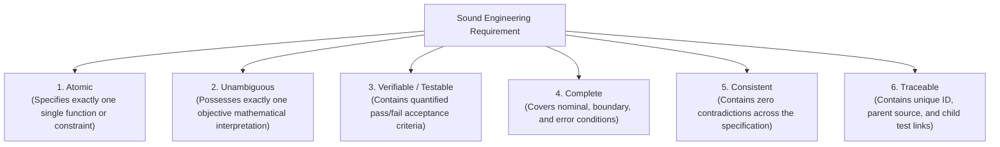
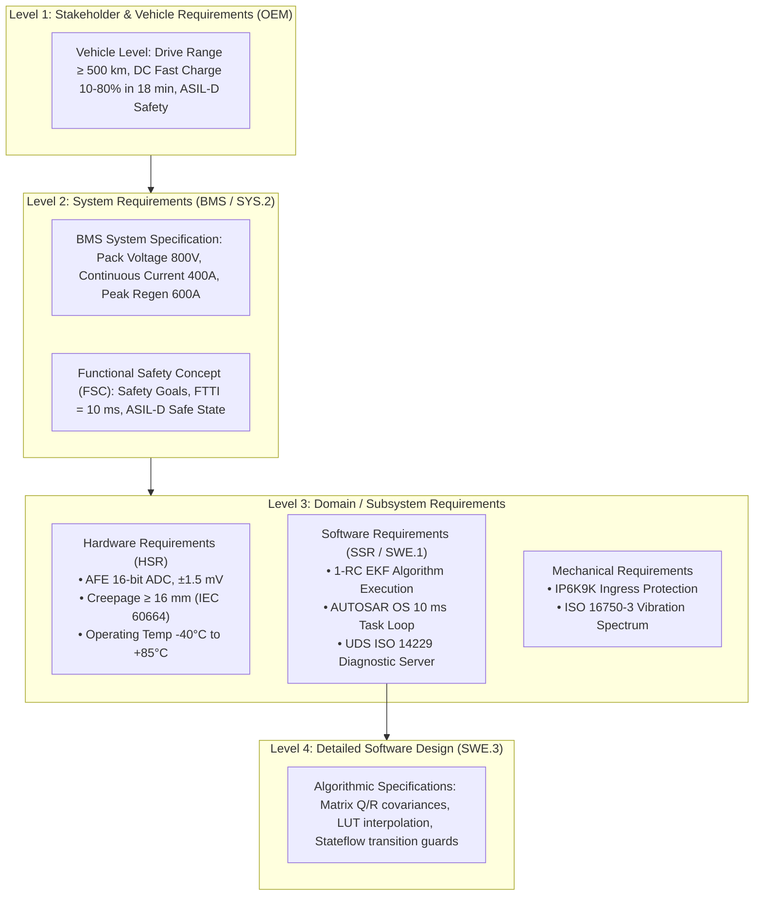

# Principles & Architecture of Automotive Requirements

In the engineering of automotive electronic systems, requirements do not exist as isolated prose. Instead, they form a **hierarchically decomposed, multi-level graph** that links high-level vehicle attributes (such as electric driving range, acceleration response, and 5-star crash safety) to embedded microcontroller registers and algorithmic constants[^hull2011].

This chapter formalizes the fundamental quality attributes of automotive requirements according to the **INCOSE (International Council on Systems Engineering)** standards and examines the multi-tier requirements hierarchy governing automotive systems under **ASPICE**[^incose2019].

---

## Quality Attributes of Sound Requirements

According to the INCOSE *Guide for Writing Requirements* and ISO/IEC/IEEE 29148, an automotive engineering requirement must exhibit six indispensable quality criteria[^iso29148]:

### 1. Atomicity
A requirement must specify a single behavior. Compound statements joined by "and", "as well as", or "in addition to" must be decomposed:
- *Poor (Non-Atomic):* "The BMS shall measure cell voltages every 100 ms and balance cells that exceed 4.15 V."
- *Correct (Decomposed):*
  - `BMS_REQ_011`: "The BMS shall sample all series cell voltages with a sampling interval of $T_s \le 100\,\text{ms}$."
  - `BMS_REQ_012`: "When the highest cell voltage exceeds $4.15\,\text{V}$ during charging, the BMS shall activate the passive balancing switch for that cell."

### 2. Unambiguity
Qualitative adjectives (e.g., "fast", "reliable", "user-friendly", "sufficient", "safe") are strictly prohibited. Every attribute must be quantified with engineering units, tolerances, and physical conditions:
- *Poor:* "The BMS shall shut down quickly if temperature gets too high."
- *Correct:* "When any cell temperature exceeds $T_{\text{max}} = 65.0^\circ\text{C} \pm 0.5^\circ\text{C}$, the BMS shall transition all main contactors to the OPEN state within $t \le 10\,\text{ms}$."

---

## The Four-Tier Automotive Requirements Hierarchy

Automotive engineering decomposes requirements across four distinct hierarchical levels:

### Traceability Schema in Requirements Management Systems

Production automotive programs maintain requirements inside specialized databases (e.g., IBM Engineering Requirements Management DOORS, PTC Integrity, Siemens Polarion, or Jama Software)[^dick2017]:

| Data Attribute | Standard Schema Value | Description & Purpose |
| :--- | :--- | :--- |
| **Requirement UID** | `BMS_SSR_VOLT_042` | Unique persistent alphanumeric key throughout project lifecycle. |
| **Requirement Title** | Cell Overvoltage Disconnect | Short human-readable title. |
| **EARS Requirement Text** | *When cell voltage exceeds $4.25\,\text{V}$, the BMS shall...* | Formal standardized syntax defining behavior. |
| **ASIL Level** | `ASIL-D` | Functional safety integrity classification (QM, ASIL A, B, C, D). |
| **Parent Links** | `BMS_SYS_018` | Backward link to the originating system requirement. |
| **Child Links** | `TC_HIL_OVP_003` | Forward link to verified test cases in the test management tool. |
| **Verification Method** | `Test (HIL)` | Method of verification: Inspection, Analysis, Test (HIL/SIL), or Demonstration. |
| **Status / Lifecycle** | `Approved / Baselined` | Workflow state: Draft, In Review, Approved, Rejected, Obsolete. |

---

## References

[^hull2011]: Hull, E., Jackson, K., & Dick, J. (2011). *Requirements Engineering*. Springer.
[^incose2019]: International Council on Systems Engineering. (2019). *INCOSE Guide for Writing Requirements*. INCOSE-TP-2010-006-03.
[^iso29148]: International Organization for Standardization. (2018). *ISO/IEC/IEEE 29148: Systems and software engineering — Life cycle processes — Requirements engineering*. ISO/IEC/IEEE.
[^dick2017]: Dick, J., Hull, E., & Jackson, K. (2017). *Requirements Engineering (4th Edition)*. Springer International Publishing.
