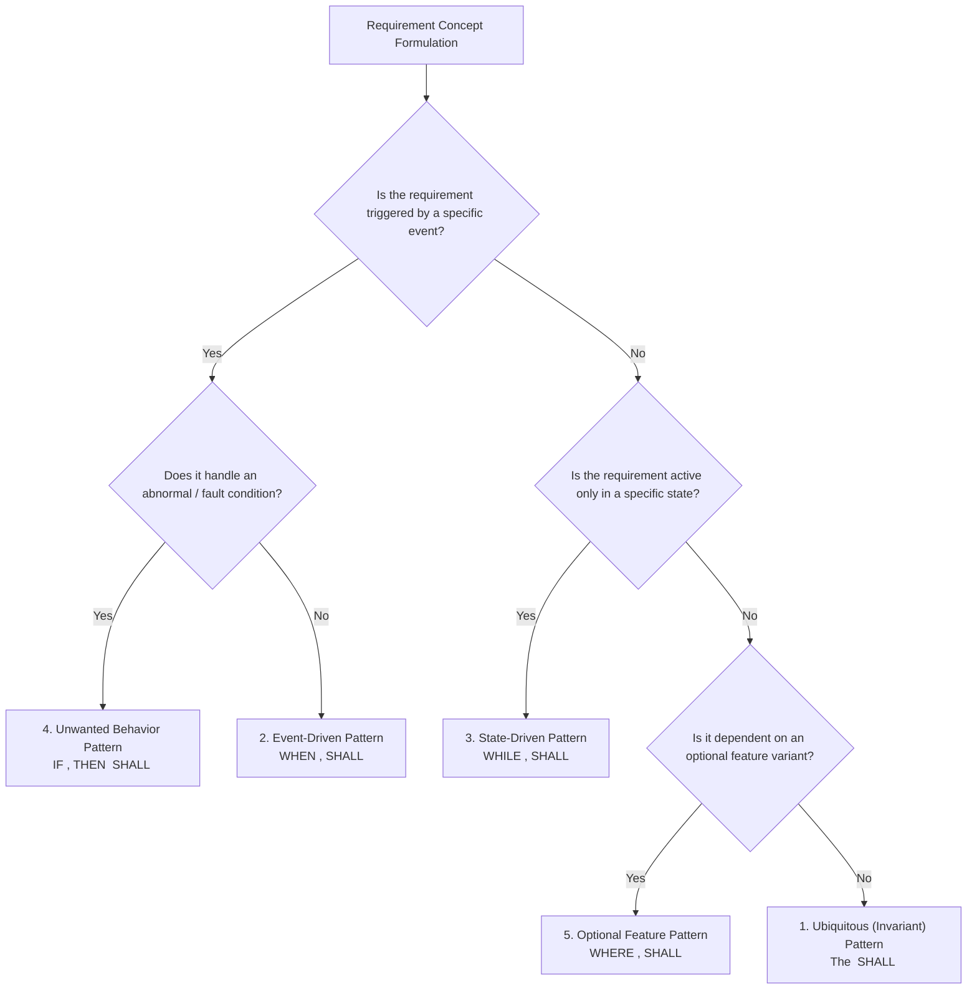

# Requirements Authoring Syntax: The EARS Framework & INCOSE Rules

Unconstrained natural language is the leading source of specification ambiguities, misinterpretations, and architectural defects in automotive software engineering[^mavin2009]. To eliminate linguistic vagueness while maintaining human readability across multidisciplinary teams, automotive Tier-1 suppliers and OEMs employ constrained natural language rule sets, primarily the **EARS (Easy Approach to Requirements Syntax)** framework and the **INCOSE Guidelines for Writing Requirements**[^incose2019].

This chapter formalizes the grammar, pattern selection decision trees, modal verb semantics, and anti-pattern rules governing automotive Battery Management System specifications.

---

## The EARS (Easy Approach to Requirements Syntax) Framework

Formulated by Alistair Mavin at Rolls-Royce and standardized across automotive and aerospace engineering, EARS constrains requirements into **five distinct syntactic patterns** based on operating context, triggers, and state dependencies[^mavin2009]:



### The 5 Core EARS Syntactic Patterns

#### 1. Ubiquitous Pattern (Universal Invariants)
Applies universally at all times during system life, independent of specific states or triggers:
```
The <system name> shall <system response>.
```
- **Example:**
  > `BMS_SSR_GEN_001`: The BMS shall maintain an electrical isolation resistance greater than $500\,\Omega/\text{V}$ between the high-voltage DC bus and the vehicle chassis ground under all operating conditions.

#### 2. Event-Driven Pattern
Triggered instantaneously when a discrete physical or communicative event occurs:
```
WHEN <trigger condition>, the <system name> shall <system response>.
```
- **Example:**
  > `BMS_SSR_PROT_004`: WHEN pack discharge current exceeds $1200\,\text{A} \pm 10\,\text{A}$ continuously for duration $t \ge 50\,\text{ms}$, the BMS shall command both main high-voltage contactors to OPEN within $t \le 10\,\text{ms}$.

#### 3. State-Driven Pattern
Active continuously while the system resides within a defined operational state:
```
WHILE <defined system state>, the <system name> shall <system response>.
```
- **Example:**
  > `BMS_SSR_CHG_018`: WHILE in the `PRECHARGE` state, the BMS shall sample the DC-link capacitor terminal voltage with a periodicity of $T_s = 10\,\text{ms} \pm 1\,\text{ms}$.

#### 4. Unwanted Behavior Pattern (Fault & Exception Handling)
Mandatory for ISO 26262 safety requirements handling hardware anomalies, sensor failures, or boundary breaches:
```
IF <unwanted condition / failure>, THEN the <system name> shall <system response>.
```
- **Example:**
  > `BMS_SSR_SAFE_009`: IF the High-Voltage Interlock Loop (HVIL) signal is interrupted, THEN the BMS shall transition to the `FAULT_SAFE_STATE` and de-energize all contactor coil drivers within $t \le 10\,\text{ms}$.

#### 5. Optional Feature Pattern
Specifies behaviors present only in certain vehicle package variants:
```
WHERE <optional feature / hardware variant is present>, the <system name> shall <system response>.
```
- **Example:**
  > `BMS_SSR_OPT_003`: WHERE active dielectric immersion cooling is equipped, the BMS shall modulate dielectric pump speed via PWM proportionally to the maximum cell temperature.

#### 6. Combined Complex Pattern
Handles complex real-world logic combining operational state, triggering event, and exception:
```
WHILE <state>, WHEN <trigger>, the <system name> shall <system response>.
```
- **Example:**
  > `BMS_SSR_BAL_012`: WHILE in `STANDBY` state, WHEN all cell voltage rates of change satisfy $\left|\frac{dV}{dt}\right| < 1\,\text{mV/min}$ for duration $t \ge 1800\,\text{s}$, the BMS shall execute the OCV-based initial SoC recalibration routine.

---

## Modal Verb Semantics: ISO/IEC Standards

In formal automotive engineering, auxiliary modal verbs carry strict legal and contractual definitions (RFC 2119 / IEEE 29148)[^iso29148]:

| Modal Verb | Contractual Meaning | Verification & Compliance Mandate |
| :--- | :--- | :--- |
| **SHALL** | Mandatory Requirement | Absolute requirement. The system cannot be certified or shipped without verified test evidence proving compliance. |
| **SHOULD** | Target Recommendation | Strong recommendation. Permissible to deviate only with documented engineering justification and risk analysis. |
| **MAY / CAN** | Permissible Option | Optional capability or physical characteristic. Does not impose a verification constraint. |
| **WILL** | Declaration of Fact | Expresses future intent or architectural fact (e.g., *"The vehicle will supply 12V auxiliary power"*); never used to specify system behavior. |

---

## INCOSE Prohibited Vocabulary & Toxic Anti-Patterns

The INCOSE *Guide for Writing Requirements* strictly identifies ambiguous words that invalidate testability[^incose2019]:

| Prohibited Anti-Pattern | Root Cause of Failure | Compliant Engineering Refactoring |
| :--- | :--- | :--- |
| **"and/or"** | Creates logical ambiguity; hides multiple requirements in one sentence. | Decompose into distinct deterministic cases using boolean logic: `IF (A OR B)...` |
| **"user-friendly / intuitive"** | Subjective; completely impossible to quantify or test on an automated HIL testbench. | Specify physical interaction: *"Response latency on display shall be $\le 100\,\text{ms}$."* |
| **"fast / quickly / immediately"** | Vague timing; no deterministic deadline for RTOS task scheduling. | Quantify exact maximum latency: *"...within $t \le 5.0\,\text{ms}$."* |
| **"etc. / and so on"** | Infinite unspecified scope; leaves system behavior open to tester interpretation. | Enumerate the exhaustive list of conditions or use a standardized table reference. |
| **"as appropriate / if possible"** | Grants the developer license to omit the functionality entirely. | Define exact deterministic conditions under which the behavior is triggered. |
| **Negative Requirements ("The BMS shall not...")** | Testing a negative requires proving an infinite set of non-occurrences. | Refactor into positive safe actions: *"When overtemperature occurs, the BMS shall open contactors..."* |

---

## References

[^mavin2009]: Mavin, A., Wilkinson, P., Harwood, A., & Novak, M. (2009). Easy Approach to Requirements Syntax (EARS). *17th IEEE International Requirements Engineering Conference (RE'09)*, 317–322.
[^incose2019]: International Council on Systems Engineering. (2019). *INCOSE Guide for Writing Requirements*. INCOSE-TP-2010-006-03.
[^iso29148]: International Organization for Standardization. (2018). *ISO/IEC/IEEE 29148: Systems and software engineering — Requirements engineering*. ISO/IEC/IEEE.
