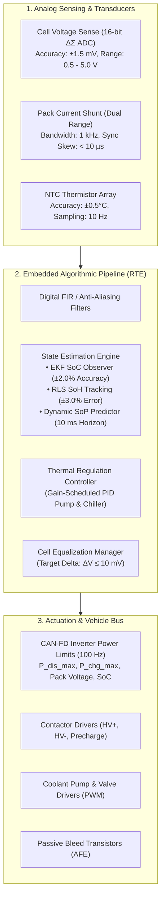

# Functional Requirements: Sensing, Estimation & Actuation

Functional requirements define the core operational behaviors of the Battery Management System (BMS) under nominal and dynamic operating conditions. While safety requirements govern fault containment and shutdown, functional requirements specify the **accuracy, sampling bandwidth, algorithm convergence, and actuation timing** necessary to maximize battery performance and energy utilization[^andrea2020][^plett2015].

This chapter details the technical specifications governing analog data acquisition, state estimation observer pipelines, and physical actuation control.

---

## Data Acquisition Pipeline & Functional Architecture

---

## 1. Physical Sensing Requirements

### 1.1 Cell Voltage Acquisition Specification
- **Requirement ID:** `BMS_FRS_SENS_001`
- **EARS Specification:**  
  *The BMS shall acquire individual cell terminal voltages across all connected series channels within the range of $0.500\,\text{V}$ to $5.000\,\text{V}$ with a measurement accuracy of $\le \pm 1.5\,\text{mV}$ across the operating temperature range of $-40^\circ\text{C}$ to $+85^\circ\text{C}$.*
- **Technical Justification:** In flat-profile chemistries such as Lithium Iron Phosphate ($\text{LiFePO}_4$), the OCV curve exhibits a slope of $< 0.5\,\text{mV}/\%$. A sensor error of $\pm 5\,\text{mV}$ introduces an intolerable State of Charge uncertainty exceeding $\pm 10\%$[^roscher2011].
- **Sampling Interval:** Complete pack array update period $T_s \le 100\,\text{ms}$.

### 1.2 Pack Current Sampling & Time-Synchronization
- **Requirement ID:** `BMS_FRS_SENS_002`
- **EARS Specification:**  
  *The BMS shall sample high-voltage pack current across the measurement range of $-2000\,\text{A}$ to $+2000\,\text{A}$ with a sampling frequency of $\ge 1.0\,\text{kHz}$ and an accuracy of $\le \pm 0.5\%$ of full scale, time-synchronized to cell voltage acquisition within a maximum skew of $t_{\text{skew}} \le 10\,\mu\text{s}$.*
- **Technical Justification:** Non-synchronous sampling between cell voltage and current induces artificial phase shifts during high-frequency inverter ripple, corrupting internal resistance identification ($R_0 = \Delta V / \Delta I$) and Extended Kalman Filter convergence.
- **Sleep Resolution:** Secondary measurement channel resolving quiescent currents down to $\le 1.0\,\text{mA}$ during resting states.

### 1.3 Module Temperature Sensing
- **Requirement ID:** `BMS_FRS_SENS_003`
- **EARS Specification:**  
  *The BMS shall monitor battery temperatures via NTC thermistors with an accuracy of $\le \pm 0.5^\circ\text{C}$ within the critical thermal window of $+15.0^\circ\text{C}$ to $+45.0^\circ\text{C}$ and $\le \pm 1.5^\circ\text{C}$ across the full $-40^\circ\text{C}$ to $+85^\circ\text{C}$ range, with a sampling rate of $\ge 10\,\text{Hz}$.*

---

## 2. State Estimation Functional Specifications

| Estimation Metric | Accuracy Requirement | Convergence Time | Algorithmic Approach |
| :--- | :--- | :--- | :--- |
| **State of Charge ($\text{SoC}$)** | $\le \pm 2.0\%$ true charge error across $10\% \le \text{SoC} \le 90\%$ | $\le 60.0\,\text{s}$ from initial $\pm 20\%$ error | 1-RC Thevenin Extended Kalman Filter (EKF) with online Jacobian linearization[^plett2004]. |
| **Capacity Health ($\text{SoH}_C$)** | $\le \pm 3.0\%$ relative to laboratory discharge capacity | Updated every 10 full equivalent cycles | Recursive Least Squares (RLS) with forgetting factor $\lambda = 0.995$ on charging data. |
| **Impedance Health ($\text{SoH}_R$)**| $\le \pm 5.0\%$ of true ohmic resistance $R_0$ | Continuous online tracking | Differential voltage-current pulse identification during acceleration pulses. |
| **State of Power ($\text{SoP}$)** | Continuous calculation over $1\,\text{s}, 10\,\text{s}$, and $30\,\text{s}$ prediction horizons | Updated every $10\,\text{ms}$ ($100\,\text{Hz}$) | Multi-constraint voltage, current, and SoC boundary projection equations. |

---

## 3. Physical Actuation Functional Requirements

### 3.1 Dynamic Power Limit Transmission
- **Requirement ID:** `BMS_FRS_ACT_001`
- **EARS Specification:**  
  *WHILE in the `RUN_DRIVE` state, the BMS shall calculate and broadcast the maximum continuous and 10-second peak discharge power ($P_{\text{dis,max}}$) and charge power ($P_{\text{chg,max}}$) across CAN-FD to the traction inverter with a repetition interval of $10\,\text{ms} \pm 1\,\text{ms}$.*
- **Acceptance Criteria:** Inverter limits strictly enforced; zero cell overvoltages or undervoltages during step acceleration or full regenerative braking.

### 3.2 Closed-Loop Electro-Thermal Control
- **Requirement ID:** `BMS_FRS_ACT_002`
- **EARS Specification:**  
  *WHILE active, the BMS shall execute a closed-loop thermal regulation controller to maintain maximum cell temperatures below $35.0^\circ\text{C}$ and intra-pack temperature deltas below $\Delta T_{\text{pack}} \le 3.0^\circ\text{C}$ by modulating coolant flow rate and chiller expansion valve commands via vehicle network interfaces.*

---

## References

[^andrea2020]: Andrea, D. (2020). *Battery Management Systems for Large Lithium-Ion Battery Packs*. Artech House.
[^plett2015]: Plett, G. L. (2015). *Battery Management Systems, Volume I & II*. Artech House.
[^roscher2011]: Roscher, M. A., & Sauer, D. U. (2011). Dynamic electric behavior and open-circuit-voltage modeling of $\text{LiFePO}_4$ batteries. *Journal of Power Sources*, 196(1), 331–336.
[^plett2004]: Plett, G. L. (2004). Extended Kalman filtering for battery management systems: Part 2. Modeling and identification. *Journal of Power Sources*, 134(2), 262–276.
