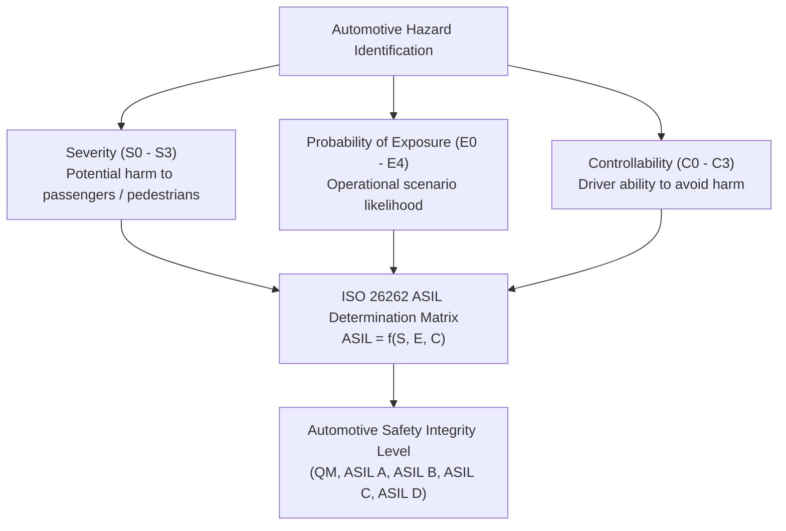
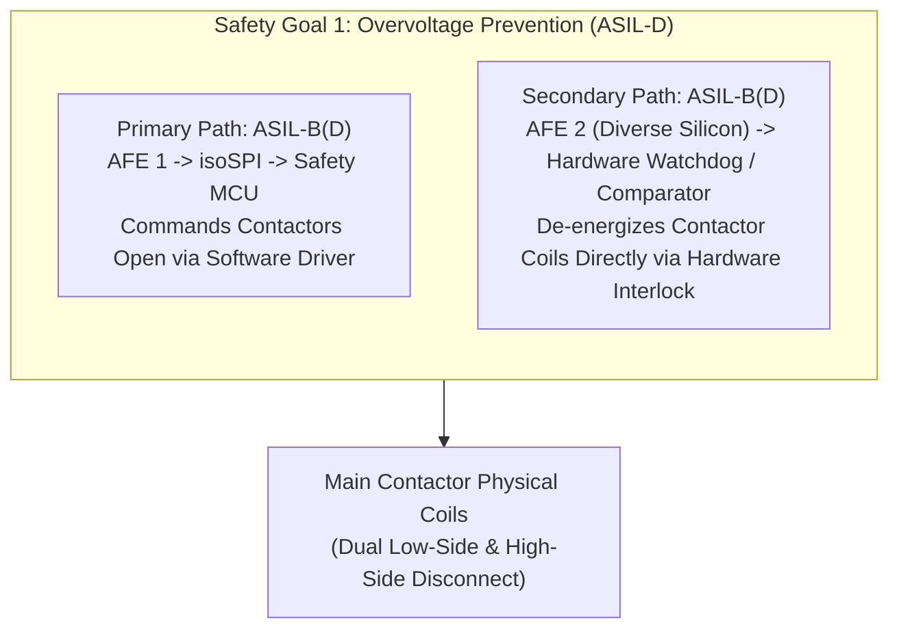

# Functional Safety Engineering: ISO 26262, HARA & ASIL-D Lifecycle

High-voltage automotive battery packs concentrate immense chemical and electrical energy ($50\,\text{kWh}$ to $>150\,\text{kWh}$ at voltages up to $1000\,\text{V}_{\text{DC}}$). System failures—such as uncontrolled overcharging, high-current short circuits, or contactor welding—can lead directly to thermal runaway fires, toxic gas venting ($\text{HF}, \text{CO}, \text{H}_2$), and lethal electrocution[^doughty2012].

Consequently, the Battery Management System (BMS) is governed by **ISO 26262: Road Vehicles — Functional Safety**, representing one of the most safety-critical electronic control units in an electrified vehicle[^iso26262].

This chapter formalizes Hazard Analysis and Risk Assessment (HARA), the calculation of Fault Tolerant Time Intervals (FTTI), ASIL decomposition strategies, and quantitative hardware reliability metrics ($\text{SPFM}, \text{LFM}, \text{PMHF}$).

---

## Hazard Analysis and Risk Assessment (HARA)

Under ISO 26262 Part 3, functional safety begins by identifying item-level operational hazards and evaluating them across three standardized parameters:

### Parameter Classifications

1. **Severity ($S$):**
   - $S0$: No injuries.
   - $S1$: Light and moderate injuries.
   - $S2$: Severe and life-threatening injuries (survival probable).
   - $S3$: Life-threatening injuries (fatalities).
2. **Probability of Exposure ($E$):**
   - $E1$: Very low likelihood (rare driving situation).
   - $E2$: Low likelihood ($<1\%$ of operating time).
   - $E3$: Medium likelihood ($1\% - 10\%$ of operating time).
   - $E4$: High likelihood ($>10\%$ of operating time, e.g. normal highway driving).
3. **Controllability ($C$):**
   - $C1$: Simply controllable ($>99\%$ of drivers can avoid harm).
   - $C2$: Normally controllable ($90\% - 99\%$ of drivers can avoid harm).
   - $C3$: Difficult to control or uncontrollable ($<90\%$ of drivers cannot prevent accident).

### ASIL Derivation for Core BMS Hazards

$$
S3 + E4 + C3 \Longrightarrow \mathbf{ASIL\text{-}D} \quad \text{(Maximum Automotive Safety Mandate)}
$$

| Hazard Description | Severity ($S$) | Exposure ($E$) | Controllability ($C$) | Determined ASIL | Safety Goal (SG) Formulated |
| :--- | :--- | :--- | :--- | :--- | :--- |
| **Unintended Cell Overcharge** leading to thermal runaway and passenger cabin fire. | **$S3$** (Fatalities) | **$E4$** (Normal driving/charging) | **$C3$** (Uncontrollable by driver) | **ASIL-D** | **SG-1:** The BMS shall prevent cell overcharge under all operating conditions. |
| **External High-Voltage Short Circuit** inducing explosive busbar melting. | **$S3$** (Severe fire) | **$E4$** (Driving / Crash) | **$C3$** (Uncontrollable) | **ASIL-D** | **SG-2:** The BMS shall isolate the battery pack within $<10\,\text{ms}$ upon short-circuit detection. |
| **Unintended Opening of Main Contactors** on highway leading to loss of propulsion. | **$S3$** (Rear-end collision) | **$E4$** (Highway speed) | **$C2$** (Steering & braking remain) | **ASIL-C** | **SG-3:** The BMS shall prevent unintended contactor opening during vehicle acceleration. |
| **Welded Contactor Contacts** leaving vehicle charging inlet live after unplugging. | **$S3$** (Fatal shock) | **$E3$** (Charging station) | **$C3$** (Uncontrollable by user) | **ASIL-D** | **SG-4:** The BMS shall detect contactor welding and inhibit vehicle restart. |

---

## Fault Tolerant Time Interval (FTTI)

The **Fault Tolerant Time Interval (FTTI)** is the maximum duration a hazardous fault can persist without safety mechanisms intervening before catastrophic physical harm occurs[^iso26262]:

```mermaid
gantt
    title Fault Tolerant Time Interval (FTTI) Decomposition
    dateFormat X
    axisFormat %s ms

    section Physical Fault Timeline
    Fault Injected (t = 0 ms)          : 0, 1
    Fault Detection Latency (t_det)     : 1, 4
    Transition to Safe State (t_trans) : 4, 8
    Safety Margin (t_margin)           : 8, 10
    Hazardous Runaway Boundary (FTTI)  : 10, 11
```

The fundamental timing constraint governing BMS embedded software and hardware is:

$$
\text{FTTI} \ge t_{\text{detection}} + t_{\text{transition\_to\_safe\_state}} + t_{\text{safety\_margin}}
$$

Where:
- $t_{\text{detection}}$: Time required for hardware ADCs, anti-aliasing filters, debounce timers, and diagnostic software to validate the fault.
- $t_{\text{transition\_to\_safe\_state}}$: Time required for MCU drivers, optocouplers, and mechanical contactor springs to physically de-energize and clear arcs.
- $t_{\text{safety\_margin}}$: Engineering safety buffer ($\ge 20\%$ of FTTI).

| Hazard Scenario | Fault Tolerant Time Interval (FTTI) | Maximum Detection Latency ($t_{\text{det}}$) | Maximum Safe-State Transition ($t_{\text{trans}}$) |
| :--- | :--- | :--- | :--- |
| **Dead Short Circuit ($I > 2500\,\text{A}$)** | $\le 10\,\text{ms}$ | $\le 2\,\text{ms}$ (Analog comparator) | $\le 2\,\text{ms}$ (Pyrofuse shear blade) |
| **Severe Overvoltage ($V > 4.35\,\text{V}$)** | $\le 500\,\text{ms}$ | $\le 50\,\text{ms}$ (Digital debounce) | $\le 30\,\text{ms}$ (Contactor coil de-energize) |
| **Cell Overtemperature ($T > 65^\circ\text{C}$)** | $\le 5.0\,\text{s}$ | $\le 200\,\text{ms}$ (NTC filter) | $\le 100\,\text{ms}$ (Inverter power derate) |
| **Insulation Loss ($R_{\text{iso}} < 100\,\Omega/\text{V}$)**| $\le 10.0\,\text{s}$ | $\le 3.0\,\text{s}$ (DC sweep measurement)| $\le 500\,\text{ms}$ (Safe shutdown request) |

---

## ASIL Decomposition: Redundancy Architectures

Designing a monolithic electronic board where every component meets ASIL-D is economically and technically prohibitive. ISO 26262 Part 9 permits **ASIL Decomposition**, allocating safety goals across independent, diverse sub-systems[^iso26262]:

$$
\mathbf{ASIL\text{-}D} = \mathbf{ASIL\text{-}B(D)} + \mathbf{ASIL\text{-}B(D)} \quad \text{or} \quad \mathbf{ASIL\text{-}C(D)} + \mathbf{ASIL\text{-}A(D)}
$$

### Criteria for Valid Decomposition

1. **Independence of Execution:** The primary and secondary paths must not share common silicon or single points of failure (e.g. separate power supply regulators, separate ADC reference voltages, diverse PCB trace routing).
2. **Freedom from Interference (FFI):** Software executing in the lower ASIL partition must be prevented from corrupting higher ASIL memory via the hardware Memory Protection Unit (MPU).

---

## Quantitative Hardware Architectural Metrics

ISO 26262 Part 5 mandates quantitative reliability metrics evaluated via Failure Modes, Effects, and Diagnostic Analysis (FMEDA):

| Metric | Definition & Target for ASIL-D | Mathematical Target |
| :--- | :--- | :--- |
| **Single-Point Fault Metric (SPFM)** | Measures the percentage of single-point and operational faults covered by safety mechanisms. | $\text{SPFM} \ge 99.0\%$ |
| **Latent Fault Metric (LFM)** | Measures coverage of latent dormant faults (e.g. broken redundant comparators tested during boot). | $\text{LFM} \ge 90.0\%$ |
| **Probabilistic Metric for Random Hardware Failures (PMHF)** | Maximum permissible random failure rate of the electronic hardware across 1 billion operating hours. | $\text{PMHF} < 10\,\text{FIT} = 10^{-8}\,\text{h}^{-1}$ |

---

## References

[^doughty2012]: Doughty, D. H., & Roth, E. P. (2012). A general discussion of Li-ion battery safety. *The Electrochemical Society Interface*, 21(2), 37–44.
[^iso26262]: International Organization for Standardization. (2018). *ISO 26262: Road vehicles — Functional safety (Parts 1–12)*. ISO.
