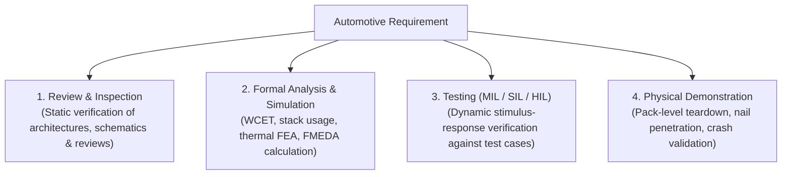
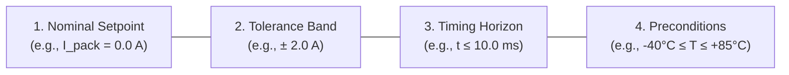
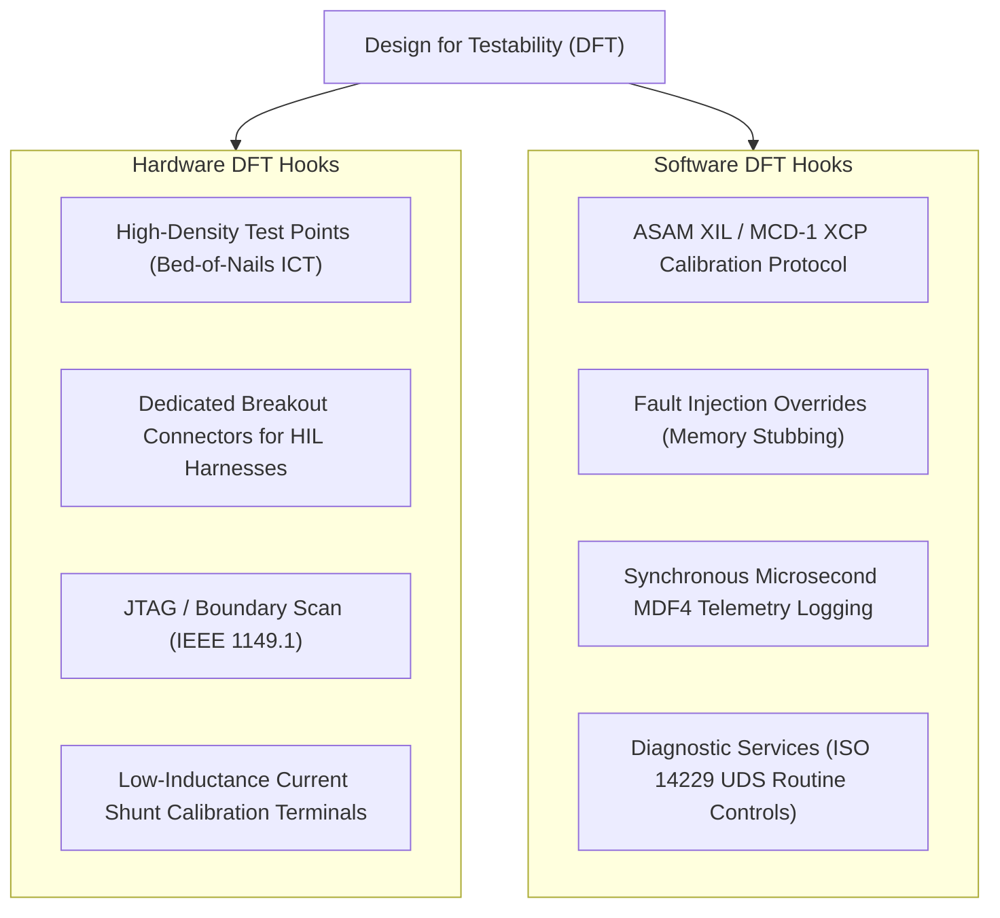

# Testability & Verification Requirements: Acceptance Criteria & DFT

A requirement cannot guarantee system safety or quality unless it is **objectively verifiable**. In safety-critical automotive systems, requirements engineering and verification strategy are developed in lockstep: every functional, environmental, and safety requirement must define its exact **verification method**, **quantified acceptance criteria**, and **Design for Testability (DFT)** hooks[^iso26262][^andrea2020].

This chapter details the formulation of unambiguous acceptance criteria, structural code coverage requirements under ISO 26262, and the hardware and software DFT mechanisms required for automated Hardware-in-the-Loop (HIL) execution.

---

## The Four Standard Automotive Verification Methods

According to ISO 26262-8 Clause 9 and ASPICE SYS.4/SYS.5, every requirement must be allocated to one of four recognized verification methods[^automotivespice]:



| Verification Method | Primary Application Scope | Execution Environment / Tooling |
| :--- | :--- | :--- |
| **Review / Inspection** | Traceability links, coding style compliance (MISRA-C:2012), schematic creepage distances. | Peer review checklists, SonarQube, Axivion Suite. |
| **Analysis** | Worst-Case Execution Time (WCET), static code analysis for run-time errors (division by zero, buffer overflow). | AbsInt aiT, Polyspace Code Prover, Astrée. |
| **Testing** | Algorithmic logic, timing deadlines, fault injection, contactor sequencing, dynamic state estimation. | Simulink Test (MIL), Vector CANoe / vTESTstudio (SIL/HIL), dSPACE SCALEXIO. |
| **Demonstration** | Mechanical vibration, IP6K9K environmental sealing, thermal runaway propagation containment. | Physical pack shaker tables, thermal chambers, fire test facilities. |

---

## Anatomy of a Quantified Acceptance Criterion

A vague acceptance criterion (e.g. *"contactor opens quickly"*) leads to unrepeatable tests and disputes between suppliers and OEMs. A compliant acceptance criterion must specify four quantitative parameters:

```
[Target State / Value] ± [Tolerance Band] WITHIN [Timing Horizon] UNDER [Operating Range / Preconditions]
```



### Comparative Formulation

- **Unacceptable Criterion:** *"The BMS will disconnect the pack if current is too high."*
- **Rigorous Engineering Criterion:**  
  *WHEN pack current $I \ge 1500\,\text{A}$, the main contactor coil driving voltage shall drop below $1.0\,\text{V}$ within $t \le 10.0\,\text{ms}$, verified across $N \ge 50$ consecutive automated HIL test runs with zero failed executions across the temperature range $-40^\circ\text{C} \le T_{\text{ambient}} \le +85^\circ\text{C}$.*

---

## Structural Code Coverage Requirements (ISO 26262-6 Table 12)

For software implementing safety-critical algorithms, ISO 26262 Part 6 mandates hierarchical levels of structural code coverage to ensure no dead, unintended, or untested code branches exist[^iso26262]:

| Structural Coverage Metric | Definition | ASIL-A | ASIL-B | ASIL-C | ASIL-D |
| :--- | :--- | :--- | :--- | :--- | :--- |
| **Statement Coverage** | Every executable C statement executed at least once. | ++ | ++ | ++ | ++ |
| **Branch / Decision Coverage** | Every decision (e.g. `if / else`) evaluated to true and false at least once. | + | ++ | ++ | ++ |
| **Modified Condition / Decision Coverage (MC/DC)** | Every atomic boolean condition within a decision shown to independently affect the decision outcome. | o | + | ++ | **++ (Mandatory)** |

> [!IMPORTANT]
> For **ASIL-D** battery software (e.g., overcharge protection or contactor trip logic), **$100\%$ MC/DC coverage** is strictly mandatory. If an expression reads:
> 
> ```c
> if ( (V_cell > 4.25) || (T_cell > 60.0 && I_pack > 100.0) )
> ```
> 
> The test suite must demonstrate that varying `V_cell`, `T_cell`, and `I_pack` independently flips the evaluation result while holding the other conditions constant.

---

## Design for Testability (DFT) Framework

Testability must be embedded directly into hardware schematics and software architectures:



1. **ASAM XIL API Compliance:** Standardizes test automation scripts. Test sequences authored in Python or Vector vTESTstudio execute identically whether interacting with a dSPACE SCALEXIO, Speedgoat, or National Instruments HIL rack[^asamxil].
2. **ASAM MCD-1 XCP Calibration:** Allows the HIL system to read and write internal microcontroller RAM variables in real time over CAN-FD or Automotive Ethernet without altering compiled software execution timing.

---

## References

[^iso26262]: International Organization for Standardization. (2018). *ISO 26262-6 / Part 8: Road vehicles — Functional safety*. ISO.
[^andrea2020]: Andrea, D. (2020). *Battery Management Systems for Large Lithium-Ion Battery Packs*. Artech House.
[^automotivespice]: VDA QMC Working Group 13. (2017). *Automotive SPICE Process Assessment Model v3.1*. VDA.
[^asamxil]: ASAM e.V. (2020). *ASAM XIL Standard: Generic Test Automation Interface for HIL/SIL Simulation*. ASAM.
