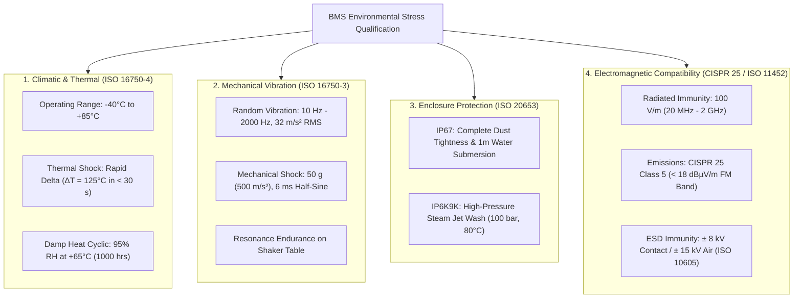

# Environmental, Mechanical & EMC Requirements

A Battery Management System (BMS) operates in one of the harshest physical environments in electrical engineering. Mounted within the vehicle underbody chassis or inside high-voltage pack enclosures, BMS electronics must maintain microvolt measurement precision while subjected to broad thermal extremes ($-40^\circ\text{C}$ to $+85^\circ\text{C}$), severe road vibration, high-pressure salt spray, and massive electromagnetic interference from Silicon Carbide (SiC) traction inverters[^andrea2020].

This chapter formalizes the environmental, mechanical, and electromagnetic compatibility requirements established under **ISO 16750**, **ISO 20653**, and **CISPR 25** standards[^iso16750][^cispr25].

---

## Environmental & Physical Stress Envelope

---

## 1. Climatic & Electrical Requirements (ISO 16750-2 & 4)

### 1.1 Operating Temperature Envelope
- **Requirement ID:** `BMS_ENV_TEMP_001`
- **EARS Specification:**  
  *The BMS shall maintain full functional operation and meet all voltage and current measurement accuracy tolerances across an ambient operating temperature range of $-40.0^\circ\text{C} \le T_{\text{amb}} \le +85.0^\circ\text{C}$.*
- **Verification Method:** Multi-day environmental chamber testing with thermal soak cycles.

### 1.2 Thermal Shock Durability
- **Requirement ID:** `BMS_ENV_TEMP_002`
- **EARS Specification:**  
  *The BMS hardware shall withstand 1000 cycles of thermal shock between $-40.0^\circ\text{C}$ and $+85.0^\circ\text{C}$ with a transfer duration of $t \le 30.0\,\text{s}$ without mechanical solder joint fatigue, PCB delamination, or component drift exceeding calibration limits.*

### 1.3 Electrical Supply Transients (ISO 16750-2)
- **Jump Start:** Withstand $26.0\,\text{V}_{\text{DC}}$ applied to the $12\,\text{V}$ auxiliary input for duration $t = 60.0\,\text{s}$ without permanent damage.
- **Reverse Polarity:** Survive reverse battery connection of $-14.0\,\text{V}_{\text{DC}}$ for duration $t = 60.0\,\text{s}$ through integrated reverse-polarity protection circuits.
- **Load Dump (Pulse 5b):** Clamping internal overvoltage transients up to $35.0\,\text{V}$ resulting from alternator field decay or DC-DC converter disconnection.

---

## 2. Mechanical Shock & Vibration Requirements (ISO 16750-3)

### 2.1 Random Vibration Profile
- **Requirement ID:** `BMS_ENV_MECH_001`
- **EARS Specification:**  
  *The BMS hardware shall operate without intermittent contact loss or measurement corruption when subjected to wideband random vibration along all three orthogonal axes ($X, Y, Z$) according to the ISO 16750-3 sprung-mass profile ($10\,\text{Hz} - 2000\,\text{Hz}$, overall root-mean-square acceleration $a_{\text{RMS}} = 31.6\,\text{m/s}^2$) for 32 hours per axis.*

### 2.2 Mechanical Shock
- **Requirement ID:** `BMS_ENV_MECH_002`
- **EARS Specification:**  
  *The BMS shall withstand half-sine acceleration shocks of peak amplitude $a_{\text{peak}} = 500\,\text{m/s}^2$ ($50\,g$) and duration $t = 6.0\,\text{ms}$, with 10 shocks applied in both positive and negative directions across three perpendicular axes (60 shocks total).*
- **Acceptance Criteria:** Zero component cracking, zero solder detachment, and no displacement of surface-mount capacitors verified via X-ray inspection.

---

## 3. Enclosure Protection: ISO 20653 Ingress Protection

Under automotive standards, the BMS enclosure must satisfy dual ingress requirements:
1. **IP67 Compliance:** Absolute dust-tight seal (no dust ingress under $20\,\text{mbar}$ vacuum); water submersion at $1.0\,\text{meter}$ depth for $30\,\text{minutes}$ with zero internal liquid accumulation.
2. **IP6K9K Compliance:** Resistance to high-pressure, high-temperature steam cleaning ($100\,\text{bar}$ water pressure delivered at $+80.0^\circ\text{C}$ from a distance of $100\,\text{mm}$ at varying angles), protecting electronics when vehicles undergo underbody washing.

---

## 4. Electromagnetic Compatibility (EMC) Requirements

High-voltage motor inverters switch currents up to $1000\,\text{A}$ across $800\,\text{V}$ DC buses at slew rates $\frac{dV}{dt} > 50\,\text{V/ns}$. The BMS must exhibit extreme electromagnetic immunity while remaining quiet in radio frequency bands[^ott2009]:

| EMC Test Category | Standard Reference | Test Severity / Limit | Engineering Acceptance Criteria |
| :--- | :--- | :--- | :--- |
| **Radiated RF Immunity** | ISO 11452-2 (ALSE) | Field strength $100.0\,\text{V/m}$ across $20\,\text{MHz} - 2.0\,\text{GHz}$. | Status Class A: Zero microcontroller resets; cell voltage measurement jitter $< \pm 3.0\,\text{mV}$. |
| **Bulk Current Injection (BCI)**| ISO 11452-4 | Injected RF current $200.0\,\text{mA}$ across $1.0\,\text{MHz} - 400.0\,\text{MHz}$. | Status Class A: Communication link (CAN-FD and isoSPI) maintains zero frame errors. |
| **Radiated Emissions** | CISPR 25 Class 5 | Peak $<18\,\text{dB}\mu\text{V/m}$ in the FM band ($76 - 108\,\text{MHz}$). | No interference with on-board vehicle communications, GPS, or emergency eCall radios. |
| **Electrostatic Discharge (ESD)**| ISO 10605 | $\pm 8.0\,\text{kV}$ contact discharge, $\pm 15.0\,\text{kV}$ air discharge. | Category C / Class A: No permanent damage to connector pins; automatic recovery without latch-up. |

---

## References

[^andrea2020]: Andrea, D. (2020). *Battery Management Systems for Large Lithium-Ion Battery Packs*. Artech House.
[^iso16750]: International Organization for Standardization. (2018). *ISO 16750: Road vehicles — Environmental conditions and testing for electrical and electronic equipment (Parts 1–5)*. ISO.
[^cispr25]: International Electrotechnical Commission. (2016). *CISPR 25: Vehicles, boats and internal combustion engines — Radio disturbance characteristics*. IEC.
[^ott2009]: Ott, H. W. (2009). *Electromagnetic Compatibility Engineering*. John Wiley & Sons.
