# Real-Time Performance & Power Consumption Requirements

A high-voltage Battery Management System (BMS) operates under strict **hard real-time deadlines**. Unlike general-purpose computing where computational delays merely reduce user responsiveness, missing a deadline in a safety-critical BMS (such as failing to process an overcurrent interrupt within its allocated window) can cause contactor contact welding, thermal runaway, or DC arc-flash explosions[^liu2000][^andrea2020].

Simultaneously, the BMS must exhibit extreme energy efficiency during vehicle parking, maintaining deep sleep quiescent currents below microampere thresholds to avoid draining the auxiliary $12\,\text{V}$ battery[^autosar_os2021].

This chapter formalizes the real-time execution budgets, Worst-Case Execution Time (WCET) limits, bus utilization margins, and low-power current constraints for automotive BMS electronics.

---

## Real-Time Task Timing & Execution Budgets

The BMS real-time operating system (AUTOSAR OS / OSEK) schedules tasks across a strict priority hierarchy:

```mermaid
gantt
    title BMS Microcontroller Task Scheduling & WCET Execution Limits
    dateFormat X
    axisFormat %s ms

    section ISR (Highest Priority)
    Overcurrent Hardware Interrupt (WCET <= 50 us) : 0, 1

    section 1 ms Task (Safety Critical)
    Contactor Trip & Pyro Monitor (WCET <= 150 us) : 0, 2
    Watchdog Trigger (WCET <= 30 us)              : 2, 3

    section 10 ms Task (Traction Control)
    Current Integration & Coulomb Counting (300 us) : 0, 3
    Inverter Power Limits Broadcast (200 us)       : 3, 5
    Contactor State Machine Evaluation (400 us)    : 5, 9

    section 100 ms Task (State Estimation)
    AFE Daisy-Chain SPI Acquisition (2.5 ms)        : 0, 3
    EKF State-Space Matrix Update (3.5 ms)          : 3, 7
    Thermal Regulation PID Loop (800 us)            : 7, 8
```



---

## 1. Microcontroller Computational Constraints

### 1.1 CPU Utilization & Idle Margin
- **Requirement ID:** `BMS_PERF_CPU_001`
- **EARS Specification:**  
  *The BMS microcontroller average central processing unit (CPU) utilization shall not exceed $65.0\%$ under worst-case nominal operational modes, and peak utilization shall not exceed $80.0\%$ during maximum diagnostic throughput.*
- **Engineering Justification:** The remaining $20\% - 35\%$ computational headroom is mandated by automotive OEMs to prevent task starvation during transient interrupt bursts and provide capacity for Over-The-Air (OTA) feature expansion over the 15-year vehicle service life.

### 1.2 Worst-Case Execution Time (WCET) Limits
- **Requirement ID:** `BMS_PERF_CPU_002`
- **EARS Specification:**  
  *The Worst-Case Execution Time (WCET) of individual periodic task loops shall satisfy the following upper bounds verified via static timing analysis:*
  - Fast Safety Loop ($1\,\text{ms}$ period): $\text{WCET} \le 150\,\mu\text{s}$ ($15\%$ task budget).
  - Powertrain Dynamics Loop ($10\,\text{ms}$ period): $\text{WCET} \le 1.80\,\text{ms}$ ($18\%$ task budget).
  - State Estimation Observer Loop ($100\,\text{ms}$ period): $\text{WCET} \le 8.00\,\text{ms}$ ($8\%$ task budget).
  - Background Diagnostics Loop ($1000\,\text{ms}$ period): $\text{WCET} \le 45.0\,\text{ms}$ ($4.5\%$ task budget).

### 1.3 Memory Footprint Ceilings
- **Static RAM:** Volatile SRAM utilization shall not exceed $70.0\%$ of physical capacity, leaving $\ge 30\%$ reserved for dynamically bounded stack expansion and OS task context switching.
- **Flash ROM:** Non-volatile program memory utilization shall not exceed $75.0\%$ of available sector space.

---

## 2. Vehicle Bus Utilization & Latency Budgets


### 2.1 Communication Network Budgets

| Network Interface | Protocol & Baud Rate | Maximum Bus Load | Latency Deadline ($t_{\text{latency}}$) |
| :--- | :--- | :--- | :--- |
| **Vehicle Powertrain CAN** | CAN-FD ($500\,\text{kbps}$ Nom. / $2.0\,\text{Mbps}$ Data) | $\le 60.0\%$ average utilization | $\le 10.0\,\text{ms}$ from sensor sample to inverter reception. |
| **AFE Satellite Daisy-Chain**| Proprietary isoSPI / isoUART ($2.0\,\text{Mbps}$) | Dedicated point-to-point bus | $\le 5.0\,\text{ms}$ to poll 192 series cell voltages with CRC. |
| **Diagnostic Network** | DoIP (100BASE-T1 Automotive Ethernet) | Burst load during service | UDS Service `0x22` response latency $\le 50.0\,\text{ms}$. |

---

## 3. Power Consumption & Quiescent Current Budgeting

Because the BMS operates continuously from the vehicle low-voltage $12\,\text{V}$ auxiliary battery, unmanaged power draw will discharge the battery during extended parking periods[^andrea2020]:

```
   BMS Operational Power States:
   +---------------------------------------------------------------+
   | RUN_DRIVE Mode:      P_active  <= 3.50 W  (I_aux ≈ 290 mA)    |
   +---------------------------------------------------------------+
   | STANDBY Mode:        P_standby <= 0.25 W  (I_aux ≈ 20 mA)     |
   +---------------------------------------------------------------+
   | DEEP_SLEEP Mode:     P_sleep   <= 1.0 mW  (I_aux <= 80 µA)    |
   +---------------------------------------------------------------+
```

### Quiescent Current Requirement Specification
- **Requirement ID:** `BMS_PERF_PWR_001`
- **EARS Specification:**  
  *WHILE in the `DEEP_SLEEP` state, the total parasitic quiescent current drawn by the BMS electronic control unit from the $12.0\,\text{V}$ auxiliary battery shall not exceed $I_{\text{sleep}} \le 80.0\,\mu\text{A}$ across the entire temperature range $-40.0^\circ\text{C} \le T_{\text{amb}} \le +85.0^\circ\text{C}$.*
- **Verification Method:** Multi-channel precision nano-ammeter recording current draw over a 24-hour sleep test in an environmental chamber.
- **Acceptance Criteria:** Current remains strictly $\le 80.0\,\mu\text{A}$ after a 5-minute pre-sleep power-down stabilization period.

---

## References

[^liu2000]: Liu, J. W. (2000). *Real-Time Systems*. Prentice Hall.
[^andrea2020]: Andrea, D. (2020). *Battery Management Systems for Large Lithium-Ion Battery Packs*. Artech House.
[^autosar_os2021]: AUTOSAR Consortium. (2021). *Specification of Operating System (FO R21-11)*. AUTOSAR.
