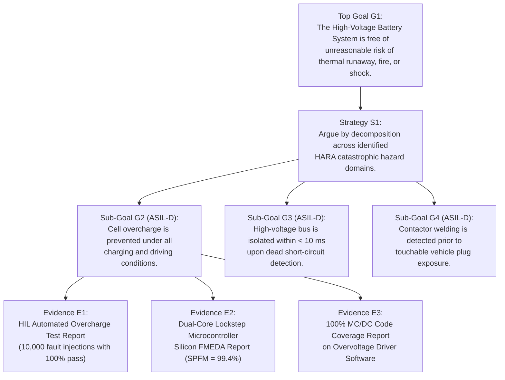
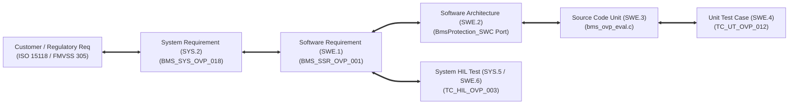
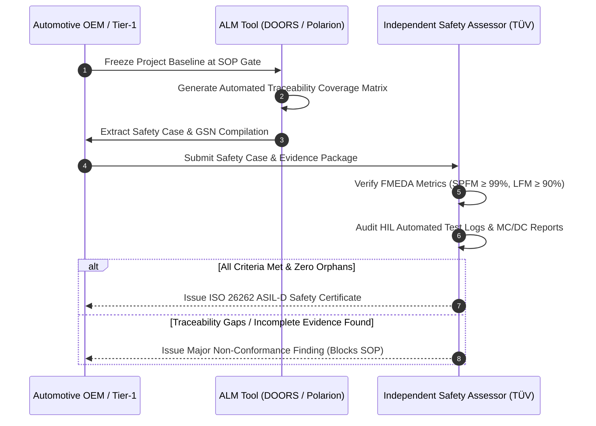

# Traceability, Safety Case & ASPICE Documentation

In safety-critical automotive engineering, documentation is not an administrative afterthought; it is a legally binding engineering deliverable. Under automotive product liability laws and international safety regulations (UNECE R100, ISO 26262), **an unverified or undocumented safety feature is legally non-existent**[^iso26262].

To achieve type approval for road vehicles, automotive manufacturers must present an auditable **Safety Case** supported by a complete, unbroken **Bi-Directional Requirements Traceability Matrix (RTM)** conforming to **Automotive SPICE (ASPICE v3.1/v4.0)** Level 2 or Level 3 standards[^automotivespice][^kelly2004].

This chapter formalizes the structure of the ISO 26262 Safety Case, Goal Structuring Notation (GSN), and bi-directional traceability frameworks for high-voltage battery management systems.

---

## The ISO 26262 Safety Case Architecture

Under ISO 26262 Part 10, a **Safety Case** is defined as a structured argument, supported by a body of physical and analytical evidence, that provides a compelling, comprehensible, and valid case that a system is free of unreasonable risk under specified operating contexts[^iso26262].

### Goal Structuring Notation (GSN)

The automotive industry uses **Goal Structuring Notation (GSN)**—a graphical argumentation methodology—to clearly demonstrate how safety goals are satisfied by technical evidence[^kelly2004]:

### Triad of the Safety Case: Claims, Arguments, and Evidence

1. **Claims / Goals:** Clear assertions about system safety (e.g., *"The BMS shall prevent lithium plating during sub-zero regeneration"*).
2. **Arguments:** The engineering rationale explaining why the claim is valid (e.g., *"By actively limiting charge current to zero when temperatures drop below $0^\circ\text{C}$ via redundant dual-sensor measurement"*).
3. **Evidence:** Concrete, objective artifacts demonstrating the argument holds true (e.g., environmental chamber HIL test logs, static analysis reports, and peer-reviewed code reviews).

---

## Bi-Directional Traceability Matrix (RTM)

Under ASPICE process outcomes **SYS.2 (System Requirements)**, **SWE.1 (Software Requirements)**, and **SWE.6 (Software Qualification Testing)**, organizations must maintain an unbroken chain of forward and backward traceability links[^automotivespice]:

### Automotive SPICE Traceability Auditing Matrix

| System Artifact | Linked Parent Artifact | Linked Child Artifact | Automated ASPICE Audit Verification Rule |
| :--- | :--- | :--- | :--- |
| **System Requirement** | Stakeholder Need / HARA Goal | Software Requirement (SWE.1) / Hardware Requirement (HSR) | **No Orphans:** Every system requirement must have at least one child software or hardware requirement. |
| **Software Requirement** | System Requirement (SYS.2) | Architecture (SWE.2) & System Test Case (SWE.6) | **Complete Verification:** Every software requirement must link to at least one test case with pass/fail status. |
| **Source Code Function** | Software Detailed Design (SWE.3) | Unit Test Case (SWE.4) with MC/DC report | **No Extraneous Code:** Every line of executable code must trace directly back to an approved requirement. |
| **HIL Test Script** | Software Requirement (SWE.1) | Automated MDF4 Test Execution Log | **Results Traceability:** Every test execution report must link to the exact firmware build Git commit hash. |

> [!CAUTION]
> **Orphan Code Hazard:** Code written without a corresponding parent requirement represents a severe safety hazard under ISO 26262. In an audit, orphan code is classified as an uncontrolled modification that can trigger unintended system behaviors (such as inadvertent contactor trips on a highway).

---

## Safety Audit & Certification Workflow

Before series production (SOP), an independent third-party functional safety assessor (e.g., TÜV SÜD, TÜV Rheinland, SGS-TÜV Saar) audits the complete safety lifecycle:

---

## References

[^iso26262]: International Organization for Standardization. (2018). *ISO 26262-10: Road vehicles — Functional safety — Part 10: Guideline on ISO 26262*. ISO.
[^automotivespice]: VDA QMC Working Group 13. (2017). *Automotive SPICE Process Assessment / Reference Model (PAM/PRM) v3.1*. VDA.
[^kelly2004]: Kelly, T., & Weaver, R. (2004). The goal structuring notation—a safety argument notation. *Dependable Systems and Networks 2004 Workshop on Assurance Cases*, 6.
