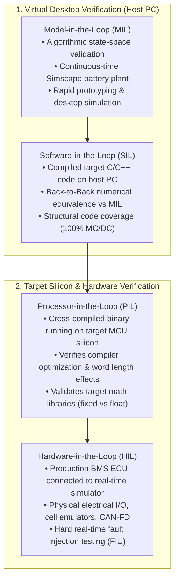
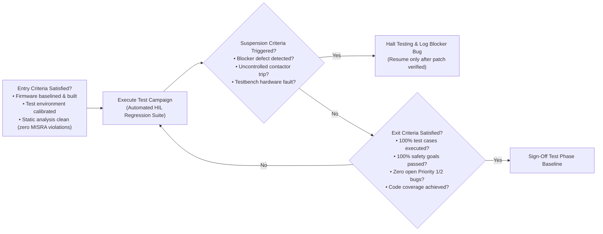
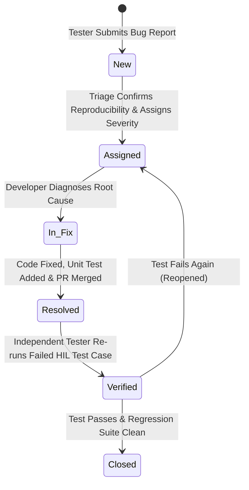

# The Automotive Test Concept: Framework & Test Levels

A **Test Concept** (Testkonzept) is the top-level strategic document that defines the methodology, architectural test environments, entry/exit criteria, and organizational governance required to verify and validate an automotive system[^fewster1999]. In high-voltage Battery Management Systems (BMS), the test concept coordinates verification activities across **ISO 26262 Part 4 (System Level)**, **Part 6 (Software Level)**, and **ASPICE SYS.4 / SYS.5 / SWE.4 / SWE.5 / SWE.6** process areas[^iso26262][^automotivespice].

Because battery systems combine high-power electronics, complex electrochemical dynamics, and safety-critical embedded firmware, the test concept establishes an integrated verification pipeline that prevents destructive physical testing through progressive simulation stages.

---

## The Automotive Verification Hierarchy: MIL, SIL, PIL & HIL

The BMS test concept partitions verification activities across four standard simulation and execution environments, moving progressively from pure virtual mathematics to physical hardware[^andrea2020]:

### Detailed Environment Comparison

| Verification Level | Execution Target | Plant Model Fidelity | Primary Verification Objectives | Typical Execution Latency |
| :--- | :--- | :--- | :--- | :--- |
| **Model-in-the-Loop (MIL)** | Simulink Engine on Host PC | Simscape multi-cell electro-thermal plant model | Control logic correctness, EKF filter convergence, state machine transition guards. | Faster than real-time ($10\times - 100\times$) |
| **Software-in-the-Loop (SIL)** | Native x86 executable on Host PC | Automated test harness / DLL plant model | Verification of auto-generated C code against model; identification of numerical overflow/underflow; MC/DC coverage. | Real-time or faster |
| **Processor-in-the-Loop (PIL)** | Target MCU (Infineon AURIX / NXP S32K) via JTAG/debugger | Non-real-time host plant model feeding target | Verification of target cross-compiler bugs (GCC / Tasking); hardware floating-point unit (FPU) precision vs. fixed-point scaling. | Slower than real-time |
| **Hardware-in-the-Loop (HIL)** | Production BMS ECU (Complete enclosed hardware) | Real-time FPGA/multi-core plant model on dSPACE SCALEXIO | True hard real-time latency ($< 10\,\text{ms}$ FTTI); contactor drivers; electrical fault injection (short-to-ground, open wire); EMC immunity. | Strict hard real-time ($1.0\times$) |

---

## Test Concept Governance: Entry, Exit & Suspension Criteria

A rigorous test concept replaces subjective readiness opinions with deterministic gating criteria:

### 1. Phase Entry Criteria
Before initiating a formal verification cycle (e.g. at Release Candidate RC1):
- All software units must compile with zero compiler warnings under `-Wall -Werror`.
- Static analysis (Polyspace / Axivion) must show zero critical MISRA-C:2012 violations and zero run-time errors (zero division by zero, zero buffer overflows).
- All associated Software Safety Requirements (SSR) must be approved and baselined in DOORS/Polarion.
- HIL testbench voltage and current calibration must be within validity window ($\le 30\,\text{days}$ from calibration).

### 2. Suspension and Resumption Criteria
- **Suspension Trigger:** If any single **Priority 1 (Safety Blocker)** defect occurs—such as failure to open contactors during overvoltage, or watchdog failure locking up the MCU—all formal test execution is suspended immediately.
- **Resumption Criterion:** A defect fix must be submitted with a root-cause analysis (8D Report), accompanied by passing unit tests, before the HIL test suite is resumed from the beginning.

### 3. Phase Exit Criteria
- $100\%$ of test cases planned for the release executed.
- $100\%$ pass rate across all ASIL-D and ASIL-C safety-critical test cases.
- Minimum $98.5\%$ pass rate across non-critical functional and diagnostic test cases.
- Zero open Priority 1 (Blocker) or Priority 2 (Critical) defects; all open Priority 3 (Minor) defects documented with signed OEM waivers and workarounds.
- Documented $100\%$ MC/DC code coverage for all ASIL-D software units.

---

## Defect Lifecycle Management (IEEE 1044 / ASPICE SUP.9)

Every anomaly detected during verification is tracked through a standardized state machine:

| Defect Severity Level | Definition in Battery Systems Context | Target Resolution SLA |
| :--- | :--- | :--- |
| **Priority 1: Blocker / Safety** | Violation of a safety goal; contactor fails to open; uncontained thermal/voltage hazard; MCU crash. | $< 24\,\text{hours}$ (Halts all deployment) |
| **Priority 2: Critical** | Functional degradation preventing charging or driving; erroneous SoC error $>10\%$; loss of vehicle CAN-FD telemetry. | $< 3\,\text{working days}$ |
| **Priority 3: Major** | Non-safety diagnostic fault; DTC misclassification; minor balancing delay; false-positive warning lamp. | Prior to next planned software sprint |
| **Priority 4: Minor** | Cosmetic GUI issue; minor timestamp jitter on telemetry logs; documentation clarification. | Next scheduled maintenance release |

---

## References

[^fewster1999]: Fewster, M., & Graham, D. (1999). *Software Test Automation: Effective Use of Test Execution Tools*. ACM Press / Addison-Wesley.
[^iso26262]: International Organization for Standardization. (2018). *ISO 26262-4 / Part 6: Road vehicles — Functional safety*. ISO.
[^automotivespice]: VDA QMC Working Group 13. (2017). *Automotive SPICE Process Assessment Model v3.1*. VDA.
[^andrea2020]: Andrea, D. (2020). *Battery Management Systems for Large Lithium-Ion Battery Packs*. Artech House.
