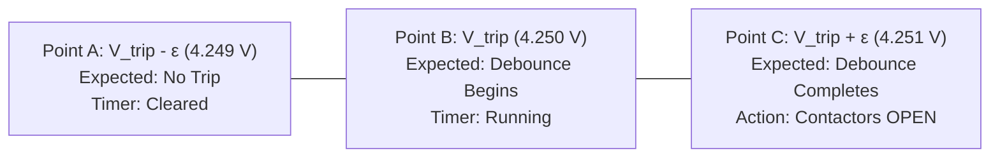
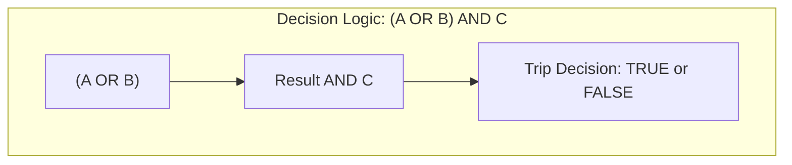
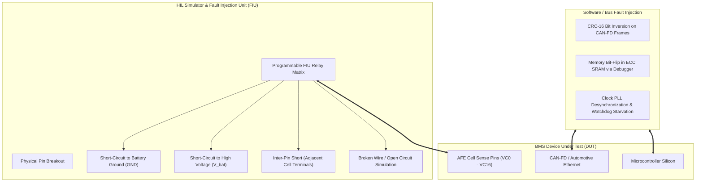
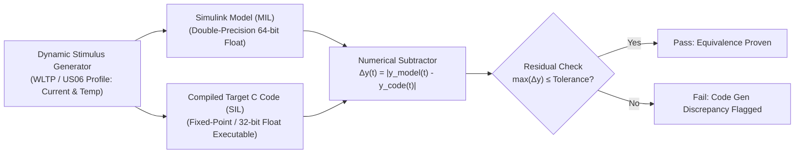

# Test Strategies & Design Techniques

A test strategy defines *how* an engineering team systematically selects, designs, and executes test cases to maximize defect detection with bounded time and computational resources[^myers2011]. In safety-critical automotive Battery Management Systems, naive random testing ("fuzzing") is completely insufficient to prove functional safety under **ISO 26262**[^iso26262].

Instead, automotive verification employs formal mathematical test design techniques: **Black-Box (Specification-Based)** methods, **White-Box (Structure-Based)** coverage criteria, **Fault Injection Testing (FIT)**, and **Back-to-Back Numerical Equivalence Testing**[^andrea2020].

This chapter formalizes Equivalence Class Partitioning, Boundary Value Analysis, MC/DC test vector derivation, and automated hardware fault injection topologies.

---

## Black-Box Test Design: ECP & Boundary Value Analysis

Black-box testing derives test vectors directly from functional specifications without knowledge of internal source code constructs[^myers2011].

### 1. Equivalence Class Partitioning (ECP)

The input domain of every sensor parameter is partitioned into contiguous mathematical subsets (classes) where the system is specified to behave identically. A single test vector drawn from each class is theoretically representative of the entire partition:

```
Cell Terminal Voltage Equivalence Partitions:
   <------- Class 1 ------->|<-------- Class 2 -------->|<--- Class 3 --->|<------- Class 4 ------->
   Deep Discharge (Fault)   |    Normal Operation       | OVP Derate Band | Critical Overvoltage Trip
                            |                           |                 |
  0.0 V                  2.50 V                      4.15 V            4.25 V                   5.0 V
```

1. **Class 1 (Deep Discharge Invalidation):** $V_{\text{cell}} < 2.50\,\text{V}$ $\longrightarrow$ Command inverter $0\,\text{Nm}$ torque, set `DTC_CELL_UNDERVOLTAGE`.
2. **Class 2 (Nominal Traction Band):** $2.50\,\text{V} \le V_{\text{cell}} \le 4.15\,\text{V}$ $\longrightarrow$ Full dynamic power limits permitted.
3. **Class 3 (Charge Derating Buffer):** $4.15\,\text{V} < V_{\text{cell}} \le 4.25\,\text{V}$ $\longrightarrow$ Throttle charge current proportionally; engage passive balancing.
4. **Class 4 (Critical Safety Trip):** $V_{\text{cell}} > 4.25\,\text{V}$ $\longrightarrow$ Immediate contactor trip within $\le 10\,\text{ms}$.

### 2. Boundary Value Analysis (BVA)

Empirical software engineering proves that the overwhelming majority of specification and algorithmic defects occur directly at the **edges of equivalence classes** (e.g. off-by-one errors, strict inequality `<` vs. less-than-or-equal `\le`)[^myers2011].

For the critical overvoltage threshold $V_{\text{trip}} = 4.250\,\text{V}$ with an ADC resolution of $\Delta V = 1.0\,\text{mV}$, **three-point boundary testing** evaluates:



- **Point A ($4.249\,\text{V}$):** Just below threshold $\longrightarrow$ BMS must remain in `RUN_DRIVE`; contactors stay closed.
- **Point B ($4.250\,\text{V}$):** Exactly on boundary $\longrightarrow$ BMS starts $50\,\text{ms}$ debounce counter.
- **Point C ($4.251\,\text{V}$):** Just above boundary for $t \ge 50\,\text{ms}$ $\longrightarrow$ BMS immediately de-energizes contactors.

---

## White-Box Test Design: Modified Condition / Decision Coverage (MC/DC)

White-box testing derives test vectors from internal source code logic. For **ISO 26262 ASIL-D**, structural code coverage mandates $100\%$ **Modified Condition / Decision Coverage (MC/DC)**[^iso26262].

### The Independence Principle of MC/DC

For a compound boolean decision composed of $N$ atomic conditions, full combinatorial testing requires $2^N$ test cases (which explodes exponentially for complex logic). MC/DC achieves high defect detection using only **$N + 1$ test cases** by demonstrating that each condition can *independently* flip the entire decision outcome while all other conditions are held constant.

#### Case Study: Contactor Emergency Trip Logic

Consider the embedded C expression governing the fast emergency disconnect:

$$
\text{Trip} = (A \lor B) \land C
$$

Where:
- $A$: Cell Overvoltage ($V_{\text{cell}} > 4.25\,\text{V}$)
- $B$: Cell Overtemperature ($T_{\text{cell}} > 60.0^\circ\text{C}$)
- $C$: Contactors Currently Engaged (`ContactorsClosed == TRUE`)



#### Truth Table & Independence Pairs Selection

| Test Case Index | Condition $A$ | Condition $B$ | Condition $C$ | Outcome $\text{Trip}$ | Selected MC/DC Independence Pair |
| :---: | :---: | :---: | :---: | :---: | :--- |
| **TC-1** | `False` | `False` | `True` | **`False`** | Baseline for $A$ and $B$ |
| **TC-2** | `True` | `False` | `True` | **`True`** | **Pair (TC-1, TC-2) proves independence of $A$!** ($B, C$ constant, $A$ flips outcome) |
| **TC-3** | `False` | `True` | `True` | **`True`** | **Pair (TC-1, TC-3) proves independence of $B$!** ($A, C$ constant, $B$ flips outcome) |
| **TC-4** | `True` | `False` | `False` | **`False`** | **Pair (TC-2, TC-4) proves independence of $C$!** ($A, B$ constant, $C$ flips outcome) |

With just **4 test cases** (instead of $2^3 = 8$), $100\%$ MC/DC compliance is proven mathematically.

---

## Fault Injection Testing (FIT)

Fault Injection Testing verifies system robustness by deliberately injecting electrical, communicative, and memory faults into the BMS during real-time execution[^andrea2020]:



### Automotive Fault Injection Test Scenarios

1. **Cell Sense Line Break (Open Wire):** Disconnecting an AFE sense wire leaves the input floating. The BMS must not report a false $0.0\,\text{V}$ deep discharge, but must detect the open circuit via integrated AFE pull-up/pull-down current sources within $\le 50\,\text{ms}$.
2. **Adjacent Pin Short-Circuit:** Accidental solder shorting between cell sense lines $VC_k$ and $VC_{k+1}$ exposes the differential input to negative voltages. The AFE input protection diodes must clamp the pin without latch-up.
3. **CAN-FD Bus Off Simulation:** Forcing dominant bits on the CAN physical bus triggers CAN controller error counters. The BMS must detect `Bus-Off` state and execute autonomous recovery within $<100\,\text{ms}$.

---

## Back-to-Back Testing: MIL vs. SIL Equivalence

Back-to-back testing validates that auto-generated production C code matches the exact behavior of the high-level floating-point Simulink reference model[^fewster1999]:



The mathematical tolerance band $\epsilon_{\text{tol}}$ accounts strictly for floating-point rounding deltas:
- State of Charge output: $|\text{SoC}_{\text{MIL}}(t) - \text{SoC}_{\text{SIL}}(t)| \le 0.001\%$ ($10^{-5}$).
- Contactor state decisions: Zero tolerance ($\Delta = 0$, exact logical identity on every discrete time step).

---

## References

[^myers2011]: Myers, G. J., Sandler, C., & Badgett, T. (2011). *The Art of Software Testing (3rd Edition)*. John Wiley & Sons.
[^iso26262]: International Organization for Standardization. (2018). *ISO 26262-6: Road vehicles — Functional safety — Part 6: Product development at the software level*. ISO.
[^andrea2020]: Andrea, D. (2020). *Battery Management Systems for Large Lithium-Ion Battery Packs*. Artech House.
[^fewster1999]: Fewster, M., & Graham, D. (1999). *Software Test Automation*. ACM Press.
