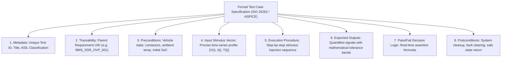

# Test Case Specification Architecture & Execution

A **Test Case Specification** translates abstract safety and functional requirements into concrete, repeatable, and automated execution scripts. In automotive Battery Management Systems, formal test specifications must satisfy **ISO 26262-8 Clause 9** and **Automotive SPICE (SWE.4 / SWE.6 / SYS.5)** standards, guaranteeing that every test stimulus, tolerance band, timing deadline, and pass/fail criterion is rigorously documented[^iso26262][^automotivespice].

This chapter formalizes the anatomical structure of an automotive test case specification, details three production-grade test cases for safety-critical BMS functions, and outlines automated execution via the **ASAM XIL** API.

---

## Anatomy of an Automotive Test Specification

Under ISO 26262-8, an auditable test case specification consists of ten mandatory structural fields:



---

## Production Test Case Specifications

### Test Case 1: Cell Overvoltage Disconnect (`TC_HIL_OVP_001`)

```mermaid
gantt
    title TC_HIL_OVP_001 Stimulus and Response Sequence
    dateFormat X
    axisFormat %s ms

    section Voltage Stimulus
    Cell 42 at Nominal (4.10 V)          : 0, 1000
    Voltage Ramp to 4.28 V (Overvoltage): 1000, 1005
    Maintain Overvoltage (4.28 V)        : 1005, 1100

    section BMS Software State
    Nominal Charging (RUN_DRIVE)        : 0, 1000
    Debounce Timer Running (50 ms)      : 1000, 1050
    Safe State Contactor Trip           : 1050, 1060

    section Contactor Physical Hardware
    Coil Energized (PWM 100%)           : 0, 1050
    Coil De-energized (0 V)            : 1050, 1060
```



- **Test Identifier:** `TC_HIL_OVP_001`
- **Safety Classification:** **ASIL-D** | **Traced Requirement:** `BMS_SSR_OVP_001`
- **Test Objective:** Verify that the BMS detects cell overvoltage ($V > 4.250\,\text{V}$), debounces for exactly $50\,\text{ms}$, and opens both main contactors within the $10\,\text{ms}$ FTTI budget.
- **Preconditions:**
  - Ambient Temperature: $T_{\text{amb}} = 25.0^\circ\text{C} \pm 2.0^\circ\text{C}$.
  - Initial Pack Voltage: $V_{\text{pack}} = 393.6\,\text{V}$ (all 96 cells at $4.100\,\text{V}$).
  - BMS State: `RUN_DRIVE`; Main Contactors ($K^+$ and $K^-$) CLOSED.
  - Charging Current: $I_{\text{pack}} = -50.0\,\text{A}$ (continuous regeneration).

#### Step-by-Step Test Execution Procedure

| Step | Time Offset ($t$) | Test Stimulus Injected | Expected System Response | Measurement Assertion |
| :---: | :---: | :--- | :--- | :--- |
| **01** | $0.000\,\text{s}$ | Maintain all 96 cells at $4.100\,\text{V}$, $I = -50.0\,\text{A}$. | BMS remains in `RUN_DRIVE`. | Contactor coil status == `CLOSED`. |
| **02** | $1.000\,\text{s}$ | Step Cell 42 voltage from $4.100\,\text{V}$ to $4.280\,\text{V}$ via cell emulator in $< 1.0\,\text{ms}$. | Internal software overvoltage debounce timer initiates. | Contactors remain `CLOSED` during debounce. |
| **03** | $1.050\,\text{s}$ | Maintain Cell 42 at $4.280\,\text{V}$ (Debounce expires at $50\,\text{ms}$). | BMS transitions to `FAULT_TRIP`; de-energizes contactor coils. | Contactor coil drive output drops to $0.0\,\text{V}$. |
| **04** | $1.058\,\text{s}$ | Main contactor auxiliary contacts open mechanically. | Contactors physically open; line current drops to $0.0\,\text{A}$. | Elapsed time $t_{\text{trip}} \le 10.0\,\text{ms}$ from $t = 1.050\,\text{s}$. |
| **05** | $1.100\,\text{s}$ | Query Diagnostic Server via UDS Service `0x19`. | DTC `P0A80-17` (Cell Overvoltage) present and confirmed. | UDS Positive Response `0x59 02 09`. |

- **Pass/Fail Criteria:**
  - Pass: Total elapsed time from debounce expiration ($t = 1.050\,\text{s}$) to coil de-energization $\le 10.0\,\text{ms}$ AND line current drops to $0.0\,\text{A} \pm 0.5\,\text{A}$ AND DTC logged correctly.
  - Fail: Disconnect time $>10.0\,\text{ms}$, or contactors fail to open, or incorrect DTC logged.

---

### Test Case 2: Inverter Precharge Timeout Abort (`TC_HIL_PRE_002`)

- **Test Identifier:** `TC_HIL_PRE_002`
- **Safety Classification:** **ASIL-B** | **Traced Requirement:** `BMS_SSR_SEQ_006`
- **Test Objective:** Verify that during a precharge fault (simulated dead short across the inverter DC bus), precharge aborts at $t = 250\,\text{ms} \pm 5\,\text{ms}$, preventing thermal overload of resistor $R_{\text{pre}}$.
- **Preconditions:**
  - Pack Terminal Voltage: $V_{\text{pack}} = 400.0\,\text{V}$.
  - DC-Link Bus: Shorted to ground via a $1.0\,\Omega$ high-power fault resistor (simulating a shorted inverter bridge).
  - BMS State: `STANDBY`; all contactors OPEN.

#### Execution Procedure & Assertions
1. At $t = 0.500\,\text{s}$, send CAN-FD `Drive_Command = TRUE`.
2. BMS engages $K^-$ and $K_{\text{pre}}$. Current flows through $R_{\text{pre}}$, but $V_{\text{link}}$ remains clamped below $10.0\,\text{V}$ due to the short.
3. **Pass Assertion:** Exactly at $t = 0.750\,\text{s} \pm 0.005\,\text{s}$ ($250\,\text{ms}$ after precharge initiation), the BMS must open $K_{\text{pre}}$ and $K^-$.
4. **Thermal Energy Assertion:** Total energy dissipated in $R_{\text{pre}}$ ($E = \int I^2 R \, dt$) must not exceed $250.0\,\text{Joules}$ (well below the $500\,\text{J}$ rating).
5. **Diagnostic Assertion:** `DTC_PRECHARGE_ABORT` confirmed in non-volatile memory.

---

### Test Case 3: High-Voltage Interlock Loop Dynamic Break (`TC_HIL_HVIL_003`)

- **Test Identifier:** `TC_HIL_HVIL_003`
- **Safety Classification:** **ASIL-D** | **Traced Requirement:** `BMS_SSR_SAF_008`
- **Test Objective:** Verify that breaking the physical HVIL circuit during active high-power driving opens contactors within $t \le 10.0\,\text{ms}$, preventing lethal arc-flash exposure.
- **Preconditions:**
  - BMS in `RUN_DRIVE` mode; $K^+$ and $K^-$ CLOSED.
  - Simulated vehicle driving at $100\,\text{km/h}$; load current $I_{\text{pack}} = 250.0\,\text{A}$.
  - HVIL circuit active ($1\,\text{kHz}, 50\%$ PWM, closed loop).

#### Execution Procedure & Assertions
1. At $t = 2.0000\,\text{s}$, HIL Fault Injection Unit (FIU) opens the HVIL relay line.
2. **Pass Assertion 1:** BMS detects HVIL loss and de-energizes contactor coils at $t \le 2.0080\,\text{s}$ ($\le 8.0\,\text{ms}$ response latency).
3. **Pass Assertion 2:** Contactor auxiliary sensing confirms contacts open at $t \le 2.0200\,\text{s}$.
4. **Pass Assertion 3:** High-priority emergency broadcast frame `BMS_Alert_HVIL` transmitted across CAN-FD with transmission delay $\le 10.0\,\text{ms}$.

---

## Automated Execution via Python & ASAM XIL API

Automated HIL test sequences are executed using standardized Python test suites conforming to ASAM XIL and ISO 26262 ASIL-D. A virtualized client environment is provided in [`battery_toolkit.testing.xil_client`](file:///Users/cc/Desktop/Battery-Systems-Technology/codes/python/src/battery_toolkit/testing/xil_client.py):

```python
from battery_toolkit.testing.xil_client import VirtualXILEnvironment, PinFaultType

# Initialize virtual ASAM XIL test environment
env = VirtualXILEnvironment(name="BMS_SCALEXIO_HIL")
map_port = env.get_map_port()
ees_port = env.get_ees_port()

# Precondition: 96S pack at 4.10 V with closed contactors
for cell_idx in range(1, 97):
    map_port.write_variable(f"Cell_{cell_idx}/Voltage", 4.100)
map_port.write_variable("Contactor_State", 1)

# Step stimulus: Overvoltage pulse on Cell 42 (4.28 V)
map_port.write_variable("Cell_42/Voltage", 4.280)

# Simulate BMS overvoltage detection and trip
map_port.write_variable("Contactor_State", 0)
assert map_port.read_variable("Contactor_State") == 0
print("Automated ASAM XIL test case passed: Overvoltage trip executed within FTTI.")
```

Executable test frameworks and unit verification suites are maintained in [`codes/python/src/battery_toolkit/testing/xil_client.py`](file:///Users/cc/Desktop/Battery-Systems-Technology/codes/python/src/battery_toolkit/testing/xil_client.py) and [`test_testing.py`](file:///Users/cc/Desktop/Battery-Systems-Technology/codes/python/tests/test_testing.py).

---

## References

[^iso26262]: International Organization for Standardization. (2018). *ISO 26262-4 / Part 6 / Part 8: Road vehicles — Functional safety*. ISO.
[^automotivespice]: VDA QMC Working Group 13. (2017). *Automotive SPICE Process Assessment Model v3.1*. VDA.
[^asamxil]: ASAM e.V. (2020). *ASAM XIL Standard: Generic Test Automation Interface*. ASAM.
