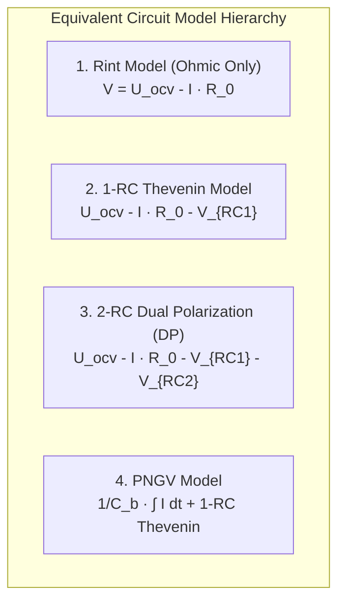
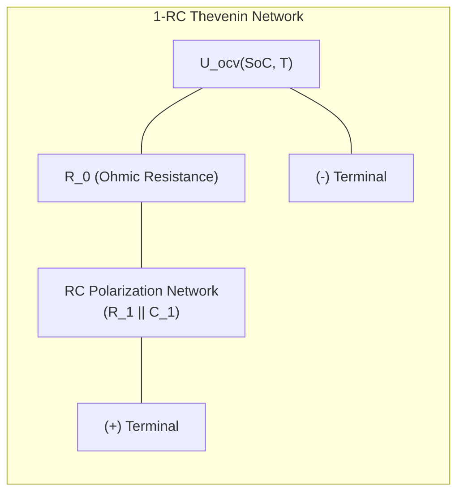
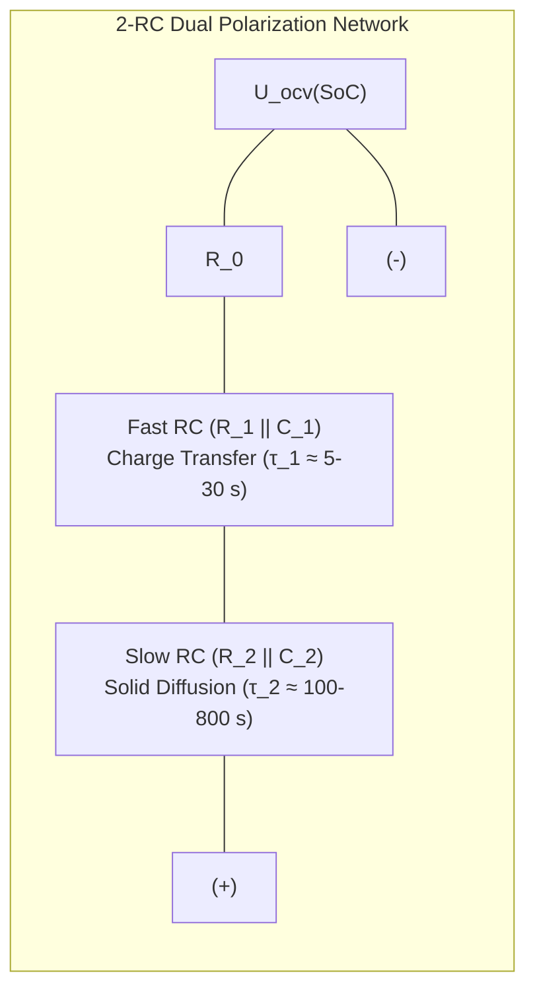

# Equivalent Circuit Modeling (ECM) of Lithium-Ion Batteries

To simulate battery electro-thermal dynamics and execute real-time state estimation algorithms (e.g. Extended Kalman Filtering) within an embedded Battery Management System (BMS), the non-linear physics of the cell must be abstracted into a computationally efficient model[^plett2015]. **Equivalent Circuit Models (ECMs)** represent electrochemical processes using lumped electrical components—voltage sources, resistors, and capacitors[^hu2012].

Unlike computationally intensive physics-based electrochemical models (such as the Doyle-Fuller-Newman P2D partial differential equations), equivalent circuit models strike an optimal compromise between physical fidelity and real-time embedded execution constraints[^he2011].

This chapter formalizes the continuous and discrete-time state-space representations, frequency-domain transfer functions, and comparative topologies across **Rint**, **1-RC Thevenin**, **2-RC Dual Polarization**, and **PNGV** battery models.

---

## Topological Taxonomy of Equivalent Circuit Models

| Model Topology | Circuit Elements | State Vector Dimensions | Relative Accuracy (RMSE) | Embedded Execution Overhead |
| :--- | :--- | :--- | :--- | :--- |
| **Rint Model** | $U_{\text{ocv}}, R_0$ | $1$ ($\text{SoC}$) | $3.5\% - 6.0\%$ | Baseline ($1\times$, minimal) |
| **1-RC Thevenin** | $U_{\text{ocv}}, R_0, R_1, C_1$ | $2$ ($\text{SoC}, V_{RC1}$) | $1.0\% - 2.0\%$ | $1.8\times$ (Industry benchmark) |
| **2-RC Dual Polarization** | $U_{\text{ocv}}, R_0, R_1, C_1, R_2, C_2$ | $3$ ($\text{SoC}, V_{RC1}, V_{RC2}$) | $0.5\% - 1.2\%$ | $3.2\times$ (High-precision automotive) |
| **3-RC Model** | $U_{\text{ocv}}, R_0, 3 \times RC$ | $4$ ($\text{SoC}, V_{RC1}, V_{RC2}, V_{RC3}$) | $0.4\% - 1.0\%$ | $5.5\times$ (Diminishing return) |

---

## 1. The 1-RC Thevenin Equivalent Circuit

The **Thevenin 1-RC model** represents the standard balance of performance for automotive state observers[^plett2004]:

### Physical Attribution of Components

1. **Open-Circuit Voltage ($U_{\text{ocv}}(\text{SoC}, T)$):** Represents the thermodynamic reversible potential difference between positive and negative electrodes at thermodynamic equilibrium.
2. **Ohmic Resistance ($R_0$):** Captures instantaneous high-frequency voltage drops across metallic current collectors, tab welds, liquid electrolyte bulk resistance, and particle-to-particle contact resistance.
3. **Polarization Network ($R_1 \parallel C_1$):** Models the transient voltage relaxation governed by the electric double-layer capacitance ($C_1$) and interfacial charge-transfer resistance ($R_1$) at the electrode/electrolyte boundary.

### Continuous-Time Governing Equations

Applying Kirchhoff's voltage and current laws (sign convention: $I > 0$ for discharge, $I < 0$ for charge):

$$
\frac{d\,\text{SoC}(t)}{dt} = -\frac{\eta_c}{C_{\text{nom}}} I(t)
$$

$$
\frac{d\,V_{RC}(t)}{dt} = -\frac{1}{R_1 C_1} V_{RC}(t) + \frac{1}{C_1} I(t)
$$

$$
V_{\text{terminal}}(t) = U_{\text{ocv}}(\text{SoC}(t)) - R_0 I(t) - V_{RC}(t)
$$

Where:
- $\eta_c$ is the Coulombic efficiency ($\eta_c \le 1.0$).
- $C_{\text{nom}}$ is the nominal capacity in Ampere-seconds ($3600 \cdot C_{\text{Ah}}$).
- $\tau_1 = R_1 C_1$ is the electrochemical relaxation time constant ($\approx 5 - 30\,\text{s}$).

---

## 2. The 2-RC Dual Polarization (DP) Model

While the 1-RC model captures charge-transfer dynamics, it struggles to replicate the slow diffusion relaxation that occurs over several minutes. The **2-RC Dual Polarization model** decouples fast charge-transfer kinetics from slow solid-state diffusion[^hu2012]:

### Continuous-Time State Equations

$$
\begin{bmatrix} \frac{d\,\text{SoC}}{dt} \\ \frac{d\,V_{RC1}}{dt} \\ \frac{d\,V_{RC2}}{dt} \end{bmatrix} = \begin{bmatrix} 0 & 0 & 0 \\ 0 & -\frac{1}{\tau_1} & 0 \\ 0 & 0 & -\frac{1}{\tau_2} \end{bmatrix} \begin{bmatrix} \text{SoC} \\ V_{RC1} \\ V_{RC2} \end{bmatrix} + \begin{bmatrix} -\frac{\eta_c}{C_{\text{nom}}} \\ \frac{1}{C_1} \\ \frac{1}{C_2} \end{bmatrix} I(t)
$$

$$
V_{\text{terminal}}(t) = U_{\text{ocv}}(\text{SoC}) - R_0 I(t) - V_{RC1}(t) - V_{RC2}(t)
$$

---

## 3. Discrete-Time State-Space Formulation

To implement equivalent circuit models on a discrete-time automotive microcontroller with a sampling interval of $\Delta t$ ($10\,\text{ms}$ to $100\,\text{ms}$), the continuous differential equations are integrated using exact zero-order hold (ZOH) matrix exponentials:

$$
\mathbf{x}_{k} = \mathbf{A} \mathbf{x}_{k-1} + \mathbf{B} u_{k-1}
$$

$$
y_k = g(\mathbf{x}_k, u_k)
$$

For the 2-RC model with state vector $\mathbf{x}_k = [\text{SoC}_k, V_{RC1,k}, V_{RC2,k}]^T$ and input $u_k = I_k$:

$$
\mathbf{A} = \begin{bmatrix} 1 & 0 & 0 \\ 0 & \exp\left(-\frac{\Delta t}{\tau_1}\right) & 0 \\ 0 & 0 & \exp\left(-\frac{\Delta t}{\tau_2}\right) \end{bmatrix}
$$

$$
\mathbf{B} = \begin{bmatrix} -\frac{\eta_c \Delta t}{C_{\text{nom}}} \\ R_1 \left(1 - \exp\left(-\frac{\Delta t}{\tau_1}\right)\right) \\ R_2 \left(1 - \exp\left(-\frac{\Delta t}{\tau_2}\right)\right) \end{bmatrix}
$$

The non-linear observation equation evaluated at discrete step $k$ is:

$$
V_{\text{terminal}, k} = U_{\text{ocv}}(\text{SoC}_k) - R_0 I_k - V_{RC1, k} - V_{RC2, k}
$$

---

## 4. Frequency-Domain Impedance Transfer Function

Transforming the 2-RC time-domain differential equations into the Laplace ($s$) domain yields the complex impedance transfer function $Z(s)$[^plett2015]:

$$
Z(s) = \frac{V_{\text{drop}}(s)}{I(s)} = R_0 + \frac{R_1}{1 + s R_1 C_1} + \frac{R_2}{1 + s R_2 C_2}
$$

Substituting $s = j\omega$ gives the frequency-dependent complex impedance locus:

$$
Z(j\omega) = R_0 + \frac{R_1}{1 + j\omega \tau_1} + \frac{R_2}{1 + j\omega \tau_2}
$$

Separating into real (in-phase) and imaginary (quadrature) components:

$$
\text{Re}\{Z(\omega)\} = R_0 + \frac{R_1}{1 + \omega^2 \tau_1^2} + \frac{R_2}{1 + \omega^2 \tau_2^2}
$$

$$
\text{Im}\{Z(\omega)\} = -\left[ \frac{\omega R_1 \tau_1}{1 + \omega^2 \tau_1^2} + \frac{\omega R_2 \tau_2}{1 + \omega^2 \tau_2^2} \right]
$$

This analytical formulation maps directly onto the semicircular arcs of Electrochemical Impedance Spectroscopy (EIS) Nyquist plots, enabling direct parameter extraction from AC impedance data.

---

## References

[^plett2015]: Plett, G. L. (2015). *Battery Management Systems, Volume I: Battery Modeling*. Artech House.
[^hu2012]: Hu, X., Li, S., & Peng, H. (2012). A comparative study of equivalent circuit models for Li-ion batteries. *Journal of Power Sources*, 198, 359–367.
[^he2011]: He, H., Xiong, R., & Fan, J. (2011). Evaluation of lithium-ion battery equivalent circuit models for state of charge estimation. *Energies*, 4(4), 582–598.
[^plett2004]: Plett, G. L. (2004). Extended Kalman filtering for battery management systems: Part 2. Modeling and identification. *Journal of Power Sources*, 134(2), 262–276.
