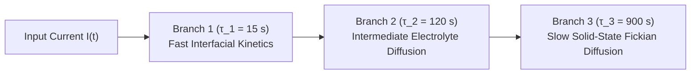

# Diffusion Overpotential & Polarization Dynamics

When a current load is applied to or removed from a lithium-ion battery, the terminal voltage does not jump instantaneously between equilibrium states. While ohmic resistance causes an immediate step change within microseconds, the remainder of the voltage transient relaxes gradually over seconds, minutes, and even hours[^plett2015]. 

This delayed voltage response—termed **polarization overpotential** and **diffusion overpotential**—is governed by fundamental electrochemical transport phenomena: double-layer capacitive charging, interfacial charge-transfer kinetics, and solid-state lithium mass diffusion within active material host particles[^newman2004].

This chapter formalizes the physical transport equations governing diffusion overpotentials, derives Fickian concentration gradients, and models multi-time-scale relaxation dynamics within equivalent circuit networks.

---

## Electrochemical Overpotential Decomposition

The instantaneous terminal voltage $V_{\text{term}}(t)$ during discharge is the thermodynamic open-circuit voltage $U_{\text{ocv}}$ minus three distinct, physically decoupled overpotential terms[^doyle1993]:

$$
V_{\text{term}}(t) = U_{\text{ocv}}(\text{SoC}) - \eta_{\text{ohmic}}(t) - \eta_{\text{ct}}(t) - \eta_{\text{diff}}(t)
$$



```mermaid
gantt
    title Multi-Time-Scale Overpotential Relaxation Dynamics
    dateFormat X
    axisFormat %s s

    section Current Load
    Discharge Current Pulse (I = 50 A) : 0, 100
    Current Interrupted (I = 0 A)        : 100, 400

    section Ohmic Overpotential
    Instantaneous IR Drop (t < 1 ms)   : 0, 100
    Instantaneous Recovery (1 ms)      : 100, 101

    section Charge-Transfer & Double Layer
    Electrochemical Polarization (τ_1 ≈ 5-30 s) : 0, 100
    Interfacial Relaxation (100-150 s)          : 100, 150

    section Solid-State Mass Diffusion
    Fickian Solid Diffusion Overpotential (τ_2 ≈ 100-3600 s) : 0, 100
    Solid Concentration Homogenization (100-400 s)           : 100, 400
```

### Physical Attribution & Time Scales

1. **Ohmic Overpotential ($\eta_{\text{ohmic}}$):**
   - Driven by electronic conduction in current collectors and ionic conduction through the liquid electrolyte.
   - Response time: $t < 1\,\text{ms}$ (instantaneous).
   - Modeled by: Pure resistance $R_0$.
2. **Charge-Transfer Polarization ($\eta_{\text{ct}}$):**
   - Driven by the activation energy barrier of the electrochemical charge-transfer reaction at the electrode/electrolyte interface, governed by the Butler-Volmer equation:

$$
j = j_0 \left[ \exp\left(\frac{\alpha_a F}{RT}\eta_{\text{ct}}\right) - \exp\left(-\frac{\alpha_c F}{RT}\eta_{\text{ct}}\right) \right]
$$

   - Combined with the electric double-layer capacitance formed by the Helmholtz layer.
   - Response time: $\tau_1 \approx 1 - 30\,\text{s}$.
   - Modeled by: Fast RC branch ($R_1 \parallel C_1$).
3. **Diffusion Overpotential ($\eta_{\text{diff}}$):**
   - Driven by solid-state lithium-ion concentration gradients developing between the surface and the core of porous active material particles.
   - Response time: $\tau_2 \approx 100 - 3600\,\text{s}$ ($1.5\,\text{minutes}$ to $>1\,\text{hour}$).
   - Modeled by: Slow RC branch ($R_2 \parallel C_2$) or fractional-order Warburg element.

---

## Solid-State Mass Diffusion: Fick's Second Law

Within intercalation electrode active materials (such as graphite, $\text{LiCoO}_2$, or NMC), lithium atoms diffuse through the interstitial vacancies of the host crystallographic lattice. Assuming spherical active particles of radius $R_p$, mass transport is governed by **Fick's Second Law of Diffusion in spherical coordinates**[^newman2004]:

$$
\frac{\partial c_s(r, t)}{\partial t} = \frac{D_s}{r^2} \frac{\partial}{\partial r} \left( r^2 \frac{\partial c_s(r, t)}{\partial r} \right)
$$

Where:
- $c_s(r, t)$ is the solid-phase lithium concentration at radial distance $r \in [0, R_p]$ and time $t$ ($\text{mol/m}^3$).
- $D_s$ is the solid-state diffusion coefficient ($\text{m}^2/\text{s}$, typically $10^{-14}$ to $10^{-12}\,\text{m}^2/\text{s}$).

```
Lithium Concentration Profile inside Active Particle during Discharge:
   Solid
   Concentration c_s(r)
      ^
c_max |                  /-----\  Core Concentration c_s(0)
      |                 /       \
      |                /         \
      |               /           \
c_min |--------------/             \-----> Particle Surface r = R_p
      +--------------+-------------+-----> Radius r
      r = 0 (Center)              r = R_p (Surface)
```

### Boundary Conditions

1. **Symmetry at Particle Center ($r = 0$):**

$$
\left. \frac{\partial c_s}{\partial r} \right|_{r = 0} = 0
$$

2. **Interfacial Molar Flux at Particle Surface ($r = R_p$):**

$$
-D_s \left. \frac{\partial c_s}{\partial r} \right|_{r = R_p} = \frac{j^{\text{Li}}}{F} = \frac{I(t)}{a_s \cdot A \cdot L \cdot F}
$$

Where $a_s$ is the specific surface area, $A$ is electrode geometric area, $L$ is electrode thickness, and $F$ is Faraday's constant ($96{,}485\,\text{C/mol}$).

### Electrochemical Origin of Diffusion Overpotential

Because the electrochemical potential of an intercalation electrode is determined strictly by the **stoichiometric lithium concentration at the outer particle surface** ($c_{s,\text{surf}} = c_s(R_p, t)$), the effective open-circuit potential shifts away from its average state-of-charge equilibrium:

$$
\eta_{\text{diff}}(t) = U_{\text{ocv}}\left( \frac{c_{s,\text{surf}}(t)}{c_{s,\max}} \right) - U_{\text{ocv}}\left( \frac{\bar{c}_s(t)}{c_{s,\max}} \right)
$$

Where $\bar{c}_s(t) = \frac{3}{R_p^3}\int_0^{R_p} r^2 c_s(r, t) \, dr$ represents the bulk average concentration (true SoC).

---

## Circuit Approximation: Multi-Order RC Ladder Networks

To model this infinite-dimensional diffusion process in embedded microcontrollers without solving partial differential equations in real time, the diffusion overpotential is approximated using an $N$-order resistor-capacitor (RC) ladder network[^kuhn2006]:

$$
\eta_{\text{diff}}(t) = \sum_{i=1}^N V_{RC, i}(t)
$$



### Analytical Step-Response Formulation

For a constant current discharge pulse of magnitude $I_0$ applied from $t = 0$ to $t_{\text{pulse}}$, followed by current interruption ($I = 0$) at $t > t_{\text{pulse}}$, the diffusion overpotential during the relaxation phase ($t > t_{\text{pulse}}$) decays according to:

$$
V_{\text{relax}}(t) = \sum_{i=1}^N I_0 R_i \left( 1 - \exp\left(-\frac{t_{\text{pulse}}}{\tau_i}\right) \right) \exp\left(-\frac{t - t_{\text{pulse}}}{\tau_i}\right)
$$

Where $\tau_i = R_i C_i$ are the characteristic time constants of the diffusion branches.

> [!TIP]
> In automotive production algorithms, a **2-RC network** ($N = 2$) captures over $95\%$ of the total diffusion relaxation energy while requiring only two scalar state variables in the Extended Kalman Filter, keeping microcontroller execution time below $5.0\,\text{ms}$.

---

## References

[^plett2015]: Plett, G. L. (2015). *Battery Management Systems, Volume I: Battery Modeling*. Artech House.
[^newman2004]: Newman, J., & Thomas-Alyea, K. E. (2004). *Electrochemical Systems (3rd Edition)*. John Wiley & Sons.
[^doyle1993]: Doyle, M., Fuller, T. F., & Newman, J. (1993). Modeling of galvanostatic charge and discharge of the lithium/polymer/insertion cell. *Journal of The Electrochemical Society*, 140(6), 1526–1533.
[^kuhn2006]: Kuhn, E., et al. (2006). Modelling Ni-MH battery using equivalent circuits with electrical double-layer capacitors. *Journal of Power Sources*, 158(2), 1490–1497.
