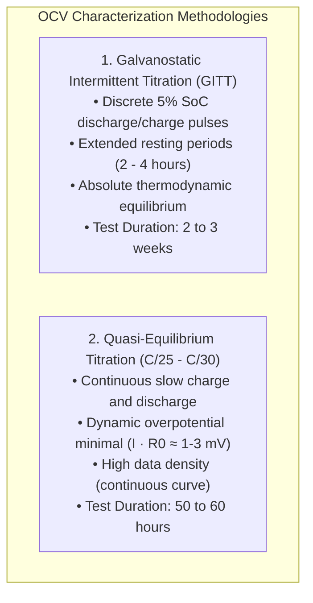
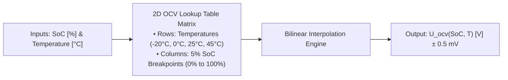

# Open-Circuit Voltage (OCV) Characterization & Hysteresis Modeling

The Open-Circuit Voltage (OCV) curve is the thermodynamic foundation of every Battery Management System (BMS). It maps the relationship between the equilibrium potential difference across cell terminals ($U_{\text{ocv}}$) and the internal electrochemical State of Charge ($\text{SoC}$)[^plett2004][^farmann2015].

Because model-based observers (such as the Extended Kalman Filter) use $U_{\text{ocv}}(\text{SoC})$ to correct for current sensor drift and numerical integration error, any inaccuracy in the baseline OCV curve propagates directly as persistent State of Charge and State of Health estimation bias[^roscher2011].

This chapter formalizes the experimental characterization protocols—**Galvanostatic Intermittent Titration Technique (GITT)** versus **Quasi-Equilibrium Low-Rate Titration**—and models crystallographic phase-transition hysteresis.

---

## Experimental Characterization Methodologies

Determining the true thermodynamic open-circuit potential requires eliminating all internal ohmic and diffusion polarization overpotentials ($\eta \to 0$)[^verbrugge2003].



### 1. Galvanostatic Intermittent Titration Technique (GITT)

GITT applies discrete discharge (or charge) current pulses equivalent to $\Delta \text{SoC} = 5.0\%$ or $2.5\%$, followed by an extended rest period ($I = 0$):

```
   Terminal Voltage V(t) during GITT Titration:
      ^
 4.2V |----\  (Pulse ΔSoC = 5%)
      |    \----------------------------\  Resting Relaxation (2-4 hrs, |dV/dt| < 1 mV/h)
      |                                 \-----\  (Next Pulse)
      |                                       \------------------------\
 2.8V +-----------------------------------------------------------------> Time [Days]
```

- **Relaxation Criterion:** The cell rests at each step until the voltage rate of change meets the strict asymptotic criterion:

$$
\left| \frac{dV_{\text{terminal}}}{dt} \right| < 1.0\,\frac{\text{mV}}{\text{hour}}
$$

- **Advantage:** True, uncorrupted thermodynamic equilibrium points across both positive and negative electrodes.
- **Limitation:** Long test duration (typically 14 to 21 days inside high-precision temperature-controlled chambers per temperature setting).

### 2. Quasi-Equilibrium Low-Rate Continuous Titration (C/25)

The cell is continuously discharged at a very low current rate ($C/25$ to $C/30$) from $100\%$ to $0\%$ SoC, followed by a continuous recharge at $C/25$ back to $100\%$ SoC:

$$
V_{\text{terminal,chg}}(\text{SoC}) = U_{\text{ocv,chg}}(\text{SoC}) + I_{\text{C/25}} R_0 + \eta_{\text{pol}}
$$

$$
V_{\text{terminal,dis}}(\text{SoC}) = U_{\text{ocv,dis}}(\text{SoC}) - I_{\text{C/25}} R_0 - \eta_{\text{pol}}
$$

The mean thermodynamic OCV curve is estimated by averaging the charge and discharge branches:

$$
U_{\text{ocv,mean}}(\text{SoC}) \approx \frac{V_{\text{terminal,chg}}(\text{SoC}) + V_{\text{terminal,dis}}(\text{SoC})}{2}
$$

---

## Electrochemical Voltage Hysteresis Modeling

In many commercial cell chemistries—most notably Lithium Iron Phosphate ($\text{LiFePO}_4$) and Silicon-doped graphite—the open-circuit potential exhibits a wide **hysteresis loop** where the equilibrium voltage during charge is significantly higher than during discharge at identical SoC levels[^roscher2011][^snihir2006]:

$$
U_{\text{ocv,chg}}(\text{SoC}) > U_{\text{ocv,dis}}(\text{SoC}), \quad \Delta V_h = U_{\text{ocv,chg}} - U_{\text{ocv,dis}} \le 50\,\text{mV}
$$

```
   Terminal
   Voltage [V]
      ^
 3.45 |                  /------------------/  Charge OCV Envelope
      |                 /   Sub-Loop       /
 3.35 |                /    Transition    /
      |               /------------------/     Discharge OCV Envelope
 3.25 |              /
      +-------------+---------------------+------> State of Charge [%]
      0            20                    100
```

### Physical Mechanism

Hysteresis originates from thermodynamic phase transformations (e.g. the two-phase coexistence of $\text{LiFePO}_4$ and $\text{FePO}_4$), microscopic mechanical strain energy within host particles, and domain boundary pinning during lithium de-insertion[^farmann2015].

### Continuous Dynamic Hysteresis State Equation

To prevent state estimation divergence during partial drive-cycle reversals, BMS algorithms model a continuous normalized hysteresis state $h(t) \in [-1, +1]$[^plett2004]:

$$
\frac{dh(t)}{dt} = -\gamma \left| \frac{\eta_c I(t)}{C_{\text{nom}}} \right| h(t) + \gamma \left| \frac{\eta_c I(t)}{C_{\text{nom}}} \right| \text{sgn}(I(t))
$$

The effective OCV used in state estimation is formulated as:

$$
U_{\text{ocv,eff}}(\text{SoC}, h) = U_{\text{ocv,mean}}(\text{SoC}) + h(t) \cdot M(\text{SoC})
$$

Where:
- $\gamma > 0$ is a dimensionless tuning parameter governing how rapidly the voltage transitions from the charge boundary to the discharge boundary upon current reversal.
- $M(\text{SoC}) = \frac{U_{\text{ocv,chg}}(\text{SoC}) - U_{\text{ocv,dis}}(\text{SoC})}{2}$ is half the hysteresis envelope width.

---

## Temperature Dependence: 2D Lookup Table (LUT) Construction

The thermodynamic open-circuit voltage varies with junction temperature according to the **entropic temperature coefficient** $\frac{\partial U_{\text{ocv}}}{\partial T}$ (governed by the Gibbs-Helmholtz relation $\Delta S = n F \frac{\partial U}{\partial T}$)[^verbrugge2003]:

$$
U_{\text{ocv}}(\text{SoC}, T) = U_{\text{ocv}}(\text{SoC}, T_{\text{ref}}) + \frac{\partial U_{\text{ocv}}}{\partial T}(\text{SoC}) \cdot (T - T_{\text{ref}})
$$

Production automotive firmware compiles these characterization results into a **calibrated 2D Lookup Table (LUT)** with bilinear interpolation:



| State of Charge ($\text{SoC}$) | $U_{\text{ocv}}$ at $-20^\circ\text{C}$ | $U_{\text{ocv}}$ at $0^\circ\text{C}$ | $U_{\text{ocv}}$ at $+25^\circ\text{C}$ (Ref) | $U_{\text{ocv}}$ at $+45^\circ\text{C}$ |
| :---: | :---: | :---: | :---: | :---: |
| **$0\%$** | $3.050\,\text{V}$ | $3.100\,\text{V}$ | $3.150\,\text{V}$ | $3.170\,\text{V}$ |
| **$20\%$** | $3.510\,\text{V}$ | $3.550\,\text{V}$ | $3.580\,\text{V}$ | $3.590\,\text{V}$ |
| **$50\%$** | $3.700\,\text{V}$ | $3.730\,\text{V}$ | $3.760\,\text{V}$ | $3.770\,\text{V}$ |
| **$80\%$** | $3.990\,\text{V}$ | $4.020\,\text{V}$ | $4.050\,\text{V}$ | $4.060\,\text{V}$ |
| **$100\%$** | $4.160\,\text{V}$ | $4.180\,\text{V}$ | $4.200\,\text{V}$ | $4.210\,\text{V}$ |

---

## References

[^plett2004]: Plett, G. L. (2004). Extended Kalman filtering for battery management systems: Part 2. Modeling and identification. *Journal of Power Sources*, 134(2), 262–276.
[^farmann2015]: Farmann, A., & Sauer, D. U. (2015). A comprehensive review of on-board condition monitoring of lithium-ion batteries based on open-circuit voltage. *Journal of Power Sources*, 281, 114–130.
[^roscher2011]: Roscher, M. A., & Sauer, D. U. (2011). Dynamic electric behavior and open-circuit-voltage modeling of $\text{LiFePO}_4$ cathode based lithium-ion batteries. *Journal of Power Sources*, 196(1), 331–336.
[^verbrugge2003]: Verbrugge, M. W., & Koch, B. J. (2003). Modeling and experimental characterization of lithium-ion batteries. *Journal of The Electrochemical Society*, 150(4), A374.
[^snihir2006]: Snihir, I., et al. (2006). Battery open-circuit voltage estimation by a combined linear/exponential regression method. *Journal of Power Sources*, 159(2), 1484–1487.
