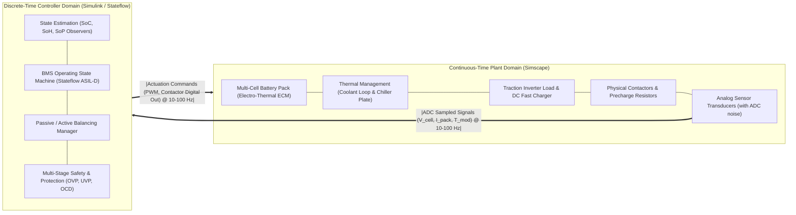
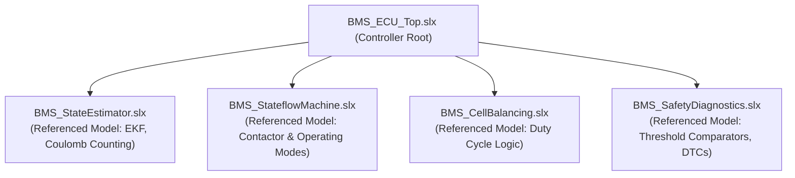

# Model-Based Design (MBD) for BMS in MATLAB & Simulink

Model-Based Design (MBD) is the standard development paradigm for safety-critical automotive embedded software. Rather than writing thousands of lines of low-level C code by hand and attempting to debug algorithms on physical hardware, engineering teams create mathematical plant models and executable control algorithms within **MATLAB, Simulink, Stateflow, and Simscape Battery**[^mathworks2021][^plett2015].

MBD enables continuous early verification, automatic MISRA-C:2012 code generation, and rigorous requirement-to-code traceability satisfying **ISO 26262** and **Automotive SPICE (ASPICE)** mandates[^iso26262][^automotivespice].

This chapter establishes the system-level architecture, multi-domain physical modeling, and model reference partitioning of an automotive Battery Management System in Simulink.

---

## Model-Based Design Architecture & Simulation Domains

An automotive BMS simulation model in Simulink couples two fundamentally different computational domains across an idealized discrete/continuous boundary:



### Numerical Solver Separation

1. **Plant Domain (Simscape Electrical & Thermal):**
   - Governed by non-linear physical differential-algebraic equations (DAEs).
   - Solved using variable-step implicit solvers (e.g., `ode15s` or `ode23t`) or fixed-step continuous solvers with physical consistency checks.
2. **Controller Domain (BMS ECU):**
   - Governed by discrete difference equations executed at fixed sample periods ($\Delta t = 1\,\text{ms}, 10\,\text{ms}, 100\,\text{ms}$).
   - Configured strictly for discrete fixed-step solvers (e.g., `FixedStepDiscrete`), mirroring the exact execution behavior of an automotive microcontroller.

---

## Simscape Battery Pack Modeling

Modern battery plant modeling in MATLAB uses **Simscape Battery**, which couples electrical equivalent circuit dynamics with 3D thermal conduction[^mathworks2021]:

```mermaid
flowchart TD
    subgraph Cell_Model["Single Cell Multi-Domain Simscape Model"]
        ECM["Electrical: 2-RC Thevenin ECM<br/>V_term = U_ocv(SoC, T) - I·R0 - V_RC1 - V_RC2"]
        Thermal["Thermal: Lumped Mass Heat Equation<br/>m · c_p · (dT/dt) = Q_gen - Q_loss"]
        Ageing["Degradation: Empirical SEI Growth<br/>ΔC_loss ∝ √(t) · exp(-E_a / RT)"]
        
        ECM <-->|Joule & Entropic Heat (Q_gen)| Thermal
        Thermal <-->|Temperature Feedback on R0, R1, C1| ECM
        ECM <--> Ageing
    end
```

### Thermal Energy Balance Equation

The instantaneous thermal dissipation inside each cell element is coupled to a convective liquid cooling circuit via:

$$
m_{\text{cell}} \cdot c_p \frac{dT_{\text{cell}}}{dt} = \dot{Q}_{\text{gen}} - \dot{Q}_{\text{cool}}
$$

Where:
- $m_{\text{cell}}$ is cell mass ($\text{kg}$), $c_p$ is specific heat capacity ($\approx 900 - 1100\,\text{J/(kg}\cdot\text{K)}$).
- $\dot{Q}_{\text{gen}} = I^2 R_{\text{int}}(T, \text{SoC}) + I \cdot T_{\text{cell}} \frac{\partial U_{\text{ocv}}}{\partial T}$ is Bernardi's heat generation rate.
- $\dot{Q}_{\text{cool}} = h \cdot A_{\text{surface}} \cdot (T_{\text{cell}} - T_{\text{coolant}})$ is heat rejection into the bottom cold plate.

---

## Model Referencing & Subsystem Partitioning

To facilitate concurrent engineering across large automotive teams and support ASPICE SWE.1/SWE.2 process compliance, the BMS controller is structured into **Model References** (`.slx` files referenced as standalone modules):



### Advantages of Model Referencing

- **Modular Compilation:** Individual modules can be compiled and simulated independently as atomic units.
- **Independent Version Control:** Software engineers can modify and merge `BMS_StateEstimator.slx` without conflicts in `BMS_StateflowMachine.slx`.
- **Targeted Code Generation:** Embedded Coder generates clean, self-contained C files (`BMS_StateEstimator.c`, `BMS_StateEstimator.h`) matching AUTOSAR Software Component (SWC) interfaces.

---

## References

[^mathworks2021]: The MathWorks Inc. (2021). *Simscape Battery: Design, simulate, and test battery systems*. MathWorks.
[^plett2015]: Plett, G. L. (2015). *Battery Management Systems, Volume I & II*. Artech House.
[^iso26262]: International Organization for Standardization. (2018). *ISO 26262: Road vehicles — Functional safety*. ISO.
[^automotivespice]: VDA QMC Working Group 13. (2017). *Automotive SPICE Process Assessment Model v3.1*. VDA.
