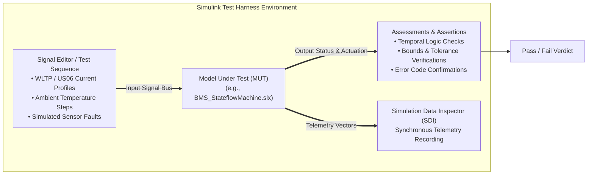
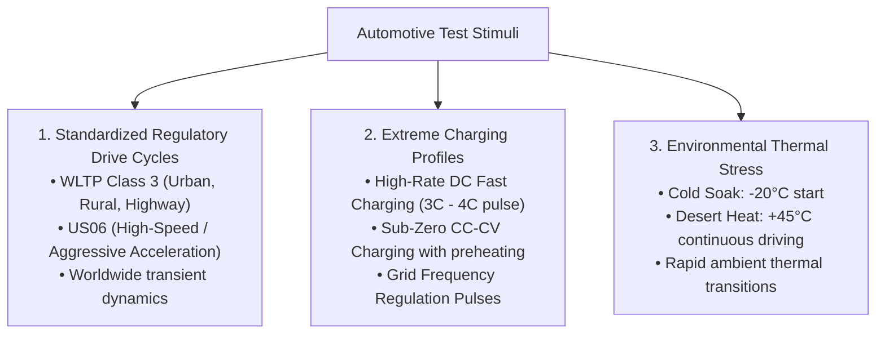

# Testing Framework in Model-Based Design: Harnesses & Stimuli

Simulation-based testing in Model-Based Design (MBD) allows engineering teams to detect algorithmic, structural, and timing errors months before physical prototype hardware is fabricated[^mathworks2021]. By integrating automated test harnesses around the Model Under Test (MUT), engineers evaluate battery control logic under severe operational conditions—including extreme ambient temperatures, dynamic drive cycles, and sensor noise injection[^andrea2020].

This chapter formalizes the architecture of automated **Simulink Test harnesses**, standardized drive-cycle stimulus profiles, and temporal logic assessment assertions under **ISO 26262-6**[^iso26262].

---

## Simulink Test Harness Architecture

In Simulink, a **Test Harness** isolates a software subsystem or model reference from the overarching vehicle system, enabling controlled unit and integration testing without altering the production model:



### Key Components of the Test Harness

1. **Test Inputs (Signal Editor / Test Sequence Blocks):** Supplies deterministic input vectors (cell voltage arrays, pack current, module temperatures, ignition key state) across defined time horizons.
2. **Model Under Test (MUT):** The production algorithmic model reference operating in discrete time.
3. **Assessments & Monitoring:** Real-time logical evaluators that continuously compare MUT outputs against mathematical acceptance criteria.
4. **Simulation Data Inspector (SDI):** Captures high-frequency signal traces for post-simulation regression analysis and report generation.

---

## Standardized Automotive Stimulus Profiles

Automotive BMS algorithms must be qualified against internationally standardized driving and charging cycles:



### Drive Cycle Electrical Characteristics

| Drive Cycle | Profile Duration | Peak Discharge Current ($C$-Rate) | Peak Regenerative Current ($C$-Rate) | Primary BMS Validation Focus |
| :--- | :--- | :--- | :--- | :--- |
| **WLTP Class 3** | $1800\,\text{s}$ ($30\,\text{min}$) | $\approx 2.5\,C$ | $\approx 1.8\,C$ | Dynamic SoC integration accuracy; energy efficiency calculation. |
| **US06 Supplemental** | $600\,\text{s}$ ($10\,\text{min}$) | $\approx 5.0\,C - 7.0\,C$ | $\approx 3.0\,C$ | Peak power limit enforcement ($P_{\text{lim}}$); thermal heat generation ($\dot{Q} = I^2 R$). |
| **400 kW DC Fast Charge**| $1200\,\text{s}$ ($20\,\text{min}$) | $0.0\,C$ | $\approx 3.0\,C - 4.0\,C$ (Continuous) | Lithium plating prevention; chiller plate heat rejection capacity. |

---

## Real-Time Assessments & Temporal Logic Assertions

Simulink Test provides **Temporal Logic** syntax to evaluate complex timing requirements directly during simulation execution without writing custom MATLAB scripts[^mathworks2021]:

```
   Assessment 1: Precharge Timing Verification
   verify( (after(250, ms, Drive_Req == 1) => (V_link >= 0.95 * V_pack)) )

   Assessment 2: Overvoltage Trip Latency
   assert( (whenever(V_cell > 4.25, duration >= 50, ms) => (ContactorsClosed == 0 within 10, ms)) )
```

### Types of In-Model Checks

1. **Signal Bounds Checking:** Asserts that output values never exceed physical boundaries (e.g. $0.0 \le \text{SoC} \le 1.0$).
2. **Rate of Change Limits:** Flags unphysical signal jumps (e.g., cell temperature increasing by $> 5.0^\circ\text{C}$ in a single $10\,\text{ms}$ step).
3. **State Invariants:** Asserts that the system never enters an illegal state combination (e.g., Main Contactor $K^+$ and Precharge Contactor $K_{\text{pre}}$ closed simultaneously during steady driving).

---

## References

[^mathworks2021]: The MathWorks Inc. (2021). *Simulink Test: Automate model-based testing and manage test artifacts*. MathWorks.
[^andrea2020]: Andrea, D. (2020). *Battery Management Systems for Large Lithium-Ion Battery Packs*. Artech House.
[^iso26262]: International Organization for Standardization. (2018). *ISO 26262-6: Road vehicles — Functional safety*. ISO.
