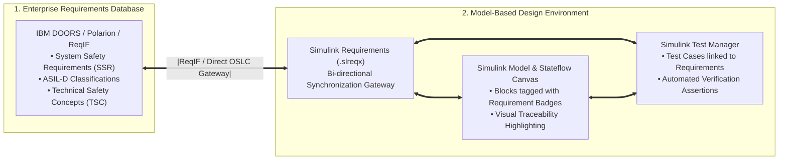
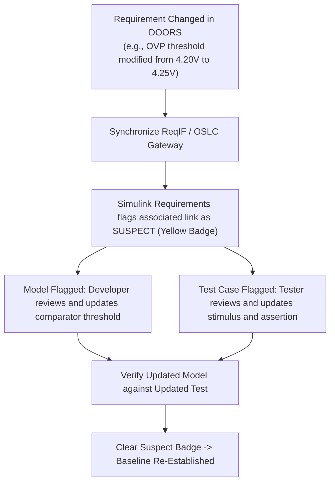

# Requirements Tracing via Simulink Requirements

In safety-critical automotive systems under **ISO 26262** and **Automotive SPICE (ASPICE SWE.1 / SWE.2 / SWE.6)**, every algorithmic element and state transition in a Simulink model must trace directly back to an approved system requirement[^iso26262][^automotivespice]. Historically, tracking requirements using static spreadsheets led to broken traceability, untested edge cases, and catastrophic discrepancies when requirements changed late in the vehicle development cycle[^hull2011].

**Simulink Requirements** integrates requirements management directly into the model canvas, establishing living, bi-directional links between external requirements databases (IBM DOORS, Siemens Polarion, PTC Integrity, ReqIF), Simulink blocks, Stateflow states, and automated test cases[^mathworks2021].

This chapter formalizes digital requirements synchronization, in-model linking, change impact analysis, and automated requirements coverage reporting.

---

## The Digital Requirements Engineering Pipeline



---

## In-Model Linking & The Requirements Perspective

Using the **Requirements Perspective** in Simulink, requirements are displayed directly alongside the graphical block diagram:

```
+-------------------------------------------------------------------------------+
| Simulink Editor: BMS_Safety_Logic.slx                                          |
|                                                                               |
| [Requirements Explorer]          [Model Canvas]                               |
| > BMS_SSR_OVP_001 (ASIL-D) ----> [ Cell_Overvoltage_Comparator ]              |
|   "When cell voltage > 4.25V..."         |                                    |
|                                          v                                    |
| > BMS_SSR_OTP_004 (ASIL-D) ----> [ Stateflow: Contactor_Manager ]             |
|   "When temperature > 60°C..."     (State: FAULT_TRIP)                        |
|                                          |                                    |
| > BMS_SSR_BAL_010 (QM)     ----> [ Subsystem: Passive_Balancing_DutyCycle ]   |
+-------------------------------------------------------------------------------+
```

### Traceability Linking Types

Simulink Requirements enforces three distinct semantic link types:
1. **Derive Link:** Connects a low-level Software Safety Requirement (SSR) back to a high-level System Requirement (SYS-RS).
2. **Implement Link:** Connects a requirement to the exact Simulink subsystem, block, or Stateflow transition that executes the logic.
3. **Verify Link:** Connects a requirement to the specific Simulink Test case that validates its acceptance criteria.

---

## Automated Change Impact Analysis (Suspect Links)

A major failure mode in automotive development occurs when a requirement changes late in a project, but engineering teams fail to update the associated model logic or test cases.

Simulink Requirements incorporates automated **Suspect Link Detection**[^mathworks2021]:



If an engineer modifies the requirement text or numerical threshold in DOORS, Simulink instantly marks all downstream model blocks and test cases with a **yellow Suspect Link indicator**. The release baseline cannot be finalized until an engineer explicitly reviews the change, updates the model and test vectors, and clears the suspect flag.

---

## Automated Requirements Verification & Coverage Metrics

Simulink Requirements automatically synthesizes an interactive **Requirements Traceability & Verification Status Matrix**:

| Metric | Compliance Target (ASIL-D) | Description & Automated Audit Rule |
| :--- | :--- | :--- |
| **Requirements Implementation Status** | **$100.0\%$** | Percentage of requirements linked to at least one functional Simulink model element. |
| **Requirements Verification Status** | **$100.0\%$** | Percentage of requirements linked to at least one passing test case in Simulink Test. |
| **Orphan Block Detection** | **$0$ Orphan Blocks** | Detects code or blocks present in the model that have no parent requirement (prohibited under ISO 26262). |
| **Suspect Link Count** | **$0$ Suspect Links** | All requirement changes must be reviewed and resolved prior to software baselining. |

---

## References

[^iso26262]: International Organization for Standardization. (2018). *ISO 26262-6 / Part 8: Road vehicles — Functional safety*. ISO.
[^automotivespice]: VDA QMC Working Group 13. (2017). *Automotive SPICE Process Assessment Model v3.1*. VDA.
[^hull2011]: Hull, E., Jackson, K., & Dick, J. (2011). *Requirements Engineering*. Springer.
[^mathworks2021]: The MathWorks Inc. (2021). *Simulink Requirements: Author, manage, and trace requirements in Model-Based Design*. MathWorks.
