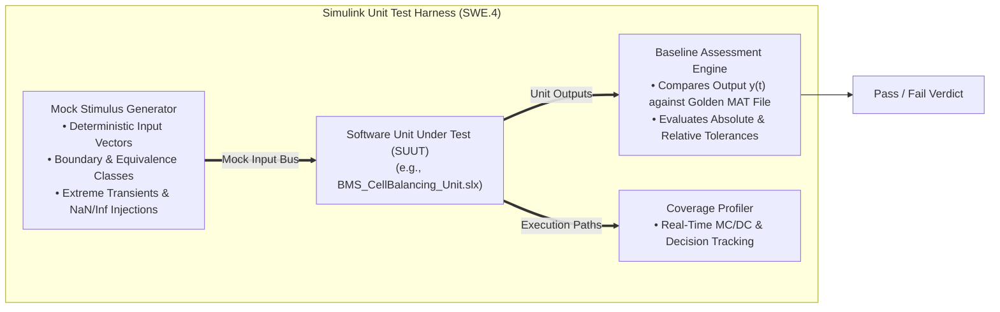
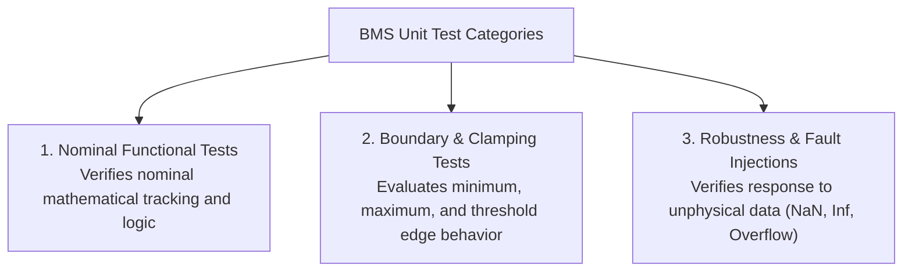

# Automated Unit Testing of BMS Algorithmic Components

In the software development lifecycle, **Unit Testing (ASPICE SWE.4 / ISO 26262-6 Clause 10)** verifies that individual atomic software components—such as Stateflow state machines, Coulomb counters, Kalman filter matrix updaters, and threshold comparators—execute their intended mathematical logic correctly in complete isolation from the broader system[^automotivespice][^iso26262].

In Model-Based Design (MBD), unit testing is conducted on discrete **Simulink Subsystems and Model References** using **Simulink Test**, validating algorithmic correctness before multi-component integration or code generation begins[^mathworks2021].

This chapter formalizes unit test isolation architectures, input mocking/stubbing, baseline time-series comparisons, and automated execution workflows for BMS software units.

---

## Unit Test Isolation & Mocking Architecture

A unit test must isolate the Software Unit Under Test (SUUT) from complex external system dependencies (such as physical battery plant physics, AFE communication stacks, or vehicle CAN buses):



### Mocking and Stubbing Principles

- **Stubbing External Communications:** If a unit relies on input data from an external CAN transceiver, the transceiver block is replaced by a virtual signal generator that feeds predefined test patterns.
- **Isolating Physical Dynamics:** Rather than running an entire continuous-time Simscape battery pack, the unit test injects direct numerical arrays representing cell voltages, current steps, and temperatures.

---

## Unit Test Design: Equivalence & Robustness Categories

A comprehensive unit test suite partitions test cases into three distinct categories:



### Case Study: Cell Balancing Software Unit (`BmsBalancing_Unit`)

Consider an atomic software unit responsible for calculating passive balancing switch states:
- **Input:** Array of 6 cell voltages $\mathbf{V}_{\text{cells}} = [V_1, V_2, V_3, V_4, V_5, V_6]$, Balancing Enable bit, and Activation Threshold $\Delta V_{\text{th}} = 15.0\,\text{mV}$.
- **Output:** Boolean switch vector $\mathbf{S}_{\text{bal}} = [s_1, s_2, s_3, s_4, s_5, s_6]$.

#### Unit Test Matrix

| Test Case ID | Test Category | Input Voltage Vector $\mathbf{V}_{\text{cells}}$ [V] | Condition / Trigger | Expected Output Vector $\mathbf{S}_{\text{bal}}$ |
| :---: | :---: | :--- | :--- | :---: |
| `TC_UT_BAL_001` | Nominal | $[4.000, 4.002, 4.001, 4.000, 4.003, 4.001]$ | Max delta $\Delta V = 3\,\text{mV} < 15\,\text{mV}$ | $[0, 0, 0, 0, 0, 0]$ (No balancing) |
| `TC_UT_BAL_002` | Nominal | $[4.000, 4.018, 4.001, 3.999, 4.016, 4.000]$ | Cells 2 and 5 exceed min ($3.999\,\text{V}$) by $> 15\,\text{mV}$ | $[0, 1, 0, 0, 1, 0]$ (Cells 2 & 5 active) |
| `TC_UT_BAL_003` | Boundary | $[4.000, 4.015, 4.000, 4.000, 4.000, 4.000]$ | Cell 2 exceeds min by exactly $\Delta V = 15.0\,\text{mV}$ | $[0, 1, 0, 0, 0, 0]$ (Strict boundary check) |
| `TC_UT_BAL_004` | Boundary | $[4.000, 4.0149, 4.000, 4.000, 4.000, 4.000]$ | Cell 2 exceeds min by $14.9\,\text{mV} < 15.0\,\text{mV}$ | $[0, 0, 0, 0, 0, 0]$ (No balancing) |
| `TC_UT_BAL_005` | Robustness | $[4.000, \text{NaN}, 4.000, 4.000, 4.000, 4.000]$ | Sensor data corrupted (NaN injection) | $[0, 0, 0, 0, 0, 0]$ & Flag Sensor Fault |

---

## Baseline Time-Series Assessments in Simulink Test

For continuous algorithmic units (such as the Extended Kalman Filter or Coulomb counter), static scalar pass/fail assertions are insufficient. Simulink Test executes **Baseline Testing**, comparing the complete continuous output trajectory $y_{\text{sim}}(t)$ against a validated pre-recorded reference signal $y_{\text{ref}}(t)$ stored in a `.mat` file[^mathworks2021]:

$$
\left| y_{\text{sim}}(t) - y_{\text{ref}}(t) \right| \le \text{Tol}_{\text{abs}} + \text{Tol}_{\text{rel}} \cdot \left| y_{\text{ref}}(t) \right|
$$

```
   Signal Comparison with Envelope Tolerances:
      ^
      |                 /---------------------------\  Upper Tolerance Boundary
      |                /   y_sim(t) & y_ref(t)     /
      |               /---------------------------/    Lower Tolerance Boundary
      +--------------+---------------------------+-----> Time [s]
```

If the simulated signal escapes the tolerance envelope at any time step during the test horizon, Simulink Test flags the exact failure timestamp and calculates the maximum residual error.

---

## Automated Execution via MATLAB Unit Test Framework

Unit tests are automated within Continuous Integration (CI) pipelines using MATLAB test runner scripts:

```matlab
% Automated Unit Test Suite Execution Script
import matlab.unittest.TestRunner;
import matlab.unittest.TestSuite;
import matlab.unittest.plugins.CodeCoveragePlugin;
import matlab.unittest.plugins.codecoverage.CoberturaFormat;

% 1. Create Test Suite for BMS Balancing Unit
suite = TestSuite.fromFile('BMS_CellBalancing_UnitTest.m');

% 2. Initialize Test Runner
runner = TestRunner.withTextOutput;

% 3. Attach Code Coverage Profiler (Targeting MC/DC)
coverageReport = CoberturaFormat('coverage.xml');
runner.addPlugin(CodeCoveragePlugin.forFile('BmsBalancing_Unit.slx', ...
    'Producing', coverageReport));

% 4. Run Tests and Return Results
results = runner.run(suite);
assert(all([results.Passed]), 'Unit Testing Failed: Regression Detected!');
```

---

## References

[^automotivespice]: VDA QMC Working Group 13. (2017). *Automotive SPICE Process Assessment Model v3.1*. VDA.
[^iso26262]: International Organization for Standardization. (2018). *ISO 26262-6: Road vehicles — Functional safety — Part 6: Product development at the software level*. ISO.
[^mathworks2021]: The MathWorks Inc. (2021). *Simulink Test: Automated testing of models and generated code*. MathWorks.
