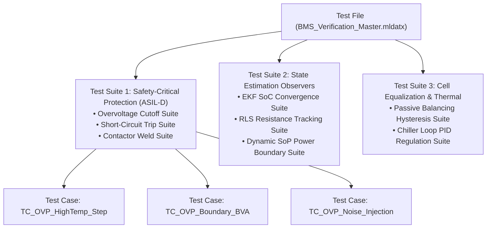
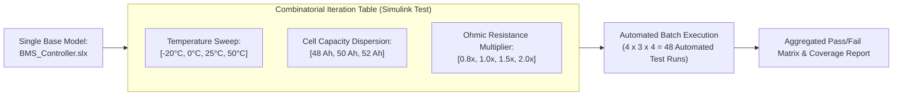
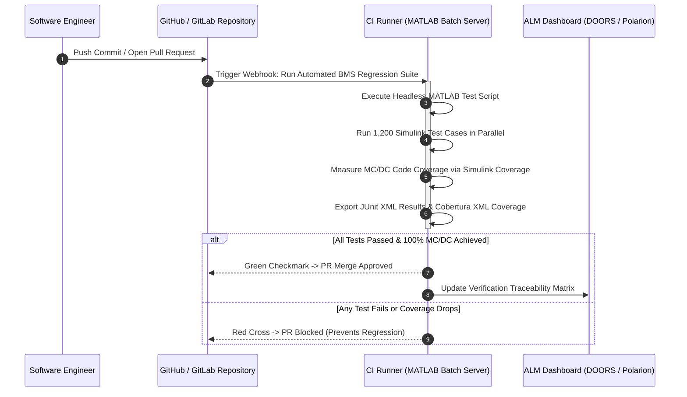

# Test Management & Automated Regression Suites with Simulink Test

As a Battery Management System evolves across production software sprints, the volume of unit, integration, and safety test cases grows from dozens to thousands. Manually opening models and clicking simulation buttons is impossible in professional automotive development[^fewster1999].

**Simulink Test Manager** provides an auditable, automated test management environment. It structures tests into hierarchical suites, executes multi-dimensional parameter sweeps (varying cell temperatures, capacities, and initial states of charge), monitors regressions, and integrates into **Continuous Integration (CI/CD)** pipelines under **ASPICE SWE.4 / SWE.6** and **ISO 26262** mandates[^mathworks2021][^automotivespice].

This chapter formalizes test hierarchy structuring, parameter override iterations, automated CI pipeline scripts, and test artifact reporting.

---

## The Simulink Test Manager Architecture

The test management structure is organized into a three-tier hierarchy compiled within test document files (`.mldatx`)[^mathworks2021]:



### Three Standard Test Types in Simulink Test

1. **Simulation Test:** Evaluates whether model signals satisfy predefined temporal logic assessments, minimum/maximum scalar bounds, and diagnostic trouble code triggers.
2. **Baseline Test:** Compares simulated time-series outputs directly against a pre-recorded golden reference file (`.mat`), evaluating absolute and relative error tolerances across the entire simulation duration.
3. **Equivalence Test (Back-to-Back):** Executes the high-level model (MIL) and the compiled target C code (SIL) in parallel with identical stimulus, asserting that numerical residuals remain within microvolt tolerances ($\Delta y \le \epsilon_{\text{tol}}$).

---

## Parameter Overrides & Iteration Sweeps

Testing BMS robustness requires verifying that algorithms maintain stability despite cell-to-cell manufacturing tolerances and environmental variations.

Rather than creating dozens of duplicate models, the Test Manager utilizes **Parameter Overrides and Multi-Dimensional Iterations**[^mathworks2021]:



### Example: Thermal & Degradation Iteration Matrix

| Iteration Index | Ambient Temperature ($T_{\text{amb}}$) | Cell Capacity ($C_{\text{nom}}$) | Internal Resistance ($R_0$) | Target Assertion |
| :---: | :---: | :---: | :---: | :--- |
| **Iter-01** | $-20.0^\circ\text{C}$ (Sub-zero) | $50.0\,\text{Ah}$ (Fresh) | $1.0\times R_{\text{nom}}$ | Charging current strictly $0.0\,\text{A}$; pre-heater active. |
| **Iter-02** | $+25.0^\circ\text{C}$ (Nominal) | $50.0\,\text{Ah}$ (Fresh) | $1.0\times R_{\text{nom}}$ | Full fast charging ($150\,\text{kW}$) accepted. |
| **Iter-03** | $+25.0^\circ\text{C}$ (Nominal) | $40.0\,\text{Ah}$ ($80\%$ EOL) | $2.0\times R_{\text{nom}}$ (Aged) | Inverter power limits derated due to high $I^2 R$ voltage drop. |
| **Iter-04** | $+45.0^\circ\text{C}$ (Desert) | $50.0\,\text{Ah}$ (Fresh) | $1.0\times R_{\text{nom}}$ | Maximum coolant pump speed engaged; fast charge throttled. |

---

## Continuous Integration (CI/CD) Pipeline Integration

In modern automotive agile workflows, test suites are executed headlessly within automated CI pipelines (GitHub Actions, GitLab CI, or Jenkins) upon every Git pull request[^fewster1999]:



### Headless MATLAB CI Execution Script

```matlab
% Automated CI/CD Regression Test Runner Script
function run_bms_ci_pipeline()
    import sltest.testmanager.*;
    
    fprintf('Starting Automated BMS Regression Test Suite...\n');
    
    % 1. Load Test File
    testFile = load('tests/BMS_Regression_Suite.mldatx');
    
    % 2. Configure Parallel Execution on Multi-Core Server
    testFile.RunInBackground = false;
    
    % 3. Execute All Test Suites
    results = run(testFile);
    
    % 4. Query Test Metrics
    resultObj = getResultSets();
    totalTests = resultObj.NumTestCases;
    failedTests = resultObj.NumFailedTestCases;
    
    fprintf('Executed %d tests: %d Passed, %d Failed.\n', ...
        totalTests, (totalTests - failedTests), failedTests);
    
    % 5. Generate Auditable PDF and XML Reports
    generateReport(resultObj, 'OutputFile', 'reports/BMS_Test_Report.pdf', ...
        'IncludeSimulationData', false, 'IncludeCoverageResult', true);
    exportResults(resultObj, 'reports/junit_results.xml', 'Format', 'JUnit');
    
    % 6. Exit with Non-Zero Code on Failure to Break CI Pipeline
    if failedTests > 0
        error('CI Pipeline Aborted: %d Test Cases Failed!', failedTests);
    end
end
```

---

## References

[^fewster1999]: Fewster, M., & Graham, D. (1999). *Software Test Automation*. ACM Press / Addison-Wesley.
[^mathworks2021]: The MathWorks Inc. (2021). *Simulink Test: Automate model-based testing and manage test artifacts*. MathWorks.
[^automotivespice]: VDA QMC Working Group 13. (2017). *Automotive SPICE Process Assessment Model v3.1*. VDA.
